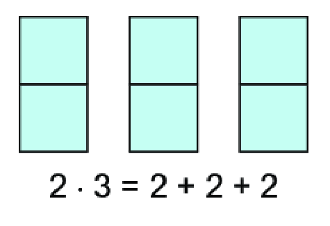
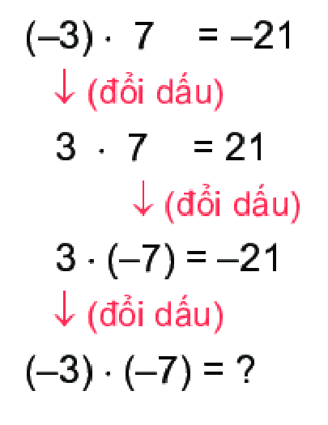
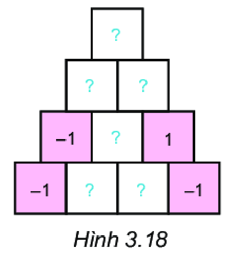
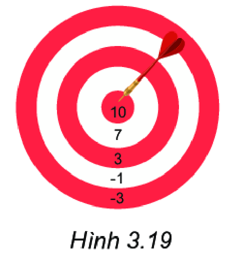

<!-- pdf:76 -->

# BÀI 16: PHÉP NHÂN SỐ NGUYÊN

## 🔤 Thuật ngữ, khái niệm

- Tính chất *giao hoán*
- Tính chất *kết hợp*
- Tính chất *phân phối* của phép nhân đối với phép cộng

## 🎯 Kiến thức, kĩ năng

- Thực hiện phép nhân hai số nguyên.
- Vận dụng các tính chất của phép nhân để tính nhẩm, tính hợp lí.
- Giải toán thực tiễn liên quan đến phép nhân số nguyên.

## 🔴 Mở đầu

Để quản lí chi tiêu cá nhân, bạn Cao dùng số nguyên âm để ghi vào sổ tay các khoản chi của mình. Cuối tháng, bạn Cao thấy trong sổ có ba lần ghi $-15\,000$ đồng. Trong ba lần ấy, bạn Cao đã chi tất cả bao nhiêu tiền?

Em có thể giải bài toán trên mà không dùng phép cộng các số âm hay không?

## 1. NHÂN HAI SỐ NGUYÊN KHÁC DẤU

- Nếu $a$ và $b$ là hai số tự nhiên thì:
  $1 \cdot a = a \cdot 1 = a; \text{ và } a \cdot b = b \cdot a = \underbrace{a + a + \dots + a}_{(b \text{ số } a)} \ (b \ge 2),$
<!-- ocr-ok: đã đối chiếu ảnh trang PDF 76, dòng công thức có dấu ngoặc nhọn bên dưới -->

Ta có thể làm tương tự đối với phép nhân hai số nguyên khác dấu.

**Tích của hai số nguyên khác dấu**

**HĐ1:** Dựa vào phép cộng các số âm, hãy tính tích $(-11) \cdot 3$ rồi so sánh kết quả với $-(11 \cdot 3)$.

**HĐ2:** Hãy dự đoán kết quả của các phép nhân $5 \cdot (-7)$ và $(-6) \cdot 8$.

> **Quy tắc nhân hai số nguyên khác dấu**
>
> Muốn nhân hai số nguyên khác dấu, ta nhân phần số tự nhiên của hai số đó với nhau rồi đặt dấu "$-$" trước kết quả nhận được.
>
> Nếu $m, n \in \mathbb{N}^*$ thì $m \cdot (-n) = (-n) \cdot m = -(m \cdot n)$.

**Ví dụ 1:**

a) $25 \cdot (-4) = -(25 \cdot 4) = -100$;

b) $(-10) \cdot 11 = -(10 \cdot 11) = -110$.

- **Pi:** Tích của hai số nguyên khác dấu luôn là một số nguyên âm.

**Luyện tập 1:**

1. Thực hiện các phép nhân sau: a) $(-12) \cdot 12$; $\quad$ b) $137 \cdot (-15)$.

2. Tính nhẩm: $5 \cdot (-12)$.

**Vận dụng 1:** Sử dụng phép nhân hai số nguyên khác dấu để giải bài toán mở đầu.

<!-- pdf:77 -->

## 2. NHÂN HAI SỐ NGUYÊN CÙNG DẤU

Ta đã biết cách nhân hai số nguyên dương (cũng là hai số tự nhiên). Dưới đây ta sẽ tìm hiểu cách nhân hai số nguyên âm.

**Tích của hai số nguyên âm**

**HĐ3:** Quan sát ba dòng đầu và nhận xét về dấu của tích mỗi khi đổi dấu một thừa số và giữ nguyên thừa số còn lại.

- $(-3) \cdot 7 = -21$ $\downarrow$ *(đổi dấu)*
- $3 \cdot 7 = 21$ $\downarrow$ *(đổi dấu)*
- $3 \cdot (-7) = -21$ $\downarrow$ *(đổi dấu)*
- $(-3) \cdot (-7) = ?$
<!-- ocr-ok: đã đối chiếu ảnh trang PDF 77, sơ đồ nhận xét đổi dấu thừa số ở HĐ3 -->

**HĐ4:** Dựa vào nhận xét ở HĐ3, hãy dự đoán kết quả của $(-3) \cdot (-7)$.

> **Quy tắc nhân hai số nguyên âm**
>
> Muốn nhân hai số nguyên âm, ta nhân phần số tự nhiên của hai số đó với nhau.
>
> Nếu $m, n \in \mathbb{N}^*$ thì $(-m) \cdot (-n) = (-n) \cdot (-m) = m \cdot n$.

- **Pi:** Tích của hai số nguyên cùng dấu luôn là số nguyên dương.

**Ví dụ 2:**

$(-10) \cdot (-15) = 10 \cdot 15 = 150.$

**Luyện tập 2:** Thực hiện các phép nhân sau:
<!-- ocr-ok: đã đối chiếu ảnh trang PDF 77, OCR bỏ sót nhãn Luyện tập 2 màu xanh lá -->

a) $(-12) \cdot (-12)$; $\quad$ b) $(-137) \cdot (-15)$.

<!-- term: Nhân một số nguyên với 0 -->
**Chú ý:** Tích của một số nguyên với $0$ luôn bằng $0$:
$a \cdot 0 = 0 \cdot a = 0.$

**Thử thách nhỏ:** Thay mỗi dấu "$?$" bằng số sao cho số trong mỗi ô ở hàng trên bằng tích các số trong hai ô kề với nó ở hàng dưới (h.3.18).

*Hình 3.18*

## 3. TÍNH CHẤT CỦA PHÉP NHÂN
<!-- ocr-ok: đã đối chiếu ảnh trang PDF 77, OCR bỏ sót tiêu đề mục chữ trắng trên nền xanh -->

Tương tự như phép nhân các số tự nhiên:

<!-- term: Tính chất giao hoán của phép nhân số nguyên -->
<!-- term: Tính chất kết hợp của phép nhân số nguyên -->
<!-- term: Tính chất phân phối của phép nhân đối với phép cộng -->
> Phép nhân các số nguyên có các tính chất:
> - Giao hoán: $a \cdot b = b \cdot a$
> - Kết hợp: $a \cdot (b \cdot c) = (a \cdot b) \cdot c$
> - Phân phối của phép nhân đối với phép cộng: $a \cdot (b + c) = a \cdot b + a \cdot c$.

> ❓ Tính $a(b + c)$ và $ab + ac$ khi $a = -2, b = 14, c = -4$.

**Chú ý:** Tích của nhiều số nguyên cũng được hiểu tương tự như tích của nhiều số tự nhiên.

<!-- pdf:78 -->

**Ví dụ 3:** Thực hiện phép tính: $\quad$ a) $(-25) \cdot (-17) \cdot 4$; $\quad$ b) $(-2) \cdot (150 + 14)$.
<!-- ocr-ok: đã đối chiếu ảnh trang PDF 78, OCR bỏ sót nhãn Ví dụ 3 màu xanh lá -->

**Giải:**

a) $(-25) \cdot (-17) \cdot 4 = (-25) \cdot 4 \cdot (-17)$ $\quad \leftarrow$ Đổi chỗ $(-17)$ và $4$

$= [(-25) \cdot 4] \cdot (-17)$ $\quad \leftarrow$ Nhóm hai thừa số $(-25)$ và $4$
<!-- ocr-ok: đã đối chiếu ảnh trang PDF 78, OCR bỏ sót chú thích mũi tên màu xanh lá bên phải -->

$= (-100) \cdot (-17) = 100 \cdot 17 = 1\,700$.

b) $(-2) \cdot (150 + 14) = (-2) \cdot 150 + (-2) \cdot 14$ $\quad \leftarrow$ Tính chất phân phối
<!-- ocr-ok: đã đối chiếu ảnh trang PDF 78, OCR bỏ sót chú thích mũi tên màu xanh lá bên phải -->

$= (-300) + (-28) = -328$.

<!-- term: Tính chất phân phối của phép nhân đối với phép trừ -->
- **Pi:** Phép nhân cũng có tính chất phân phối đối với phép trừ: $a(b - c) = ab - ac$.
<!-- ocr-ok: đã đối chiếu ảnh trang PDF 78, lời thoại của nhân vật Pi trong bóng thoại -->

**Luyện tập 3:**

1. a) Tính giá trị của tích $P = 3 \cdot (-4) \cdot 5 \cdot (-6)$;

   b) Tích $P$ sẽ thay đổi thế nào nếu ta đổi dấu tất cả các thừa số?
<!-- ocr-ok: đã đối chiếu ảnh trang PDF 78, OCR đọc dính chữ quanh kí hiệu P -->

2. Tính $4 \cdot (-39) - 4 \cdot (-14)$.

## BÀI TẬP

3.32. Nhân hai số khác dấu:

a) $24 \cdot (-25)$; $\quad$ b) $(-15) \cdot 12$.

3.33. Nhân hai số cùng dấu:

a) $(-298) \cdot (-4)$; $\quad$ b) $(-10) \cdot (-135)$.

3.34. Một tích nhiều thừa số sẽ mang dấu dương hay âm nếu trong tích đó có

a) Ba thừa số mang dấu âm, các thừa số khác đều dương?

b) Bốn thừa số mang dấu âm, các thừa số khác đều dương?

3.35. Tính một cách hợp lí:

a) $4 \cdot (1\,930 + 2\,019) + 4 \cdot (-2\,019)$;

b) $(-3) \cdot (-17) + 3 \cdot (120 - 17)$.

3.36. Cho biết tích của hai số tự nhiên $n$ và $m$ là $36$. Mỗi tích $n \cdot (-m)$ và $(-n) \cdot (-m)$ bằng bao nhiêu?
<!-- ocr-ok: đã đối chiếu ảnh trang PDF 78, OCR bỏ sót số bài 3.36 và đọc lỗi công thức -->

3.37. Tính giá trị của biểu thức sau một cách hợp lí:

a) $(-8) \cdot 72 + 8 \cdot (-19) - (-8)$;

b) $(-27) \cdot 1\,011 - 27 \cdot (-12) + 27 \cdot (-1)$.

3.38. Ba bạn An, Bình, Cường chơi ném tiêu với bia gồm năm vòng như hình 3.19. Kết quả được ghi lại trong bảng sau:

| Vòng | $10$ điểm | $7$ điểm | $3$ điểm | $-1$ điểm | $-3$ điểm |
| :---: | :---: | :---: | :---: | :---: | :---: |
| *An* | $1$ | $2$ | $0$ | $1$ | $1$ |
| *Bình* | $2$ | $0$ | $1$ | $0$ | $2$ |
| *Cường* | $0$ | $3$ | $1$ | $1$ | $0$ |

Hỏi trong ba bạn, bạn nào đạt điểm cao nhất?

*Hình 3.19*

## 📷 Danh sách hình trong bài

| Mã hình | Trang PDF | Vị trí trong bài | Chú thích gốc |
| --- | :---: | --- | --- |
| H6-toan-b16-01 | 76 | Mục 1 | (sách không đánh số, hình ba cột ô vuông minh hoạ $2 \cdot 3 = 2 + 2 + 2$) |
| H6-toan-b16-02 | 77 | Mục 2, HĐ3 | (sách không đánh số, sơ đồ nhận xét dấu của tích khi đổi dấu thừa số) |
| H6-toan-b16-03 | 77 | Mục 2, Thử thách nhỏ | Hình 3.18 |
| H6-toan-b16-04 | 78 | Bài tập 3.38 | Hình 3.19 |
