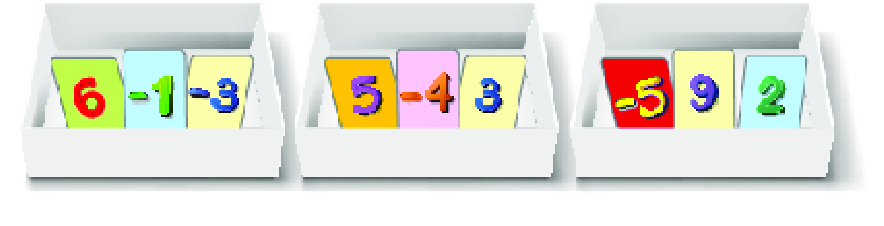

<!-- pdf:75 -->

# LUYỆN TẬP CHUNG

**Ví dụ 1:** Tính giá trị của biểu thức: $A = 25 - (-115) - [315 + (-105)]$.
<!-- ocr-ok: đã đối chiếu ảnh trang PDF 75, OCR bỏ sót nhãn Ví dụ 1 màu xanh lá -->

**Giải:**

$A = 25 + 115 - [315 - 105]$

$= (25 + 115) - 210$

$= 140 - 210 = -(210 - 140) = -70$.

**Ví dụ 2:** Tính nhanh: $283 - 286 - 83 + 86$.
<!-- ocr-ok: đã đối chiếu ảnh trang PDF 75, OCR bỏ sót nhãn Ví dụ 2 màu xanh lá -->

**Giải:**

$283 - 286 - 83 + 86$

$= 283 - 83 - 286 + 86$

$= (283 - 83) - (286 - 86)$

$= 200 - 200 = 0$.

## BÀI TẬP

3.24. Dùng số nguyên âm hoặc số nguyên dương để diễn tả các thông tin sau:

a) Khi đọc sách, bạn Quang thường đưa trang sách lại quá gần mắt. Bạn ấy đã phải mang kính cận $1$ dioptre.

b) Ông của bạn Quang đã già nên phải dùng kính lão $2$ dioptre để đọc sách báo.

3.25. Điểm $A$ nằm trên trục số và cách gốc $O$ một khoảng bằng $12$ đơn vị (trục số nằm ngang và có chiều dương từ trái sang phải). Hỏi điểm $A$ biểu diễn số nguyên nào nếu:

a) $A$ nằm ở bên phải gốc $O$;

b) $A$ nằm ở bên trái gốc $O$.

3.26. Liệt kê các phần tử của tập hợp sau rồi tính tổng của chúng:

a) $S = \{x \in \mathbb{Z} \mid -3 < x \le 3\}$;

b) $T = \{x \in \mathbb{Z} \mid -7 < x \le -2\}$.

3.27. Tính giá trị của biểu thức:

a) $(27 + 86) - (29 - 5 + 84)$;

b) $39 - (298 - 89) + 299$.

3.28. Tính giá trị của biểu thức $(-314) - (75 + x)$ nếu:
<!-- ocr-ok: đã đối chiếu ảnh trang PDF 75, OCR bỏ sót số bài 3.28 màu xanh -->

a) $x = 25$; $\quad$ b) $x = -313$.

3.29. Tính một cách hợp lí:

a) $2\,834 + 275 - 2\,833 - 265$;

b) $(11 + 12 + 13) - (1 + 2 + 3)$.

3.30. Có ba chiếc hộp đựng những miếng bìa. Trên mỗi miếng bìa có ghi một số như đã cho trong hình dưới đây. Hãy chuyển một miếng bìa từ hộp này sang hộp khác sao cho tổng các số ghi trên các miếng bìa trong mỗi hộp đều bằng nhau.

3.31. Trong một trò chơi, bạn Minh nhận được yêu cầu: "Hãy tính tổng của tất cả các số trong tập hợp $\{x \in \mathbb{Z} \mid -25 \le x \le 25\}$".

Minh trả lời ngay: "Bằng $0$". Em có thể giải thích tại sao Minh tính nhanh thế không?

## 📷 Danh sách hình trong bài

| Mã hình | Trang PDF | Vị trí trong bài | Chú thích gốc |
| --- | :---: | --- | --- |
| H6-toan-ltc-c03-01-01 | 75 | Bài tập 3.30 | (sách không đánh số, hình ba chiếc hộp đựng các miếng bìa ghi số) |
