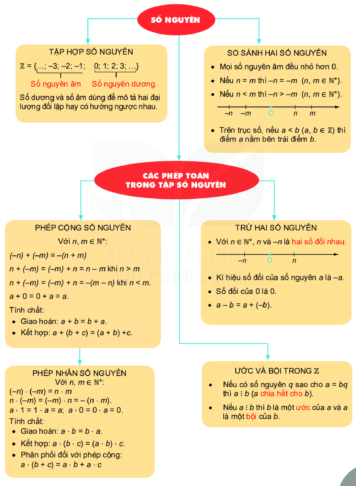

<!-- pdf:82 -->

# CHÚNG TA ĐÃ HỌC NHỮNG GÌ?

- **SỐ NGUYÊN:**
  - **TẬP HỢP SỐ NGUYÊN:**
    - $\mathbb{Z} = \{\underbrace{\dots; -3; -2; -1}_{\text{Số nguyên âm}}; \ 0; \ \underbrace{1; 2; 3; \dots}_{\text{Số nguyên dương}}\}$
    - Số dương và số âm dùng để mô tả hai đại lượng đối lập hay có hướng ngược nhau.
  - **SO SÁNH HAI SỐ NGUYÊN:**
    - Mọi số nguyên âm đều nhỏ hơn $0$.
    - Nếu $n = m$ thì $-n = -m \ (n, m \in \mathbb{N}^*)$.
    - Nếu $n < m$ thì $-n > -m \ (n, m \in \mathbb{N}^*)$.
    - Trên trục số, nếu $a < b \ (a, b \in \mathbb{Z})$ thì điểm $a$ nằm bên trái điểm $b$.
  - **CÁC PHÉP TOÁN TRONG TẬP SỐ NGUYÊN:**
    - **PHÉP CỘNG SỐ NGUYÊN:**
      - Với $n, m \in \mathbb{N}^*$:
        - $(-n) + (-m) = -(n + m)$
        - $n + (-m) = (-m) + n = n - m$ khi $n > m$
        - $n + (-m) = (-m) + n = -(m - n)$ khi $n < m$.
        - $a + 0 = 0 + a = a$.
      - Tính chất:
        - Giao hoán: $a + b = b + a$.
        - Kết hợp: $a + (b + c) = (a + b) + c$.
    - **TRỪ HAI SỐ NGUYÊN:**
      - Với $n \in \mathbb{N}^*$, $n$ và $-n$ là hai số đối nhau.
      - Kí hiệu số đối của số nguyên $a$ là $-a$.
      - Số đối của $0$ là $0$.
      - $a - b = a + (-b)$.
    - **PHÉP NHÂN SỐ NGUYÊN:**
      - Với $n, m \in \mathbb{N}^*$:
        - $(-n) \cdot (-m) = n \cdot m$
        - $n \cdot (-m) = (-m) \cdot n = -(n \cdot m)$.
        - $a \cdot 1 = 1 \cdot a = a$; $a \cdot 0 = 0 \cdot a = 0$.
      - Tính chất:
        - Giao hoán: $a \cdot b = b \cdot a$.
        - Kết hợp: $a \cdot (b \cdot c) = (a \cdot b) \cdot c$.
        - Phân phối đối với phép cộng: $a \cdot (b + c) = a \cdot b + a \cdot c$
    - **ƯỚC VÀ BỘI TRONG $\mathbb{Z}$:**
      - Nếu có số nguyên $q$ sao cho $a = bq$ thì $a \vdots b$ ($a$ chia hết cho $b$).
      - Nếu $a \vdots b$ thì $b$ là một ước của $a$ và $a$ là một bội của $b$.
<!-- ocr-ok: đã đối chiếu ảnh trang PDF 82, sơ đồ tổng kết chương nhiều nhánh -->

<!-- pdf:83 -->

## BÀI TẬP CUỐI CHƯƠNG III

3.50. Dùng số âm để diễn tả các thông tin sau:
<!-- ocr-ok: đã đối chiếu ảnh trang PDF 83, OCR bỏ sót số bài 3.50 màu xanh -->

a) Ở nơi lạnh nhất thế giới, nhiệt độ có thể xuống đến $60^\circ\text{C}$ dưới $0^\circ\text{C}$.

b) Do dịch bệnh, một công ty trong một tháng đã bị lỗ $2$ triệu đồng.

3.51. Trong các số $a, b, c, d$, số nào dương, số nào âm nếu:

$a > 0; \quad b < 0; \quad c \ge 1; \quad d \le -2.$

3.52. Liệt kê các phần tử của tập hợp sau rồi tính tổng của chúng:

a) $S = \{x \in \mathbb{Z} \mid -5 < x \le 5\}$;

b) $T = \{x \in \mathbb{Z} \mid -7 \le x < 1\}$.

3.53. Tính một cách hợp lí:

a) $15 \cdot (-236) + 15 \cdot 235$;

b) $237 \cdot (-28) + 28 \cdot 137$;

c) $38 \cdot (27 - 44) - 27 \cdot (38 - 44)$.

3.54. Tính giá trị của biểu thức $P = (-35) \cdot x - (-15) \cdot 37$ trong mỗi trường hợp sau:

a) $x = 15$; $\quad$ b) $x = -37$.

3.55. Có hay không hai số nguyên $a$ và $b$ mà hiệu $a - b$:
<!-- ocr-ok: đã đối chiếu ảnh trang PDF 83, OCR bỏ sót số bài 3.55 màu xanh -->

a) lớn hơn cả $a$ và $b$;

b) lớn hơn $a$ nhưng nhỏ hơn $b$?

Trong mỗi trường hợp, hãy cho ví dụ minh hoạ bằng số.

3.56. Cho $15$ số có tính chất: Tích của $5$ số bất kì trong chúng đều âm. Hỏi tích của $15$ số đó mang dấu gì?

## 📷 Danh sách hình trong bài

| Mã hình | Trang PDF | Vị trí trong bài | Chú thích gốc |
| --- | :---: | --- | --- |
| H6-toan-ot-c03-01 | 82 | Đầu bài | (sách không đánh số, sơ đồ tổng kết kiến thức Chương III — Số nguyên) |
