<!-- pdf:85 -->

<!-- Trang mở đầu Chương IV (PDF 84): HÌNH HỌC TRỰC QUAN — CHƯƠNG IV. MỘT SỐ HÌNH PHẲNG TRONG THỰC TIỄN: "Hình vuông, hình chữ nhật, hình tam giác đều, hình thoi,... là các hình phẳng quen thuộc trong thực tế. Trong chương này, chúng ta sẽ cùng nhau tìm hiểu về các đặc điểm cơ bản, thú vị của những hình đó." -->

# BÀI 18: HÌNH TAM GIÁC ĐỀU. HÌNH VUÔNG. HÌNH LỤC GIÁC ĐỀU

## 🔤 Khái niệm, thuật ngữ

- Hình tam giác đều
- Hình vuông
- Hình lục giác đều
- Cạnh, đỉnh, góc, đường chéo

## 🎯 Kiến thức, kĩ năng

- Nhận dạng các hình trong bài.
- Mô tả một số yếu tố cơ bản của tam giác đều, hình vuông, lục giác đều.
- Vẽ tam giác đều, hình vuông bằng dụng cụ học tập.
- Tạo lập được lục giác đều thông qua việc lắp ghép các tam giác đều.

## 🔴 Mở đầu

Người ta có thể sử dụng các viên gạch hình tam giác đều, hình vuông hay hình lục giác đều để lát kín một nền phẳng, chẳng hạn lát nền nhà như hình bên.

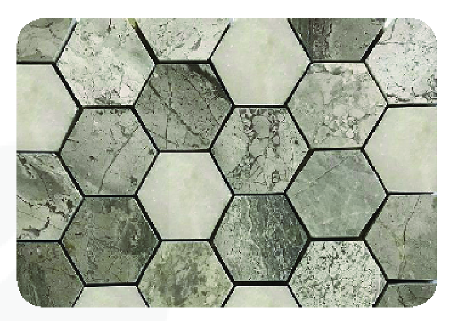

## 1. HÌNH TAM GIÁC ĐỀU

**Các yếu tố cơ bản của tam giác đều**

**HĐ1:** Trong các hình dưới đây (h.4.1), hình nào là tam giác đều?

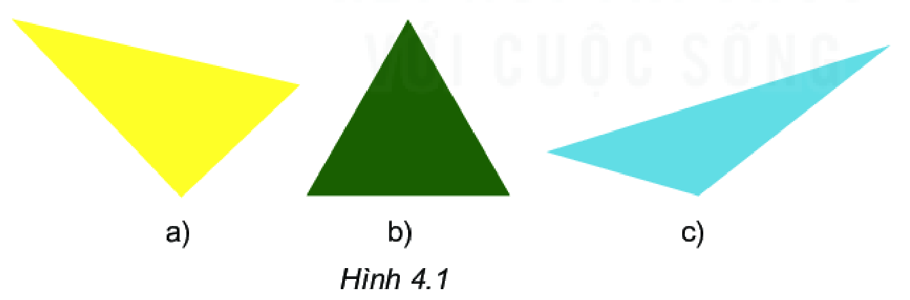
*Hình 4.1*

Em hãy tìm một số hình ảnh tam giác đều trong thực tế.

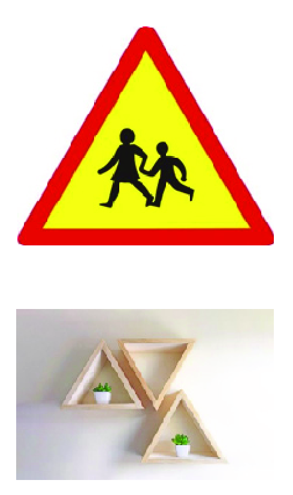

**HĐ2:** Cho tam giác đều $ABC$ như hình 4.2.
1. Gọi tên các đỉnh, cạnh, góc của tam giác đều $ABC$.
2. Dùng thước thẳng để đo và so sánh các cạnh của tam giác $ABC$.
3. Sử dụng thước đo góc để đo và so sánh các góc của tam giác $ABC$.

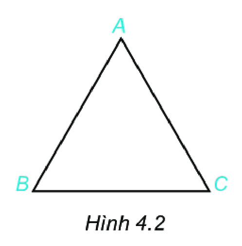
*Hình 4.2*

<!-- pdf:86 -->

**Nhận xét:**
Trong **tam giác đều**:
- Ba cạnh bằng nhau.
- Ba góc bằng nhau và bằng $60^\circ$.

**Thực hành 1:**

1. Vẽ tam giác đều $ABC$ cạnh $3\text{ cm}$ theo hướng dẫn sau:

Bước 1. Vẽ đoạn thẳng $AB = 3\text{ cm}$.
<!-- ocr-ok: đã đối chiếu ảnh trang PDF 86, OCR bỏ sót nhãn màu xanh Bước 1 và dính chữ 3cm -->

Bước 2. Dùng ê ke có góc $60^\circ$ vẽ góc $BAx$ bằng $60^\circ$.

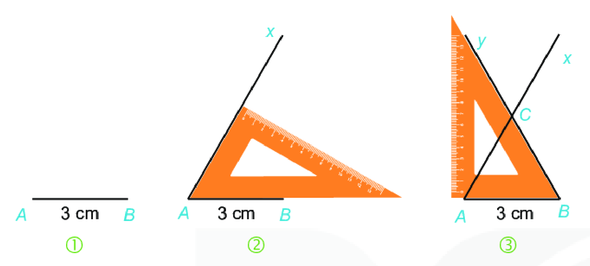

**Vuông:** Liệu có cách nào khác để vẽ hình tam giác đều không nhỉ?

Bước 3. Vẽ góc $ABy$ bằng $60^\circ$. Hai tia $Ax$ và $By$ cắt nhau tại $C$, ta được tam giác đều $ABC$.

2. Em hãy kiểm tra lại hình vừa vẽ, xem các cạnh của tam giác $ABC$ có bằng nhau không? Các góc có bằng nhau không?

## 2. HÌNH VUÔNG

**Một số yếu tố cơ bản của hình vuông**

**HĐ3:** Em hãy tìm một số hình ảnh của hình vuông trong thực tế.

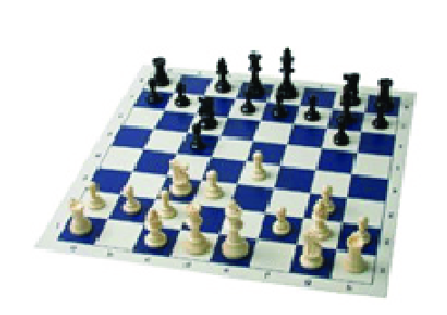

**HĐ4:** Quan sát hình 4.3a.
<!-- ocr-ok: đã đối chiếu ảnh trang PDF 86, OCR đọc lỗi nhãn HĐ4 và dính chữ hình4.3a -->

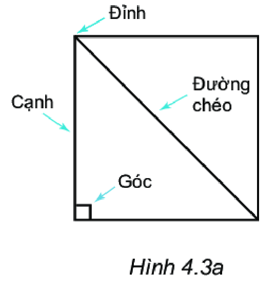
*Hình 4.3a*

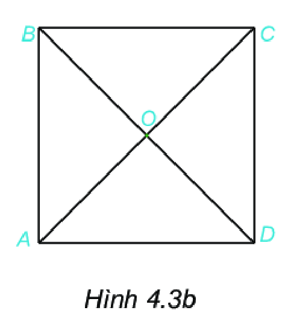
*Hình 4.3b*

<!-- term: Đỉnh -->
<!-- term: Cạnh -->
<!-- term: Góc -->
<!-- term: Đường chéo -->
1. Nêu tên các đỉnh, cạnh, đường chéo của hình vuông $ABCD$ (h.4.3b).
2. Dùng thước thẳng đo và so sánh độ dài các cạnh của hình vuông; hai đường chéo của hình vuông.
3. Dùng thước đo góc để đo và so sánh các góc của hình vuông.

<!-- pdf:87 -->

**Nhận xét:**
Trong **hình vuông**:
- Bốn cạnh bằng nhau.
- Bốn góc bằng nhau và bằng $90^\circ$.
- Hai đường chéo bằng nhau.

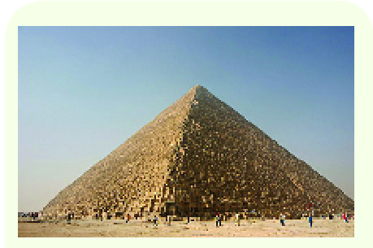

Kim tự tháp Kheops (đọc là Kê-ốp) ở Ai Cập được xây dựng bằng đá và có dạng hình chóp có đáy là hình vuông, bốn mặt bên là hình tam giác đều. Kim tự tháp Kheops là kim tự tháp lớn nhất thế giới.

**Thực hành 2:**

1. Vẽ hình vuông $ABCD$ có cạnh $4\text{ cm}$ theo hướng dẫn sau:

Bước 1. Vẽ đoạn thẳng $AB = 4\text{ cm}$.
<!-- ocr-ok: đã đối chiếu ảnh trang PDF 87, OCR bỏ sót nhãn màu xanh Bước 1 và dính chữ 4cm -->

Bước 2. Vẽ đường thẳng vuông góc với $AB$ tại $A$. Xác định điểm $D$ trên đường thẳng đó sao cho $AD = 4\text{ cm}$.

Bước 3. Vẽ đường thẳng vuông góc với $AB$ tại $B$. Xác định điểm $C$ trên đường thẳng đó sao cho $BC = 4\text{ cm}$.

Bước 4. Nối $C$ với $D$ ta được hình vuông $ABCD$.
<!-- ocr-ok: đã đối chiếu ảnh trang PDF 87, OCR bỏ sót nhãn màu xanh Bước 4 -->

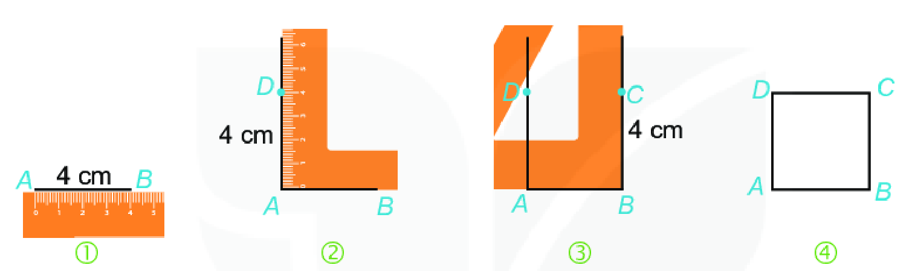

2. Em hãy kiểm tra lại hình vừa vẽ, xem các cạnh có bằng nhau không? Các góc có bằng nhau không?

3. a) Hãy gấp và cắt một hình vuông từ tờ giấy hình chữ nhật như hình bên.

b) Cắt hình vuông đó theo hai đường chéo thành bốn phần rồi ghép thành hai hình vuông.

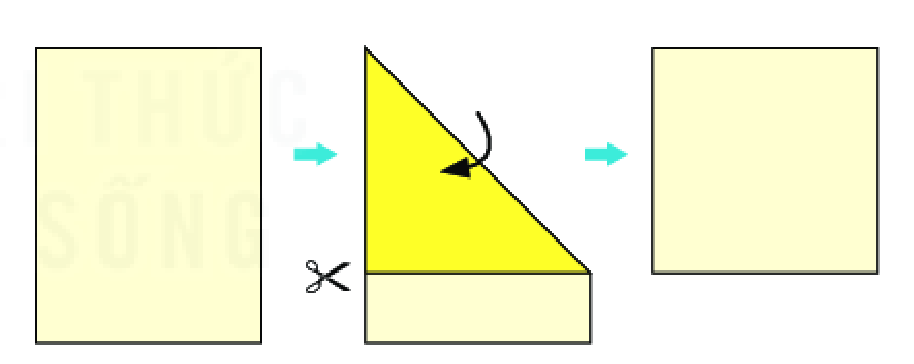

## 3. HÌNH LỤC GIÁC ĐỀU

**Các yếu tố cơ bản của hình lục giác đều**

**HĐ5:**
1. Cắt sáu hình tam giác đều giống nhau và ghép lại như hình 4.4a để được hình lục giác đều như hình 4.4b.
2. Kể tên các đỉnh, cạnh, góc của hình lục giác đều $ABCDEF$.
3. Các cạnh của hình này có bằng nhau không?
4. Các góc của hình này có bằng nhau không và bằng bao nhiêu độ?

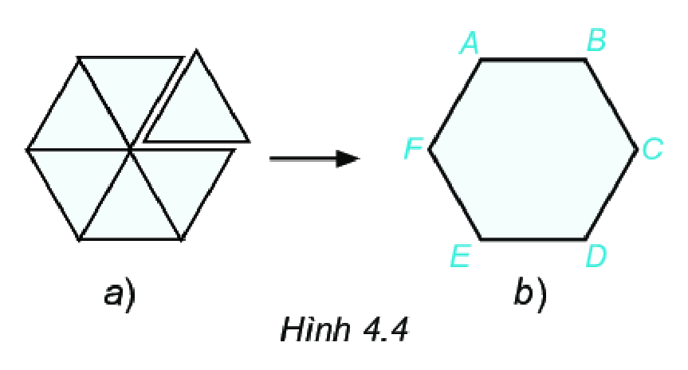
*Hình 4.4*

<!-- pdf:88 -->

<!-- term: Đường chéo chính -->
**HĐ6:** Hãy quan sát hình 4.5.
1. Hãy kể tên các đường chéo chính của hình lục giác đều $ABCDEF$.
2. Hãy so sánh độ dài các đường chéo chính với nhau.

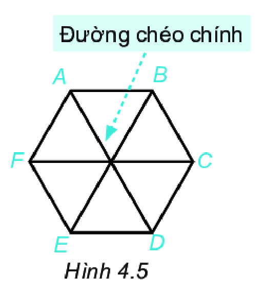
*Hình 4.5*

<!-- term: Đường chéo chính -->
**Nhận xét:**
**Hình lục giác đều** có:
- Sáu cạnh bằng nhau.
- Sáu góc bằng nhau, mỗi góc bằng $120^\circ$.
- Ba đường chéo chính bằng nhau.

> $AC, BD, CE, DF, EA, FB$ còn gọi là **đường chéo phụ** của hình lục giác đều $ABCDEF$

**Luyện tập:**

Cho hình lục giác đều như hình 4.6.

Ta đã biết, $6$ tam giác đều ghép lại thành hình lục giác đều, đó là những tam giác đều nào? Ngoài $6$ tam giác đều đó, trong hình em còn thấy những tam giác đều nào khác?

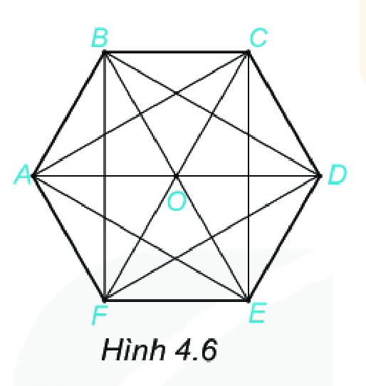
*Hình 4.6*

**Vận dụng:**

Hãy tìm một số hình ảnh có dạng hình lục giác đều trong thực tế.

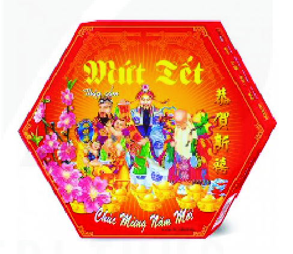

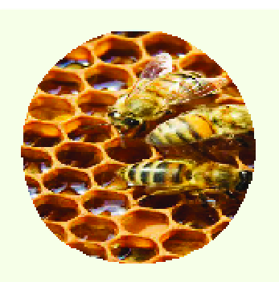

Nhìn bề mặt tổ ong ta thấy các hình lục giác đều xếp liền kề nhau. Cấu trúc này tiết kiệm nguyên liệu và tận dụng được không gian. Ngày nay con người đang ứng dụng rộng rãi cấu trúc này trong các lĩnh vực như kiến trúc, hàng không,...

> ❓ Qua tìm hiểu về hình tam giác đều, hình vuông, hình lục giác đều, em có nhận xét gì về đặc điểm chung (cạnh, góc) của các hình nói trên?

**Tranh luận:**

Người ta vẽ sáu hình vuông ở phía ngoài của một hình lục giác đều mà mỗi hình vuông có chung một cạnh với hình lục giác đều như hình 4.7.

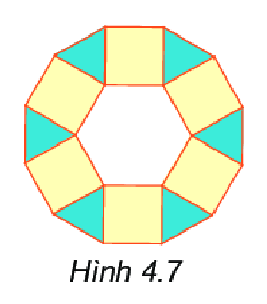
*Hình 4.7*

**Tròn:** Theo em các tam giác màu xanh có là tam giác đều không?

**Thử thách nhỏ:**

Một cái bánh có mặt trên là hình lục giác đều. Em hãy cắt bánh để chia đều cho:

a) $6$ bạn;

b) $12$ bạn;

c) $4$ bạn.

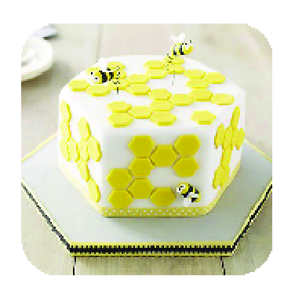

<!-- pdf:89 -->

## BÀI TẬP

4.1. Hãy kể tên một số vật dụng, họa tiết, công trình kiến trúc,... có hình ảnh của tam giác đều, hình vuông, hình lục giác đều.

4.2. Vẽ tam giác đều có cạnh bằng $2\text{ cm}$.

4.3. Vẽ hình vuông có cạnh bằng $5\text{ cm}$.

4.4. Cắt và ghép để được một cái hộp có nắp theo hình gợi ý dưới đây:

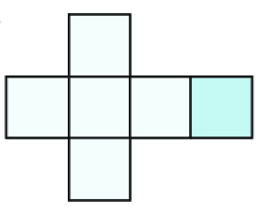

4.5. Có nhiều cách để trang trí một hình vuông, chẳng hạn như hình bên. Em hãy vẽ một hình vuông trên tờ giấy A4 và trang trí theo cách của mình.

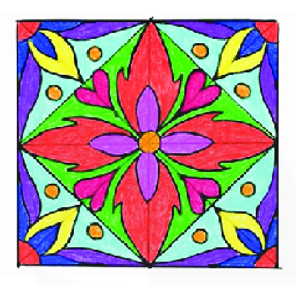

4.6. Quan sát hình dưới đây và chỉ ra ít nhất hai cách, để một con kiến bò từ $A$ đến $B$ theo đường chéo của các hình vuông nhỏ?

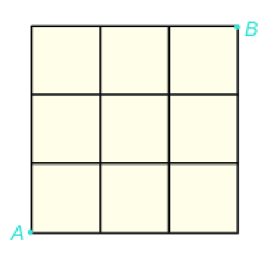

4.7. Gấp và cắt hình tam giác đều từ một tờ giấy hình vuông theo hướng dẫn sau:

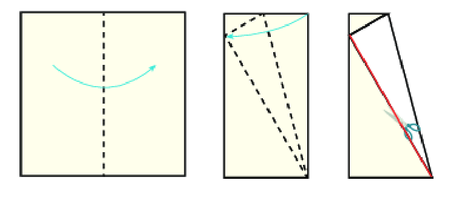

4.8. Người ta muốn đặt một trạm biến áp để đưa điện về sáu ngôi nhà. Phải đặt trạm biến áp ở đâu để khoảng cách từ trạm biến áp đến sáu ngôi nhà bằng nhau, biết rằng sáu ngôi nhà ở vị trí sáu đỉnh của hình lục giác đều?

## 💡 Em có biết?

Một số cách lát kín nền phẳng bằng các viên gạch hình tam giác đều, hình vuông, hình lục giác đều hoặc kết hợp với nhau.

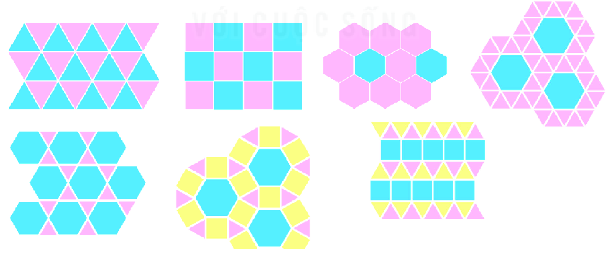

## 📷 Danh sách hình trong bài

| Mã hình | Trang PDF | Vị trí trong bài | Chú thích gốc |
| --- | :---: | --- | --- |
| H6-toan-b18-01 | 85 | Mở đầu | (sách không đánh số, nền nhà lát gạch hình lục giác đều) |
| H6-toan-b18-02 | 85 | Mục 1, HĐ1 | Hình 4.1 |
| H6-toan-b18-03 | 85 | Mục 1, HĐ1 | (sách không đánh số, biển báo giao thông và kệ gỗ hình tam giác đều) |
| H6-toan-b18-04 | 85 | Mục 1, HĐ2 | Hình 4.2 |
| H6-toan-b18-05 | 86 | Mục 1, Thực hành 1 | (sách không đánh số, 3 bước vẽ tam giác đều $ABC$ cạnh $3\text{ cm}$) |
| H6-toan-b18-06 | 86 | Mục 2, HĐ3 | (sách không đánh số, bàn cờ vua) |
| H6-toan-b18-07 | 86 | Mục 2, HĐ4 | Hình 4.3a |
| H6-toan-b18-08 | 86 | Mục 2, HĐ4 | Hình 4.3b |
| H6-toan-b18-09 | 87 | Mục 2, Nhận xét | (sách không đánh số, Kim tự tháp Kheops ở Ai Cập) |
| H6-toan-b18-10 | 87 | Mục 2, Thực hành 2 | (sách không đánh số, 4 bước vẽ hình vuông $ABCD$ cạnh $4\text{ cm}$) |
| H6-toan-b18-11 | 87 | Mục 2, Thực hành 2 | (sách không đánh số, gấp và cắt hình vuông từ tờ giấy hình chữ nhật) |
| H6-toan-b18-12 | 87 | Mục 3, HĐ5 | Hình 4.4 |
| H6-toan-b18-13 | 88 | Mục 3, HĐ6 | Hình 4.5 |
| H6-toan-b18-14 | 88 | Mục 3, Luyện tập | Hình 4.6 |
| H6-toan-b18-15 | 88 | Mục 3, Vận dụng | (sách không đánh số, hộp mứt Tết hình lục giác đều) |
| H6-toan-b18-16 | 88 | Mục 3, Vận dụng | (sách không đánh số, bề mặt tổ ong) |
| H6-toan-b18-17 | 88 | Mục 3, Tranh luận | Hình 4.7 |
| H6-toan-b18-18 | 88 | Mục 3, Thử thách nhỏ | (sách không đánh số, chiếc bánh có mặt trên là hình lục giác đều) |
| H6-toan-b18-19 | 89 | Bài tập, Bài 4.4 | (sách không đánh số, hình gợi ý cắt ghép cái hộp có nắp) |
| H6-toan-b18-20 | 89 | Bài tập, Bài 4.5 | (sách không đánh số, mẫu trang trí hình vuông) |
| H6-toan-b18-21 | 89 | Bài tập, Bài 4.6 | (sách không đánh số, lưới các hình vuông nhỏ từ $A$ đến $B$) |
| H6-toan-b18-22 | 89 | Bài tập, Bài 4.7 | (sách không đánh số, hướng dẫn gấp và cắt hình tam giác đều từ tờ giấy hình vuông) |
| H6-toan-b18-23 | 89 | Em có biết? | (sách không đánh số, một số cách lát kín nền phẳng) |
