<!-- pdf:90 -->

# BÀI 19: HÌNH CHỮ NHẬT. HÌNH THOI. HÌNH BÌNH HÀNH. HÌNH THANG CÂN

## 🔤 Khái niệm, thuật ngữ

- Hình chữ nhật
- Hình thoi
- Hình bình hành
- Hình thang cân
- Cạnh đối, cạnh bên, góc đối

## 🎯 Kiến thức, kĩ năng

- Mô tả một số yếu tố cơ bản (cạnh, đỉnh, góc) của hình chữ nhật, hình thoi, hình bình hành, hình thang cân.
- Vẽ hình chữ nhật, hình thoi, hình bình hành bằng các dụng cụ học tập.

## 🔴 Mở đầu

Hình chữ nhật, hình bình hành, hình thoi, hình thang cân là các hình mà chúng ta thường gặp trong đời sống thực tế và đã được làm quen ở Tiểu học. Bài này sẽ giúp chúng ta tìm hiểu thêm về các hình như thế, từ đó chúng ta có thể vẽ, cắt, ghép các hình để làm một số đồ dùng hoặc trang trí nơi học tập của mình.

## 1. HÌNH CHỮ NHẬT

**Một số yếu tố cơ bản của hình chữ nhật**

**HĐ1:** Em hãy tìm một số hình ảnh của hình chữ nhật trong thực tế.

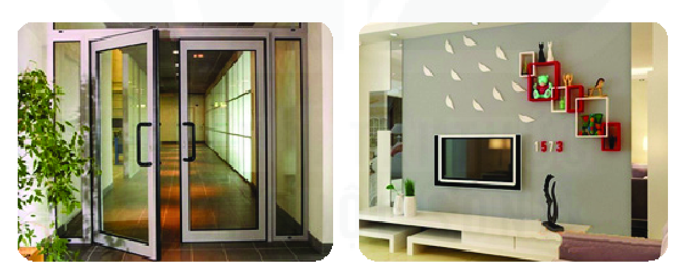

**HĐ2:** Quan sát hình chữ nhật ở hình 4.8a.

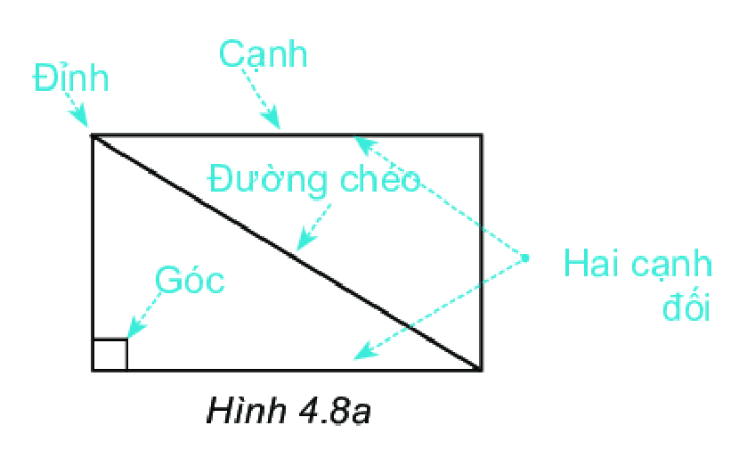
*Hình 4.8a*

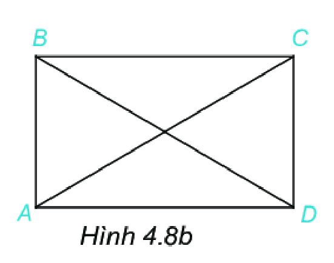
*Hình 4.8b*

<!-- term: Cạnh đối -->
1. Nêu tên đỉnh, cạnh, đường chéo, hai cạnh đối của hình chữ nhật $ABCD$ (h.4.8b).
2. Dùng thước đo góc để đo và so sánh các góc của hình chữ nhật $ABCD$.
3. Dùng thước thẳng hoặc compa để so sánh hai cạnh đối, hai đường chéo của hình chữ nhật $ABCD$.

<!-- pdf:91 -->

<!-- term: Cạnh đối -->
**Nhận xét:**
Trong **hình chữ nhật**:
- Bốn góc bằng nhau và bằng $90^\circ$.
- Các cạnh đối bằng nhau.
- Hai đường chéo bằng nhau.

**Thực hành 1:**

1. Vẽ hình chữ nhật $ABCD$ có một cạnh bằng $5\text{ cm}$, một cạnh bằng $3\text{ cm}$ theo hướng dẫn sau:

Bước 1. Vẽ đoạn thẳng $AB = 5\text{ cm}$.
<!-- ocr-ok: đã đối chiếu ảnh trang PDF 91, OCR bỏ sót nhãn màu xanh Bước 1 và dính chữ 5cm -->

Bước 2. Vẽ đường thẳng vuông góc với $AB$ tại $A$. Trên đường thẳng đó lấy điểm $D$ sao cho $AD = 3\text{ cm}$.
<!-- ocr-ok: đã đối chiếu ảnh trang PDF 91, OCR bỏ sót nhãn Bước 2, đọc sai lấy thành lầy và dính 3cm -->

Bước 3. Vẽ đường thẳng vuông góc với $AB$ tại $B$. Trên đường thẳng đó lấy điểm $C$ sao cho $BC = 3\text{ cm}$.
<!-- ocr-ok: đã đối chiếu ảnh trang PDF 91, OCR bỏ sót nhãn Bước 3, đọc sai BC thành 8C và dính 3cm -->

Bước 4. Nối $D$ với $C$ ta được hình chữ nhật $ABCD$.
<!-- ocr-ok: đã đối chiếu ảnh trang PDF 91, OCR bỏ sót nhãn màu xanh Bước 4 -->

**Vuông:** Liệu có cách nào khác để vẽ hình chữ nhật không nhỉ?

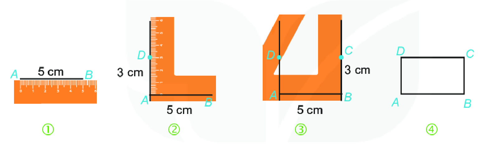

2. Em hãy kiểm tra lại hình vừa vẽ xem các cạnh đối có bằng nhau không? Các góc có bằng nhau không?

## 2. HÌNH THOI

**Một số yếu tố cơ bản của hình thoi**

**HĐ3:**
1. Trong các đồ vật có ở hình 4.9, đồ vật nào có dạng hình thoi?
2. Em hãy tìm thêm một số hình ảnh khác của hình thoi trong thực tế.

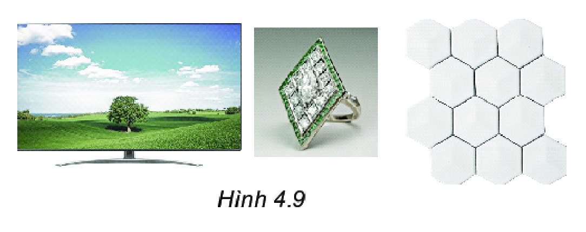
*Hình 4.9*

<!-- pdf:92 -->

**HĐ4:** Quan sát hình thoi ở hình 4.10a.

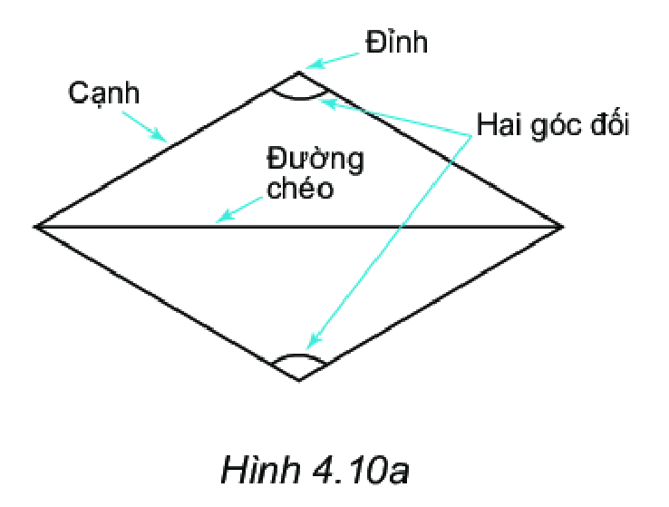
*Hình 4.10a*

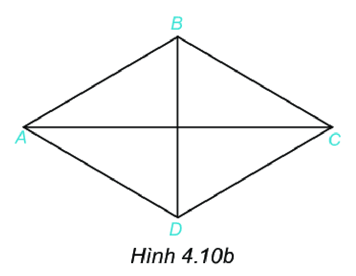
*Hình 4.10b*

<!-- term: Góc đối -->
1. Dùng thước thẳng hoặc compa so sánh các cạnh của hình thoi (h.4.10b).
2. Kiểm tra xem hai đường chéo của hình thoi có vuông góc với nhau không?
3. Các cạnh đối của hình thoi có song song với nhau không?
4. Các góc đối của hình thoi có bằng nhau không?

<!-- term: Góc đối -->
**Nhận xét:**
Trong một **hình thoi**:
- Bốn cạnh bằng nhau.
- Hai đường chéo vuông góc với nhau.
- Các cạnh đối song song với nhau.
- Các góc đối bằng nhau.

> ❓ Quan sát hình vẽ bên. Hãy tìm điểm $E$ trên đoạn thẳng $BC$, điểm $F$ trên đoạn thẳng $AD$ để tứ giác $ABEF$ là hình thoi.

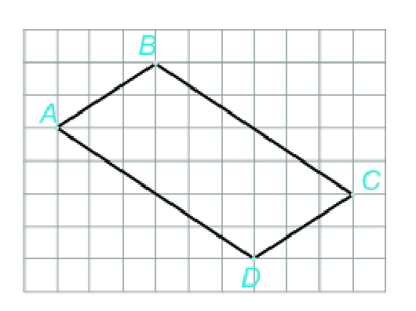

**Thực hành 2:**

1. Vẽ hình thoi $ABCD$ có cạnh bằng $3\text{ cm}$ theo hướng dẫn sau:

Bước 1. Vẽ đoạn thẳng $AB = 3\text{ cm}$.
<!-- ocr-ok: đã đối chiếu ảnh trang PDF 92, OCR bỏ sót nhãn màu xanh Bước 1 và dính chữ 3cm -->

Bước 2. Vẽ đường thẳng đi qua $B$. Lấy điểm $C$ trên đường thẳng đó sao cho $BC = 3\text{ cm}$.
<!-- ocr-ok: đã đối chiếu ảnh trang PDF 92, OCR bỏ sót nhãn màu xanh Bước 2 và dính chữ 3cm -->

Bước 3. Vẽ đường thẳng đi qua $C$ và song song với cạnh $AB$. Vẽ đường thẳng đi qua $A$ và song song với cạnh $BC$.

Bước 4. Hai đường thẳng này cắt nhau tại $D$, ta được hình thoi $ABCD$.

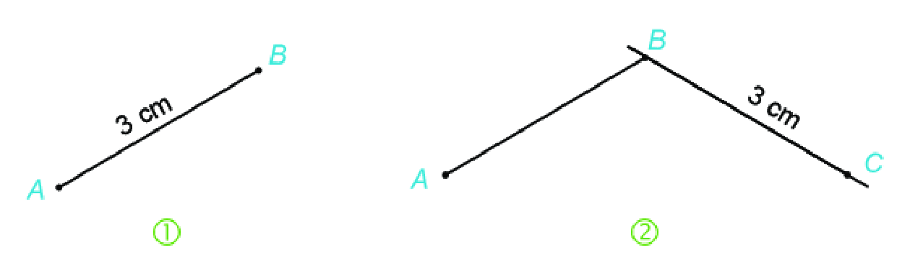

<!-- pdf:93 -->

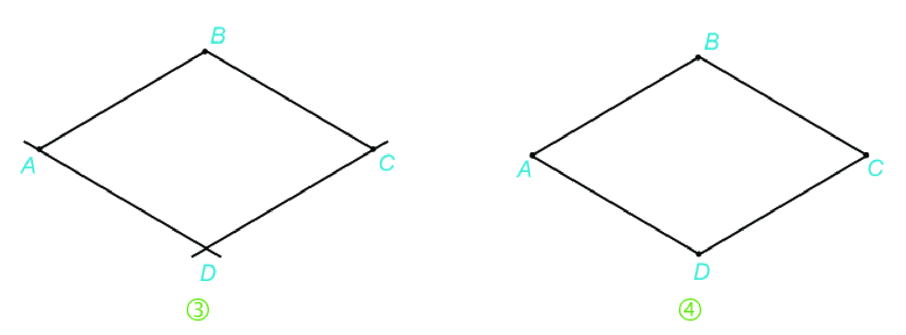

2. Em hãy kiểm tra lại hình vừa vẽ xem các cạnh có bằng nhau không?

3. Gấp, cắt hình thoi từ tờ giấy hình chữ nhật theo hướng dẫn sau:

Bước 1. Gấp đôi tờ giấy sau đó lại gấp đôi một lần nữa sao cho xuất hiện một góc vuông với cạnh là các nếp gấp.

Bước 2. Vẽ một đoạn thẳng nối hai điểm tuỳ ý trên hai cạnh của góc vuông.

Bước 3. Dùng kéo cắt theo đoạn thẳng vừa vẽ rồi mở ra, ta được một hình thoi.

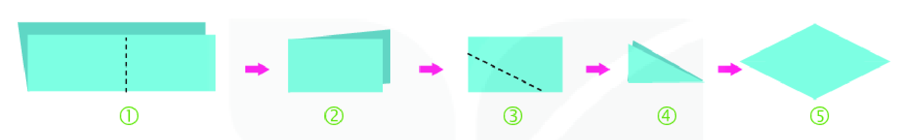

**Vận dụng:**

Em hãy vẽ đường trang trí theo mẫu dưới đây rồi tô màu tuỳ ý.

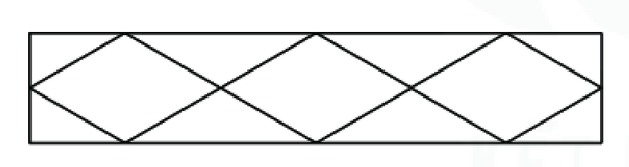

## 3. HÌNH BÌNH HÀNH

**Một số yếu tố cơ bản của hình bình hành**

**HĐ5:**
1. Hình bình hành có trong hình ảnh nào dưới đây (h.4.11)?

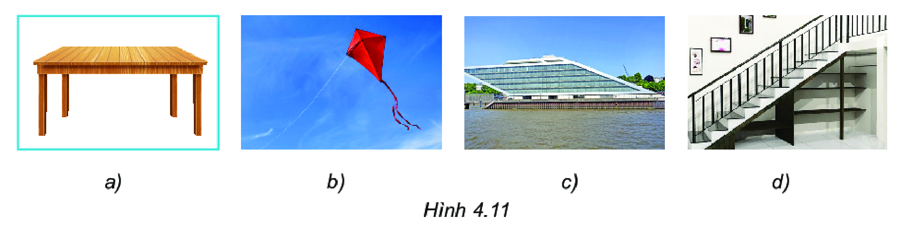
*Hình 4.11*

2. Em hãy tìm thêm một số hình ảnh khác của hình bình hành trong thực tế.

<!-- pdf:94 -->

**HĐ6:** Quan sát hình bình hành ở hình 4.12a.

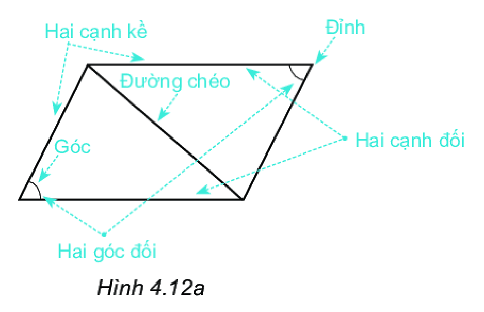
*Hình 4.12a*

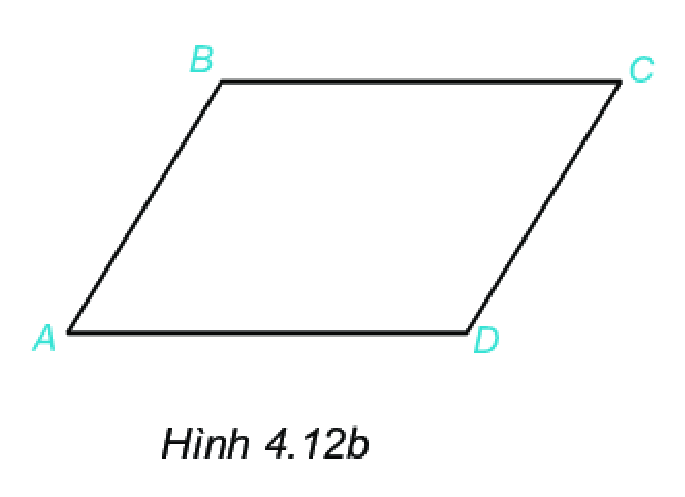
*Hình 4.12b*

1. Dùng thước thẳng đo và so sánh độ dài các cạnh đối của hình bình hành $ABCD$ (h.4.12b).
2. Các góc đối của hình bình hành $ABCD$ có bằng nhau không?
3. Các cạnh đối của hình bình hành $ABCD$ có song song với nhau không?

**Nhận xét:**
Trong **hình bình hành**:
- Các cạnh đối bằng nhau.
- Các góc đối bằng nhau.
- Các cạnh đối song song với nhau.

**Thực hành 3:**

Vẽ hình bình hành $ABCD$ có $AB = 5\text{ cm}$; $BC = 3\text{ cm}$ theo hướng dẫn sau:

Bước 1. Vẽ đoạn thẳng $AB = 5\text{ cm}$.
<!-- ocr-ok: đã đối chiếu ảnh trang PDF 94, OCR bỏ sót nhãn màu xanh Bước 1 và dính chữ 5cm -->

Bước 2. Vẽ đường thẳng đi qua $B$. Trên đường thẳng đó lấy điểm $C$ sao cho $BC = 3\text{ cm}$.
<!-- ocr-ok: đã đối chiếu ảnh trang PDF 94, OCR bỏ sót nhãn màu xanh Bước 2 và dính chữ 3cm -->

Bước 3. Vẽ đường thẳng đi qua $A$ và song song với $BC$, đường thẳng qua $C$ và song song với $AB$. Hai đường thẳng này cắt nhau tại $D$, ta được hình bình hành $ABCD$.

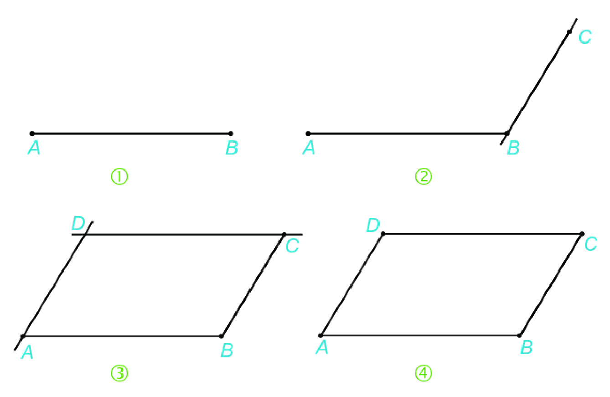

<!-- pdf:95 -->

## 4. HÌNH THANG CÂN

**Một số yếu tố cơ bản của hình thang cân**

**HĐ7:** Mặt bàn ở hình bên là hình ảnh của một hình thang cân. Em hãy tìm thêm một số hình ảnh khác của hình thang cân trong thực tế.

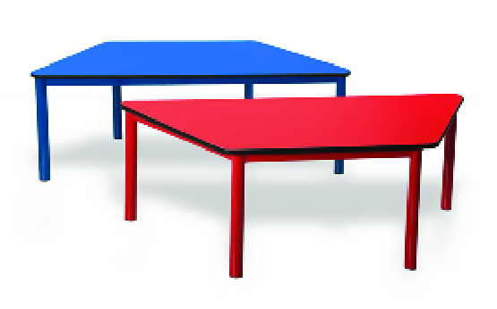

**HĐ8:** Quan sát hình thang cân ở hình 4.13a.

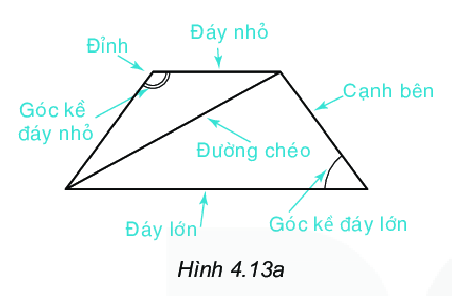
*Hình 4.13a*

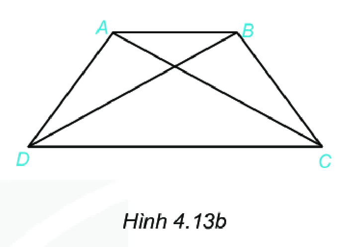
*Hình 4.13b*

<!-- term: Cạnh bên -->
<!-- term: Đáy lớn, đáy nhỏ, góc kề đáy -->
1. Gọi tên các đỉnh, đáy lớn, đáy nhỏ, đường chéo, cạnh bên và các góc kề đáy lớn của hình thang cân $ABCD$ (h.4.13b)
2. Sử dụng thước thẳng hoặc compa để so sánh hai cạnh bên, hai đường chéo của hình thang cân $ABCD$.
3. Hai đáy của hình thang cân $ABCD$ có song song với nhau không?
4. Hai góc kề một đáy của hình thang cân $ABCD$ *có bằng nhau không?*

<!-- term: Cạnh bên -->
**Nhận xét:**
Trong **hình thang cân**:
- Hai cạnh bên bằng nhau.
- Hai đường chéo bằng nhau.
- Hai đáy song song với nhau.
- Hai góc kề một đáy bằng nhau.

**Luyện tập:**

Hình nào trong các hình đã cho là hình thang cân? Hãy cho biết tên hình thang cân đó.

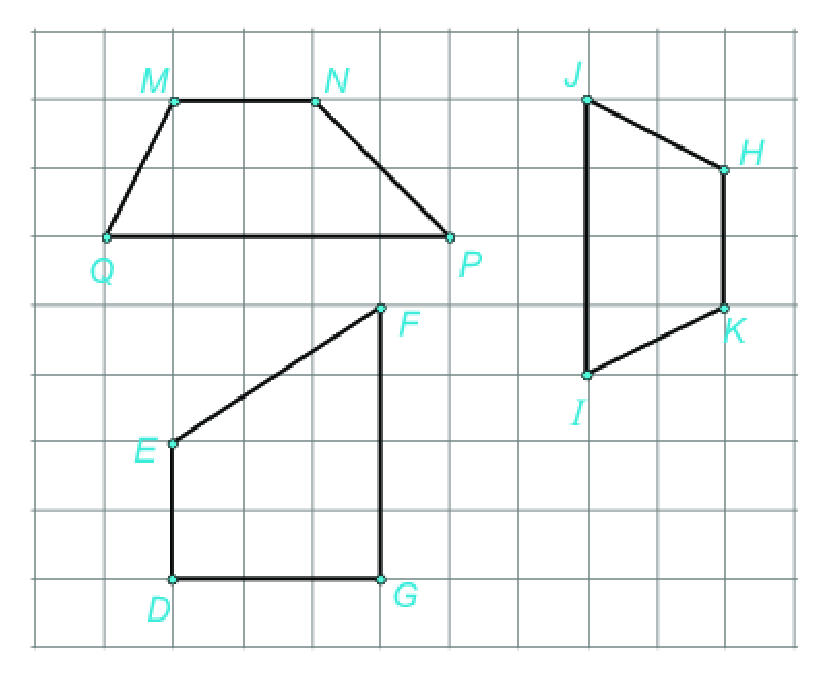

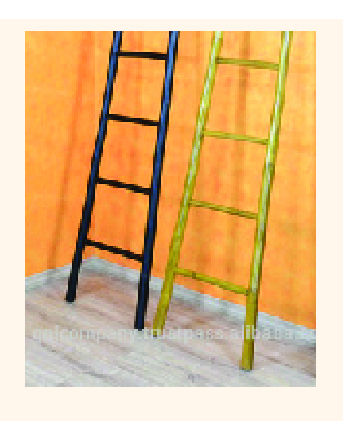

Các thanh ngang tạo với hai trụ bên thành các hình thang cân để cái thang có thể cân đối và vững chắc khi sử dụng.

<!-- pdf:96 -->

**Thực hành 4:**

Gấp, cắt hình thang cân từ tờ giấy hình chữ nhật.

Bước 1. Gấp đôi tờ giấy.
<!-- ocr-ok: đã đối chiếu ảnh trang PDF 96, OCR bỏ sót nhãn màu xanh Bước 1 -->

Bước 2. Vẽ một đoạn thẳng nối hai điểm tuỳ ý trên hai cạnh đối diện (cạnh không chứa nếp gấp).

Bước 3. Cắt theo đường vừa vẽ.

Bước 4. Mở tờ giấy ra ta được một hình thang cân.

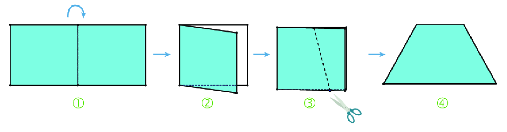

## BÀI TẬP

4.9. Vẽ hình chữ nhật có một cạnh dài $6\text{ cm}$, một cạnh dài $4\text{ cm}$.

4.10. Vẽ hình thoi có cạnh $4\text{ cm}$.
<!-- ocr-ok: đã đối chiếu ảnh trang PDF 96, OCR bỏ sót nhãn màu xanh 4.10 và dính chữ 4cm -->

4.11. Vẽ hình bình hành có độ dài một cạnh bằng $6\text{ cm}$, một cạnh bằng $3\text{ cm}$.

4.12. Hãy kể tên các hình thang cân, hình chữ nhật có trong hình lục giác đều sau:

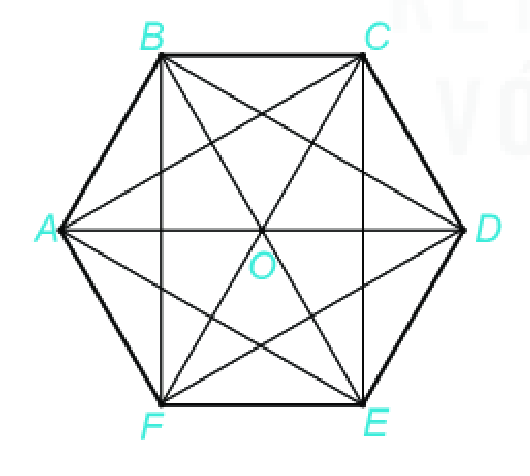

4.13. Cho hình bình hành $ABCD$, hai đường chéo $AC$ và $BD$ cắt nhau tại điểm $I$. Sử dụng compa hoặc thước thẳng kiểm tra xem điểm $I$ có là trung điểm của hai đường chéo $AC$ và $BD$ không?

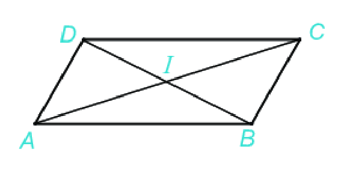

4.14. Vẽ và cắt từ giấy một hình thoi tuỳ ý. Sau đó cắt hình thoi theo hai đường chéo của nó để được bốn mảnh. Ghép lại bốn mảnh đó để được một hình chữ nhật.

4.15. *“Bàn làm việc đa năng”*: Hãy cắt $6$ hình thang cân giống nhau rồi ghép thành hình mặt chiếc bàn làm việc như hình dưới đây:

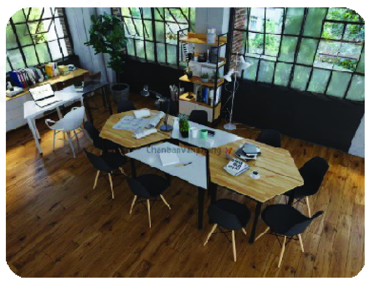

## 📷 Danh sách hình trong bài

| Mã hình | Trang PDF | Vị trí trong bài | Chú thích gốc |
| --- | :---: | --- | --- |
| H6-toan-b19-01 | 90 | Mục 1, HĐ1 | (sách không đánh số, hình ảnh hình chữ nhật trong thực tế) |
| H6-toan-b19-02 | 90 | Mục 1, HĐ2 | Hình 4.8a |
| H6-toan-b19-03 | 90 | Mục 1, HĐ2 | Hình 4.8b |
| H6-toan-b19-04 | 91 | Mục 1, Thực hành 1 | (sách không đánh số, 4 bước vẽ hình chữ nhật $ABCD$) |
| H6-toan-b19-05 | 91 | Mục 2, HĐ3 | Hình 4.9 |
| H6-toan-b19-06 | 92 | Mục 2, HĐ4 | Hình 4.10a |
| H6-toan-b19-07 | 92 | Mục 2, HĐ4 | Hình 4.10b |
| H6-toan-b19-08 | 92 | Mục 2, Câu hỏi | (sách không đánh số, hình tứ giác $ABCD$ trên giấy kẻ ô vuông) |
| H6-toan-b19-09 | 92 | Mục 2, Thực hành 2 | (sách không đánh số, bước 1 và bước 2 vẽ hình thoi $ABCD$) |
| H6-toan-b19-10 | 93 | Mục 2, Thực hành 2 | (sách không đánh số, bước 3 và bước 4 vẽ hình thoi $ABCD$) |
| H6-toan-b19-11 | 93 | Mục 2, Thực hành 2 | (sách không đánh số, 5 bước gấp, cắt hình thoi từ tờ giấy hình chữ nhật) |
| H6-toan-b19-12 | 93 | Mục 2, Vận dụng | (sách không đánh số, mẫu đường trang trí) |
| H6-toan-b19-13 | 93 | Mục 3, HĐ5 | Hình 4.11 |
| H6-toan-b19-14 | 94 | Mục 3, HĐ6 | Hình 4.12a |
| H6-toan-b19-15 | 94 | Mục 3, HĐ6 | Hình 4.12b |
| H6-toan-b19-16 | 94 | Mục 3, Thực hành 3 | (sách không đánh số, 4 bước vẽ hình bình hành $ABCD$) |
| H6-toan-b19-17 | 95 | Mục 4, HĐ7 | (sách không đánh số, bàn có mặt hình thang cân) |
| H6-toan-b19-18 | 95 | Mục 4, HĐ8 | Hình 4.13a |
| H6-toan-b19-19 | 95 | Mục 4, HĐ8 | Hình 4.13b |
| H6-toan-b19-20 | 95 | Mục 4, Luyện tập | (sách không đánh số, các hình tứ giác trên lưới ô vuông) |
| H6-toan-b19-21 | 95 | Mục 4, Luyện tập | (sách không đánh số, chiếc thang có các thanh ngang tạo thành hình thang cân) |
| H6-toan-b19-22 | 96 | Mục 4, Thực hành 4 | (sách không đánh số, 4 bước gấp, cắt hình thang cân từ tờ giấy hình chữ nhật) |
| H6-toan-b19-23 | 96 | Bài tập, Bài 4.12 | (sách không đánh số, hình lục giác đều $ABCDEF$ tâm $O$) |
| H6-toan-b19-24 | 96 | Bài tập, Bài 4.13 | (sách không đánh số, hình bình hành $ABCD$ hai đường chéo cắt nhau tại $I$) |
| H6-toan-b19-25 | 96 | Bài tập, Bài 4.15 | (sách không đánh số, bàn làm việc đa năng ghép từ $6$ hình thang cân) |
