<!-- pdf:97 -->

# BÀI 20: CHU VI VÀ DIỆN TÍCH CỦA MỘT SỐ TỨ GIÁC ĐÃ HỌC

## 🎯 Kiến thức, kĩ năng

- Giải quyết được một số vấn đề thực tiễn gắn với việc tính chu vi, tính diện tích của hình chữ nhật, hình thoi, hình bình hành, hình thang cân.

## 🔴 Mở đầu

Trong nông nghiệp, xây dựng, người ta có thể cần sử dụng kiến thức về diện tích, chu vi các hình chữ nhật, hình vuông, hình thoi, hình thang cân để tính toán vật liệu trong các công việc như căng lưới che nắng cho rau, làm hàng rào bao quanh khu vườn,... hay lát nền nhà, sơn tường, tạo khung thép,.... Bài này sẽ giúp em tìm hiểu cách vận dụng công thức tính chu vi, diện tích của một số tứ giác đã học và ứng dụng vào thực tế.

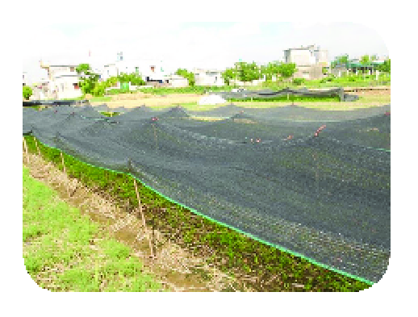

## 1. CHU VI, DIỆN TÍCH CỦA HÌNH VUÔNG, HÌNH CHỮ NHẬT, HÌNH THANG CÂN

<!-- term: Chu vi -->
<!-- term: Diện tích -->
Ở Tiểu học các em đã học và biết sử dụng các công thức tính chu vi, diện tích của một số hình sau:

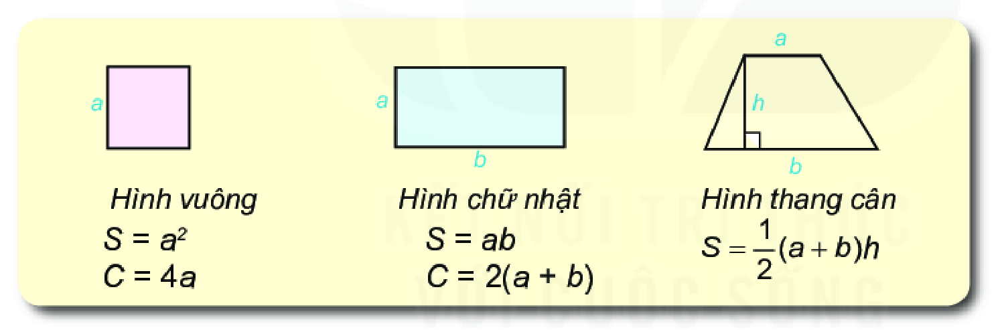

<!-- term: Chu vi và diện tích của hình vuông -->
> *Hình vuông:* $S = a^2$; $C = 4a$

<!-- term: Chu vi và diện tích của hình chữ nhật -->
> *Hình chữ nhật:* $S = ab$; $C = 2(a + b)$

<!-- term: Diện tích của hình thang cân -->
> *Hình thang cân:* $S = \frac{1}{2}(a + b)h$

<!-- term: Chu vi -->
<!-- term: Diện tích -->
<!-- term: Chu vi và diện tích của hình vuông -->
<!-- term: Chu vi và diện tích của hình chữ nhật -->
<!-- term: Diện tích của hình thang cân -->
*(Kí hiệu $C$ là chu vi, $S$ là diện tích của hình)*

**Ví dụ 1:**

Một siêu thị cần treo đèn trang trí xung quanh mép một tấm biển quảng cáo hình chữ nhật có chiều rộng $5\text{ m}$, chiều dài $10\text{ m}$. Chi phí cho mỗi mét dài của đèn là $40\,000$ đồng. Hỏi siêu thị đó phải chi bao nhiêu tiền để mua đèn?

**Giải:** Chu vi của biển quảng cáo hình chữ nhật là:

$$2 \cdot (5 + 10) = 2 \cdot 15 = 30\text{ (m)}.$$
<!-- ocr-ok: đã đối chiếu ảnh trang PDF 97, công thức toán chứa lệnh LaTeX \cdot và \text -->

Vậy siêu thị cần chi số tiền mua đèn là:

$$40\,000 \cdot 30 = 1\,200\,000\text{ (đồng)}.$$
<!-- ocr-ok: đã đối chiếu ảnh trang PDF 97, công thức toán chứa lệnh LaTeX \cdot và \text -->

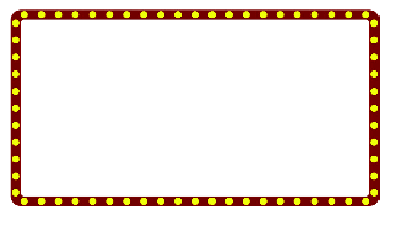

**Ví dụ 2:**

Bác Khôi muốn lát nền cho một căn phòng hình chữ nhật có chiều dài $8\text{ m}$, chiều rộng $6\text{ m}$. Loại gạch lát nền được sử dụng là gạch hình vuông có cạnh dài $40\text{ cm}$. Hỏi bác Khôi phải sử dụng bao nhiêu viên gạch (coi mạch vữa không đáng kể)?

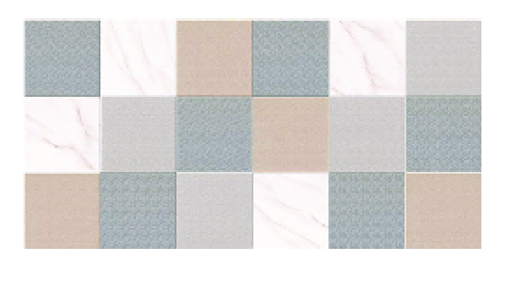

<!-- pdf:98 -->

**Giải:**

Diện tích nền của căn phòng hình chữ nhật là: $8 \cdot 6 = 48\text{ (m}^2\text{)}$.

Diện tích của một viên gạch hình vuông cạnh $40\text{ cm}$ là:

$$40^2 = 1\,600\text{ (cm}^2\text{)} = 0,16\text{ (m}^2\text{)}.$$
<!-- ocr-ok: đã đối chiếu ảnh trang PDF 98, công thức đổi đơn vị diện tích chứa số mũ LaTeX -->

Số viên gạch bác Khôi cần dùng là: $48 : 0,16 = 300$ (viên).
<!-- ocr-ok: đã đối chiếu ảnh trang PDF 98, OCR đọc sai số thập phân 0,16 -->

**Luyện tập 1:**

1. Một người thợ phải làm các khung thép hình chữ nhật có chiều dài $35\text{ cm}$, chiều rộng $30\text{ cm}$ để làm đai cho cột bê tông cốt thép. Nếu dùng $260\text{ m}$ dây thép thì người đó sẽ làm được bao nhiêu khung thép như vậy?

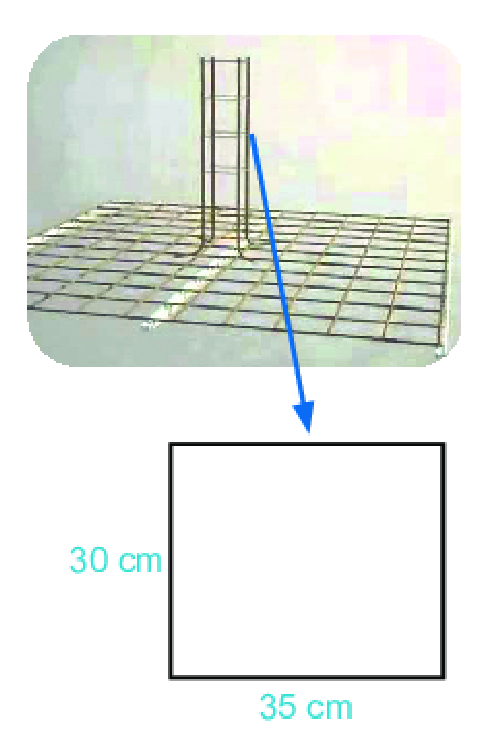

2. Một chiếc bàn khung thép được thiết kế như hình bên. Mặt bàn là hình thang cân có hai đáy lần lượt là $1\,200\text{ mm}$, $600\text{ mm}$ và cạnh bên $600\text{ mm}$. Chiều cao bàn là $730\text{ mm}$. Hỏi làm một chiếc khung bàn nói trên cần bao nhiêu mét thép (coi mối hàn không đáng kể)?

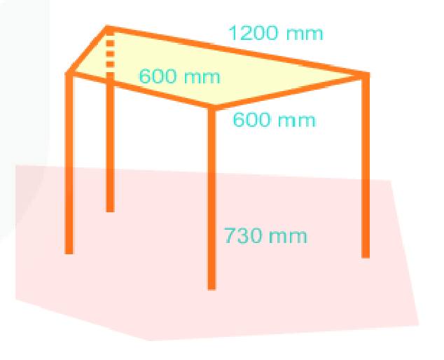

3. Một thửa ruộng có dạng như hình bên. Nếu trên mỗi mét vuông thu hoạch được $0,8\text{ kg}$ thóc thì thửa ruộng đó thu hoạch được bao nhiêu kilôgam thóc?

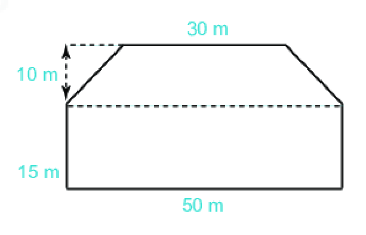

**Thử thách nhỏ:**

Một chiếc móc treo quần áo có dạng hình thang cân (hình bên) được làm từ đoạn dây nhôm dài $60\text{ cm}$. Phần hình thang cân có đáy nhỏ dài $15\text{ cm}$, đáy lớn $25\text{ cm}$, cạnh bên $7\text{ cm}$. Hỏi phần còn lại làm móc treo có độ dài bao nhiêu (bỏ qua mối nối)?

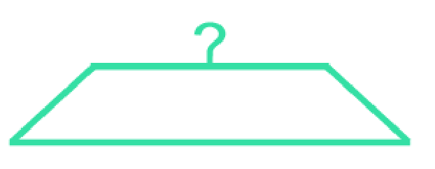

<!-- pdf:99 -->

## 2. CHU VI, DIỆN TÍCH CỦA HÌNH BÌNH HÀNH, HÌNH THOI

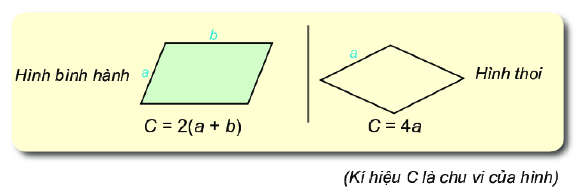

<!-- term: Chu vi của hình bình hành -->
> *Hình bình hành:* $C = 2(a + b)$

<!-- term: Chu vi của hình thoi -->
> *Hình thoi:* $C = 4a$

<!-- term: Chu vi -->
<!-- term: Chu vi của hình bình hành -->
<!-- term: Chu vi của hình thoi -->
*(Kí hiệu $C$ là chu vi của hình)*

**Ví dụ 3:**

Tính chu vi của hình bình hành có độ dài hai cạnh là $3\text{ cm}$ và $5\text{ cm}$.

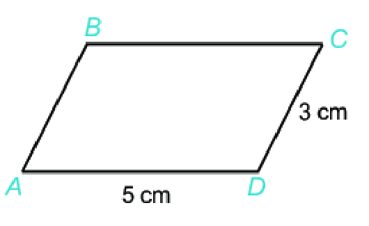

**Giải:**

Chu vi của hình bình hành là: $2 \cdot (3 + 5) = 2 \cdot 8 = 16\text{ (cm)}$.

**Ví dụ 4:**

Một người làm khung thép cho ô thoáng khí cửa ra vào có kích thước và hình dạng như hình sau. Khung thép bên ngoài là hình chữ nhật có chiều dài $160\text{ cm}$, chiều rộng $60\text{ cm}$, phía trong là hai hình thoi cạnh $50\text{ cm}$. Hỏi để làm khung thép như vậy cho bốn cửa ra vào thì hết bao nhiêu mét dài thép? (Coi như các mối hàn không đáng kể).

**Giải:**

Chu vi của hình chữ nhật là:

$$2 \cdot (60 + 160) = 440\text{ (cm)}.$$
<!-- ocr-ok: đã đối chiếu ảnh trang PDF 99, công thức toán chứa lệnh LaTeX \cdot và \text -->

Chu vi một hình thoi là: $4 \cdot 50 = 200\text{ (cm)}$.

Độ dài thép để làm một ô thoáng là:

$$440 + 2 \cdot 200 = 840\text{ (cm)} = 8,4\text{ (m)}.$$
<!-- ocr-ok: đã đối chiếu ảnh trang PDF 99, công thức toán chứa lệnh LaTeX \cdot và \text -->

Độ dài thép để làm bốn ô thoáng là:

$$4 \cdot 8,4 = 33,6\text{ (m)}.$$
<!-- ocr-ok: đã đối chiếu ảnh trang PDF 99, công thức toán chứa lệnh LaTeX \cdot và \text -->

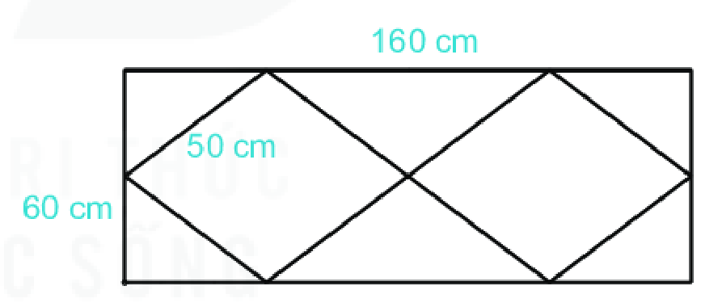

*Diện tích hình bình hành*

**HĐ1:** Vẽ hình bình hành trên giấy kẻ ô vuông rồi cắt, ghép thành hình chữ nhật.

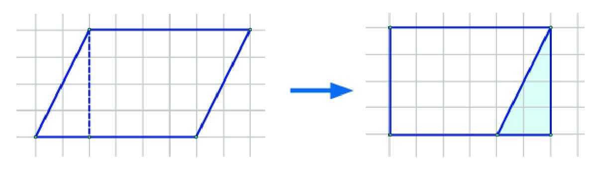

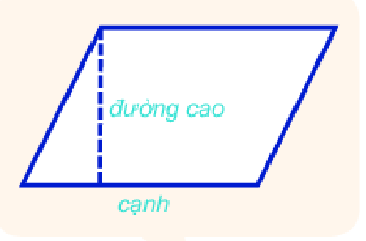

<!-- pdf:100 -->

**HĐ2:** Từ hoạt động 1, hãy so sánh độ dài cạnh, chiều cao tương ứng của hình bình hành với chiều dài, chiều rộng của hình chữ nhật. Từ đó, so sánh diện tích của hình bình hành với diện tích hình chữ nhật.

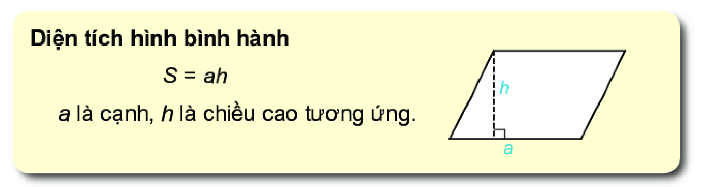

> **Diện tích hình bình hành**
> $S = ah$
> $a$ là cạnh, $h$ là chiều cao tương ứng.

<!-- term: Diện tích -->
*(Kí hiệu $S$ là diện tích của hình)*

**Ví dụ 5:**

Một mảnh gỗ có dạng hình bình hành như hình bên. Tính diện tích mảnh gỗ.

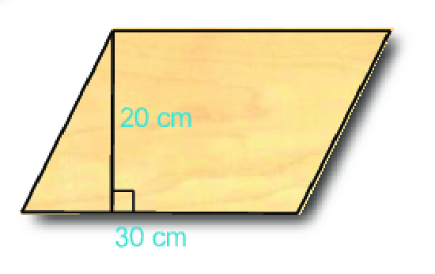

**Giải:**

Mảnh gỗ là hình bình hành có chiều cao $20\text{ cm}$ và độ dài cạnh tương ứng $30\text{ cm}$ nên có diện tích là

$$S = 20 \cdot 30 = 600\text{ (cm}^2\text{)}.$$
<!-- ocr-ok: đã đối chiếu ảnh trang PDF 100, công thức toán chứa lệnh LaTeX \cdot và số mũ -->

**Luyện tập 2:**

Trên một mảnh đất hình chữ nhật có chiều dài $12\text{ m}$, chiều rộng $10\text{ m}$, người ta phân chia khu vực để trồng hoa, trồng cỏ như hình bên. Hoa sẽ được trồng ở trong khu vực hình bình hành $AMCN$, cỏ sẽ trồng ở phần đất còn lại. Tiền công để trả cho mỗi mét vuông trồng hoa là $50\,000$ đồng, trồng cỏ là $40\,000$ đồng. Tính số tiền công cần chi trả để trồng hoa và cỏ.

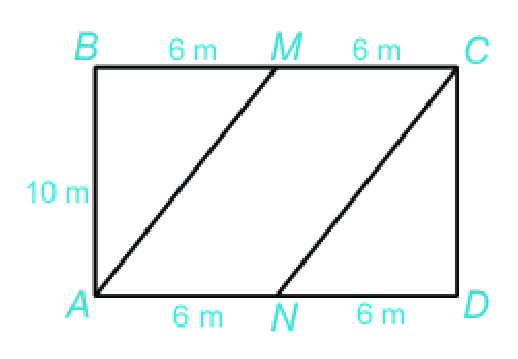

*Diện tích hình thoi*

**HĐ3:** Vẽ hình thoi trên giấy kẻ ô vuông và cắt, ghép thành hình chữ nhật.

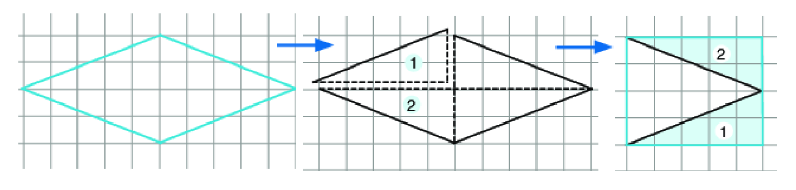

**HĐ4:** Từ hoạt động 3, hãy so sánh các đường chéo của hình thoi với chiều rộng và chiều dài của hình chữ nhật. Từ đó so sánh diện tích hình thoi ban đầu với diện tích hình chữ nhật.

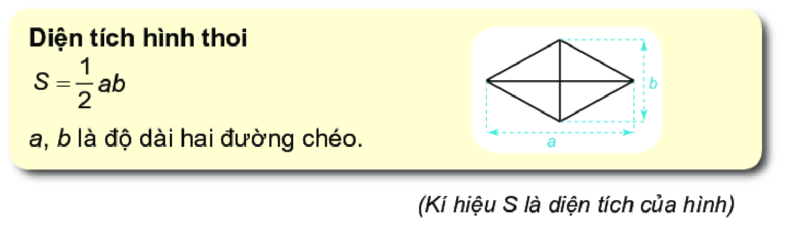

> **Diện tích hình thoi**
> $S = \frac{1}{2}ab$
> $a, b$ là độ dài hai đường chéo.

*(Kí hiệu $S$ là diện tích của hình)*

Ta có thể tính diện tích hình thoi theo công thức tính diện tích hình bình hành $S = ah$.

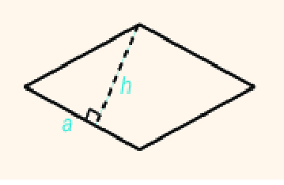

<!-- pdf:101 -->

**Ví dụ 6:**

Tính diện tích hình thoi $ABCD$ có hai đường chéo $AC = 8\text{ cm}$; $BD = 6\text{ cm}$.

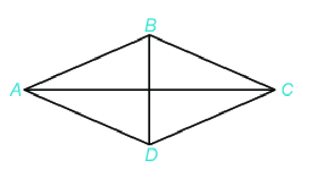

**Giải:**

Diện tích hình thoi $ABCD$ là:

$$S = \frac{1}{2}AC \cdot BD = \frac{1}{2} \cdot 8 \cdot 6 = 24\text{ (cm}^2\text{)}.$$
<!-- ocr-ok: đã đối chiếu ảnh trang PDF 101, công thức phân số LaTeX \frac{1}{2} và \cdot -->

**Luyện tập 3:**

Trong mảnh vườn hình chữ nhật có chiều dài $8\text{ m}$, chiều rộng $5\text{ m}$, người ta trồng hoa hồng trong một mảnh đất hình thoi như hình bên. Nếu mỗi mét vuông trồng $4$ cây hoa thì cần bao nhiêu cây hoa để trồng trên mảnh đất hình thoi đó?

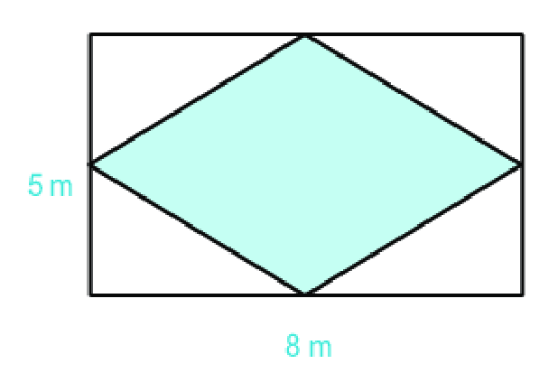

## BÀI TẬP

4.16. Tính chu vi và diện tích của hình chữ nhật $ABCD$ có $AB = 4\text{ cm}$, $BC = 6\text{ cm}$.

4.17 Hình thoi $MNPQ$ có cạnh $MN = 6\text{ cm}$. Tính chu vi hình thoi $MNPQ$.
<!-- ocr-ok: đã đối chiếu ảnh trang PDF 101, giữ nguyên SGK in 4.17 không dấu chấm, OCR dính 6cm -->

4.18. Một khu vườn hình chữ nhật có chiều dài $15\text{ m}$, chiều rộng $10\text{ m}$ như hình dưới, cổng vào có độ rộng bằng $\frac{1}{3}$ chiều dài, phần còn lại là hàng rào. Hỏi hàng rào của khu vườn dài bao nhiêu mét?

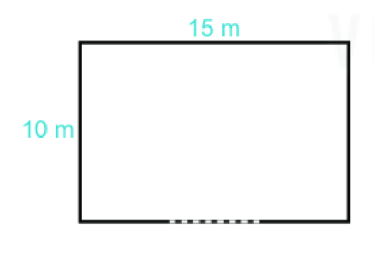

4.19. Một mảnh ruộng hình thang có kích thước như hình dưới. Biết năng suất lúa là $0,8\text{ kg/m}^2$.

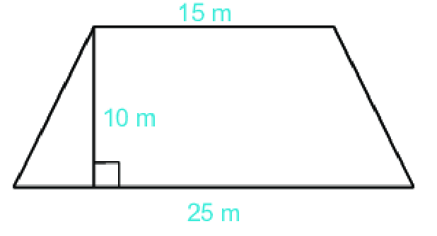

a) Tính diện tích mảnh ruộng.

b) Hỏi mảnh ruộng cho sản lượng là bao nhiêu kilôgam thóc?

4.20. Mặt sàn của một ngôi nhà được thiết kế như hình dưới (đơn vị m). Hãy tính diện tích mặt sàn.

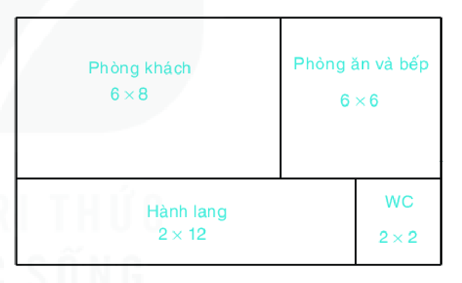

4.21. Tính diện tích mảnh đất hình thang $ABCD$ như hình dưới, biết $AB = 10\text{ m}$; $DC = 25\text{ m}$ và hình chữ nhật $ABED$ có diện tích là $150\text{ m}^2$.

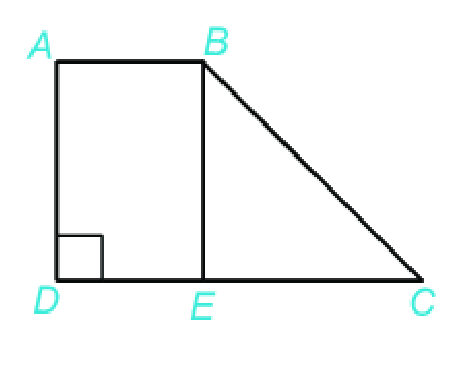

4.22. Một gia đình dự định mua gạch men loại hình vuông cạnh $30\text{ cm}$ để lát nền của căn phòng hình chữ nhật có chiều rộng $3\text{ m}$, chiều dài $9\text{ m}$. Tính số viên gạch cần mua để lát căn phòng đó.

## 📷 Danh sách hình trong bài

| Mã hình | Trang PDF | Vị trí trong bài | Chú thích gốc |
| --- | :---: | --- | --- |
| H6-toan-b20-01 | 97 | Mở đầu | (sách không đánh số, căng lưới che nắng cho rau) |
| H6-toan-b20-02 | 97 | Mục 1 | (sách không đánh số, khung công thức chu vi, diện tích hình vuông, hình chữ nhật, hình thang cân) |
| H6-toan-b20-03 | 97 | Mục 1, Ví dụ 1 | (sách không đánh số, biển quảng cáo hình chữ nhật gắn đèn trang trí) |
| H6-toan-b20-04 | 97 | Mục 1, Ví dụ 2 | (sách không đánh số, các viên gạch hình vuông lát nền) |
| H6-toan-b20-05 | 98 | Mục 1, Luyện tập 1 | (sách không đánh số, khung thép hình chữ nhật $30\text{ cm} \times 35\text{ cm}$ làm đai cột bê tông) |
| H6-toan-b20-06 | 98 | Mục 1, Luyện tập 1 | (sách không đánh số, chiếc bàn khung thép mặt hình thang cân) |
| H6-toan-b20-07 | 98 | Mục 1, Luyện tập 1 | (sách không đánh số, hình dạng và kích thước thửa ruộng) |
| H6-toan-b20-08 | 98 | Mục 1, Thử thách nhỏ | (sách không đánh số, chiếc móc treo quần áo dạng hình thang cân) |
| H6-toan-b20-09 | 99 | Mục 2 | (sách không đánh số, khung công thức chu vi hình bình hành và hình thoi) |
| H6-toan-b20-10 | 99 | Mục 2, Ví dụ 3 | (sách không đánh số, hình bình hành $ABCD$ cạnh $3\text{ cm}$ và $5\text{ cm}$) |
| H6-toan-b20-11 | 99 | Mục 2, Ví dụ 4 | (sách không đánh số, khung thép ô thoáng khí cửa ra vào) |
| H6-toan-b20-12 | 99 | Mục 2, HĐ1 | (sách không đánh số, cắt ghép hình bình hành trên giấy kẻ ô vuông thành hình chữ nhật) |
| H6-toan-b20-13 | 99 | Mục 2, HĐ1 | (sách không đánh số, đường cao và cạnh của hình bình hành) |
| H6-toan-b20-14 | 100 | Mục 2, HĐ2 | (sách không đánh số, khung công thức diện tích hình bình hành) |
| H6-toan-b20-15 | 100 | Mục 2, Ví dụ 5 | (sách không đánh số, mảnh gỗ dạng hình bình hành) |
| H6-toan-b20-16 | 100 | Mục 2, Luyện tập 2 | (sách không đánh số, mảnh đất hình chữ nhật $ABCD$ chia khu vực trồng hoa $AMCN$ và trồng cỏ) |
| H6-toan-b20-17 | 100 | Mục 2, HĐ3 | (sách không đánh số, cắt ghép hình thoi trên giấy kẻ ô vuông thành hình chữ nhật) |
| H6-toan-b20-18 | 100 | Mục 2, HĐ4 | (sách không đánh số, khung công thức diện tích hình thoi) |
| H6-toan-b20-19 | 100 | Mục 2, HĐ4 | (sách không đánh số, tính diện tích hình thoi theo cạnh $a$ và chiều cao $h$) |
| H6-toan-b20-20 | 101 | Mục 2, Ví dụ 6 | (sách không đánh số, hình thoi $ABCD$) |
| H6-toan-b20-21 | 101 | Mục 2, Luyện tập 3 | (sách không đánh số, mảnh đất hình thoi trong mảnh vườn hình chữ nhật $8\text{ m} \times 5\text{ m}$) |
| H6-toan-b20-22 | 101 | Bài tập, Bài 4.18 | (sách không đánh số, khu vườn hình chữ nhật $15\text{ m} \times 10\text{ m}$ có cổng vào) |
| H6-toan-b20-23 | 101 | Bài tập, Bài 4.19 | (sách không đánh số, mảnh ruộng hình thang) |
| H6-toan-b20-24 | 101 | Bài tập, Bài 4.20 | (sách không đánh số, sơ đồ mặt sàn ngôi nhà) |
| H6-toan-b20-25 | 101 | Bài tập, Bài 4.21 | (sách không đánh số, mảnh đất hình thang $ABCD$) |
