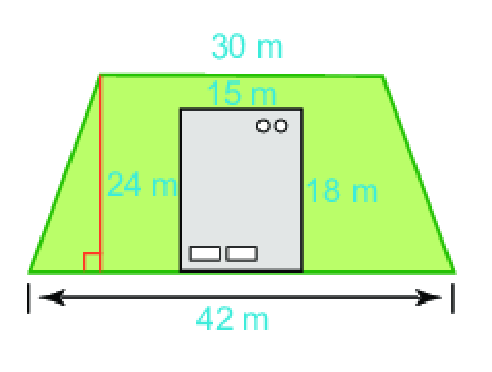
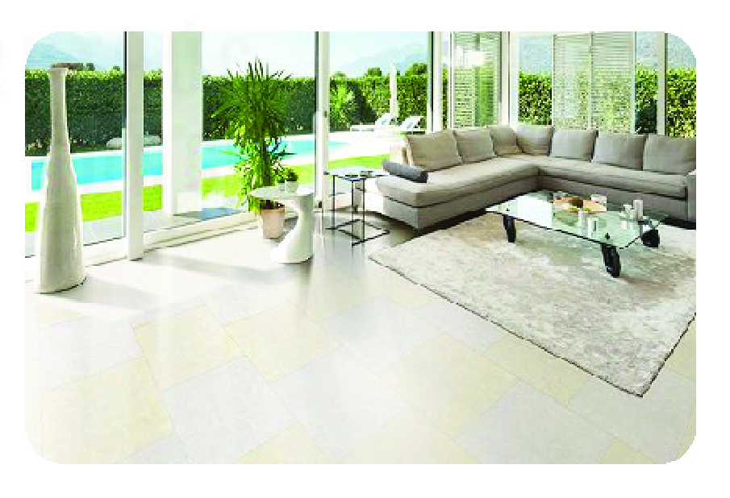
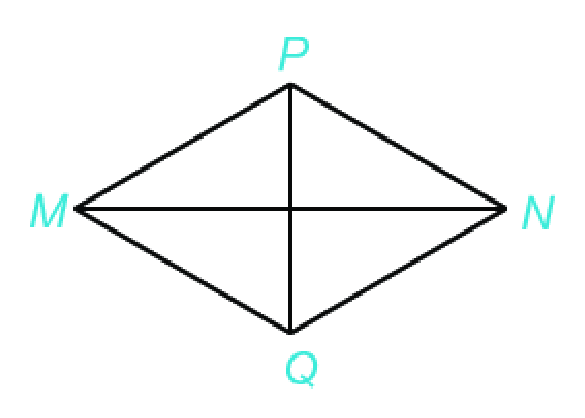
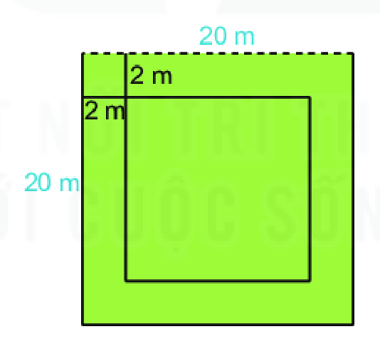
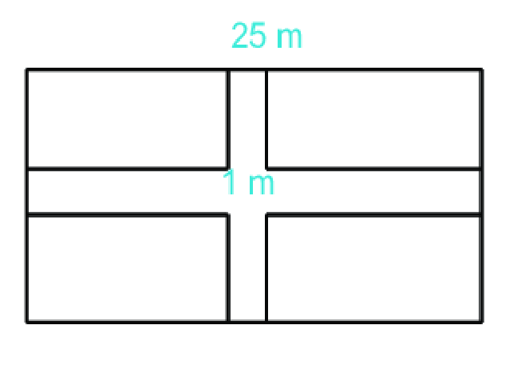

<!-- pdf:102 -->

# LUYỆN TẬP CHUNG

**Ví dụ 1:**

Một ngôi nhà có bãi cỏ bao quanh như hình bên.

a) Hãy tính diện tích của bãi cỏ.

b) Nếu một túi hạt giống cỏ gieo vừa đủ trên $33\text{ m}^2$ đất, thì cần bao nhiêu túi hạt giống để gieo hết bãi cỏ?

**Giải:** Diện tích cả bãi cỏ và khu đất làm nhà là:

$$\frac{1}{2}(30 + 42) \cdot 24 = 864\text{ (m}^2\text{)}.$$
<!-- ocr-ok: đã đối chiếu ảnh trang PDF 102, OCR đọc sai phân số \frac{1}{2}(30 + 42) thành 200 + 42) -->

Diện tích khu đất làm nhà là: $15 \cdot 18 = 270\text{ (m}^2\text{)}$.

Diện tích cả bãi cỏ là: $864 - 270 = 594\text{ (m}^2\text{)}$.

Để gieo hết bãi cỏ thì cần số túi hạt giống là: $594 : 33 = 18$ (túi).

**Ví dụ 2:**

Một nền nhà hình chữ nhật có chiều dài $20\text{ m}$ và chiều rộng bằng $\frac{1}{4}$ chiều dài. Người ta lát nền nhà bằng những viên gạch hình vuông cạnh $4\text{ dm}$. Tổng số tiền mua gạch là $11\,785\,000$ đồng thì vừa đủ để lát. Hỏi giá mỗi viên gạch lát nền là bao nhiêu?

**Giải:**

Chiều rộng của nền nhà là: $\frac{1}{4} \cdot 20 = 5\text{ (m)}$.

Diện tích nền nhà hình chữ nhật là:

$$20 \cdot 5 = 100\text{ (m}^2\text{)}.$$
<!-- ocr-ok: đã đối chiếu ảnh trang PDF 102, công thức toán chứa lệnh LaTeX \cdot và số mũ -->

Đổi $4\text{ dm} = 0,4\text{ m}$.

Diện tích một viên gạch lát nền là:

$$0,4 \cdot 0,4 = 0,16\text{ (m}^2\text{)}.$$
<!-- ocr-ok: đã đối chiếu ảnh trang PDF 102, OCR đọc sai 0,4 thành 04 và 0,16 thành 0,18 -->

Số viên gạch dùng để lát nền nhà là:

$$100 : 0,16 = 625\text{ (viên)}.$$
<!-- ocr-ok: đã đối chiếu ảnh trang PDF 102, OCR đọc sai 0,16 thành 0,18 -->

Giá mỗi viên gạch lát nền là:

$$11\,785\,000 : 625 = 19\,000\text{ (đồng)}.$$

<!-- pdf:103 -->

## BÀI TẬP

4.23.

a) Vẽ hình vuông có cạnh $5\text{ cm}$.

b) Vẽ hình chữ nhật có chiều dài $4\text{ cm}$, chiều rộng $2\text{ cm}$.

c) Vẽ tam giác đều có cạnh $3\text{ cm}$.

4.24. Cho hình thoi $MPNQ$ như hình dưới với $MN = 8\text{ cm}$; $PQ = 6\text{ cm}$.
<!-- ocr-ok: đã đối chiếu ảnh trang PDF 103, OCR bỏ sót nhãn màu xanh 4.24 và dính 8cm, 6cm -->

a) Tính diện tích hình thoi $MPNQ$.

b) Biết $MP = 5\text{ cm}$, tính chu vi của hình thoi $MPNQ$.

4.25. Một mảnh giấy hình chữ nhật có diện tích $96\text{ cm}^2$. Một cạnh có độ dài $12\text{ cm}$. Tính chu vi của mảnh giấy đó.

4.26. Một mảnh vườn hình vuông cạnh $20\text{ m}$. Người ta làm một lối đi xung quanh vườn rộng $2\text{ m}$ thuộc đất của vườn. Phần đất còn lại dùng để trồng trọt. Tính diện tích trồng trọt của mảnh vườn.

4.27. Một mảnh vườn hình chữ nhật có chiều dài $25\text{ m}$. Chiều rộng bằng $\frac{3}{5}$ chiều dài. Người ta làm hai lối đi rộng $1\text{ m}$ như hình vẽ. Phần đất còn lại dùng để trồng cây. Tính diện tích đất dùng để trồng cây.

## 📷 Danh sách hình trong bài

| Mã hình | Trang PDF | Vị trí trong bài | Chú thích gốc |
| --- | :---: | --- | --- |
| H6-toan-ltc-c04-01-01 | 102 | Ví dụ 1 | (sách không đánh số, ngôi nhà có bãi cỏ bao quanh) |
| H6-toan-ltc-c04-01-02 | 102 | Ví dụ 2 | (sách không đánh số, nền nhà lát gạch) |
| H6-toan-ltc-c04-01-03 | 103 | Bài tập, Bài 4.24 | (sách không đánh số, hình thoi $MPNQ$) |
| H6-toan-ltc-c04-01-04 | 103 | Bài tập, Bài 4.26 | (sách không đánh số, mảnh vườn hình vuông cạnh $20\text{ m}$ có lối đi rộng $2\text{ m}$) |
| H6-toan-ltc-c04-01-05 | 103 | Bài tập, Bài 4.27 | (sách không đánh số, mảnh vườn hình chữ nhật dài $25\text{ m}$ có hai lối đi rộng $1\text{ m}$) |
