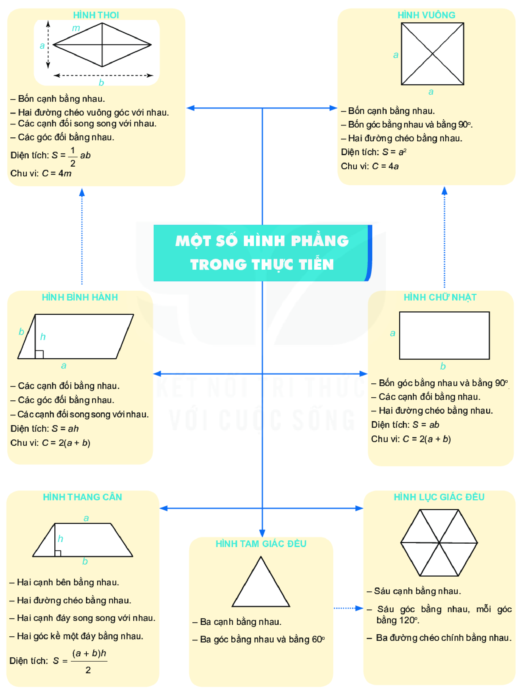
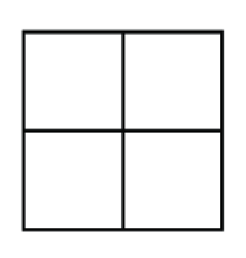
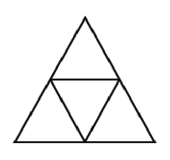
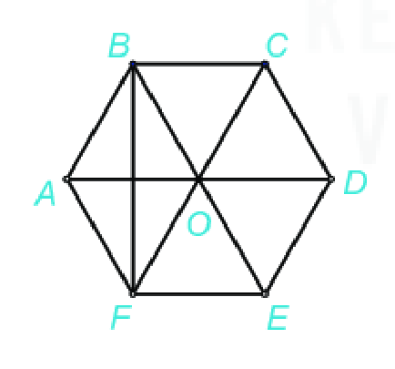
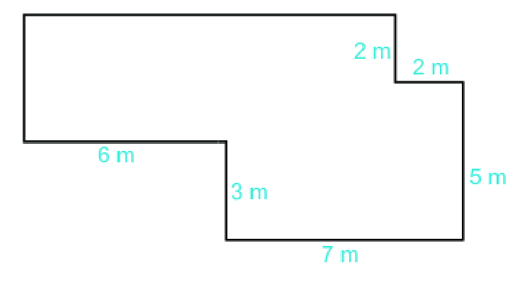
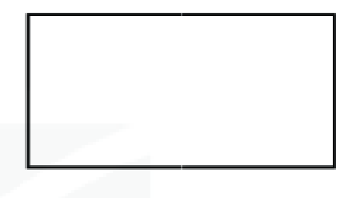
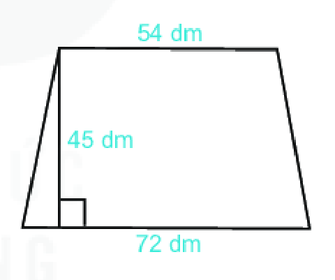

<!-- pdf:104 -->

# CHÚNG TA ĐÃ HỌC NHỮNG GÌ?

**MỘT SỐ HÌNH PHẲNG TRONG THỰC TIỄN**
<!-- ocr-ok: đã đối chiếu ảnh trang PDF 104, chữ trắng trên nền băng rôn màu xanh trung tâm sơ đồ tổng kết chương -->

<!-- term: Chu vi của hình thoi -->
- **HÌNH THOI:**
  - Bốn cạnh bằng nhau.
  - Hai đường chéo vuông góc với nhau.
  - Các cạnh đối song song với nhau.
  - Các góc đối bằng nhau.
  - Diện tích: $S = \frac{1}{2}ab$
  - Chu vi: $C = 4m$

<!-- term: Chu vi và diện tích của hình vuông -->
- **HÌNH VUÔNG:**
  - Bốn cạnh bằng nhau.
  - Bốn góc bằng nhau và bằng $90^\circ$.
  - Hai đường chéo bằng nhau.
  - Diện tích: $S = a^2$
  - Chu vi: $C = 4a$

<!-- term: Chu vi của hình bình hành -->
- **HÌNH BÌNH HÀNH:**
  - Các cạnh đối bằng nhau.
  - Các góc đối bằng nhau.
  - Các cạnh đối song song với nhau.
  - Diện tích: $S = ah$
  - Chu vi: $C = 2(a + b)$

<!-- term: Chu vi và diện tích của hình chữ nhật -->
- **HÌNH CHỮ NHẬT:**
  - Bốn góc bằng nhau và bằng $90^\circ$.
  - Các cạnh đối bằng nhau.
  - Hai đường chéo bằng nhau.
  - Diện tích: $S = ab$
  - Chu vi: $C = 2(a + b)$

<!-- term: Diện tích của hình thang cân -->
- **HÌNH THANG CÂN:**
  - Hai cạnh bên bằng nhau.
  - Hai đường chéo bằng nhau.
  - Hai cạnh đáy song song với nhau.
  - Hai góc kề một đáy bằng nhau.
  - Diện tích: $S = \frac{(a + b)h}{2}$

- **HÌNH TAM GIÁC ĐỀU:**
  - Ba cạnh bằng nhau.
  - Ba góc bằng nhau và bằng $60^\circ$

- **HÌNH LỤC GIÁC ĐỀU:**
  - Sáu cạnh bằng nhau.
  - Sáu góc bằng nhau, mỗi góc bằng $120^\circ$.
  - Ba đường chéo chính bằng nhau.

<!-- pdf:105 -->

## BÀI TẬP CUỐI CHƯƠNG IV

4.28. Hãy đếm xem trong hình bên có bao nhiêu hình vuông, bao nhiêu hình chữ nhật.

4.29. Hãy đếm số hình tam giác đều, số hình thang cân và số hình thoi trong hình vẽ bên.

4.30. Vẽ hình theo các yêu cầu sau:

a) Tam giác đều có cạnh bằng $5\text{ cm}$.

b) Hình vuông có cạnh bằng $6\text{ cm}$.

c) Hình chữ nhật có chiều dài $4\text{ cm}$, chiều rộng $3\text{ cm}$.

4.31. a) Vẽ hình bình hành có một cạnh dài $4\text{ cm}$, một cạnh dài $3\text{ cm}$.

b) Vẽ hình thoi có cạnh bằng $3\text{ cm}$.

4.32. Tính chu vi và diện tích hình chữ nhật có chiều dài $6\text{ cm}$, chiều rộng $5\text{ cm}$.

4.33. Cho hình lục giác đều $ABCDEF$ như hình sau, biết $OA = 6\text{ cm}$; $BF = 10,4\text{ cm}$.

a) Tính diện tích hình thoi $ABOF$.

b) Tính diện tích hình lục giác đều $ABCDEF$.

4.34. Một mảnh vườn có hình dạng như hình dưới đây. Tính diện tích mảnh vườn.

4.35. Một hình chữ nhật có chiều dài gấp đôi chiều rộng. Hãy cắt và ghép lại thành một hình vuông có diện tích tương đương.

4.36. Bản thiết kế một hiên nhà được biểu thị ở hình sau. Nếu chi phí làm mỗi $9\text{ dm}^2$ hiên là $103$ nghìn đồng thì chi phí của cả hiên nhà sẽ là bao nhiêu?

## 📷 Danh sách hình trong bài

| Mã hình | Trang PDF | Vị trí trong bài | Chú thích gốc |
| --- | :---: | --- | --- |
| H6-toan-ot-c04-01 | 104 | Tổng kết chương | (sách không đánh số, sơ đồ tổng kết Chương IV: Một số hình phẳng trong thực tiễn) |
| H6-toan-ot-c04-02 | 105 | Bài tập cuối chương IV, Bài 4.28 | (sách không đánh số, hình lưới ô vuông) |
| H6-toan-ot-c04-03 | 105 | Bài tập cuối chương IV, Bài 4.29 | (sách không đánh số, hình tam giác đều chia thành $4$ tam giác nhỏ) |
| H6-toan-ot-c04-04 | 105 | Bài tập cuối chương IV, Bài 4.33 | (sách không đánh số, hình lục giác đều $ABCDEF$ tâm $O$) |
| H6-toan-ot-c04-05 | 105 | Bài tập cuối chương IV, Bài 4.34 | (sách không đánh số, hình dạng và kích thước mảnh vườn) |
| H6-toan-ot-c04-06 | 105 | Bài tập cuối chương IV, Bài 4.35 | (sách không đánh số, hình chữ nhật có chiều dài gấp đôi chiều rộng) |
| H6-toan-ot-c04-07 | 105 | Bài tập cuối chương IV, Bài 4.36 | (sách không đánh số, bản thiết kế hiên nhà dạng hình thang cân) |
