<!-- pdf:107 -->

<!-- Trang mở đầu Chương V (PDF 106): HÌNH HỌC TRỰC QUAN — CHƯƠNG V: TÍNH ĐỐI XỨNG CỦA HÌNH PHẲNG TRONG TỰ NHIÊN (Hình ảnh Khuê Văn Các; nội dung chính: Hình có trục đối xứng, Trục đối xứng; Hình có tâm đối xứng, Tâm đối xứng). -->

# BÀI 21: HÌNH CÓ TRỤC ĐỐI XỨNG

## 🔤 Khái niệm, thuật ngữ

- Hình có trục đối xứng
- Trục đối xứng

## 🎯 Kiến thức, kĩ năng

- Nhận biết hình có trục đối xứng.
- Nhận biết trục đối xứng của một hình trên giấy bằng cách gấp đôi tờ giấy.
- Gấp giấy để cắt chữ hoặc một số hình đơn giản.

## 🔴 Mở đầu

Trong thiên nhiên và trong đời sống, chúng ta thường gặp rất nhiều hình ảnh đẹp.

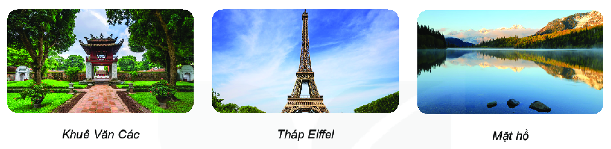
*Khuê Văn Các — Tháp Eiffel — Mặt hồ*

Các hình ảnh trên đều có sự cân đối, hài hoà. Chúng ta cùng tìm hiểu điều gì đã đem lại sự cân đối, hài hoà đó.

## 1. HÌNH CÓ TRỤC ĐỐI XỨNG TRONG THỰC TẾ
<!-- ocr-ok: đã đối chiếu ảnh trang PDF 107, chữ in hoa màu trắng trên băng màu xanh OCR đọc thiếu dấu -->

**HĐ1:** Quan sát hình con bướm ở hình bên.

Em thấy điều gì khi hai cánh của con bướm gập lại?

**HĐ2:** Vẽ một đường tròn trên giấy rồi cắt theo nét vẽ ta được một hình tròn. Gấp đôi hình tròn đó theo một đường thẳng đi qua tâm (h.5.1).

Hãy nhận xét về hai nửa hình tròn sau khi gấp.

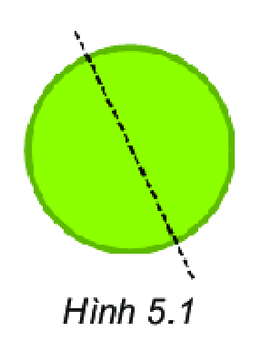
*Hình 5.1*

**HĐ3:** Gấp đôi một tờ giấy (h.5.2a), dùng kéo cắt một đường như hình 5.2b rồi mở ra, ta được một hình. Hình đó có đặc điểm gì giống những hình trên?

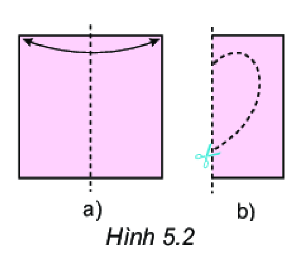
*Hình 5.2*

<!-- pdf:108 -->

> Các hình bên (h.5.3) đều có chung tính chất: *Có một đường thẳng $d$ chia hình thành hai phần mà nếu “gấp” hình theo đường thẳng $d$ thì hai phần đó “chồng khít” lên nhau.*
>
> Những hình như thế gọi là **hình có trục đối xứng** và đường thẳng $d$ là **trục đối xứng** của nó.

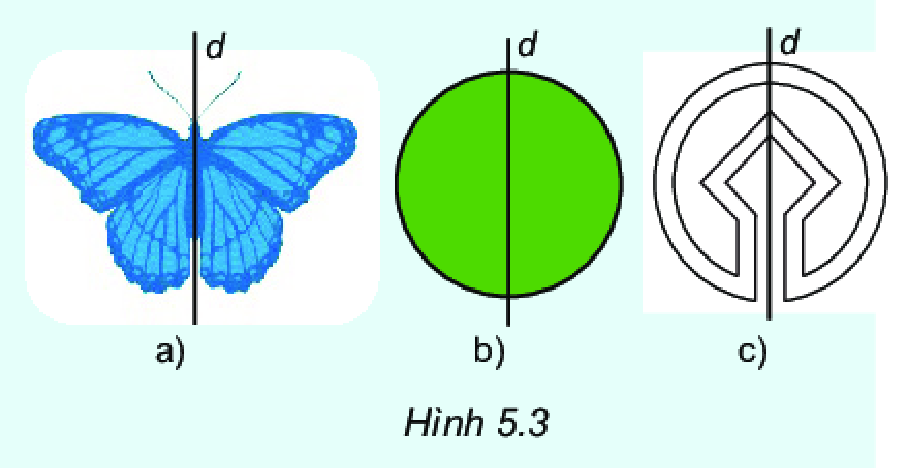
*Hình 5.3*

**Luyện tập:**

1. Những chữ cái nào dưới đây có trục đối xứng? Hãy dự đoán trục đối xứng của chúng.

2. Những hình nào dưới đây có trục đối xứng?

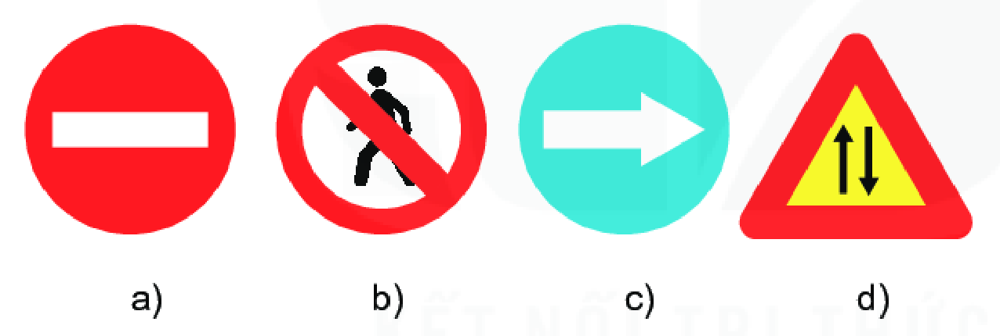

3. Hãy tìm một ví dụ khác về hình có trục đối xứng.

> Một số hình có trục đối xứng:
> - *Trong kiến trúc*
> - *Trong thiết kế*

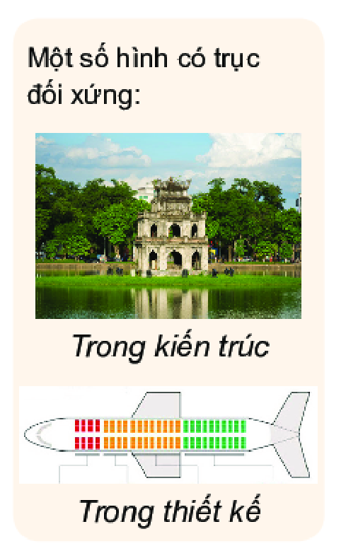

## 2. TRỤC ĐỐI XỨNG CỦA MỘT SỐ HÌNH PHẲNG
<!-- ocr-ok: đã đối chiếu ảnh trang PDF 108, chữ in hoa màu trắng trên băng màu xanh OCR đọc thiếu dấu -->

**HĐ4:** Dựa vào HĐ2, em hãy cho biết trục đối xứng của hình tròn là đường thẳng nào?

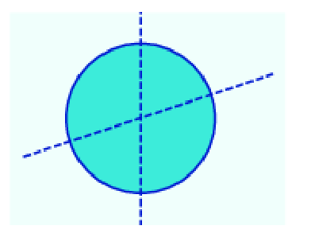

**HĐ5:** Cắt một hình thoi bằng giấy. Hãy tìm trục đối xứng của nó bằng cách gấp giấy. Trục đối xứng của nó là đường thẳng nào? Em tìm được mấy trục đối xứng?

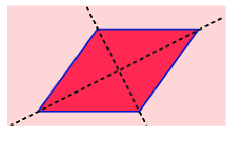

**HĐ6:** Vẽ rồi cắt một hình chữ nhật bằng giấy. Hãy tìm trục đối xứng của nó bằng cách gấp giấy. Trục đối xứng của nó là đường thẳng nào? Em tìm được mấy trục đối xứng?

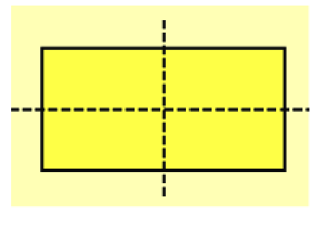

<!-- pdf:109 -->

<!-- term: Trục đối xứng của hình tròn -->
<!-- term: Trục đối xứng của hình thoi -->
<!-- term: Trục đối xứng của hình chữ nhật -->
> **Nhận xét:**
> - Mỗi đường thẳng đi qua tâm là một trục đối xứng của hình tròn.
> - Mỗi đường chéo là một trục đối xứng của hình thoi.
> - Mỗi đường thẳng đi qua trung điểm hai cạnh đối diện là một trục đối xứng của hình chữ nhật.

- **Pi:** Mỗi hình có thể có nhiều trục đối xứng.
<!-- ocr-ok: đã đối chiếu ảnh trang PDF 109, bóng thoại nhân vật Pi -->

**Thực hành 1:**

1. Bằng cách gấp giấy, em hãy tìm một trục đối xứng của đoạn thẳng.
2. Làm tương tự như hoạt động 6 với tam giác đều, hình vuông, lục giác đều. Em hãy chỉ ra một trục đối xứng của mỗi hình trên.

**Tranh luận 1:**

- **Tròn:** Này Vuông, tớ nghĩ cậu có hai trục đối xứng.
- **Vuông:** Tớ lại nghĩ tớ có vô số trục đối xứng cơ!
- **Tròn:** Hình Tròn là tớ đây mới có vô số trục đối xứng!
- **Vuông:** Các bạn ơi, giúp tớ với!

> - Hình vuông có bao nhiêu trục đối xứng?
> - Hình tròn có bao nhiêu trục đối xứng?

**Ứng dụng tính đối xứng để cắt chữ bằng giấy**

Để cắt một chữ cái có trục đối xứng, ta có thể gấp đôi tờ giấy theo trục đối xứng ấy để cắt. Khi đó ta chỉ phải cắt một nửa con chữ và nhận được cả con chữ khi mở giấy ra. Để làm mẫu, em hãy cắt chữ A theo hướng dẫn sau (h.5.4):

1. Chuẩn bị một mảnh giấy hình chữ nhật kích thước $3\text{ cm} \times 5\text{ cm}$. Gấp đôi mảnh giấy như hình 5.4b.
2. Vẽ theo hình 5.4c rồi cắt theo nét vẽ, sau đó mở ra ta được chữ A (h.5.4d).

<!-- pdf:110 -->

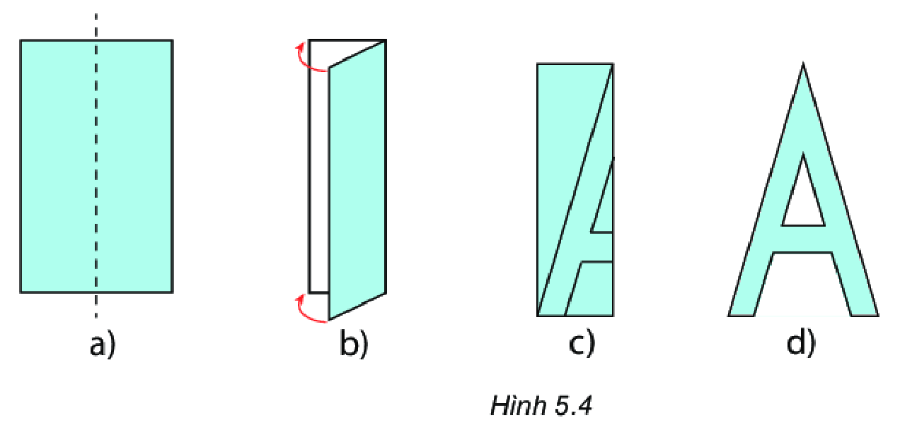
*Hình 5.4*

**Thực hành 2:**

Bằng cách tương tự, hãy cắt chữ E, T.

**Tranh luận 2:**

- **Tròn:** Tớ đang gấp giấy để cắt chữ. Hãy đoán xem tớ được chữ gì sau khi mở những mảnh giấy (h.5.5) ra nhé!

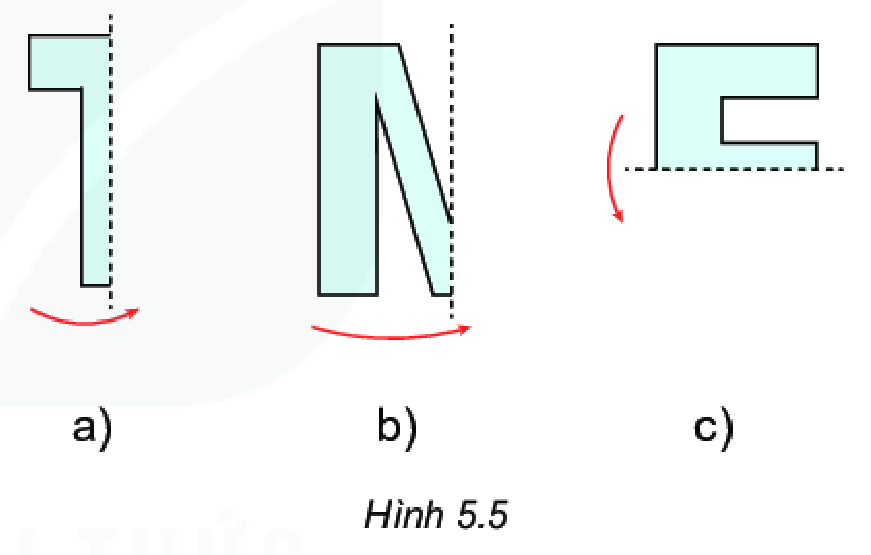
*Hình 5.5*

**Thử thách nhỏ:**

Tính đối xứng là một yếu tố tạo nên sự cân đối, hài hoà của các hình. Tuy nhiên, không phải lúc nào ta cũng có thể gấp hình để biết hình có trục đối xứng hay không. Em hãy quan sát và vẽ phác trục đối xứng của hình Tháp Chàm và ngôi sao sáu cánh dưới đây (nếu có).

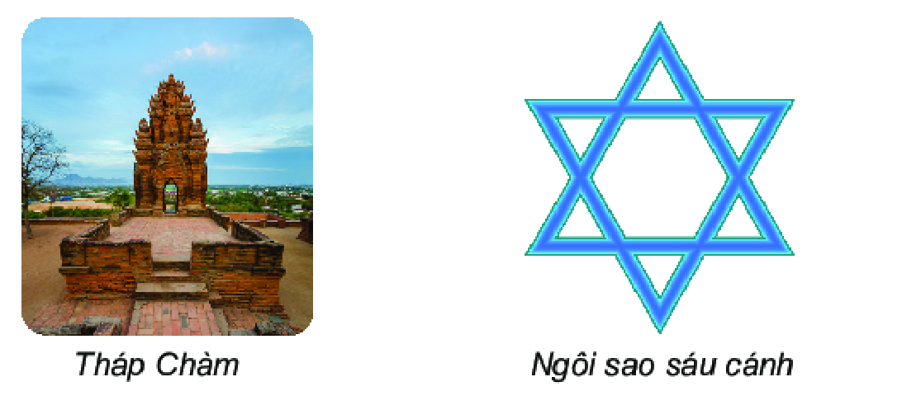
*Tháp Chàm — Ngôi sao sáu cánh*

> Những công trình kiến trúc có tính đối xứng thì không những đẹp mà còn chắc chắn, bền vững.

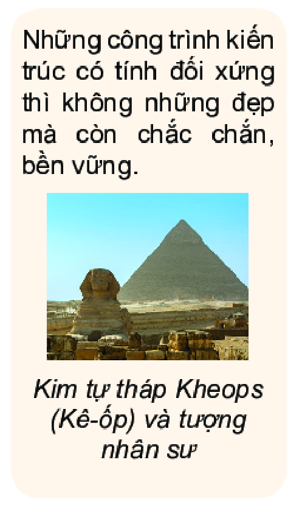
*Kim tự tháp Kheops (Kê-ốp) và tượng nhân sư*

<!-- pdf:111 -->

## BÀI TẬP

5.1. Hãy chỉ ra trục đối xứng của hình thang cân.

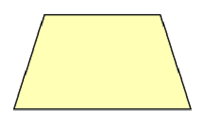

5.2. Hình lục giác đều có bao nhiêu trục đối xứng?

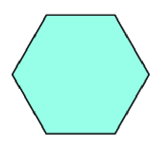

5.3. Trong các hình dưới đây, hình nào có trục đối xứng?

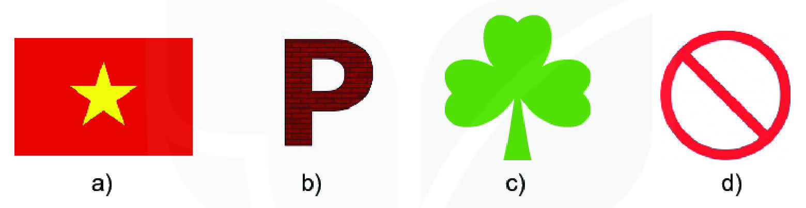

5.4. Quan sát những hình dưới đây và cho biết:

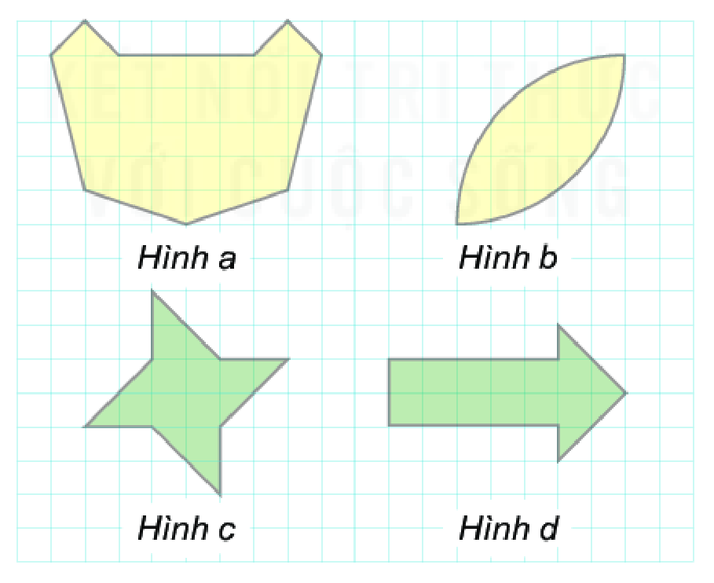

a) Hình nào không có trục đối xứng?

b) Hình nào chỉ có một trục đối xứng?

c) Hình nào có ít nhất hai trục đối xứng?

## 📷 Danh sách hình trong bài

| Mã hình | Trang PDF | Vị trí trong bài | Chú thích gốc |
| --- | :---: | --- | --- |
| H6-toan-b21-01 | 107 | Mở đầu | Khuê Văn Các — Tháp Eiffel — Mặt hồ |
| H6-toan-b21-02 | 107 | Mục 1, HĐ1 | (sách không đánh số, hai hình ảnh con bướm) |
| H6-toan-b21-03 | 107 | Mục 1, HĐ2 | Hình 5.1 |
| H6-toan-b21-04 | 107 | Mục 1, HĐ3 | Hình 5.2 |
| H6-toan-b21-05 | 108 | Mục 1, khung kiến thức | Hình 5.3 |
| H6-toan-b21-06 | 108 | Mục 1, Luyện tập câu 1 | (sách không đánh số, các chữ cái A, B, G, H, E, F) |
| H6-toan-b21-07 | 108 | Mục 1, Luyện tập câu 2 | (sách không đánh số, bốn biển báo a, b, c, d) |
| H6-toan-b21-08 | 108 | Mục 1, hộp thông tin | Một số hình có trục đối xứng: Trong kiến trúc — Trong thiết kế |
| H6-toan-b21-09 | 108 | Mục 2, HĐ4 | (sách không đánh số, hình tròn và các trục đối xứng) |
| H6-toan-b21-10 | 108 | Mục 2, HĐ5 | (sách không đánh số, hình thoi và hai trục đối xứng) |
| H6-toan-b21-11 | 108 | Mục 2, HĐ6 | (sách không đánh số, hình chữ nhật và hai trục đối xứng) |
| H6-toan-b21-12 | 110 | Mục 2, cắt chữ bằng giấy | Hình 5.4 |
| H6-toan-b21-13 | 110 | Mục 2, Tranh luận 2 | Hình 5.5 |
| H6-toan-b21-14 | 110 | Mục 2, Thử thách nhỏ | Tháp Chàm — Ngôi sao sáu cánh |
| H6-toan-b21-15 | 110 | Mục 2, hộp thông tin | Kim tự tháp Kheops (Kê-ốp) và tượng nhân sư |
| H6-toan-b21-16 | 111 | Bài tập 5.1 | (sách không đánh số, hình thang cân) |
| H6-toan-b21-17 | 111 | Bài tập 5.2 | (sách không đánh số, hình lục giác đều) |
| H6-toan-b21-18 | 111 | Bài tập 5.3 | (sách không đánh số, các hình a, b, c, d) |
| H6-toan-b21-19 | 111 | Bài tập 5.4 | Hình a — Hình b — Hình c — Hình d |
