<!-- pdf:112 -->

# BÀI 22: HÌNH CÓ TÂM ĐỐI XỨNG

## 🔤 Khái niệm, thuật ngữ

- Hình có tâm đối xứng
- Tâm đối xứng

## 🎯 Kiến thức, kĩ năng

- Nhận biết hình có tâm đối xứng.
- Nhận biết tâm đối xứng của một số hình đơn giản.
- Gấp giấy để cắt được một số hoa văn trang trí hoặc một số hình có tâm đối xứng đơn giản.

## 🔴 Mở đầu

Quan sát những hình ảnh trong thiên nhiên và cuộc sống dưới đây.

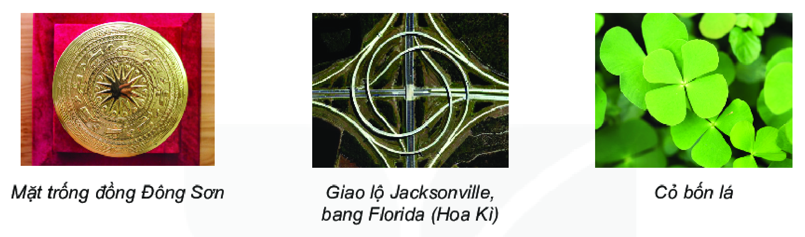
*Mặt trống đồng Đông Sơn — Giao lộ Jacksonville, bang Florida (Hoa Kì) — Cỏ bốn lá*

Những hình ảnh này, dù có hay không có trục đối xứng, ta vẫn cảm nhận được sự cân đối, hài hoà của chúng. Chúng ta sẽ cùng tìm hiểu xem điều gì đã mang lại sự cân đối, hài hoà đó.

## 1. HÌNH CÓ TÂM ĐỐI XỨNG TRONG THỰC TẾ
<!-- ocr-ok: đã đối chiếu ảnh trang PDF 112, chữ in hoa màu trắng trên băng màu xanh OCR đọc thiếu dấu -->

**Quay nửa vòng quanh một điểm**

**HĐ1:** Đặt chiếc chong chóng màu đỏ có hai cánh trên mặt giấy. Dùng bút màu xanh tô theo viền của chong chóng để đánh dấu vị trí ban đầu của nó và ghim chong chóng tại điểm $O$ (màu vàng). Quan sát chong chóng quay xung quanh điểm $O$ như dưới đây (h.5.6).

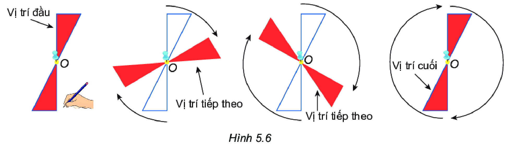
*Hình 5.6*

Sau khi quay đúng một nửa vòng, chong chóng lại khớp với viền màu xanh đã đánh dấu. Ta nói chong chóng này sau khi quay nửa vòng “chồng khít” với chính nó ở vị trí trước khi quay (h.5.6).

<!-- pdf:113 -->

**HĐ2:** Tương tự như vậy, ta quan sát hình tròn (h.5.7a), hình chong chóng ba cánh (h.5.7b) và hình chong chóng bốn cánh (h.5.7c) lúc đầu và sau khi quay nửa vòng quanh điểm $O$ như dưới đây.

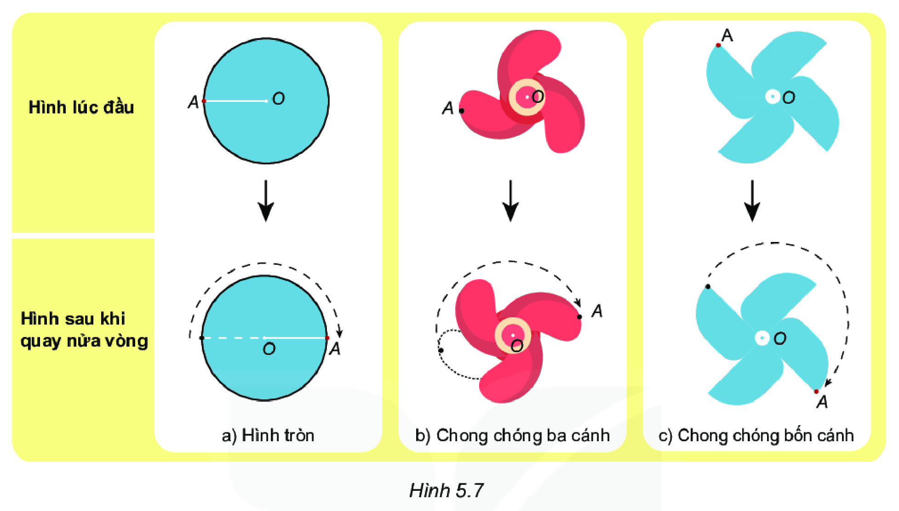
*Hình 5.7*

Trong ba hình trên, sau khi quay nửa vòng quanh điểm $O$, hình nào “chồng khít” với chính nó ở vị trí trước khi quay.

<!-- term: Tâm đối xứng của hình tròn -->
> - Hình tròn, chong chóng hai cánh, chong chóng bốn cánh như nói ở trên đều có chung đặc điểm: *Mỗi hình có một điểm $O$, mà khi quay hình đó xung quanh điểm $O$ đúng một nửa vòng thì hình thu được “chồng khít” với chính nó ở vị trí ban đầu (trước khi quay).*
> - Những hình như thế được gọi là **hình có tâm đối xứng** và điểm $O$ được gọi là **tâm đối xứng** của hình.

**Luyện tập 1:**

1. Đoạn thẳng là một hình có tâm đối xứng. Tâm đối xứng của nó là điểm nào?
2. Những chữ cái nào dưới đây có tâm đối xứng? Hãy dự đoán tâm đối xứng của chúng, rồi kiểm tra điều đó bằng cách quay hình nửa vòng.

<!-- pdf:114 -->

3. Những hình nào dưới đây có tâm đối xứng?

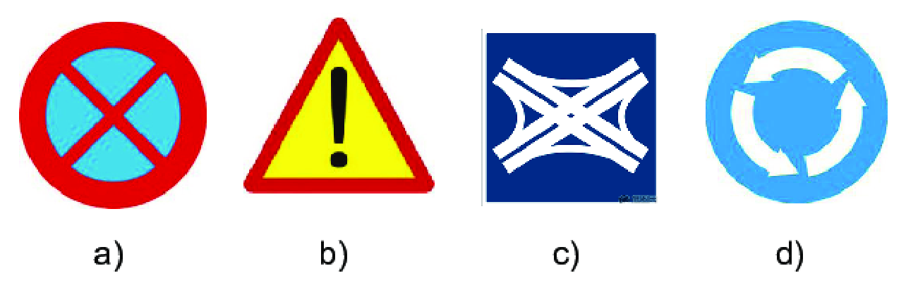

> Một số hình có tâm đối xứng:
> - *Trong kiến trúc*
> - *Trong hội họa*

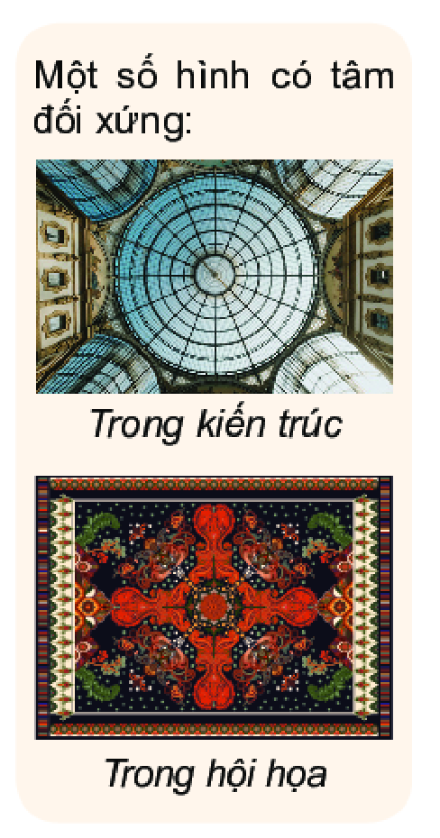

**Thực hành 1:**

Gấp đôi tờ giấy hai lần theo hình 5.8a. Cắt tờ giấy vừa gấp theo một đường như hình 5.8b. Mở phần cắt được ra ta có một hình bông hoa bốn cánh (h.5.8c).

Gọi giao điểm của hai nếp gấp là $O$. Cố định điểm $O$ bằng đinh ghim để có thể quay hình đó quanh $O$.

Bằng cách quay hình nửa vòng quanh $O$, em hãy kiểm tra xem điểm $O$ có phải là tâm đối xứng của hình không.

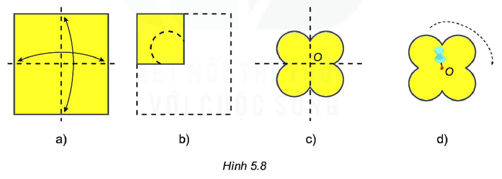
*Hình 5.8*

## 2. TÂM ĐỐI XỨNG CỦA MỘT SỐ HÌNH PHẲNG
<!-- ocr-ok: đã đối chiếu ảnh trang PDF 114, chữ in hoa màu trắng trên băng màu xanh OCR đọc thiếu dấu -->

**HĐ3:** Cắt một hình bình hành bằng giấy. Bằng cách quay hình bình hành một nửa vòng quanh giao điểm của hai đường chéo, hãy cho biết giao điểm này có là tâm đối xứng của hình bình hành không?

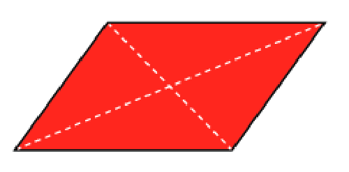

**HĐ4:** Bằng cách làm tương tự hoạt động 3, em hãy chỉ ra tâm đối xứng của mỗi hình dưới đây (nếu có).

<!-- pdf:115 -->

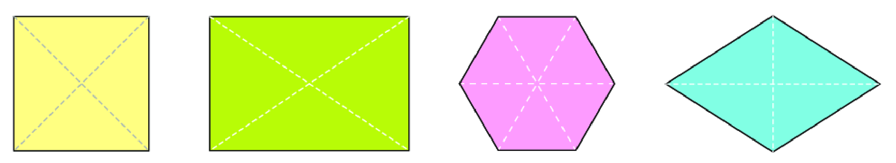

<!-- term: Tâm đối xứng của hình bình hành -->
<!-- term: Tâm đối xứng của hình thoi -->
<!-- term: Tâm đối xứng của hình vuông -->
<!-- term: Tâm đối xứng của hình chữ nhật -->
<!-- term: Tâm đối xứng của hình lục giác đều -->
> **Nhận xét:**
> - Tâm đối xứng của hình bình hành, hình thoi, hình vuông, hình chữ nhật là giao điểm của hai đường chéo.
> - Tâm đối xứng của hình lục giác đều là giao điểm của các đường chéo chính.

**Luyện tập 2:**

Vẽ lại các hình bên vào giấy kẻ ô vuông rồi vẽ thêm để được một hình nhận điểm $O$ là tâm đối xứng.

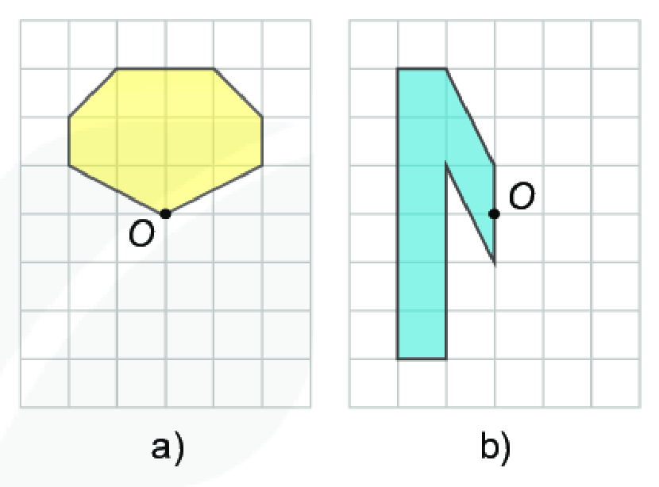

**Thực hành 2:**

**Ứng dụng tính đối xứng trong nghệ thuật cắt giấy**

Cắt hình cỏ bốn lá theo hướng dẫn sau:

1. Chuẩn bị một mảnh giấy hình vuông kích thước $4\text{ cm} \times 4\text{ cm}$. Gấp đôi mảnh giấy hai lần sao cho các cạnh đối diện của nó trùng lên nhau (h.5.9a).
2. Vẽ theo hình 5.9b rồi cắt theo nét vẽ, sau đó mở ra ta được hình cỏ bốn lá (h.5.9c).

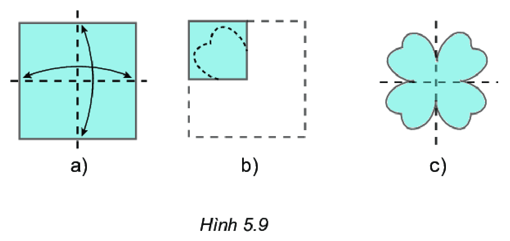
*Hình 5.9*

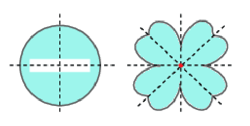

- **Pi:** Có những hình có tâm đối xứng và có nhiều trục đối xứng.
- **Pi:** Cũng có hình không có tâm đối xứng như tam giác đều,...

<!-- pdf:116 -->

**Thử thách nhỏ:**

Em hãy dự đoán tâm đối xứng của các hình sau:

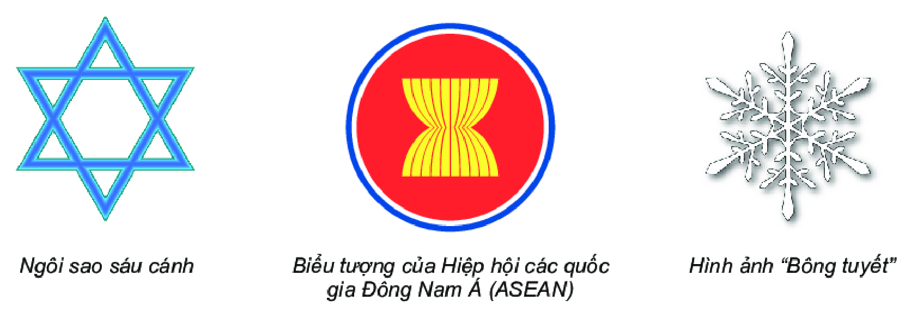
*Ngôi sao sáu cánh — Biểu tượng của Hiệp hội các quốc gia Đông Nam Á (ASEAN) — Hình ảnh “Bông tuyết”*

## BÀI TẬP

5.5. Trong các hình dưới đây, hình nào có tâm đối xứng?

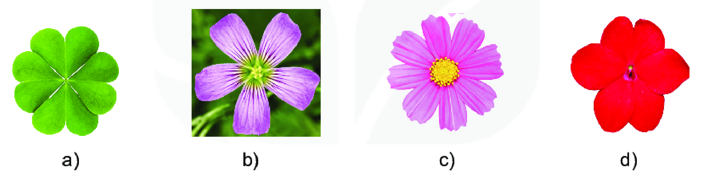

5.6. Trong mỗi hình dưới đây, điểm $O$ có phải tâm đối xứng không?

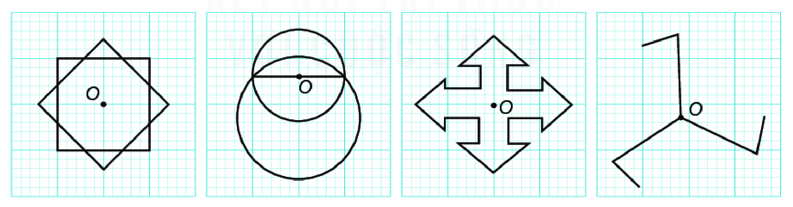

5.7. Hình nào dưới đây có tâm đối xứng? Em hãy xác định tâm đối xứng (nếu có) của chúng.

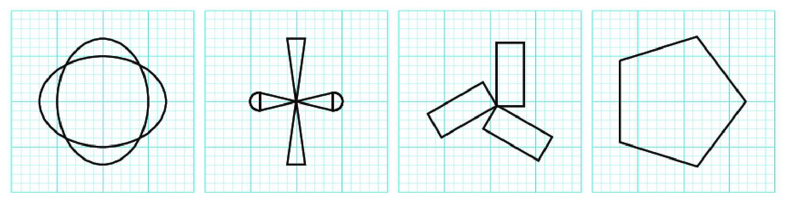

<!-- pdf:117 -->

5.8. Em hãy trình bày các bước gấp và cắt giấy như trong Thực hành (cắt hình cỏ bốn lá) ở mục 2 để gấp và cắt hình sau.

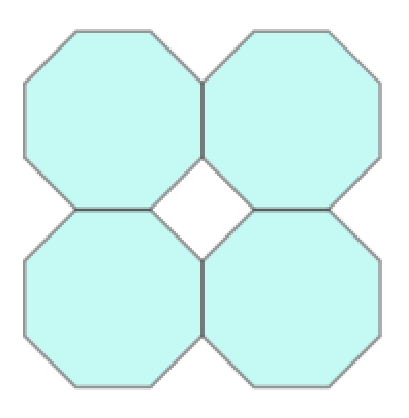

5.9. Vẽ lại các hình sau vào giấy kẻ ô vuông rồi vẽ thêm để được một hình nhận điểm $O$ là tâm đối xứng.

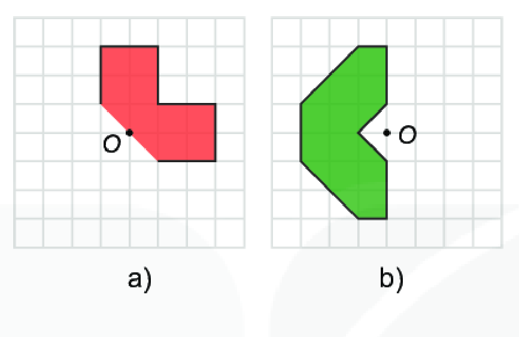

5.10. An gấp những mảnh giấy kích thước $3\text{ cm} \times 5\text{ cm}$ lần lượt theo chiều ngang và chiều dọc rồi cắt như những hình bên. Theo em, khi mở những mảnh giấy này, An sẽ nhận được chữ gì?

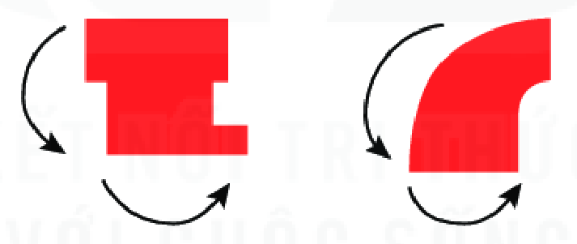

## 📷 Danh sách hình trong bài

| Mã hình | Trang PDF | Vị trí trong bài | Chú thích gốc |
| --- | :---: | --- | --- |
| H6-toan-b22-01 | 112 | Mở đầu | Mặt trống đồng Đông Sơn — Giao lộ Jacksonville, bang Florida (Hoa Kì) — Cỏ bốn lá |
| H6-toan-b22-02 | 112 | Mục 1, HĐ1 | Hình 5.6 |
| H6-toan-b22-03 | 113 | Mục 1, HĐ2 | Hình 5.7 |
| H6-toan-b22-04 | 113 | Mục 1, Luyện tập 1 câu 2 | (sách không đánh số, các chữ cái H, K, M, N, X) |
| H6-toan-b22-05 | 114 | Mục 1, Luyện tập 1 câu 3 | (sách không đánh số, bốn biển báo a, b, c, d) |
| H6-toan-b22-06 | 114 | Mục 1, hộp thông tin | Một số hình có tâm đối xứng: Trong kiến trúc — Trong hội họa |
| H6-toan-b22-07 | 114 | Mục 1, Thực hành 1 | Hình 5.8 |
| H6-toan-b22-08 | 114 | Mục 2, HĐ3 | (sách không đánh số, hình bình hành và hai đường chéo) |
| H6-toan-b22-09 | 115 | Mục 2, HĐ4 | (sách không đánh số, hình vuông, hình chữ nhật, hình lục giác đều, hình thoi) |
| H6-toan-b22-10 | 115 | Mục 2, Luyện tập 2 | (sách không đánh số, hai hình a, b trên lưới ô vuông) |
| H6-toan-b22-11 | 115 | Mục 2, Thực hành 2 | Hình 5.9 |
| H6-toan-b22-12 | 115 | Mục 2, bóng thoại của Pi | (sách không đánh số, hình tròn và hình bông hoa bốn cánh có tâm đối xứng và nhiều trục đối xứng) |
| H6-toan-b22-13 | 116 | Mục 2, Thử thách nhỏ | Ngôi sao sáu cánh — Biểu tượng của Hiệp hội các quốc gia Đông Nam Á (ASEAN) — Hình ảnh “Bông tuyết” |
| H6-toan-b22-14 | 116 | Bài tập 5.5 | (sách không đánh số, bốn bông hoa/lá a, b, c, d) |
| H6-toan-b22-15 | 116 | Bài tập 5.6 | (sách không đánh số, bốn hình có điểm $O$ trên lưới ô vuông) |
| H6-toan-b22-16 | 116 | Bài tập 5.7 | (sách không đánh số, bốn hình trên lưới ô vuông) |
| H6-toan-b22-17 | 117 | Bài tập 5.8 | (sách không đánh số, hình bốn bát giác ghép nhau) |
| H6-toan-b22-18 | 117 | Bài tập 5.9 | (sách không đánh số, hai hình a, b trên lưới ô vuông) |
| H6-toan-b22-19 | 117 | Bài tập 5.10 | (sách không đánh số, hai mảnh giấy gấp màu đỏ) |
