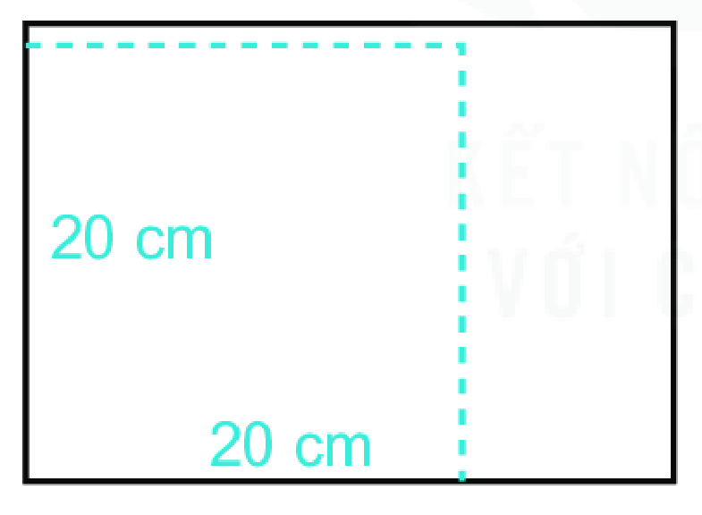
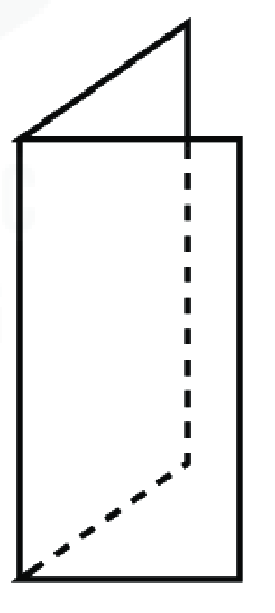
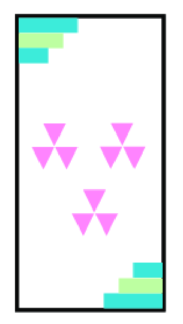
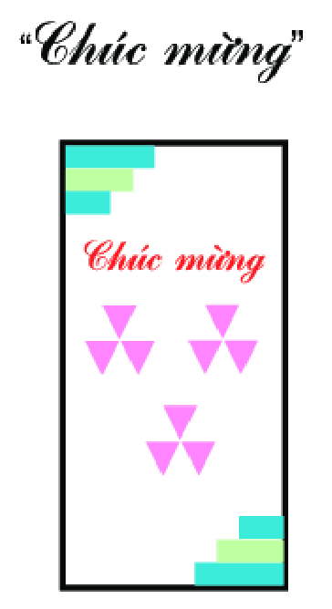

<!-- pdf:123 -->

<!-- Trang mở đầu chuyên mục (PDF 122): HOẠT ĐỘNG THỰC HÀNH TRẢI NGHIỆM — Các em hãy thực hiện các hoạt động thực hành trải nghiệm để biết sử dụng phần mềm GeoGebra trong vẽ hình, sử dụng máy tính cầm tay để tính toán và ứng dụng các kiến thức đã học vào đời sống thực tế như thế nào nhé (Tấm thiệp và phòng học của em; Vẽ hình đơn giản với phần mềm GeoGebra; Sử dụng máy tính cầm tay). -->

# TẤM THIỆP VÀ PHÒNG HỌC CỦA EM

## 🎯 Mục tiêu

Ứng dụng các kiến thức đã học về các hình phẳng trong thực tiễn vào giải quyết một số tình huống trong cuộc sống như mĩ thuật, thủ công, xác định phòng học đạt mức chuẩn về ánh sáng,...

## HOẠT ĐỘNG 1 TẤM THIỆP CỦA EM
<!-- ocr-ok: đã đối chiếu ảnh trang PDF 123, tiêu đề phông trang trí màu xanh OCR đọc thiếu dấu -->

**Chuẩn bị**

- Một tờ bìa A4 ($21\text{ cm} \times 29,7\text{ cm}$), màu tuỳ ý.
- Giấy màu các loại.
- Kéo, hồ dán hoặc băng dính hai mặt.
- Thước thẳng, bút chì, compa, bút màu hoặc sáp màu.
- Địa điểm thực hiện:
  - Ở lớp học
  - Ở nhà

**Gợi ý**

Bước 1. Vẽ rồi cắt một hình vuông có cạnh $20\text{ cm}$ từ tờ bìa A4.

Bước 2. Gấp đôi hình vuông (vừa cắt) thành hai hình chữ nhật chồng khít lên nhau.

Bước 3. Vẽ và cắt các hình sau từ giấy màu:

- $02$ hình chữ nhật kích thước $1\text{ cm} \times 4\text{ cm}$.
- $02$ hình chữ nhật kích thước $1\text{ cm} \times 3\text{ cm}$.
- $02$ hình chữ nhật kích thước $1\text{ cm} \times 2\text{ cm}$.
- $09$ tam giác đều cạnh $1,5\text{ cm}$.

<!-- pdf:124 -->

Bước 4. Dán các hình vừa cắt vào mặt trước của tờ bìa gấp đôi (ở bước 2) theo mẫu dưới đây:

Bước 5. Viết chữ “*Chúc mừng*”

Bước 6. Ghi nội dung chúc mừng phù hợp vào mặt trong của thiệp.

## HOẠT ĐỘNG 2 KIỂM TRA PHÒNG HỌC ĐẠT MỨC CHUẨN VỀ ÁNH SÁNG
<!-- ocr-ok: đã đối chiếu ảnh trang PDF 124, tiêu đề phông trang trí màu xanh OCR đọc thiếu dấu -->

**Chuẩn bị**

- Thước dây.
- Giấy, bút.
- Máy tính bỏ túi.
- Địa điểm thực hiện: ở lớp.
- Chia thành các nhóm, mỗi nhóm từ $6$ đến $8$ học sinh.

**Gợi ý**

<!-- term: Chỉ số mức ánh sáng của phòng học -->
- Thực hiện đo và tính diện tích nền của phòng học ($S_1$).
- Đo và tính tổng diện tích các cửa gồm cửa ra vào, cửa sổ ($S_2$).
- Áp dụng công thức tính chỉ số mức ánh sáng của phòng học: $A = \frac{S_2}{S_1} \cdot 100$.
- So sánh chỉ số $A$ với $20$ để kết luận việc đạt mức chuẩn về ánh sáng của phòng học:
  - Nếu $A < 20$ thì phòng học không đủ ánh sáng (không đạt mức chuẩn về ánh sáng).
  - Nếu $A \ge 20$ thì phòng học đủ ánh sáng.

> ❓ Lớp học của em có đạt mức chuẩn về ánh sáng không?

- **Tròn:** Một gian phòng đạt mức chuẩn về ánh sáng nếu diện tích các cửa không nhỏ hơn $20\%$ diện tích nền nhà.

## 📷 Danh sách hình trong bài

| Mã hình | Trang PDF | Vị trí trong bài | Chú thích gốc |
| --- | :---: | --- | --- |
| H6-toan-hd-thtn-01-01 | 123 | Hoạt động 1, Bước 1 | (sách không đánh số, vẽ hình vuông cạnh $20\text{ cm}$ từ tờ bìa A4) |
| H6-toan-hd-thtn-01-02 | 123 | Hoạt động 1, Bước 2 | (sách không đánh số, gấp đôi hình vuông) |
| H6-toan-hd-thtn-01-03 | 124 | Hoạt động 1, Bước 4 | (sách không đánh số, mẫu dán các hình trang trí lên mặt trước tấm thiệp) |
| H6-toan-hd-thtn-01-04 | 124 | Hoạt động 1, Bước 5 | “Chúc mừng” |
