<!-- pdf:125 -->

# VẼ HÌNH ĐƠN GIẢN VỚI PHẦN MỀM GEOGEBRA

## 🎯 Mục tiêu

<!-- term: Phần mềm GeoGebra -->
Sử dụng phần mềm GeoGebra để vẽ các hình đơn giản như điểm, đoạn thẳng, góc,... đến các hình đẹp như tam giác đều, hình chữ nhật, hình vuông, hình tròn,... và đặc biệt là các hình có tính chất đối xứng.

<!-- term: Phần mềm GeoGebra -->
Khởi động phần mềm GeoGebra và trên giao diện của phần mềm GeoGebra với các bảng chọn, công cụ Tiếng Việt như sau:

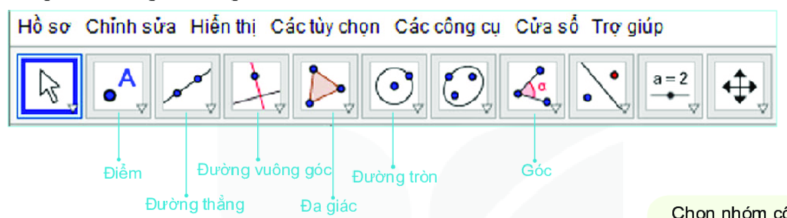

- **Pi:** Chọn nhóm công cụ là nháy chuột lên biểu tượng nhóm công cụ.

## HOẠT ĐỘNG 1 VẼ ĐIỂM
<!-- ocr-ok: đã đối chiếu ảnh trang PDF 125, tiêu đề phông trang trí màu xanh OCR đọc thiếu dấu -->

**Thao tác:** Chọn nhóm công cụ Điểm $\rightarrow$ Chọn Điểm mới (h.T.1a) $\rightarrow$ Nháy chuột lên vị trí bất kì Vùng làm việc của GeoGebra để tạo điểm mới (điểm $A$).

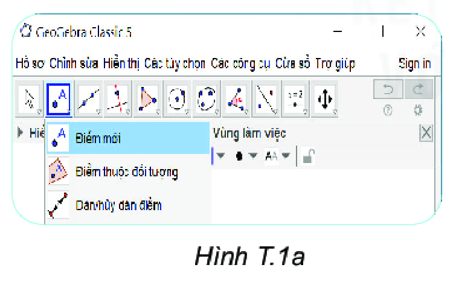
*Hình T.1a*

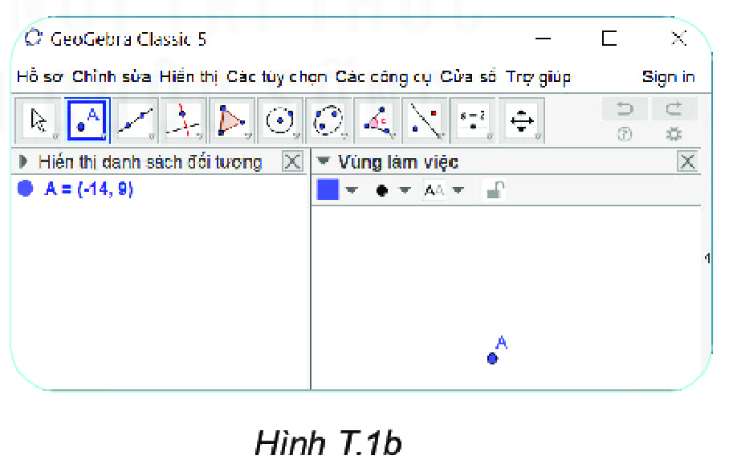
*Hình T.1b*

## HOẠT ĐỘNG 2 VẼ ĐOẠN THẲNG

**Thao tác:** Chọn nhóm công cụ Đường thẳng $\rightarrow$ Chọn Đoạn thẳng $\rightarrow$ Nháy chuột chọn điểm thứ nhất (điểm $A$) $\rightarrow$ Nháy chuột chọn điểm thứ hai (điểm $B$). Ta được đoạn thẳng $AB$.

- **Tròn:** Hai điểm $A$ và $B$ có thể là điểm mới hoặc điểm có sẵn.

<!-- pdf:126 -->

## HOẠT ĐỘNG 3 VẼ GÓC $60^\circ$

**Thao tác:** Chọn nhóm công cụ Góc và khoảng cách $\rightarrow$ Chọn Góc với độ lớn cho trước $\rightarrow$ Nháy chuột chọn điểm thuộc một cạnh ($B$) $\rightarrow$ Nháy chuột chọn điểm gốc ($A$) $\rightarrow$ Nhập số đo góc ($60$).

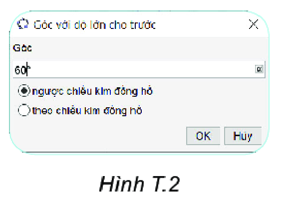
*Hình T.2*

Phần mềm tự vẽ thêm điểm $B'$. Nối $A$ với $B$, $A$ với $B'$, ta được góc $BAB'$ bằng $60^\circ$.
<!-- ocr-ok: đã đối chiếu ảnh trang PDF 126, nhiều kí hiệu toán học LaTeX -->

## HOẠT ĐỘNG 4 VẼ ĐƯỜNG TRÒN

**Thao tác:** Chọn Đường tròn $\rightarrow$ Chọn Đường tròn khi biết tâm và 1 điểm trên đường tròn $\rightarrow$ Nháy chuột chọn điểm là tâm đường tròn (điểm $A$) $\rightarrow$ Nháy chuột chọn điểm nằm trên đường tròn (điểm $B$). Ta được đường tròn tâm $A$ và đi qua $B$.

## HOẠT ĐỘNG 5 VẼ TAM GIÁC ĐỀU

**Thao tác:** Vẽ tam giác đều bằng cách vẽ góc $60^\circ$:

Bước 1. Dùng nhóm công cụ Góc và khoảng cách vẽ góc có số đo $60^\circ$.
<!-- ocr-ok: đã đối chiếu ảnh trang PDF 126, chữ màu xanh xen biểu tượng nút công cụ -->

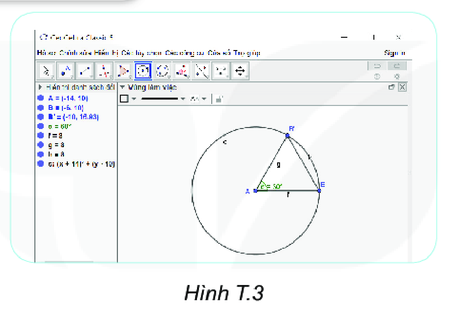
*Hình T.3*

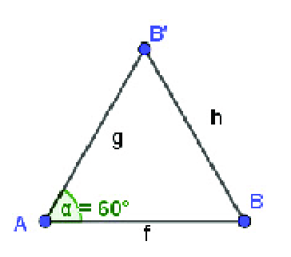

> ❓ Tam giác $ABB'$ có phải tam giác đều không?

Bước 2. Dùng công cụ Đoạn thẳng nối các điểm của góc để tạo thành tam giác. Ta được tam giác $ABB'$.

**Chú ý:** Nếu có sẵn góc $BAB'$ bằng $60^\circ$ và đường tròn như kết quả của hoạt động 3 và hoạt động 4 trên Vùng làm việc thì dùng công cụ Đoạn thẳng để vẽ các đoạn thẳng $AB'$ và $BB'$, ta có tam giác đều $ABB'$ như hình T.3.

## HOẠT ĐỘNG 6 VẼ LỤC GIÁC ĐỀU

**Chuẩn bị:** Có kết quả như sau hoạt động 5.

**Thao tác:** Dùng cách vẽ góc $60^\circ$ ở hoạt động 3 và cách vẽ đoạn thẳng ở hoạt động 2 để vẽ tiếp được hình kết quả như hình T.4. Ẩn các đoạn thẳng $AB$, $AB'$ và điểm $A$ ta nhận được lục giác như hình T.5.

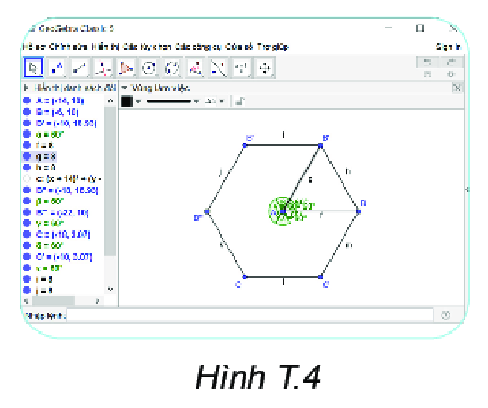
*Hình T.4*

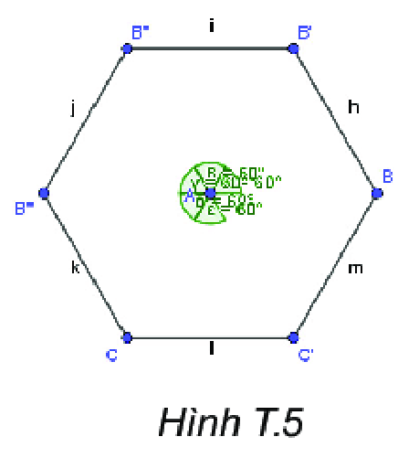
*Hình T.5*

> ❓ Hình lục giác ở hình T.5 có là lục giác đều không?

<!-- pdf:127 -->

**Lưu ý:** Có thể vẽ tam giác đều và lục giác đều rất nhanh như sau:

Chọn nhóm công cụ Đa giác $\rightarrow$ Chọn Đa giác đều $\rightarrow$ Chọn hai điểm $\rightarrow$ Nhập số đỉnh.

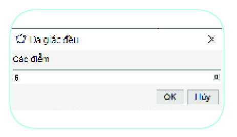

## HOẠT ĐỘNG 7 VẼ HÌNH BÌNH HÀNH

**Thao tác**

Bước 1. Vẽ hai đoạn thẳng $AB$, $BC$.
<!-- ocr-ok: đã đối chiếu ảnh trang PDF 127, kí hiệu đoạn thẳng LaTeX -->

Bước 2. Vẽ đường thẳng đi qua $C$ và song song với $AB$ như sau:

Chọn nhóm công cụ Hai đường thẳng $\rightarrow$ Chọn Đường song song $\rightarrow$ Chọn điểm đi qua $C$ $\rightarrow$ Chọn đường thẳng song song $AB$.

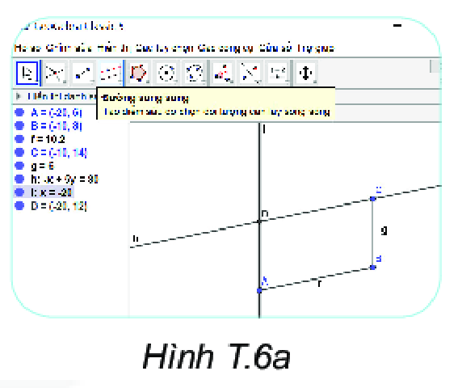
*Hình T.6a*

Bước 3. Vẽ đường thẳng đi qua $A$ và song song với $BC$ tương tự bước 2.

Bước 4. Vẽ điểm $D$ như sau:
<!-- ocr-ok: đã đối chiếu ảnh trang PDF 127, câu ngắn có kí hiệu LaTeX -->

Chọn công cụ Điểm $\rightarrow$ Chọn Giao điểm của 2 đối tượng $\rightarrow$ Chọn lần lượt hai đường thẳng vừa vẽ ở bước 2 và bước 3 (h.T.6a).

Bước 5. Ẩn hai đường thẳng vừa vẽ ở bước 2 và bước 3. Dùng công cụ Đoạn thẳng vẽ các đoạn thẳng $CD$ và $AD$.

Ta được hình bình hành $ABCD$ (h.T.6b).

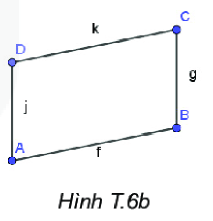
*Hình T.6b*

## HOẠT ĐỘNG 8 VẼ HÌNH THOI
<!-- ocr-ok: đã đối chiếu ảnh trang PDF 127, tiêu đề phông trang trí màu xanh -->

**Thao tác**

Bước 1. Vẽ đoạn thẳng $AB$.
<!-- ocr-ok: đã đối chiếu ảnh trang PDF 127, câu ngắn có kí hiệu LaTeX -->

Bước 2. Vẽ đường tròn $(B; BA)$ tâm $B$ đi qua điểm $A$ như hoạt động 4.

Bước 3. Dùng công cụ Điểm vẽ điểm $C$ tuỳ ý nằm trên $(B; BA)$. Vẽ đoạn thẳng $BC$.
<!-- ocr-ok: đã đối chiếu ảnh trang PDF 127, nhiều kí hiệu điểm và đường tròn LaTeX -->

Bước 4. Vẽ đường thẳng qua $A$ song song với $BC$ và đường thẳng qua $C$ song song với $AB$. Xác định giao điểm $D$ của chúng.

Bước 5. Ẩn các đường thẳng và vẽ thêm đoạn thẳng nối các đỉnh $A$, $D$, $C$ ta được hình thoi (h.T.7b).

> ❓ Tứ giác $ABCD$ mới tạo ra có phải là hình thoi không?

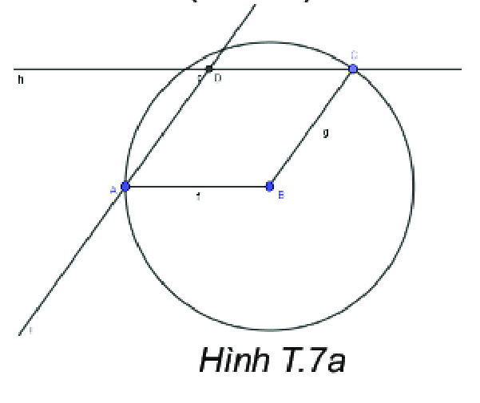
*Hình T.7a*

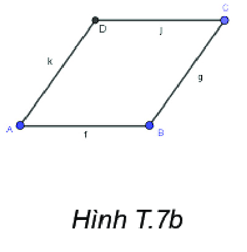
*Hình T.7b*

<!-- pdf:128 -->

## HOẠT ĐỘNG 9 VẼ HÌNH CHỮ NHẬT VÀ HÌNH VUÔNG
<!-- ocr-ok: đã đối chiếu ảnh trang PDF 128, tiêu đề phông trang trí màu xanh OCR đọc thiếu dấu -->

Tứ giác $ABCD$ ở hình T.8a là hình chữ nhật, tứ giác $ABCD$ ở hình T.8b là hình vuông.

a) Quan sát hình rồi đề xuất cách vẽ cho mỗi hình đó.

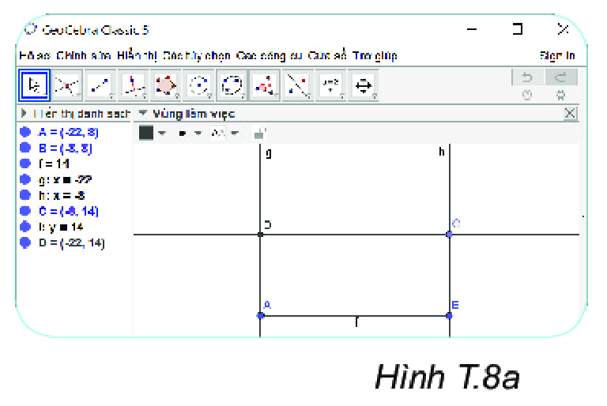
*Hình T.8a*

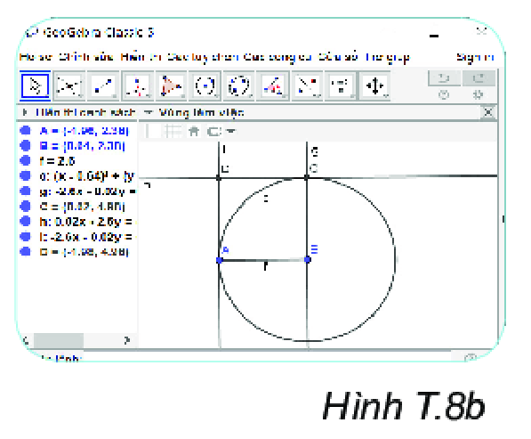
*Hình T.8b*

b) Em hãy đo góc $CDA$ và nhận xét.

> *Vẽ đường vuông góc:* Vẽ đường thẳng đi qua một điểm vuông góc với một đường thẳng: Chọn nhóm công cụ Hai đường thẳng $\rightarrow$ Chọn Đường vuông góc $\rightarrow$ Chọn điểm $\rightarrow$ Chọn đường thẳng
>
> *Đo góc:* Chọn nhóm công cụ Góc $\rightarrow$ Chọn Góc $\rightarrow$ Nháy chuột lên ba điểm theo thứ tự $C$, $D$, $A$ để đo góc $CDA$.

**MỘT SỐ TÍNH NĂNG HỖ TRỢ**
<!-- ocr-ok: đã đối chiếu ảnh trang PDF 128, tiêu đề phông trang trí màu xanh -->

**1. Hiển thị giao diện Tiếng Việt**

Mở bảng chọn Các tuỳ chọn $\rightarrow$ Ngôn Ngữ rồi chọn Tiếng Việt.
<!-- ocr-ok: đã đối chiếu ảnh trang PDF 128, chữ màu xanh và mũi tên LaTeX -->

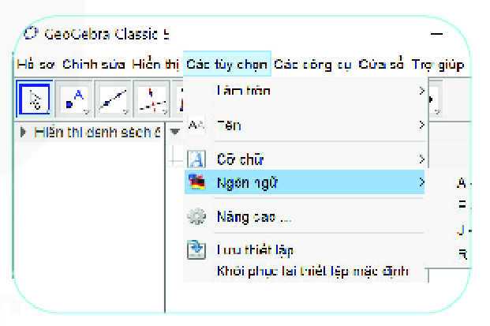

**2. Ẩn/hiện đối tượng**

Nháy nút phải chuột lên đối tượng $\rightarrow$ Chọn Hiển thị đối tượng

**Kết quả:** Đối tượng đó được ẩn (không còn hiển thị ở Vùng làm việc nữa).

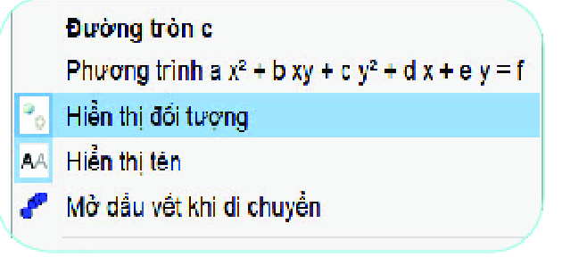

**3. Xoá đối tượng**

*Cách 1.* Nháy chọn đối tượng rồi nhấn phím Delete.

*Cách 2.* Nháy nút phải chuột lên đối tượng đó rồi chọn Xóa.

**4. Đổi tên đối tượng**
<!-- ocr-ok: đã đối chiếu ảnh trang PDF 128, tiêu đề mục ngắn -->

Nháy chọn đối tượng rồi nháy nút phải chuột và chọn Đổi tên.

**5. Ẩn/hiện hệ trục tọa độ và lưới ô vuông ở vùng làm việc**

Chọn Vùng làm việc rồi nháy chuột vào các biểu tượng tương ứng để ẩn/hiện lưới hoặc hệ trục toạ độ.

<!-- pdf:129 -->

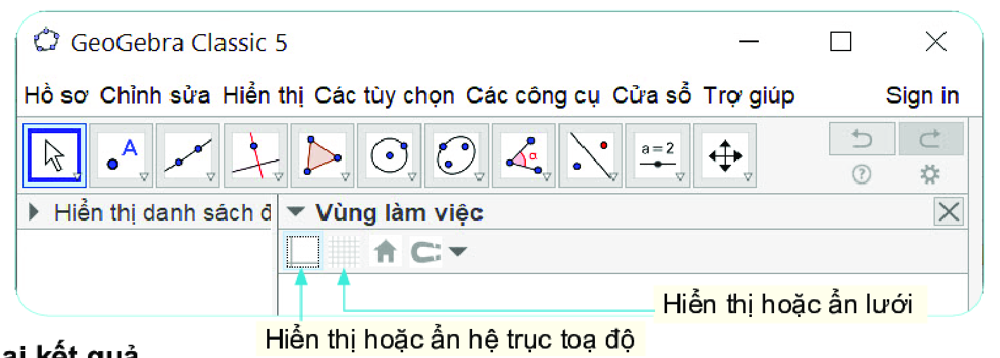

**6. Lưu lại kết quả**

- Để lưu lại hình đã vẽ thành tệp, ta làm như sau: Chọn Hồ sơ $\rightarrow$ Lưu lại $\rightarrow$ Chọn vị trí lưu tệp và đặt tên tệp. Tệp được tạo có phần mở rộng là ggb.
- Chúng ta cũng có thể xuất bản hình đã vẽ thành một tệp ảnh như sau:

Chọn Hồ sơ $\rightarrow$ Xuất bản $\rightarrow$ Hiển thị đồ thị dạng hình (png,eps)... Tệp được tạo ngầm định có phần mở rộng là png.
<!-- ocr-ok: đã đối chiếu ảnh trang PDF 129, chữ màu xanh xen mũi tên LaTeX -->

## BÀI TẬP

1. Một bạn vẽ trong GeoGebra như sau:

- Chọn nhóm công cụ Điểm $\rightarrow$ Chọn Điểm mới $\rightarrow$ Vẽ điểm $A$.
- Chọn nhóm công cụ Điểm $\rightarrow$ Chọn Điểm mới $\rightarrow$ Vẽ điểm $B$.
- Chọn nhóm công cụ Đường tròn $\rightarrow$ Chọn Đường tròn khi biết tâm và 1 điểm trên đường tròn $\rightarrow$ Chọn $A$. Chọn $B$.
- Chọn nhóm công cụ Đường tròn $\rightarrow$ Chọn Đường tròn khi biết tâm và 1 điểm trên đường tròn $\rightarrow$ Chọn $B$. Chọn $A$.
- Chọn nhóm công cụ Điểm $\rightarrow$ Chọn Giao điểm của 2 đối tượng $\rightarrow$ Nháy chuột vào đường tròn thứ nhất $\rightarrow$ Nháy chuột vào đường tròn thứ hai, ta được điểm $C$, $D$.
- Chọn nhóm công cụ Đường thẳng $\rightarrow$ Chọn Đoạn thẳng $\rightarrow$ Vẽ đoạn $AC$, $CB$, $BD$, $DA$.
- Giữ phím Ctrl $\rightarrow$ Chọn cả hai đường tròn $\rightarrow$ Nháy nút phải chuột, chọn Hiển thị đối tượng
<!-- ocr-ok: đã đối chiếu ảnh trang PDF 129, danh sách thao tác có nhiều mũi tên và kí hiệu LaTeX -->

Hỏi hình còn lại trên *Vùng làm việc* là hình gì?

2. Hãy vẽ hình sau bằng phần mềm GeoGebra.

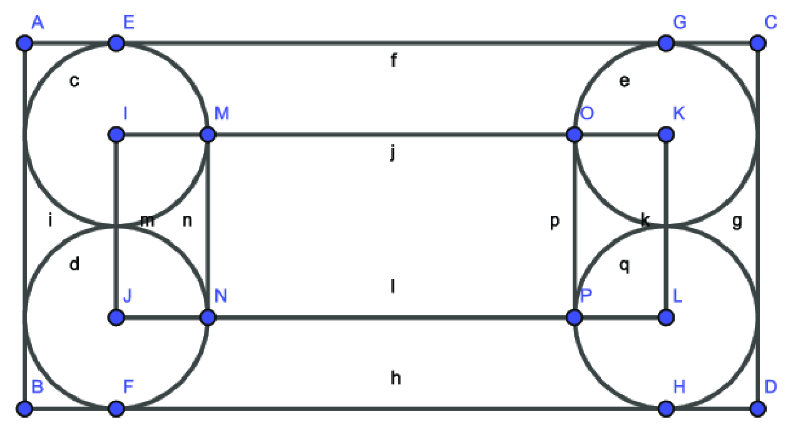

## 📷 Danh sách hình trong bài

| Mã hình | Trang PDF | Vị trí trong bài | Chú thích gốc |
| --- | :---: | --- | --- |
| H6-toan-hd-thtn-02-01 | 125 | Mở đầu | (sách không đánh số, giao diện bảng chọn và thanh công cụ Tiếng Việt của GeoGebra) |
| H6-toan-hd-thtn-02-02 | 125 | Hoạt động 1 | Hình T.1a |
| H6-toan-hd-thtn-02-03 | 125 | Hoạt động 1 | Hình T.1b |
| H6-toan-hd-thtn-02-04 | 126 | Hoạt động 3 | Hình T.2 |
| H6-toan-hd-thtn-02-05 | 126 | Hoạt động 5 | Hình T.3 |
| H6-toan-hd-thtn-02-06 | 126 | Hoạt động 5 | (sách không đánh số, tam giác $ABB'$ với góc $60^\circ$) |
| H6-toan-hd-thtn-02-07 | 126 | Hoạt động 6 | Hình T.4 |
| H6-toan-hd-thtn-02-08 | 126 | Hoạt động 6 | Hình T.5 |
| H6-toan-hd-thtn-02-09 | 127 | Lưu ý đầu trang | (sách không đánh số, hộp thoại Đa giác đều) |
| H6-toan-hd-thtn-02-10 | 127 | Hoạt động 7 | Hình T.6a |
| H6-toan-hd-thtn-02-11 | 127 | Hoạt động 7 | Hình T.6b |
| H6-toan-hd-thtn-02-12 | 127 | Hoạt động 8 | Hình T.7a |
| H6-toan-hd-thtn-02-13 | 127 | Hoạt động 8 | Hình T.7b |
| H6-toan-hd-thtn-02-14 | 128 | Hoạt động 9 | Hình T.8a |
| H6-toan-hd-thtn-02-15 | 128 | Hoạt động 9 | Hình T.8b |
| H6-toan-hd-thtn-02-16 | 128 | Một số tính năng hỗ trợ, mục 1 | (sách không đánh số, bảng chọn Ngôn ngữ Tiếng Việt) |
| H6-toan-hd-thtn-02-17 | 128 | Một số tính năng hỗ trợ, mục 2 | (sách không đánh số, bảng chọn tắt Hiển thị đối tượng) |
| H6-toan-hd-thtn-02-18 | 129 | Một số tính năng hỗ trợ, mục 5 | Hiển thị hoặc ẩn hệ trục toạ độ — Hiển thị hoặc ẩn lưới |
| H6-toan-hd-thtn-02-19 | 129 | Bài tập 2 | (sách không đánh số, hình vẽ hình chữ nhật và bốn đường tròn bằng GeoGebra) |
