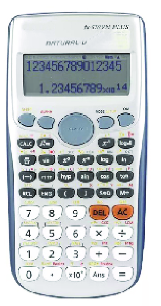
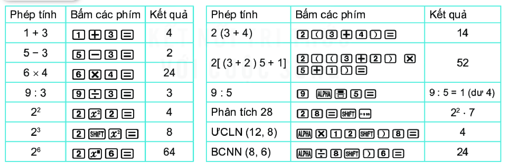

<!-- pdf:130 -->

# SỬ DỤNG MÁY TÍNH CẦM TAY

## 🎯 Mục tiêu

Sử dụng máy tính cầm tay để thực hành các phép tính đã học với số tự nhiên, số nguyên, số thập phân.

Với máy tính cầm tay ta dễ dàng thực hiện nhanh chóng, chính xác các phép tính số học cộng, trừ, nhân, chia, luỹ thừa; ta cũng có thể phân tích một số tự nhiên ra thừa số nguyên tố (do đó cũng biết được một số là nguyên tố hay hợp số), tìm ước chung lớn nhất, bội chung nhỏ nhất của hai số tự nhiên, tìm thương và dư của phép chia các số tự nhiên. Trên thị trường có nhiều loại máy tính cầm tay khác nhau, dưới đây ta tìm hiểu các tính năng nói trên của máy Casio fx-570VN PLUS, một loại máy tính cầm tay khá phổ biến ở nước ta.

## 1. MỘT SỐ PHÍM CHỨC NĂNG CHÍNH
<!-- ocr-ok: đã đối chiếu ảnh trang PDF 130, tiêu đề phông trang trí màu xanh OCR đọc thiếu dấu -->

Phím `ON` dùng để bật máy; Phím `SHIFT` `AC` dùng để tắt máy; Phím `AC` dùng để xoá màn hình (như xoá bảng) nhưng các biểu thức và kết quả trước đó vẫn còn lưu trong bộ nhớ; Các phím $\blacktriangle$ $\blacktriangledown$ để hiện lại biểu thức và kết quả vừa tính.

## 2. CHẾ ĐỘ TÍNH TOÁN SỐ HỌC
<!-- ocr-ok: đã đối chiếu ảnh trang PDF 130, tiêu đề phông trang trí màu xanh OCR đọc thiếu dấu -->

Các phím `MODE` `1` dùng để thực hiện các phép tính số học cần để máy ở chế độ tính toán thông thường (nếu phiên làm việc trước máy đã ở chế độ khác).

## 3. VÍ DỤ

| Phép tính | Bấm các phím | Kết quả | Phép tính | Bấm các phím | Kết quả |
| :---: | --- | :---: | :--- | --- | :---: |
| $1 + 3$ | `1` `+` `3` `=` | $4$ | $2(3 + 4)$ | `2` `(` `3` `+` `4` `)` `=` | $14$ |
| $5 - 3$ | `5` `-` `3` `=` | $2$ | $2[(3 + 2)5 + 1]$ | `2` `(` `(` `3` `+` `2` `)` `×` `5` `+` `1` `)` `=` | $52$ |
| $6 \times 4$ | `6` `×` `4` `=` | $24$ | $9 : 5$ | `9` `ALPHA` `÷R` `5` `=` | $9 : 5 = 1\text{ (dư }4\text{)}$ |
| $9 : 3$ | `9` `÷` `3` `=` | $3$ | Phân tích $28$ | `2` `8` `=` `SHIFT` `° ' "` | $2^2 \cdot 7$ |
| $2^2$ | `2` `$x^2$` `2` `=` | $4$ | $\text{ƯCLN }(12, 8)$ | `ALPHA` `×` `1` `2` `SHIFT` `)` `8` `=` | $4$ |
| $2^3$ | `2` `SHIFT` `$x^3$` `=` | $8$ | $\text{BCNN }(8, 6)$ | `ALPHA` `÷` `8` `SHIFT` `)` `6` `=` | $24$ |
| $2^6$ | `2` `$x^{\square}$` `6` `=` | $64$ | | | |
<!-- ocr-ok: đã đối chiếu ảnh trang PDF 130, bảng biểu tượng phím máy tính cầm tay -->

<!-- Lưu ý in gốc dòng 2^2 cột Bấm các phím trên SGK PDF 130 in dư phím 2 sau phím x^2: 2 [x^2] 2 [=]. -->

**Chú ý:** Khi nhập phép nhân một số với một tổng, trước dấu ngoặc không cần bấm phím `×`.

- Sửa các công thức: các phím $\blacktriangleleft$; $\blacktriangleright$ dùng để di chuyển con trỏ; phím `DEL` dùng để xoá.
- Kết quả và các biểu thức chỉ bị xoá sau khi bấm phím `ON`

## BÀI TẬP

1. Tính:

a) $2[3 \cdot 5^2 - 2(5 + 7)] + 3^3$;

b) $3\{120 + [55 - (11 - 3 \cdot 2)^2]\} + 2^3$.

2. Phân tích ra thừa số nguyên tố:

a) $847$; $\quad$ b) $246$.

3. Tìm

a) $\text{ƯCLN}(215, 75)$; $\quad$ b) $\text{BCNN}(45, 72)$.

4. Số $14\,791$ là số nguyên tố hay hợp số?

## 📷 Danh sách hình trong bài

| Mã hình | Trang PDF | Vị trí trong bài | Chú thích gốc |
| --- | :---: | --- | --- |
| H6-toan-hd-thtn-03-01 | 130 | Mục 1–2 | (sách không đánh số, máy tính cầm tay Casio fx-570VN PLUS) |
| H6-toan-hd-thtn-03-02 | 130 | Mục 3, Ví dụ | (bảng ví dụ bấm các phím trên máy tính cầm tay) |
