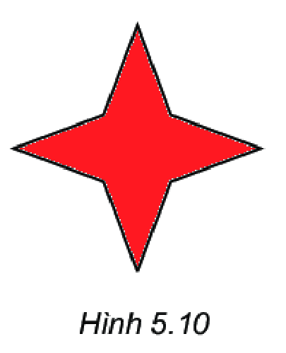
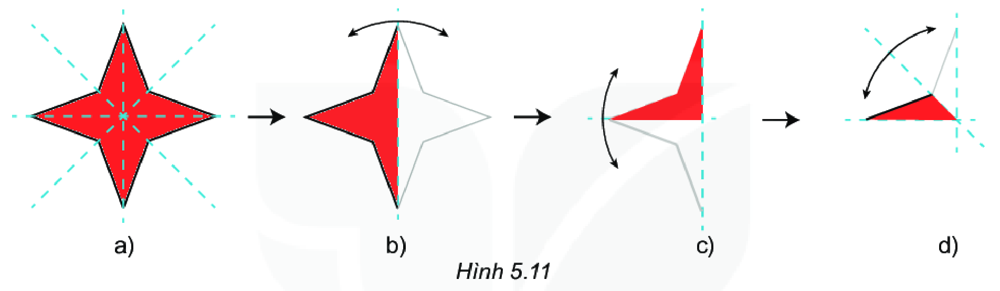
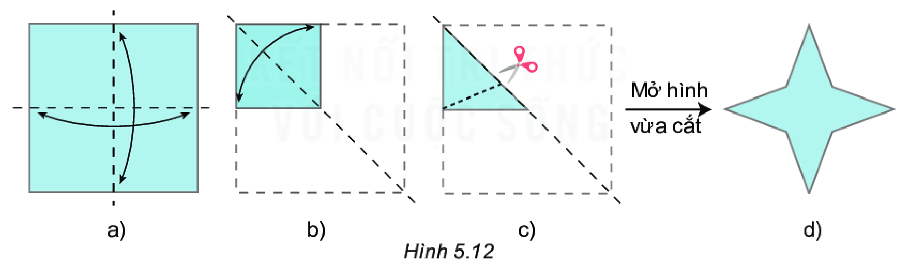
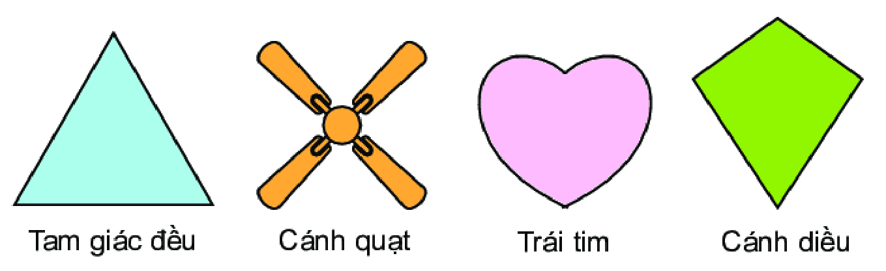
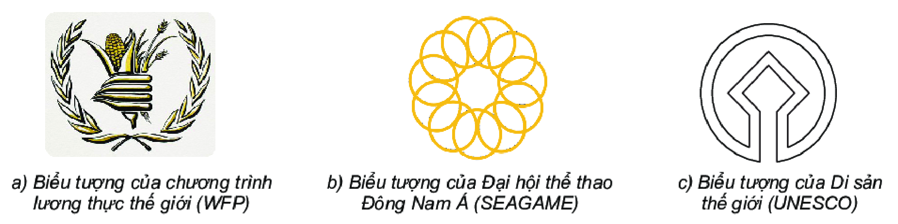
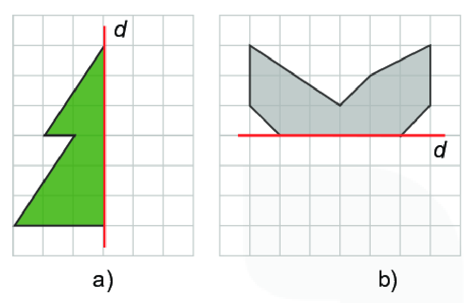
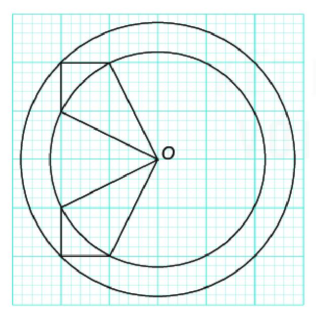
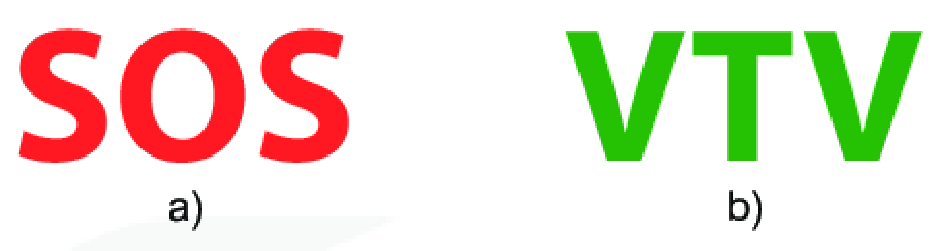
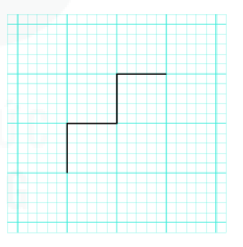

<!-- pdf:118 -->

# LUYỆN TẬP CHUNG

**Ví dụ:**

Tìm cách gấp giấy và cắt hình ngôi sao bốn cánh (h.5.10) chỉ bằng một nhát cắt.

*Hình 5.10*

*Hướng dẫn*

Hình đã cho có bốn trục đối xứng và có tâm đối xứng (h.5.11a). Tưởng tượng gấp hình trên theo các trục đối xứng ta được hình 5.11d.

*Hình 5.11*

Từ đó em thực hiện gấp và cắt hình trên theo hướng dẫn sau (h.5.12):

*Hình 5.12*

## BÀI TẬP

5.11. Trong các hình bên, em hãy chỉ ra:

a) Những hình có tâm đối xứng;

b) Những hình có trục đối xứng.

*Tam giác đều — Cánh quạt — Trái tim — Cánh diều*

<!-- pdf:119 -->

5.12. Trong các hình dưới đây, hình nào có trục đối xứng, hình nào có tâm đối xứng?

*a) Biểu tượng của chương trình lương thực thế giới (WFP) — b) Biểu tượng của Đại hội thể thao Đông Nam Á (SEAGAME) — c) Biểu tượng của Di sản thế giới (UNESCO)*

5.13. Vẽ các hình sau vào giấy kẻ ô vuông rồi vẽ thêm để được hình nhận đường thẳng $d$ là trục đối xứng.

5.14. Vẽ hình dưới đây vào giấy kẻ ô vuông rồi vẽ thêm để được hình nhận điểm $O$ làm tâm đối xứng.

5.15. Trong các hình sau, hình nào có trục đối xứng, hình nào có tâm đối xứng?

5.16. Hình gấp khúc dưới đây gồm bốn đoạn thẳng có độ dài bằng $1\text{ cm}$. Em hãy vẽ thêm một đường gấp khúc có độ dài bằng $8\text{ cm}$ để được một hình có cả trục đối xứng và tâm đối xứng.

## 📷 Danh sách hình trong bài

| Mã hình | Trang PDF | Vị trí trong bài | Chú thích gốc |
| --- | :---: | --- | --- |
| H6-toan-ltc-c05-01-01 | 118 | Ví dụ | Hình 5.10 |
| H6-toan-ltc-c05-01-02 | 118 | Ví dụ, Hướng dẫn | Hình 5.11 |
| H6-toan-ltc-c05-01-03 | 118 | Ví dụ, Hướng dẫn | Hình 5.12 |
| H6-toan-ltc-c05-01-04 | 118 | Bài tập 5.11 | Tam giác đều — Cánh quạt — Trái tim — Cánh diều |
| H6-toan-ltc-c05-01-05 | 119 | Bài tập 5.12 | a) Biểu tượng của chương trình lương thực thế giới (WFP) — b) Biểu tượng của Đại hội thể thao Đông Nam Á (SEAGAME) — c) Biểu tượng của Di sản thế giới (UNESCO) |
| H6-toan-ltc-c05-01-06 | 119 | Bài tập 5.13 | (sách không đánh số, hai hình a, b trên lưới ô vuông có đường thẳng $d$) |
| H6-toan-ltc-c05-01-07 | 119 | Bài tập 5.14 | (sách không đánh số, hình vẽ trên lưới ô vuông có điểm $O$) |
| H6-toan-ltc-c05-01-08 | 119 | Bài tập 5.15 | (sách không đánh số, a) SOS — b) VTV) |
| H6-toan-ltc-c05-01-09 | 119 | Bài tập 5.16 | (sách không đánh số, đường gấp khúc trên lưới ô vuông) |
