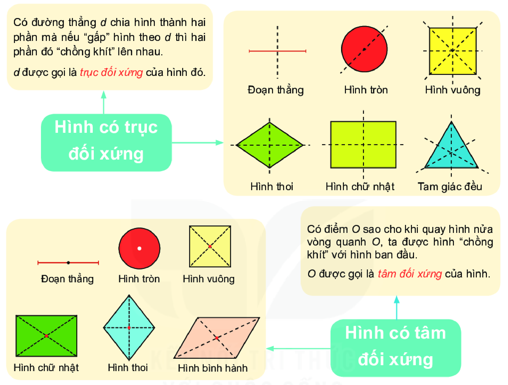
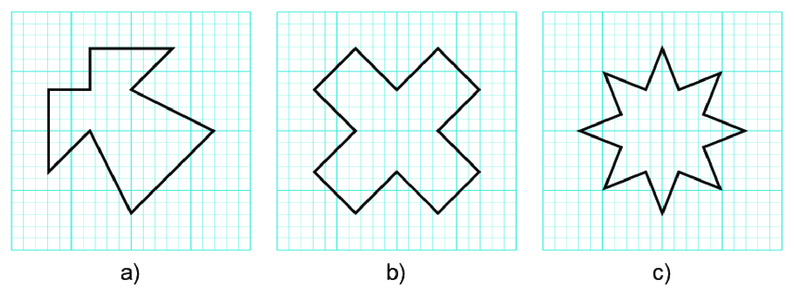
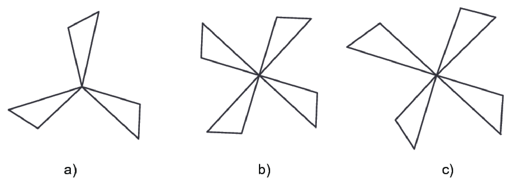
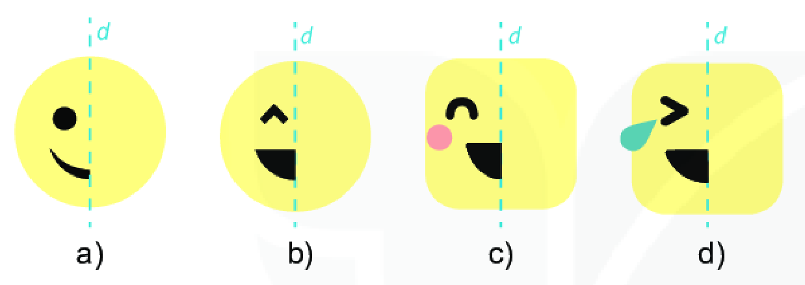
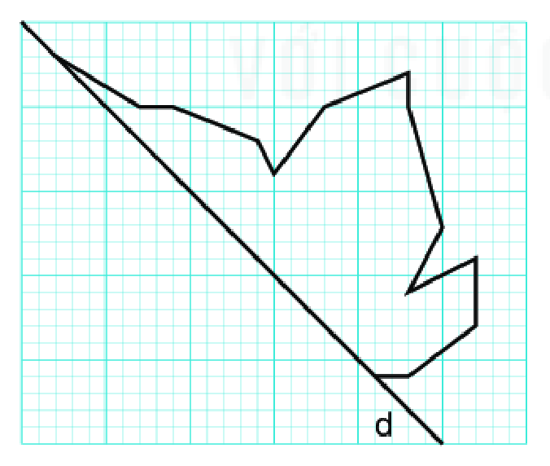

<!-- pdf:120 -->

# CHÚNG TA ĐÃ HỌC NHỮNG GÌ?

- *Hình có trục đối xứng:*
  - Có đường thẳng $d$ chia hình thành hai phần mà nếu “gấp” hình theo $d$ thì hai phần đó “chồng khít” lên nhau. $d$ được gọi là *trục đối xứng* của hình đó.
  - Các hình minh hoạ trục đối xứng: Đoạn thẳng; Hình tròn; Hình vuông; Hình thoi; Hình chữ nhật; Tam giác đều.
- *Hình có tâm đối xứng:*
  - Có điểm $O$ sao cho khi quay hình nửa vòng quanh $O$, ta được hình “chồng khít” với hình ban đầu. $O$ được gọi là *tâm đối xứng* của hình.
  - Các hình minh hoạ tâm đối xứng: Đoạn thẳng; Hình tròn; Hình vuông; Hình chữ nhật; Hình thoi; Hình bình hành.

## BÀI TẬP CUỐI CHƯƠNG V

5.17. Em hãy vẽ các hình dưới đây vào giấy kẻ ô vuông rồi chỉ ra tất cả các trục đối xứng của chúng (nếu có).

<!-- pdf:121 -->

5.18. Hình nào dưới đây là hình có tâm đối xứng?

5.19. VẼ MẶT CƯỜI
<!-- ocr-ok: đã đối chiếu ảnh trang PDF 121, phông chữ hẹp màu xanh tiêu đề bài tập -->

Vẽ các hình sau vào vở và vẽ thêm hoạ tiết để được hình mặt cười nhận đường thẳng $d$ cho trước là trục đối xứng.

> Biểu tượng cảm xúc (emoji) xuất hiện lần đầu tiên vào năm 1998, bởi một nhà thiết kế người Nhật. Tính đến năm 2018, có tới $2\,823$ emoji được thiết kế và khoảng $5$ tỉ emoji được gửi hàng ngày trên Facebook Messenger.
>
> *(Theo Forbesvietnam.com.vn)*

5.20. VẼ CHIẾC LÁ
<!-- ocr-ok: đã đối chiếu ảnh trang PDF 121, phông chữ hẹp màu xanh tiêu đề bài tập -->

Vẽ hình bên dưới vào giấy kẻ ô vuông rồi vẽ thêm và trang trí để được hình chiếc lá nhận đường thẳng $d$ là trục đối xứng.

## 📷 Danh sách hình trong bài

| Mã hình | Trang PDF | Vị trí trong bài | Chú thích gốc |
| --- | :---: | --- | --- |
| H6-toan-ot-c05-01 | 120 | Tổng kết chương V | (sơ đồ tổng kết Chương V: Hình có trục đối xứng — Hình có tâm đối xứng) |
| H6-toan-ot-c05-02 | 120 | Bài tập 5.17 | (sách không đánh số, ba hình a, b, c trên lưới ô vuông) |
| H6-toan-ot-c05-03 | 121 | Bài tập 5.18 | (sách không đánh số, ba hình a, b, c) |
| H6-toan-ot-c05-04 | 121 | Bài tập 5.19 | (sách không đánh số, bốn hình mặt cười a, b, c, d có đường thẳng $d$) |
| H6-toan-ot-c05-05 | 121 | Bài tập 5.20 | (sách không đánh số, hình chiếc lá trên lưới ô vuông có đường thẳng $d$) |
