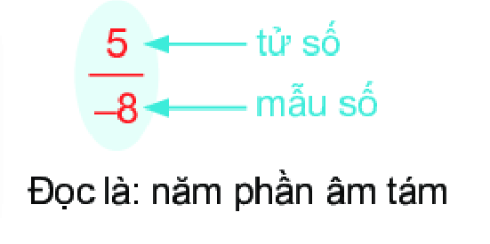
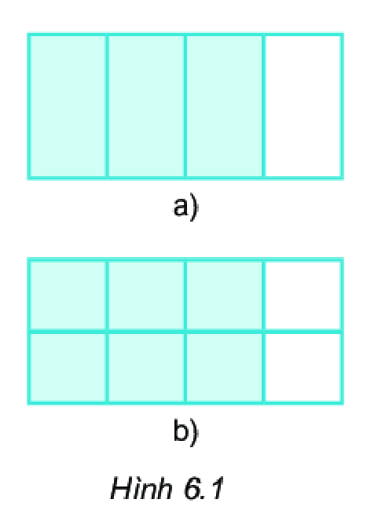
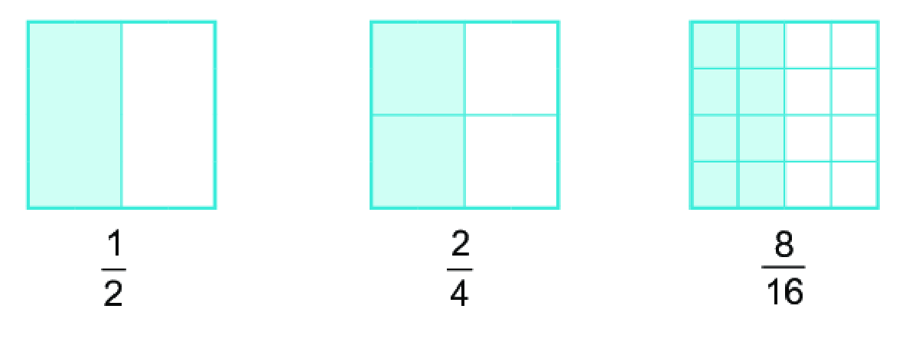
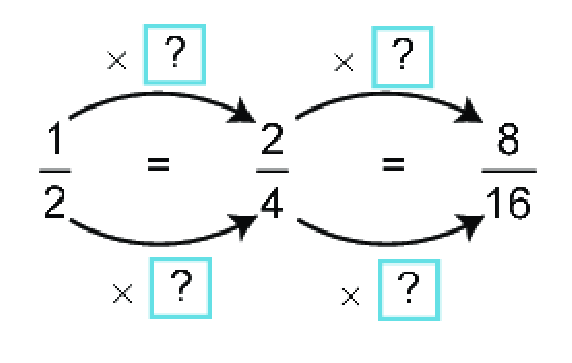
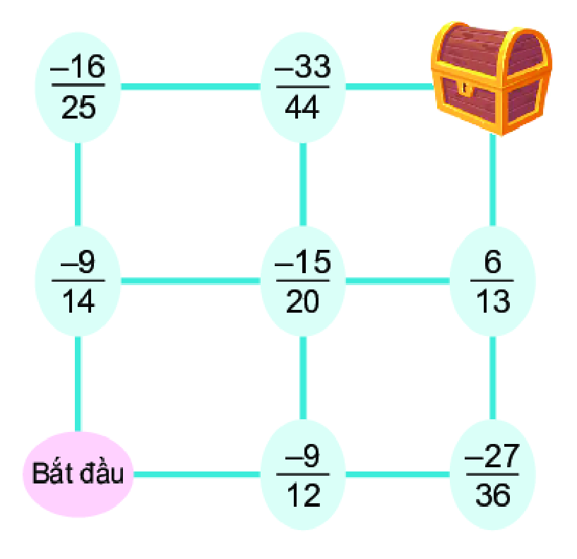

<!-- pdf:6 -->

<!-- Trang bìa Chương VI (trang PDF 5): CHƯƠNG VI. PHÂN SỐ (SỐ HỌC) — Mở rộng phân số. Phân số bằng nhau; So sánh phân số. Hỗn số dương; Tính toán với phân số; Hai bài toán về phân số -->

# BÀI 23: MỞ RỘNG PHÂN SỐ. PHÂN SỐ BẰNG NHAU

## 🔤 Khái niệm, thuật ngữ

- Phân số
- Tử số (tử); mẫu số (mẫu)
- Phân số bằng nhau
- Rút gọn phân số

## 🎯 Kiến thức, kĩ năng

- Nhận biết phân số với tử và mẫu là các số nguyên.
- Nhận biết hai phân số bằng nhau, quy tắc bằng nhau của hai phân số.
- Nêu và áp dụng hai tính chất cơ bản của phân số.
- Rút gọn phân số.

## 🔴 Mở đầu

- **Vuông:** Chúng mình đã biết $2 : 5 = \frac{2}{5}$, còn phép chia $-2$ cho $5$ thì sao nhỉ?
<!-- ocr-ok: đã đối chiếu ảnh trang PDF 6, lời thoại nhân vật Vuông -->

## 1. MỞ RỘNG KHÁI NIỆM PHÂN SỐ
<!-- ocr-ok: đã đối chiếu ảnh trang PDF 6, OCR đọc sai tiêu đề mục in trắng trên nền màu -->

Người ta cũng gọi $\frac{-2}{5}$ là phân số (đọc là "âm hai phần năm") và coi $\frac{-2}{5}$ là kết quả của phép chia $-2$ cho $5$.

> Với $a, b \in \mathbb{Z}, b \ne 0$, ta gọi $\frac{a}{b}$ là một **phân số**, trong đó $a$ là **tử số** (**tử**) và $b$ là **mẫu số** (**mẫu**) của phân số.

*Đọc là: năm phần âm tám*

Chẳng hạn, $\frac{-3}{4}, \frac{5}{-9}, \frac{8}{3}, \dots$ là các phân số.

> ❓ Cách viết nào sau đây cho ta một phân số? Cho biết tử và mẫu của phân số đó.
>
> $\frac{-2,5}{4}; \quad \frac{0}{7}; \quad \frac{3}{-8}; \quad \frac{4}{0}.$

**Luyện tập 1:** Viết kết quả của các phép chia sau dưới dạng phân số:

a) $4 : 9$;

b) $(-2) : 7$;

c) $8 : (-3)$.

**Tranh luận:**

- **Tròn:** Mọi số nguyên đều có thể viết dưới dạng phân số.
- **Vuông:** Số nguyên sao có thể là một phân số được!!!
<!-- ocr-ok: đã đối chiếu ảnh trang PDF 6, lời thoại nhân vật Tròn và Vuông -->

Em nghĩ sao về hai ý kiến của Vuông và Tròn? Ai sai, ai đúng?

<!-- pdf:7 -->

## 2. HAI PHÂN SỐ BẰNG NHAU

Chia hai hình chữ nhật cùng kích thước thành các phần bằng nhau và tô màu như hình 6.1.

*Hình 6.1*

**HĐ1:** Viết phân số biểu thị phần tô màu trong mỗi hình bên.

**HĐ2:** Dựa vào hình vẽ, em hãy so sánh các phân số nhận được.

**Nhận xét:** Hai **phân số bằng nhau** có cùng giá trị.

**HĐ3:** Em hãy tìm các cặp phân số bằng nhau trong các phân số sau:

$\frac{2}{5}; \quad \frac{1}{3}; \quad \frac{3}{9}; \quad \frac{4}{10}.$

**HĐ4:** Với mỗi cặp phân số bằng nhau trên, nhân tử số của phân số này với mẫu số của phân số kia rồi so sánh kết quả.

> **Quy tắc bằng nhau của hai phân số**
>
> $\frac{a}{b} = \frac{c}{d} \text{ nếu } a \cdot d = b \cdot c \quad (a, b, c, d \in \mathbb{Z} \text{ và } b, d \ne 0).$

**Ví dụ 1:** Ta có: $\frac{-9}{12} = \frac{-3}{4}$ vì $(-9) \cdot 4 = (-3) \cdot 12$ (cùng bằng $-36$).
<!-- ocr-ok: đã đối chiếu ảnh trang PDF 7, OCR đọc thiếu nhãn Ví dụ 1 và công thức -->

**Luyện tập 2:** Các cặp phân số sau đây có bằng nhau không?

a) $\frac{-3}{5}$ và $\frac{9}{-15}$;

b) $\frac{-1}{-4}$ và $\frac{1}{4}$.

## 3. TÍNH CHẤT CƠ BẢN CỦA PHÂN SỐ

**HĐ5:** a) Cho biết các phân số sau có bằng nhau không?

b) Thay các dấu "?" trong hình bên bằng số thích hợp rồi rút ra nhận xét.

<!-- pdf:8 -->

**HĐ6:** Nhân cả tử và mẫu của phân số $\frac{-3}{2}$ với $-5$ ta được phân số nào? Phân số vừa tìm được có bằng phân số $\frac{-3}{2}$ không?

**HĐ7:** Chia cả tử và mẫu của phân số $\frac{-28}{21}$ cho $7$ ta được phân số nào? Phân số vừa tìm được có bằng phân số $\frac{-28}{21}$ không?

- **Pi:** Em hãy vận dụng quy tắc bằng nhau của hai phân số để kiểm tra nhé!
<!-- ocr-ok: đã đối chiếu ảnh trang PDF 8, lời thoại nhân vật Pi -->

> **Tính chất cơ bản của phân số**
>
> 1. Nếu nhân cả tử và mẫu của một phân số với cùng một số nguyên khác $0$ thì ta được một phân số bằng phân số đã cho.
>    $\frac{a}{b} = \frac{a \cdot m}{b \cdot m} \text{ với } m \in \mathbb{Z}, m \ne 0.$
> 2. Nếu chia cả tử và mẫu của một phân số cho cùng một ước chung của chúng thì ta được một phân số bằng phân số đã cho.
>    $\frac{a}{b} = \frac{a : n}{b : n} \text{ với } n \text{ là ước chung của } a \text{ và } b.$

**Ví dụ 2:**

$\frac{2}{-5} = \frac{2 \cdot (-3)}{(-5) \cdot (-3)} = \frac{-6}{15}; \quad \frac{-12}{16} = \frac{(-12) : 4}{16 : 4} = \frac{-3}{4}.$

**Chú ý:** Mọi phân số đều có thể viết dưới dạng phân số có mẫu dương.

Chẳng hạn: $\frac{3}{-4} = \frac{3 \cdot (-1)}{(-4) \cdot (-1)} = \frac{-3}{4}; \quad \frac{-5}{-6} = \frac{(-5) \cdot (-1)}{(-6) \cdot (-1)} = \frac{5}{6}.$

**Luyện tập 3:** Tìm những cặp phân số bằng nhau trong các phân số sau và sử dụng tính chất cơ bản của phân số để giải thích kết luận.

$\frac{1}{5}; \quad \frac{-10}{55}; \quad \frac{3}{15}; \quad \frac{-2}{11}.$

**Chú ý:** Người ta thường dùng tính chất 2 để **rút gọn phân số**. Chẳng hạn:

$\frac{-9}{21} = \frac{(-9) : 3}{21 : 3} = \frac{-3}{7}; \quad \frac{-9}{21} = \frac{(-9) : (-3)}{21 : (-3)} = \frac{3}{-7}.$

Phân số $\frac{-3}{7}$ hay $\frac{3}{-7}$ không rút gọn được nữa vì tử và mẫu đều không có ước chung nào khác $1$ và $-1$. Chúng được gọi là các **phân số tối giản**.

<!-- pdf:9 -->

**Luyện tập 4:** Trong các phân số $\frac{11}{23}; \frac{-24}{15}$, phân số nào là phân số tối giản?

Nếu chưa là phân số tối giản, hãy rút gọn chúng.

**Thử thách nhỏ:** Việt đang chơi trò chơi dò đường. Biết rằng Việt chỉ được phép di chuyển giữa các ô theo đường kẻ và chứa phân số bằng phân số $\frac{-3}{4}$. Em hãy giúp Việt tìm đường đi đến kho báu nhé.

## BÀI TẬP

**6.1.** Hoàn thành bảng sau:
<!-- ocr-ok: đã đối chiếu ảnh trang PDF 9, OCR mất nhãn 6.1 -->

| Phân số | Đọc | Tử số | Mẫu số |
| :---: | :---: | :---: | :---: |
| $\frac{5}{7}$ | $?$ | $?$ | $?$ |
| $\frac{-6}{11}$ | $?$ | $?$ | $?$ |
| $?$ | âm hai phần ba | $?$ | $?$ |
| $?$ | $?$ | $9$ | $-11$ |
<!-- ocr-ok: đã đối chiếu ảnh trang PDF 9, bảng 4 cột chứa phân số -->

**6.2.** Thay dấu "?" bằng số thích hợp.
<!-- ocr-ok: đã đối chiếu ảnh trang PDF 9, OCR mất nhãn 6.2 -->

a) $\frac{1}{2} = \frac{?}{8}$;

b) $\frac{-6}{9} = \frac{18}{?}$.

**6.3.** Viết mỗi phân số sau đây thành phân số bằng nó và có mẫu dương.

$\frac{8}{-11}; \quad \frac{-5}{-9}.$

**6.4.** Rút gọn các phân số sau:

$\frac{-12}{-4}; \quad \frac{7}{-35}; \quad \frac{-9}{27}.$

**6.5.** Viết các số đo thời gian sau đây theo đơn vị giờ, dưới dạng phân số tối giản.

$15$ phút; $90$ phút.

**6.6.** Một vòi nước chảy vào một bể không có nước, sau $40$ phút thì đầy bể. Hỏi sau $10$ phút, lượng nước đã chảy chiếm bao nhiêu phần bể?

**6.7.** Hà Linh tham gia một cuộc thi sáng tác và nhận được phần thưởng là số tiền $200\,000$ đồng. Bạn mua một món quà để tặng sinh nhật mẹ hết $80\,000$ đồng. Hỏi Hà Linh đã tiêu hết bao nhiêu phần số tiền mình được thưởng?

## 📷 Danh sách hình trong bài

| Mã hình | Trang PDF | Vị trí trong bài | Chú thích gốc |
| --- | :---: | --- | --- |
| H6-toan-b23-01 | 6 | Mục 1 | Đọc là: năm phần âm tám |
| H6-toan-b23-02 | 7 | Mục 2 | Hình 6.1 |
| H6-toan-b23-03 | 7 | Mục 3, HĐ5a | (sách không đánh số, ba hình vuông tô màu biểu thị các phân số $\frac{1}{2}, \frac{2}{4}, \frac{8}{16}$) |
| H6-toan-b23-04 | 7 | Mục 3, HĐ5b | (sách không đánh số, sơ đồ nhân cả tử và mẫu liên hệ $\frac{1}{2} = \frac{2}{4} = \frac{8}{16}$) |
| H6-toan-b23-05 | 9 | Mục 3, Thử thách nhỏ | (sách không đánh số, sơ đồ trò chơi dò đường tìm kho báu) |
