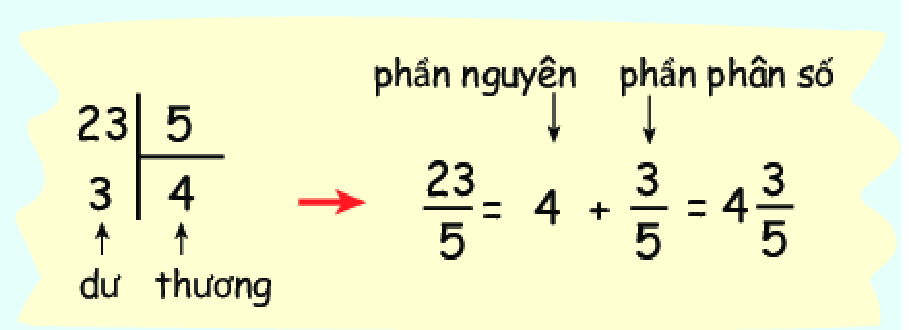

<!-- pdf:10 -->

# BÀI 24: SO SÁNH PHÂN SỐ. HỖN SỐ DƯƠNG

## 🔤 Khái niệm, thuật ngữ

- Mẫu (số) chung
- So sánh phân số
- Hỗn số dương

## 🎯 Kiến thức, kĩ năng

- Quy đồng mẫu nhiều phân số.
- So sánh hai phân số.
- Nhận biết hỗn số dương.
- Vận dụng giải các bài toán thực tiễn có liên quan.

## 🔴 Mở đầu

- **Vuông:** Tớ còn $\frac{3}{4}$ cái bánh.
- **Tròn:** Tớ còn $\frac{5}{6}$ cái bánh.
- **Pi:** Đố em biết phần bánh còn lại của bạn nào nhiều hơn?

Trong tình huống trên, ta cần so sánh hai phân số $\frac{3}{4}$ và $\frac{5}{6}$. Bài học này sẽ giúp chúng ta học cách so sánh hai phân số.

## 1. QUY ĐỒNG MẪU NHIỀU PHÂN SỐ

**HĐ1:** Em thực hiện các yêu cầu sau để quy đồng mẫu hai phân số $\frac{5}{6}$ và $\frac{7}{4}$:

- Tìm bội chung nhỏ nhất của hai mẫu số.
- Viết hai phân số mới bằng hai phân số đã cho và có mẫu là số vừa tìm được.

**HĐ2:** Tương tự HĐ1, em hãy quy đồng mẫu hai phân số $\frac{-3}{5}$ và $\frac{-1}{2}$.

<!-- term: Quy đồng mẫu nhiều phân số -->
<!-- term: Mẫu chung -->
> Để quy đồng mẫu hai hay nhiều phân số có mẫu dương, ta làm như sau:
>
> 1. Tìm một bội chung (thường là BCNN) của các mẫu để làm mẫu chung.
> 2. Tìm thừa số phụ của mỗi mẫu bằng cách chia mẫu chung cho từng mẫu.
> 3. Nhân tử và mẫu của mỗi phân số với thừa số phụ tương ứng.

<!-- pdf:11 -->

**Ví dụ 1:** Để quy đồng mẫu hai phân số $\frac{5}{6}$ và $\frac{3}{-8}$, ta làm như sau:

- Đưa về phân số có mẫu dương: $\frac{3}{-8} = \frac{-3}{8}$;
- Tìm mẫu chung: $\text{BCNN}(6, 8) = 24$;
- Tìm thừa số phụ: $24 : 6 = 4$ và $24 : 8 = 3$;
- Ta có: $\frac{5}{6} = \frac{5 \cdot 4}{6 \cdot 4} = \frac{20}{24}$ và $\frac{3}{-8} = \frac{-3}{8} = \frac{(-3) \cdot 3}{8 \cdot 3} = \frac{-9}{24}$.

- **Pi:** Với các phân số có mẫu âm, ta viết lại thành các phân số mới bằng nó nhưng có mẫu dương.

**Luyện tập 1:** Quy đồng mẫu các phân số: $\frac{-3}{4}; \frac{5}{9}; \frac{2}{3}$.
<!-- ocr-ok: đã đối chiếu ảnh trang PDF 11, OCR đọc sai nhãn Luyện tập 1 -->

## 2. SO SÁNH HAI PHÂN SỐ

**So sánh hai phân số có cùng mẫu**

**HĐ3:** Em hãy nhắc lại quy tắc so sánh hai phân số có cùng mẫu (tử và mẫu đều dương), rồi so sánh hai phân số $\frac{7}{11}$ và $\frac{9}{11}$.

Đối với hai phân số cùng một mẫu dương bất kì, ta cũng có quy tắc:

<!-- term: Quy tắc so sánh hai phân số cùng mẫu -->
> Trong hai phân số có cùng một mẫu dương, phân số nào có tử lớn hơn thì phân số đó lớn hơn.

**Ví dụ 2:** $\frac{-5}{7} < \frac{3}{7}$ vì $-5 < 3$; $\quad \frac{-7}{21} > \frac{-11}{21}$ vì $-7 > -11$.
<!-- ocr-ok: đã đối chiếu ảnh trang PDF 11, OCR đọc thiếu nhãn Ví dụ 2 và công thức -->

**Luyện tập 2:** Tìm dấu thích hợp ($>, <$) thay cho dấu "?".
<!-- ocr-ok: đã đối chiếu ảnh trang PDF 11, OCR đọc sai nhãn Luyện tập 2 -->

a) $\frac{-2}{9} \; \boxed{?} \; \frac{-7}{9}$;

b) $\frac{5}{7} \; \boxed{?} \; \frac{-10}{7}$.

**So sánh hai phân số không cùng mẫu**

**HĐ4:** Để giải quyết bài toán mở đầu, ta cần so sánh $\frac{3}{4}$ và $\frac{5}{6}$. Em hãy thực hiện các yêu cầu sau:

- Viết hai phân số trên về hai phân số có cùng một mẫu dương bằng cách quy đồng mẫu số.
- So sánh hai phân số cùng mẫu vừa nhận được. Từ đó kết luận về phần bánh còn lại của hai bạn Vuông và Tròn.

<!-- term: Quy tắc so sánh hai phân số không cùng mẫu -->
> Muốn so sánh hai phân số không cùng mẫu, ta viết chúng dưới dạng hai phân số có cùng một mẫu dương rồi so sánh các tử với nhau: *Phân số nào có tử lớn hơn thì phân số đó lớn hơn.*

<!-- pdf:12 -->

**Ví dụ 3:** So sánh hai phân số sau: $\frac{-7}{12}$ và $\frac{-11}{18}$.

**Giải:**

Ta có $\text{BCNN}(12, 18) = 36$ nên $\frac{-7}{12} = \frac{(-7) \cdot 3}{12 \cdot 3} = \frac{-21}{36}$; $\frac{-11}{18} = \frac{(-11) \cdot 2}{18 \cdot 2} = \frac{-22}{36}$.

Vì $-21 > -22$ nên $\frac{-21}{36} > \frac{-22}{36}$. Do đó $\frac{-7}{12} > \frac{-11}{18}$.

- **Vuông:** Bạn nhớ chọn mẫu chung của các phân số là một số dương nhé!
<!-- ocr-ok: đã đối chiếu ảnh trang PDF 12, lời thoại nhân vật Vuông -->

**Luyện tập 3:** So sánh các phân số sau: a) $\frac{7}{10}$ và $\frac{11}{15}$; $\quad$ b) $\frac{-1}{8}$ và $\frac{-5}{24}$.

**Thử thách nhỏ:**

- **Pi:** Muốn so sánh $\frac{-15}{81}$ và $\frac{7}{90}$ ta làm thế nào nhỉ?
- **Vuông:** Ta phải tìm $\text{BCNN}(81, 90)$!
- **Tròn:** $\frac{-15}{81} < 0$ và $0 < \frac{7}{90}$ nên $\frac{-15}{81} < \frac{7}{90}$.
<!-- ocr-ok: đã đối chiếu ảnh trang PDF 12, lời thoại ba nhân vật Pi, Vuông, Tròn -->

Không quy đồng mẫu số, em hãy so sánh $\frac{31}{32}$ và $\frac{-5}{57}$.

## 3. HỖN SỐ DƯƠNG

- **Pi:** Chia đều ba cái bánh cho hai bạn thì mỗi bạn được bao nhiêu phần bánh nhỉ?

**HĐ5:** Viết phân số biểu thị phần bánh của mỗi bạn.
<!-- ocr-ok: đã đối chiếu ảnh trang PDF 12, OCR đọc sai nhãn HĐ5 -->

**HĐ6:** Tròn nói mỗi bạn được $1$ cái bánh và $\frac{1}{2}$ cái bánh. Em có đồng ý với Tròn không?

<!-- pdf:13 -->

> Ta viết phân số $\frac{3}{2}$ dưới dạng tổng $\frac{3}{2} = 1 + \frac{1}{2}$ và viết gọn là: $\frac{3}{2} = 1\frac{1}{2}$.
> $1\frac{1}{2}$ được gọi là một **hỗn số** (dương), trong đó $1$ là **phần nguyên**, $\frac{1}{2}$ là **phần phân số**.
> Hỗn số $1\frac{1}{2}$ đọc là: "Một một phần hai".

<!-- term: Cách đổi phân số ra hỗn số dương và ngược lại -->
Muốn viết một phân số (lớn hơn $1$), chẳng hạn $\frac{23}{5}$ dưới dạng hỗn số, ta làm như sau:

> $23 : 5$ được thương là $4$, dư $3$ $\rightarrow \frac{23}{5} = 4 + \frac{3}{5} = 4\frac{3}{5}$ ($4$: phần nguyên; $\frac{3}{5}$: phần phân số).
<!-- ocr-ok: đã đối chiếu ảnh trang PDF 13, diễn giải sơ đồ phép chia có dư -->

<!-- term: Cách đổi phân số ra hỗn số dương và ngược lại -->
Ngược lại, ta cũng có thể viết một hỗn số dương dưới dạng phân số, chẳng hạn:

> $3\frac{4}{5} = \frac{3 \cdot 5 + 4}{5} = \frac{19}{5}.$

> ❓ $2\frac{5}{4}$ có là một hỗn số không? Vì sao?

- **Vuông:** Phần phân số của hỗn số luôn nhỏ hơn $1$.

**Luyện tập 4:**

a) Viết phân số $\frac{24}{7}$ dưới dạng hỗn số;

b) Viết hỗn số $5\frac{2}{3}$ dưới dạng phân số.

## BÀI TẬP

**6.8.** Quy đồng mẫu các phân số sau:

a) $\frac{2}{3}$ và $\frac{-6}{7}$;

b) $\frac{5}{2^2 \cdot 3^2}$ và $\frac{-7}{2^2 \cdot 3}$.

**6.9.** So sánh các phân số sau:

a) $\frac{-11}{8}$ và $\frac{1}{24}$;

b) $\frac{3}{20}$ và $\frac{6}{15}$.

**6.10.** Lớp 6A có $\frac{4}{5}$ số học sinh thích bóng bàn, $\frac{7}{10}$ số học sinh thích bóng đá và $\frac{1}{2}$ số học sinh thích bóng chuyền. Hỏi môn thể thao nào được các bạn học sinh lớp 6A yêu thích nhất?

**6.11.** a) Khối lượng nào lớn hơn: $\frac{5}{3}\text{ kg}$ hay $\frac{15}{11}\text{ kg}$?
<!-- ocr-ok: đã đối chiếu ảnh trang PDF 13, OCR mất nhãn 6.11 -->

b) Vận tốc nào nhỏ hơn: $\frac{5}{6}\text{ km/h}$ hay $\frac{4}{5}\text{ km/h}$?

**6.12.** Bảng sau cho biết chiều dài (theo đơn vị feet, $1\text{ feet}$ xấp xỉ bằng $30,48\text{ cm}$) của một số loài động vật có vú nhỏ nhất trên thế giới.

| Chuột chũi châu Âu | Dơi Kitti | Chuột túi có gai | Sóc |
| :---: | :---: | :---: | :---: |
| $\frac{5}{12}$ | $\frac{83}{100}$ | $\frac{1}{4}$ | $\frac{1}{3}$ |
<!-- ocr-ok: đã đối chiếu ảnh trang PDF 13, bảng nhiều cột chứa phân số -->

*(Theo Scholastic Book of World Records)*

Hãy sắp xếp các động vật trên theo thứ tự chiều dài từ lớn đến bé.

**6.13.** Mẹ có $15$ quả táo, mẹ muốn chia đều số quả táo đó cho bốn anh em. Hỏi mỗi anh em được mấy quả táo và mấy phần của quả táo?

## 📷 Danh sách hình trong bài

| Mã hình | Trang PDF | Vị trí trong bài | Chú thích gốc |
| --- | :---: | --- | --- |
| H6-toan-b24-01 | 10 | Mở đầu | (sách không đánh số, tình huống Vuông, Tròn và Pi so sánh phần bánh còn lại) |
| H6-toan-b24-02 | 12 | Mục 3 | (sách không đánh số, tình huống chia đều ba cái bánh cho hai bạn) |
| H6-toan-b24-03 | 13 | Mục 3 | (sách không đánh số, sơ đồ phép chia có dư viết phân số $\frac{23}{5}$ dưới dạng hỗn số $4\frac{3}{5}$) |
