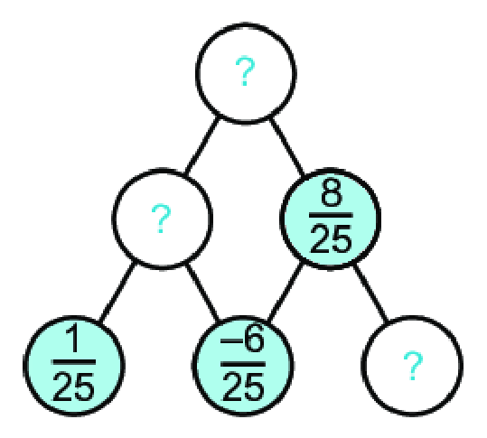

<!-- pdf:16 -->

# BÀI 25: PHÉP CỘNG VÀ PHÉP TRỪ PHÂN SỐ

## 🔤 Khái niệm, thuật ngữ

- Phép cộng
- Phép trừ
- Số đối
- Tính chất giao hoán
- Tính chất kết hợp

## 🎯 Kiến thức, kĩ năng

- Thực hiện phép cộng, trừ phân số.
- Vận dụng các tính chất của phép cộng, quy tắc dấu ngoặc trong tính toán.
- Nhận biết số đối của một phân số.
- Giải các bài toán thực tiễn có liên quan.

## 🔴 Mở đầu

Tuấn ước tính cần $3$ giờ ngày Chủ Nhật để hoàn thành một bức tranh tặng mẹ nhân ngày Quốc tế Phụ nữ 8-3. Buổi sáng bạn dành ra $\frac{2}{3}$ giờ để vẽ; buổi chiều bạn tiếp tục dành $\frac{5}{3}$ giờ để vẽ. Hỏi buổi tối Tuấn cần dành khoảng bao nhiêu giờ nữa để hoàn thành bức tranh?

## 1. PHÉP CỘNG HAI PHÂN SỐ

**Cộng hai phân số cùng mẫu**

**HĐ1:** Em hãy nhắc lại quy tắc cộng hai phân số cùng mẫu (có tử và mẫu dương) rồi tính các tổng $\frac{8}{11} + \frac{3}{11}$ và $\frac{9}{12} + \frac{11}{12}$.

Quy tắc trên vẫn đúng với các phân số có tử và mẫu là các số nguyên.

<!-- term: Quy tắc cộng hai phân số cùng mẫu -->
> Muốn cộng hai phân số cùng mẫu, ta cộng các tử và giữ nguyên mẫu:
>
> $\frac{a}{m} + \frac{b}{m} = \frac{a + b}{m}.$

**Ví dụ 1:**

$\frac{-4}{7} + \frac{3}{7} = \frac{(-4) + 3}{7} = \frac{-1}{7}; \qquad \frac{-6}{13} + \frac{-8}{13} = \frac{(-6) + (-8)}{13} = \frac{-14}{13}.$

<!-- pdf:17 -->

**Luyện tập 1:** Tính: $\frac{-7}{12} + \frac{5}{12}; \quad \frac{-8}{11} + \frac{-19}{11}$.

**Cộng hai phân số không cùng mẫu**

**HĐ2:** Để thực hiện phép cộng $\frac{5}{7} + \frac{-3}{4}$, em hãy làm theo các bước sau:

- Quy đồng mẫu hai phân số $\frac{5}{7}$ và $\frac{-3}{4}$.
- Sử dụng quy tắc cộng hai phân số cùng mẫu để tính tổng hai phân số sau khi đã quy đồng.

<!-- term: Quy tắc cộng hai phân số không cùng mẫu -->
> Muốn cộng hai phân số không cùng mẫu, ta viết chúng dưới dạng hai phân số cùng mẫu rồi cộng các tử và giữ nguyên mẫu chung.

**Ví dụ 2:**

$\frac{-5}{6} + \frac{7}{9} = \frac{(-5) \cdot 3}{6 \cdot 3} + \frac{7 \cdot 2}{9 \cdot 2} \qquad (\leftarrow \text{Quy đồng mẫu số})$

$= \frac{-15}{18} + \frac{14}{18} = \frac{(-15) + 14}{18} = \frac{-1}{18}. \qquad (\leftarrow \text{Cộng hai phân số cùng mẫu})$

**Luyện tập 2:** Tính: $\frac{-5}{8} + \frac{-7}{20}$.

**Số đối**

**HĐ3:** Tính các tổng: $\frac{1}{2} + \frac{-1}{2}; \quad \frac{1}{2} + \frac{1}{-2}$.

Em có nhận xét gì về các kết quả nhận được?

> Hai số gọi là **đối nhau** nếu tổng của chúng bằng $0$. Kí hiệu **số đối** của phân số $\frac{a}{b}$ là $-\frac{a}{b}$.
>
> $\frac{a}{b} + \left(-\frac{a}{b}\right) = 0.$

- **Pi:** $-\frac{a}{b} = \frac{-a}{b} = \frac{a}{-b}$.

Chẳng hạn, $\frac{-1}{2}$ và $\frac{1}{-2}$ đều là số đối của $\frac{1}{2}$. Do đó: $-\frac{1}{2} = \frac{-1}{2} = \frac{1}{-2}$.

- **Vuông:** Số đối của số $0$ là số nào nhỉ?
<!-- ocr-ok: đã đối chiếu ảnh trang PDF 17, lời thoại nhân vật Vuông -->

**Luyện tập 3:** Tìm số đối của các số sau: $\frac{1}{3}; \frac{-1}{3}$ và $\frac{-4}{5}$.

<!-- pdf:18 -->

## 2. TÍNH CHẤT CỦA PHÉP CỘNG PHÂN SỐ
<!-- ocr-ok: đã đối chiếu ảnh trang PDF 18, OCR đọc sai tiêu đề mục in trắng trên nền màu -->

<!-- term: Tính chất giao hoán của phép cộng phân số -->
<!-- term: Tính chất kết hợp của phép cộng phân số -->
Tương tự phép cộng số nguyên, phép cộng phân số cũng có các tính chất sau:

| Tính chất | Ví dụ |
| :---: | :---: |
| Giao hoán | $\frac{-1}{3} + \frac{2}{3} = \frac{2}{3} + \frac{-1}{3} = \frac{1}{3}$. |
| Kết hợp | $\left(\frac{1}{2} + \frac{-1}{3}\right) + \frac{1}{3} = \frac{1}{2} + \left(\frac{-1}{3} + \frac{1}{3}\right) = \frac{1}{2}$. |
<!-- ocr-ok: đã đối chiếu ảnh trang PDF 18, bảng hai cột chứa phân số -->

**Ví dụ 3:** Tính một cách hợp lí: $A = \frac{-3}{5} + \frac{1}{6} + \frac{-2}{5} + \frac{5}{6}$.

**Giải:**

$A = \frac{-3}{5} + \frac{-2}{5} + \frac{1}{6} + \frac{5}{6} \qquad (\leftarrow \text{Tính chất giao hoán})$

$= \left(\frac{-3}{5} + \frac{-2}{5}\right) + \left(\frac{1}{6} + \frac{5}{6}\right) \qquad (\leftarrow \text{Tính chất kết hợp})$

$= (-1) + 1 = 0.$

<!-- term: Tính chất giao hoán của phép cộng phân số -->
<!-- term: Tính chất kết hợp của phép cộng phân số -->
- **Tròn:** Khi cộng nhiều phân số, ta có thể đổi chỗ hoặc nhóm các phân số một cách tuỳ ý để việc tính toán thuận lợi.

**Luyện tập 4:** Tính một cách hợp lí: $B = \frac{-1}{9} + \frac{8}{7} + \frac{10}{9} + \frac{-29}{7}$.
<!-- ocr-ok: đã đối chiếu ảnh trang PDF 18, OCR đọc sai nhãn Luyện tập 4 -->

## 3. PHÉP TRỪ HAI PHÂN SỐ
<!-- ocr-ok: đã đối chiếu ảnh trang PDF 18, OCR đọc sai tiêu đề mục in trắng trên nền màu -->

**HĐ4:** Em hãy nhắc lại quy tắc trừ hai phân số cùng mẫu (cả tử và mẫu đều dương) đã học rồi tính các hiệu sau: $\frac{7}{13} - \frac{5}{13}$ và $\frac{3}{4} - \frac{1}{5}$.

Quy tắc trên vẫn đúng với các phân số có tử và mẫu là các số nguyên.

<!-- term: Quy tắc trừ hai phân số -->
> 1. Muốn trừ hai phân số cùng mẫu, ta lấy tử số của phân số thứ nhất trừ đi tử số của phân số thứ hai và giữ nguyên mẫu.
>    $\frac{a}{m} - \frac{b}{m} = \frac{a - b}{m}.$
> 2. Muốn trừ hai phân số không cùng mẫu, ta quy đồng mẫu hai phân số, rồi trừ hai phân số đó.

<!-- pdf:19 -->

**Ví dụ 4:**

$\frac{17}{15} - \frac{21}{15} = \frac{17 - 21}{15} = \frac{-4}{15}; \qquad \frac{8}{9} - \frac{-1}{3} = \frac{8}{9} - \frac{-3}{9} = \frac{8 - (-3)}{9} = \frac{8 + 3}{9} = \frac{11}{9}.$

**Luyện tập 5:** Tính: a) $\frac{3}{5} - \frac{-1}{3}$; $\quad$ b) $-3 - \frac{2}{7}$.
<!-- ocr-ok: đã đối chiếu ảnh trang PDF 19, OCR đọc sai nhãn Luyện tập 5 -->

**Ví dụ 5:** Trở lại bài toán mở đầu, Tuấn cần số giờ để hoàn thành bức tranh tặng mẹ là:

$3 - \frac{2}{3} - \frac{5}{3} = \frac{9}{3} - \frac{2}{3} - \frac{5}{3} = \frac{9 - 2 - 5}{3} = \frac{2}{3}\text{ (giờ)}.$

**Thử thách nhỏ:** Thay dấu "?" bằng các phân số thích hợp để hoàn thiện sơ đồ bên, biết số trong mỗi ô ở hàng trên bằng tổng của hai số kề nó trong hai ô ở hàng dưới.

## BÀI TẬP

**6.21.** Tính:

a) $\frac{-1}{13} + \frac{9}{13}$;

b) $\frac{-3}{8} + \frac{5}{12}$.

**6.22.** Tính:

a) $\frac{-5}{3} - \frac{-7}{3}$;

b) $\frac{5}{6} - \frac{8}{9}$.

**6.23.** Tính một cách hợp lí.

$A = \left(-\frac{3}{11}\right) + \frac{11}{8} - \frac{3}{8} + \left(-\frac{8}{11}\right).$

**6.24.** Chị Chi mới đi làm và nhận được tháng lương đầu tiên. Chị quyết định dùng $\frac{2}{5}$ số tiền đó để chi tiêu trong tháng, dành $\frac{1}{4}$ số tiền để mua quà biếu bố mẹ. Tìm số phần tiền lương còn lại của chị Chi.

**6.25.** Mai tự nhẩm tính về thời gian biểu của mình trong một ngày thì thấy: $\frac{1}{3}$ thời gian là dành cho việc học ở trường; $\frac{1}{24}$ thời gian là dành cho các hoạt động ngoại khoá; $\frac{7}{16}$ thời gian dành cho hoạt động ăn, ngủ. Còn lại là thời gian dành cho các công việc cá nhân khác. Hỏi:

a) Mai đã dành bao nhiêu phần thời gian trong ngày cho việc học ở trường và hoạt động ngoại khoá?

b) Mai đã dành bao nhiêu phần thời gian trong ngày cho các công việc cá nhân khác?

## 📷 Danh sách hình trong bài

| Mã hình | Trang PDF | Vị trí trong bài | Chú thích gốc |
| --- | :---: | --- | --- |
| H6-toan-b25-01 | 16 | Mở đầu | (sách không đánh số, bức tranh hoa tặng mẹ nhân ngày Quốc tế Phụ nữ 8-3) |
| H6-toan-b25-02 | 19 | Mục 3, Thử thách nhỏ | (sách không đánh số, sơ đồ tháp số các phân số) |
