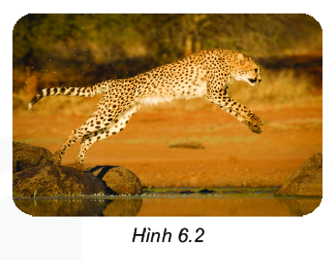
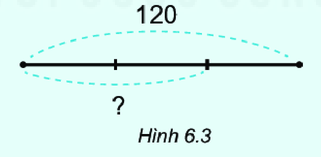
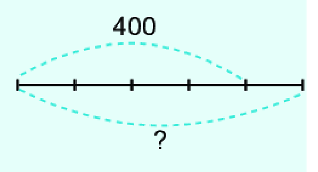

<!-- pdf:23 -->

# BÀI 27: HAI BÀI TOÁN VỀ PHÂN SỐ

## 🎯 Kiến thức, kĩ năng

- Tìm giá trị phân số của một số cho trước.
- Tìm một số biết giá trị phân số của nó.
- Giải quyết một số vấn đề thực tiễn gắn với hai bài toán về phân số.

## 🔴 Mở đầu

*Bài toán 1.* Báo Cheetah (Tri-tơ, h.6.2) được coi là động vật chạy nhanh nhất Trái Đất, tốc độ chạy có thể lên tới $120\text{ km/h}$ (Theo *vast.gov.vn*). Mặc dù được mệnh danh là "chúa tể rừng xanh" nhưng tốc độ chạy tối đa của sư tử chỉ bằng khoảng $\frac{2}{3}$ tốc độ chạy tối đa của báo Cheetah. Tốc độ chạy tối đa của sư tử là bao nhiêu?

*Hình 6.2*

## 1. TÌM GIÁ TRỊ PHÂN SỐ CỦA MỘT SỐ CHO TRƯỚC

Bài toán 1 yêu cầu tìm $\frac{2}{3}$ của $120\text{ (km/h)}$. Muốn vậy, ta phải chia $120$ thành $3$ phần bằng nhau rồi lấy $2$ trong $3$ phần ấy (h.6.3).

*Hình 6.3*

Do đó cần tính $2 \cdot \frac{120}{3}$ hay $120 \cdot \frac{2}{3}$.

Kết quả, tốc độ chạy tối đa của sư tử là: $120 \cdot \frac{2}{3} = 80\text{ (km/h)}$.

> **Quy tắc tìm giá trị phân số của một số**
>
> Muốn tìm $\frac{m}{n}$ của một số $a$ cho trước ta tính $a \cdot \frac{m}{n}$ ($m \in \mathbb{N}, n \in \mathbb{N}^*$).

Quy tắc trên được áp dụng với $a$ là một số tuỳ ý, chẳng hạn $\frac{2}{5}$ của $20$ là $20 \cdot \frac{2}{5} = 8$.

<!-- pdf:24 -->

**Ví dụ 1:** Chiều dài đường chạy marathon (ma-ra-tông) là $42\,195\text{ m}$. Khi còn cách đích $\frac{2}{87}$ đường chạy, một vận động viên thấy bạn gặp sự cố nên đã dìu bạn cùng về đích. Tính chiều dài quãng đường hai bạn cùng nhau về đích.

**Giải:**

Chiều dài quãng đường hai bạn cùng nhau về đích là:

$42\,195 \cdot \frac{2}{87} = 970\text{ (m)}.$

**Luyện tập 1:**

a) Tính $\frac{3}{100}$ của $200$;

b) $\frac{3}{4}$ giờ là bao nhiêu phút?

## 2. TÌM MỘT SỐ BIẾT GIÁ TRỊ PHÂN SỐ CỦA NÓ

*Bài toán 2.* Nga mua quà biếu ông bà hết $400$ nghìn đồng, số tiền này bằng $\frac{4}{5}$ số tiền Nga đã tiết kiệm được. Số tiền Nga tiết kiệm được là bao nhiêu?

- **Tròn:** Liệu cách giải bài toán này có gì khác so với bài toán 1?

Bài toán 2 đòi hỏi tìm số tiền $T$ mà Nga tiết kiệm được. Ta đã biết $\frac{4}{5}$ số tiền đó là $400$ nghìn đồng, nghĩa là $\frac{4}{5} \cdot T = 400$.

Từ đó ta có $T = 400 : \frac{4}{5}$.

Vậy Nga đã tiết kiệm được:

$T = 400 : \frac{4}{5} = 400 \cdot \frac{5}{4} = 500\text{ (nghìn đồng)}.$

> **Quy tắc tìm một số biết giá trị phân số của nó**
>
> Muốn tìm một số biết $\frac{m}{n}$ của nó bằng $a$, ta tính $a : \frac{m}{n}$ ($m, n \in \mathbb{N}^*$).

<!-- pdf:25 -->

**Ví dụ 2:** Một chủ xưởng mộc đã vay một khoản tiền để mua nguyên vật liệu mà không bị tính lãi. Một tháng sau khi vay, chủ xưởng đã hoàn trả được một phần khoản vay nên số nợ sau tháng thứ nhất còn $90$ triệu đồng và bằng $\frac{3}{7}$ số nợ ban đầu. Hỏi người chủ xưởng mộc đã vay bao nhiêu tiền?

**Giải:** Theo giả thiết, $\frac{3}{7}$ số nợ ban đầu là $90$ (triệu đồng). Do đó, người chủ xưởng đã vay:

$90 : \frac{3}{7} = 210\text{ (triệu đồng)}.$

**Luyện tập 2:** Tìm một số, biết $-115$ là $\frac{1}{4}$ của số đó.
<!-- ocr-ok: đã đối chiếu ảnh trang PDF 25, OCR đọc sai nhãn Luyện tập 2 -->

**Vận dụng:** Trong ngày Black Friday, $\frac{3}{4}$ số mặt hàng trong một siêu thị được giảm giá. Tính ra có khoảng $6\,000$ mặt hàng được giảm giá trong ngày này. Hãy cho biết siêu thị có khoảng bao nhiêu mặt hàng.

## BÀI TẬP

**6.33.** Tính:

a) $\frac{4}{5}$ của $100$;

b) $\frac{1}{4}$ của $-8$.

**6.34**

a) $\frac{2}{5}$ của $30\text{ m}$ là bao nhiêu mét?

b) $\frac{3}{4}\text{ ha}$ là bao nhiêu mét vuông?

**6.35.** Tìm một số, biết:
<!-- ocr-ok: đã đối chiếu ảnh trang PDF 25, OCR mất nhãn 6.35 -->

a) $\frac{2}{7}$ của số đó là $145$;

b) $-36$ là $\frac{3}{8}$ của số đó.

**6.36.** Tàu ngầm lớp Kilo 636 trang bị cho Hải quân Việt Nam có thể lặn tối đa tới $300\text{ m}$. Sau $15$ phút, tàu có thể lặn được tới độ sâu bằng $\frac{2}{5}$ độ sâu tối đa. Em hãy tính xem lúc đó tàu cách mực nước biển bao nhiêu mét?

## 📷 Danh sách hình trong bài

| Mã hình | Trang PDF | Vị trí trong bài | Chú thích gốc |
| --- | :---: | --- | --- |
| H6-toan-b27-01 | 23 | Mở đầu | Hình 6.2 |
| H6-toan-b27-02 | 23 | Mục 1 | Hình 6.3 |
| H6-toan-b27-03 | 24 | Mục 2 | (sách không đánh số, sơ đồ đoạn thẳng minh hoạ Bài toán 2) |
| H6-toan-b27-04 | 25 | Mục 2, Vận dụng | (sách không đánh số, nhãn BLACK FRIDAY) |
