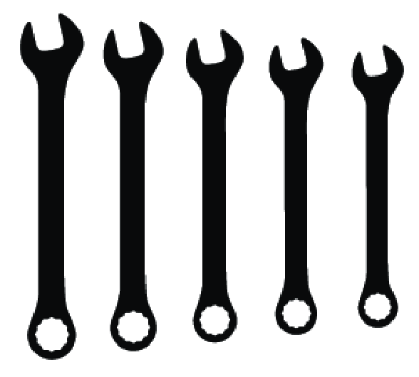

<!-- pdf:14 -->

# LUYỆN TẬP CHUNG

**Ví dụ 1:** Cho các phân số: $\frac{1}{5}; \frac{4}{120}$ và $\frac{-50}{60}$.
<!-- ocr-ok: đã đối chiếu ảnh trang PDF 14, OCR đọc thiếu nhãn Ví dụ 1 -->

a) Rút gọn rồi quy đồng mẫu các phân số trên.

b) Sắp xếp các phân số theo thứ tự từ bé đến lớn.

**Giải:**

a) $\frac{4}{120} = \frac{4 : 4}{120 : 4} = \frac{1}{30}; \quad \frac{-50}{60} = \frac{(-50) : 10}{60 : 10} = \frac{-5}{6}$.

Quy đồng mẫu các phân số: $\frac{1}{5}; \frac{1}{30}$ và $\frac{-5}{6}$.

Ta có: $\text{BCNN}(5, 30, 6) = 30$ nên $\frac{1}{5} = \frac{1 \cdot 6}{5 \cdot 6} = \frac{6}{30}; \quad \frac{-5}{6} = \frac{(-5) \cdot 5}{6 \cdot 5} = \frac{-25}{30}$.

b) Vì $-25 < 1 < 6$ nên $\frac{-25}{30} < \frac{1}{30} < \frac{6}{30}$. Do đó $\frac{-5}{6} < \frac{1}{30} < \frac{1}{5}$.
<!-- ocr-ok: đã đối chiếu ảnh trang PDF 14, câu nhiều công thức phân số -->

Vậy các phân số được sắp xếp theo thứ tự từ bé đến lớn là: $\frac{-50}{60}; \frac{4}{120}; \frac{1}{5}$.

**Ví dụ 2:** Bố dẫn Mai đến cửa hàng văn phòng phẩm để mua bút. Cửa hàng có hai loại hộp bút: Hộp $12$ cái bút cùng loại có giá bán $75$ nghìn đồng; hộp $15$ cái bút cùng loại có giá bán $88$ nghìn đồng. Bố Mai khuyên nên chọn mua hộp $15$ cái bút vì rẻ hơn. Em hãy giúp Mai giải thích lời khuyên của bố.

**Giải:**

Giá tiền mỗi cái bút trong hộp $12$ cái là: $\frac{75}{12}$ (nghìn đồng).

Giá tiền mỗi cái bút trong hộp $15$ cái là: $\frac{88}{15}$ (nghìn đồng).

Ta có: $\frac{75}{12} = \frac{75 \cdot 5}{12 \cdot 5} = \frac{375}{60}; \quad \frac{88}{15} = \frac{88 \cdot 4}{15 \cdot 4} = \frac{352}{60}$.

Vì $375 > 352$ nên $\frac{375}{60} > \frac{352}{60}$. Do đó, $\frac{75}{12} > \frac{88}{15}$.

Vậy bố Mai khuyên nên chọn mua hộp $15$ cái bút vì rẻ hơn là chính xác.

<!-- pdf:15 -->

**Ví dụ 3:** Tìm số nguyên $x$ biết:
<!-- ocr-ok: đã đối chiếu ảnh trang PDF 15, OCR đọc thiếu nhãn Ví dụ 3 -->

$\frac{x}{10} = \frac{-11}{5}.$

**Giải:**

Từ $\frac{x}{10} = \frac{-11}{5}$ nên $x \cdot 5 = 10 \cdot (-11) = -110$. $\quad (\leftarrow$ *Quy tắc bằng nhau của hai phân số* $)$
<!-- ocr-ok: đã đối chiếu ảnh trang PDF 15, chú thích màu xanh bên phải công thức -->

Do đó $x = (-110) : 5 = -22$.

## BÀI TẬP

**6.14.** Quy đồng mẫu các phân số sau:

$\frac{5}{7}; \frac{-3}{21}; \frac{-8}{15}.$

**6.15.** Tính đến hết ngày 31-12-2019, tổng diện tích đất có rừng trên toàn quốc là khoảng $14\,600\,000$ hécta, trong đó diện tích rừng tự nhiên khoảng $10\,300\,000$ hécta, diện tích rừng trồng khoảng $4\,300\,000$ hécta. Hỏi diện tích rừng trồng chiếm bao nhiêu phần của tổng diện tích đất có rừng trên toàn quốc?

*(Theo nongnghiep.vn)*

**6.16.** Dùng tính chất cơ bản của phân số, hãy giải thích vì sao các phân số sau bằng nhau:

a) $\frac{20}{30}$ và $\frac{30}{45}$;

b) $\frac{-25}{35}$ và $\frac{-55}{77}$.

**6.17.** Tìm phân số lớn hơn $1$ trong các phân số sau rồi viết chúng dưới dạng hỗn số.

$\frac{15}{8}; \quad \frac{47}{4}; \quad \frac{-3}{7}.$

**6.18.** Viết các hỗn số $4\frac{1}{13}; 2\frac{2}{5}$ dưới dạng phân số.
<!-- ocr-ok: đã đối chiếu ảnh trang PDF 15, OCR mất nhãn 6.18 -->

**6.19.** Tìm số nguyên $x$, biết:
<!-- ocr-ok: đã đối chiếu ảnh trang PDF 15, OCR mất nhãn 6.19 -->

$\frac{-6}{x} = \frac{30}{60}.$

**6.20.** Một bộ $5$ chiếc cờ lê như hình bên có thể vặn được $5$ loại ốc vít có đường kính lần lượt là:

$\frac{9}{10}\text{ cm}; \; \frac{4}{5}\text{ cm}; \; \frac{3}{2}\text{ cm}; \; \frac{6}{5}\text{ cm và } \frac{1}{2}\text{ cm}.$

Em hãy sắp xếp các số đo này theo thứ tự từ nhỏ đến lớn.

## 📷 Danh sách hình trong bài

| Mã hình | Trang PDF | Vị trí trong bài | Chú thích gốc |
| --- | :---: | --- | --- |
| H6-toan-ltc-c06-01-01 | 14 | Ví dụ 2 | (sách không đánh số, hình minh hoạ bố và Mai mua bút tại cửa hàng văn phòng phẩm) |
| H6-toan-ltc-c06-01-02 | 15 | Bài tập 6.20 | (sách không đánh số, bộ 5 chiếc cờ lê) |
