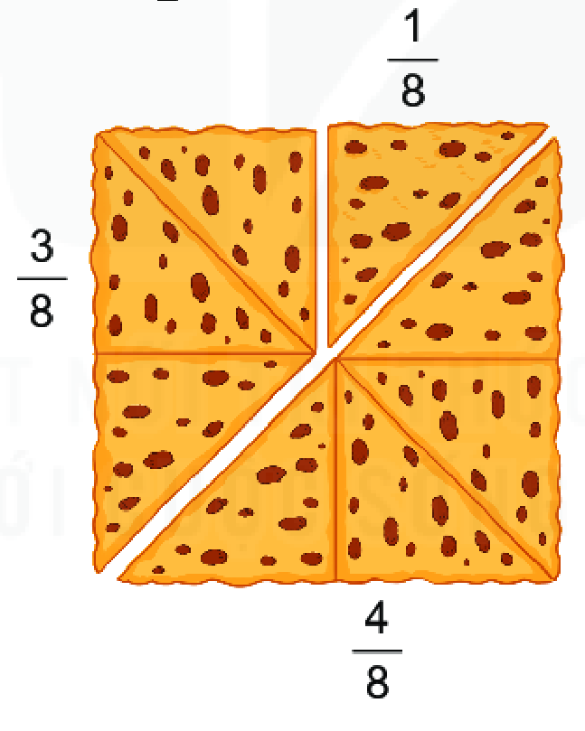

<!-- pdf:26 -->

# LUYỆN TẬP CHUNG

**Ví dụ 1:** Tính giá trị của biểu thức sau:

$B = b \cdot \frac{1}{2} + b \cdot \frac{1}{3} - b \cdot \frac{1}{4} \text{ với } b = \frac{4}{5}.$

**Giải:**

Với $b = \frac{4}{5}$ ta có:

$B = \frac{4}{5} \cdot \frac{1}{2} + \frac{4}{5} \cdot \frac{1}{3} - \frac{4}{5} \cdot \frac{1}{4} = \frac{4}{5} \cdot \left(\frac{1}{2} + \frac{1}{3} - \frac{1}{4}\right)$

$= \frac{4}{5} \cdot \left(\frac{6}{12} + \frac{4}{12} - \frac{3}{12}\right) = \frac{4}{5} \cdot \frac{7}{12} = \frac{7}{15}.$

**Ví dụ 2:** Việt cùng các bạn trong lớp đi tham quan khu di tích Côn Sơn - Kiếp Bạc, thành phố Chí Linh, tỉnh Hải Dương. Sau khi tham quan đền thờ Nguyễn Trãi, Việt cùng các bạn leo lên tham quan Bàn Cờ Tiên trên đỉnh núi Côn Sơn. Trong $5$ phút đầu, Việt đi được $\frac{1}{6}$ quãng đường; $5$ phút sau đi được $\frac{1}{7}$ quãng đường; $5$ phút sau nữa đi được $\frac{1}{9}$ quãng đường. Hỏi sau $15$ phút, Việt đi được bao nhiêu phần quãng đường?

**Giải:**

Sau $15$ phút, Việt đi được số phần quãng đường là:

$\frac{1}{6} + \frac{1}{7} + \frac{1}{9} = \frac{21}{126} + \frac{18}{126} + \frac{14}{126} = \frac{21 + 18 + 14}{126} = \frac{53}{126}\text{ (quãng đường)}.$

**Ví dụ 3:** Để làm món thịt kho dừa, ta cần có cùi dừa, thịt ba chỉ, đường, nước mắm và muối. Thông thường, lượng thịt ba chỉ và lượng đường được sử dụng lần lượt bằng $\frac{3}{2}$ và $\frac{1}{20}$ lượng cùi dừa. Theo công thức này, nếu có $600$ gam thịt ba chỉ thì ta cần bao nhiêu gam cùi dừa, bao nhiêu gam đường?

**Giải:**

Lượng thịt ba chỉ bằng $\frac{3}{2}$ khối lượng cùi dừa nên lượng cùi dừa cần là: $600 : \frac{3}{2} = 400\text{ (g)}$.

Lượng đường bằng $\frac{1}{20}$ lượng cùi dừa nên lượng đường cần là:

$400 \cdot \frac{1}{20} = 20\text{ (g)}.$

<!-- pdf:27 -->

## BÀI TẬP

**6.37.** Tính:

a) $\frac{-1}{2} + \frac{5}{6} + \frac{1}{3}$;

b) $\frac{-3}{8} + \frac{7}{4} - \frac{1}{12}$;

c) $\frac{3}{5} : \left(\frac{1}{4} \cdot \frac{7}{5}\right)$;

d) $\frac{10}{11} + \frac{4}{11} : 4 - \frac{1}{8}$.

**6.38.** Tính một cách hợp lí.

$B = \frac{5}{13} \cdot \frac{8}{15} + \frac{5}{13} \cdot \frac{26}{15} - \frac{5}{13} \cdot \frac{8}{15}.$

**6.39.** Tính giá trị của biểu thức sau:

$B = \frac{1}{3} \cdot b + \frac{2}{9} \cdot b - b : \frac{9}{4} \text{ với } b = \frac{9}{10}.$

**6.40.** Nam cắt một chiếc bánh nướng hình vuông thành ba phần không bằng nhau (như hình vẽ). Nam đã ăn hai phần bánh, tổng cộng là $\frac{1}{2}$ chiếc bánh. Đố em biết Nam đã ăn hai phần bánh nào?

**6.41.** Để làm một chiếc bánh chưng trong dịp Tết cổ truyền, Vân phải chuẩn bị: Gạo nếp, đậu xanh không vỏ, thịt ba chỉ, lá dong, và các gia vị khác. Khối lượng đậu xanh bằng $\frac{3}{5}$ khối lượng gạo nếp và gấp $\frac{3}{2}$ khối lượng thịt ba chỉ.

Nếu có $150$ gam đậu xanh thì cần bao nhiêu gam gạo nếp và bao nhiêu gam thịt ba chỉ?

**6.42** Hà thường đi xe đạp từ nhà đến trường với vận tốc $12\text{ km/h}$, hết $\frac{1}{5}$ giờ. Hôm nay xe đạp bị hỏng nên Hà phải đi bộ đến trường với vận tốc $5\text{ km/h}$. Hỏi hôm nay Hà đi đến trường mất bao lâu?

## 📷 Danh sách hình trong bài

| Mã hình | Trang PDF | Vị trí trong bài | Chú thích gốc |
| --- | :---: | --- | --- |
| H6-toan-ltc-c06-02-01 | 27 | Bài tập 6.40 | (sách không đánh số, chiếc bánh nướng hình vuông cắt thành ba phần $\frac{1}{8}, \frac{3}{8}, \frac{4}{8}$) |
