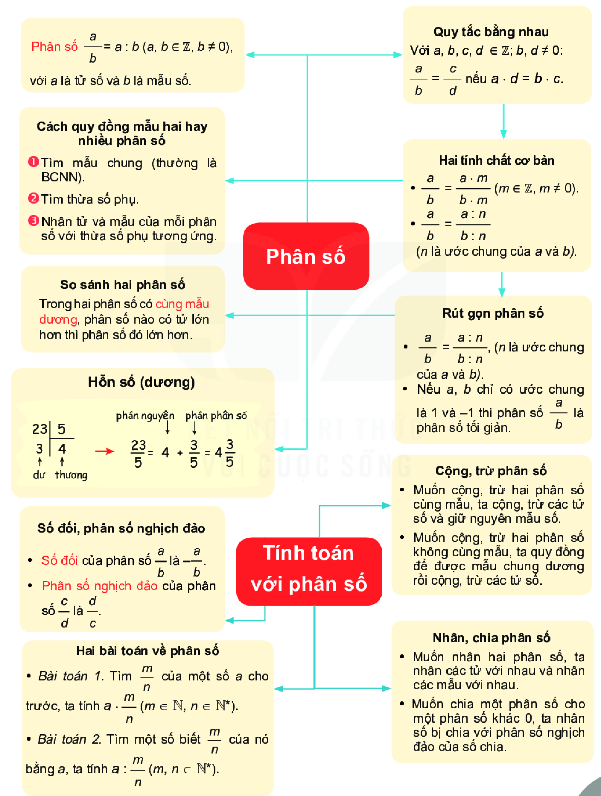
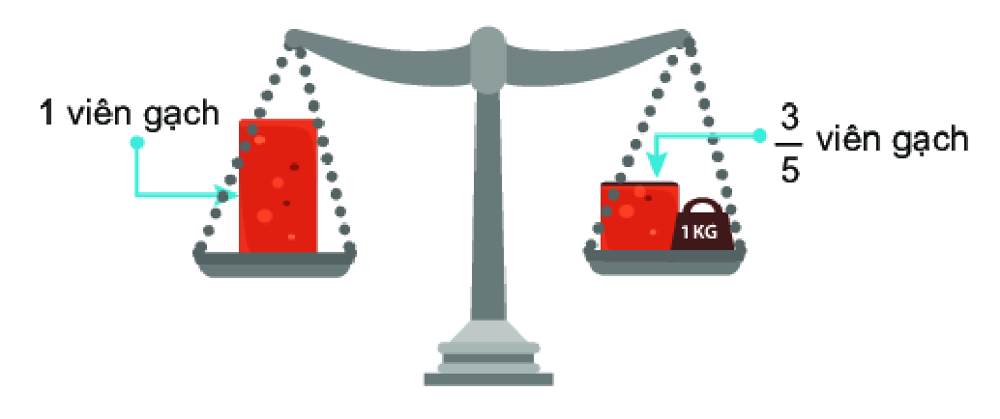

<!-- pdf:28 -->

# CHÚNG TA ĐÃ HỌC NHỮNG GÌ?

- **Phân số:**
  - *Phân số:* $\frac{a}{b} = a : b$ ($a, b \in \mathbb{Z}, b \ne 0$), với $a$ là tử số và $b$ là mẫu số.
  - *Quy tắc bằng nhau:* Với $a, b, c, d \in \mathbb{Z}; b, d \ne 0$: $\frac{a}{b} = \frac{c}{d}$ nếu $a \cdot d = b \cdot c$.
  - *Hai tính chất cơ bản:*
    - $\frac{a}{b} = \frac{a \cdot m}{b \cdot m}$ ($m \in \mathbb{Z}, m \ne 0$).
    - $\frac{a}{b} = \frac{a : n}{b : n}$ ($n$ là ước chung của $a$ và $b$).
  - *Rút gọn phân số:*
    - $\frac{a}{b} = \frac{a : n}{b : n}$, ($n$ là ước chung của $a$ và $b$).
    - Nếu $a, b$ chỉ có ước chung là $1$ và $-1$ thì phân số $\frac{a}{b}$ là phân số tối giản.
  - *Cách quy đồng mẫu hai hay nhiều phân số:*
    1. Tìm mẫu chung (thường là BCNN).
    2. Tìm thừa số phụ.
    3. Nhân tử và mẫu của mỗi phân số với thừa số phụ tương ứng.
  - *So sánh hai phân số:* Trong hai phân số có cùng mẫu dương, phân số nào có tử lớn hơn thì phân số đó lớn hơn.
  - *Hỗn số (dương):* $23 : 5$ được thương là $4$, dư $3$ $\rightarrow \frac{23}{5} = 4 + \frac{3}{5} = 4\frac{3}{5}$ ($4$: phần nguyên; $\frac{3}{5}$: phần phân số).
- **Tính toán với phân số:**
  - *Số đối, phân số nghịch đảo:*
    - Số đối của phân số $\frac{a}{b}$ là $-\frac{a}{b}$.
    - Phân số nghịch đảo của phân số $\frac{c}{d}$ là $\frac{d}{c}$.
  - *Cộng, trừ phân số:*
    - Muốn cộng, trừ hai phân số cùng mẫu, ta cộng, trừ các tử số và giữ nguyên mẫu số.
    - Muốn cộng, trừ hai phân số không cùng mẫu, ta quy đồng để được mẫu chung dương rồi cộng, trừ các tử số.
  - *Nhân, chia phân số:*
    - Muốn nhân hai phân số, ta nhân các tử với nhau và nhân các mẫu với nhau.
    - Muốn chia một phân số cho một phân số khác $0$, ta nhân số bị chia với phân số nghịch đảo của số chia.
  - *Hai bài toán về phân số:*
    - *Bài toán 1.* Tìm $\frac{m}{n}$ của một số $a$ cho trước, ta tính $a \cdot \frac{m}{n}$ ($m \in \mathbb{N}, n \in \mathbb{N}^*$).
    - *Bài toán 2.* Tìm một số biết $\frac{m}{n}$ của nó bằng $a$, ta tính $a : \frac{m}{n}$ ($m, n \in \mathbb{N}^*$).

<!-- pdf:29 -->

## BÀI TẬP CUỐI CHƯƠNG VI

**6.43.** Thay số thích hợp vào dấu "?".
<!-- ocr-ok: đã đối chiếu ảnh trang PDF 29, OCR mất nhãn 6.43 -->

$\frac{-10}{16} = \frac{?}{56} = \frac{-20}{?} = \frac{50}{?}$

**6.44.** Tính một cách hợp lí.

a) $A = \frac{-3}{14} + \frac{2}{13} + \frac{-25}{14} + \frac{-15}{13}$;

b) $B = \frac{5}{3} \cdot \frac{7}{25} + \frac{5}{3} \cdot \frac{21}{25} - \frac{5}{3} \cdot \frac{7}{25}$.

**6.45.** Mẹ mua cho Mai một hộp sữa tươi loại $1\,000\text{ ml}$. Ngày đầu Mai uống $\frac{1}{5}$ hộp; ngày tiếp theo Mai uống tiếp $\frac{1}{4}$ hộp. Hỏi:

a) Sau hai ngày hộp sữa tươi còn lại bao nhiêu phần?

b) Tính lượng sữa tươi còn lại sau hai ngày.

**6.46.** Một bác nông dân thu hoạch và mang cà chua ra chợ bán. Bác đã bán được $20\text{ kg}$, tức là $\frac{2}{5}$ số cà chua. Hỏi bác nông dân đã mang bao nhiêu kilôgam cà chua ra chợ bán?

**6.47.** Con người ngủ khoảng $8$ giờ mỗi ngày. Nếu trung bình một năm có $365\frac{1}{4}$ ngày, hãy cho biết số ngày ngủ trung bình mỗi năm của con người.

**6.48.** Các phân số sau được sắp xếp theo một quy luật, hãy quy đồng mẫu các phân số để tìm quy luật, rồi viết hai phân số kế tiếp.

$\frac{1}{8}, \frac{1}{20}, \frac{-1}{40}, \frac{-1}{10}, \dots, \dots$

**6.49.** Trong hình dưới đây, cân đang ở vị trí thăng bằng.
<!-- ocr-ok: đã đối chiếu ảnh trang PDF 29, OCR đọc sai câu dẫn Bài 6.49 -->

Đố em biết một viên gạch cân nặng bao nhiêu kilôgam?

## 📷 Danh sách hình trong bài

| Mã hình | Trang PDF | Vị trí trong bài | Chú thích gốc |
| --- | :---: | --- | --- |
| H6-toan-ot-c06-01 | 28 | Tổng kết chương | (sách không đánh số, sơ đồ tổng kết Chương VI: Chúng ta đã học những gì?) |
| H6-toan-ot-c06-02 | 29 | Bài tập 6.49 | (sách không đánh số, cân thăng bằng giữa $1$ viên gạch và $\frac{3}{5}$ viên gạch cùng quả cân $1\text{ kg}$) |
