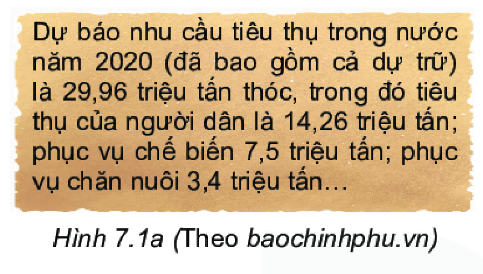
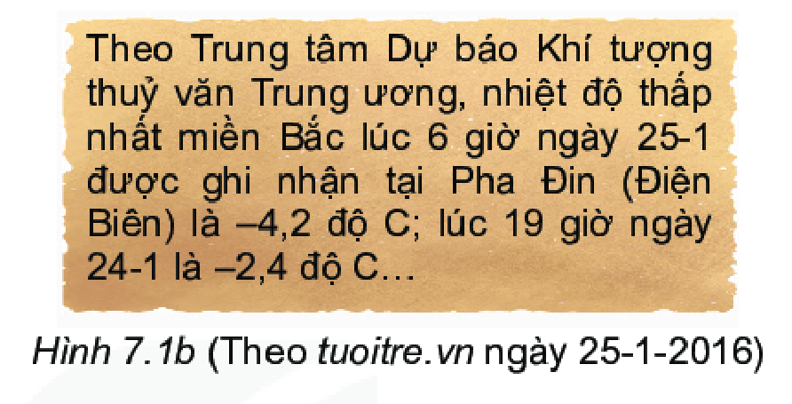
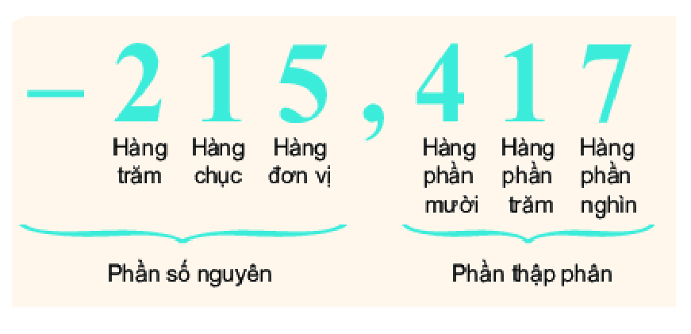

<!-- pdf:31 -->

<!-- Trang mở đầu Chương VII (PDF 30): CHƯƠNG VII. SỐ THẬP PHÂN — Giới thiệu ứng dụng số thập phân và tỉ số phần trăm qua số liệu biến đổi khí hậu (1,1°C; 3,99 triệu kilômét vuông; 25%). Nội dung chính: Số thập phân; Tính toán với số thập phân; Làm tròn và ước lượng; Một số bài toán về tỉ số và tỉ số phần trăm. -->

# BÀI 28: SỐ THẬP PHÂN

## 🔤 Khái niệm, thuật ngữ

- Phân số thập phân
- Số thập phân âm
- Số đối
- So sánh hai số thập phân

## 🎯 Kiến thức, kĩ năng

- Nhận biết số thập phân âm; số đối của một số thập phân.
- So sánh hai số thập phân.
- Sử dụng số thập phân trong một số tình huống thực tiễn.

## 🔴 Mở đầu

> Dự báo nhu cầu tiêu thụ trong nước năm 2020 (đã bao gồm cả dự trữ) là $29,96$ triệu tấn thóc, trong đó tiêu thụ của người dân là $14,26$ triệu tấn; phục vụ chế biến $7,5$ triệu tấn; phục vụ chăn nuôi $3,4$ triệu tấn...
<!-- ocr-ok: đã đối chiếu ảnh trang PDF 31, OCR bỏ sót phần lớn chữ trên nền giấy màu Hình 7.1a -->

*Hình 7.1a (Theo baochinhphu.vn)*

> Theo Trung tâm Dự báo Khí tượng thuỷ văn Trung ương, nhiệt độ thấp nhất miền Bắc lúc $6$ giờ ngày 25-1 được ghi nhận tại Pha Đin (Điện Biên) là $-4,2$ độ C; lúc $19$ giờ ngày 24-1 là $-2,4$ độ C...
<!-- ocr-ok: đã đối chiếu ảnh trang PDF 31, OCR bỏ sót chữ trên nền giấy màu Hình 7.1b -->

*Hình 7.1b (Theo tuoitre.vn ngày 25-1-2016)*

Trong hai đoạn tin trên, ngoài các số thập phân quen thuộc, ta còn gặp cả các số với dấu “$-$” đứng trước, đó là các số thập phân âm. Trong bài này chúng ta sẽ tìm hiểu ý nghĩa của số thập phân âm trong đời sống và cách dùng chúng.

## 1. PHÂN SỐ THẬP PHÂN VÀ SỐ THẬP PHÂN

**HĐ1:** Viết các phân số thập phân $\frac{17}{10}; \frac{34}{100}; \frac{25}{1000}$ dưới dạng số thập phân.

**HĐ2:** Viết các số đối của các phân số thập phân trên.

> **Số thập phân âm:**
> - Các phân số $-\frac{17}{10}; \frac{-34}{100}; \frac{-25}{1000}; \dots$ cũng được gọi là các **phân số thập phân**.
> - Ta viết $-\frac{17}{10} = -1,7$ và gọi $-1,7$ là **số thập phân âm**, đọc là “âm một phẩy bảy”.
> - Các số $1,7$; $0,34$; $0,025$; $\dots$ gọi là **số thập phân dương**, đôi khi còn được viết là $+1,7$; $+0,34$; $+0,025$; $\dots$
> - Các số thập phân dương và các số thập phân âm gọi chung là **số thập phân**.
> - Các số $1,7$ và $-1,7$ cũng là **hai số đối nhau**.

**Nhận xét:**

- Mỗi số thập phân gồm **phần số nguyên** viết bên trái dấu “,” và **phần thập phân** viết bên phải dấu “,”.
- Mọi *phân số thập phân* đều viết được dưới dạng *số thập phân* và ngược lại.

<!-- pdf:32 -->

> ❓ Em hãy chỉ ra các số thập phân xuất hiện trong đoạn tin hình 7.1a và hình 7.1b. Tìm số đối của các số thập phân đó.

**Luyện tập 1:**

1. Viết các phân số thập phân $\frac{-5}{1000}; -\frac{798}{10}$ dưới dạng số thập phân.

2. Viết các số thập phân xuất hiện trong đoạn tin hình 7.1b dưới dạng phân số thập phân.

## 2. SO SÁNH HAI SỐ THẬP PHÂN

Ta đã biết cách so sánh hai số thập phân dương và so sánh hai phân số. Tương tự, ta cũng có:

<!-- term: So sánh hai số thập phân -->
> - Số thập phân âm nhỏ hơn $0$ và nhỏ hơn số thập phân dương.
> - Nếu $a, b$ là hai số thập phân dương và $a > b$ thì $-a < -b$.

**Ví dụ:** So sánh:

a) $2,93$ và $6,15$;

b) $-25,3$ và $1,5$;

c) $-10,186$ và $-10,08$.

**Giải:**

a) $2,93 < 6,15$ $\leftarrow$ $2 < 6$

b) $-25,3 < 1,5$ $\leftarrow$ $-25,3$ là số âm và $1,5$ là số dương
<!-- ocr-ok: đã đối chiếu ảnh trang PDF 32, OCR bỏ sót dòng chữ màu xanh lá giải thích -->

c) $-10,186 < -10,08$ $\leftarrow$ $10,186 > 10,08$

**Luyện tập 2:** Sắp xếp các số sau theo thứ tự từ bé đến lớn: $0$; $-8,152$; $0,12$; $-8,9$.

**Vận dụng:** Đọc đoạn tin trong hình 7.1b và cho biết trong hai thời điểm, $19$ giờ ngày 24-1-2016 và $6$ giờ ngày 25-1-2016, thời điểm nào nhiệt độ tại Pha Đin (Điện Biên) xuống thấp hơn.

## BÀI TẬP

**7.1.** a) Viết các phân số thập phân sau dưới dạng số thập phân.

$\frac{21}{10}; \frac{-35}{10}; \frac{-125}{100}; \frac{-89}{1000}.$

b) Chỉ ra các số thập phân âm viết được trong câu a.

**7.2.** Tìm số đối của các số thập phân sau:

$-1,2;\ 4,15;\ 19,2.$

**7.3.** So sánh các số sau:

a) $-421,3$ với $0,15$;

b) $-7,52$ với $-7,6$.

**7.4.** Nhiệt độ đông đặc của một chất là nhiệt độ mà tại đó chất chuyển từ thể lỏng sang thể rắn.

Nhiệt độ đông đặc của rượu, nước và thuỷ ngân lần lượt là:

$-117^\circ\text{C};\ 0^\circ\text{C};\ -38,83^\circ\text{C}.$

Hãy sắp xếp nhiệt độ đông đặc của ba chất này theo thứ tự từ nhỏ đến lớn.

## 📷 Danh sách hình trong bài

| Mã hình | Trang PDF | Vị trí trong bài | Chú thích gốc |
| --- | :---: | --- | --- |
| H6-toan-b28-01 | 31 | Mở đầu | Hình 7.1a (Theo baochinhphu.vn) |
| H6-toan-b28-02 | 31 | Mở đầu | Hình 7.1b (Theo tuoitre.vn ngày 25-1-2016) |
| H6-toan-b28-03 | 31 | Mục 1, Nhận xét | (sách không đánh số, sơ đồ phần số nguyên và phần thập phân của số $-215,417$) |
