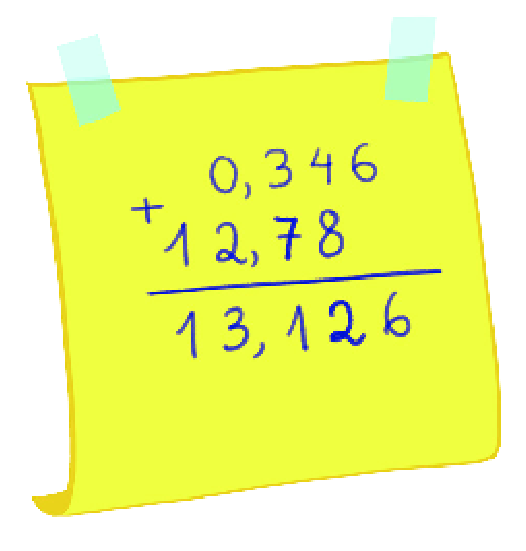
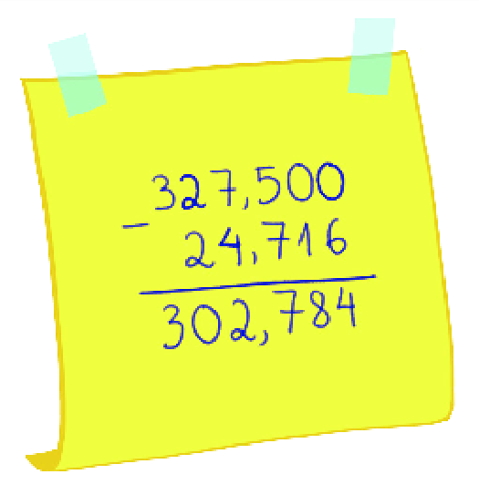
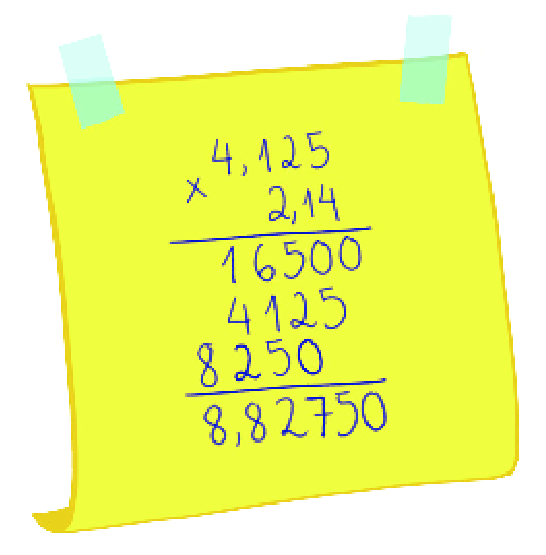
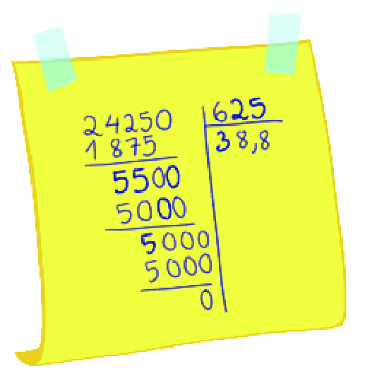

<!-- pdf:33 -->

# BÀI 29: TÍNH TOÁN VỚI SỐ THẬP PHÂN

## 🎯 Kiến thức, kĩ năng

- Thực hiện phép tính cộng, trừ, nhân, chia số thập phân.
- Vận dụng các tính chất của phép tính trong tính toán.
- Giải quyết một số bài toán thực tiễn gắn với các phép tính về số thập phân.

## 🔴 Mở đầu

Một tàu thăm dò đáy biển đang ở độ cao $-0,32\text{ km}$ so với mực nước biển.

Tính độ cao mới của tàu sau khi tàu nổi lên thêm $0,11\text{ km}$.

## 1. PHÉP CỘNG, TRỪ SỐ THẬP PHÂN

**Phép cộng số thập phân**

**HĐ1:** Tính:

a) $2,259 + 0,31$;

b) $11,325 - 0,15$.

**HĐ2:** Thực hiện các phép tính sau bằng cách quy về cộng hoặc trừ hai số thập phân dương tương tự như với số nguyên:

a) $(-2,5) + (-0,25)$;

b) $(-1,4) + 2,1$.

<!-- term: Quy tắc cộng hai số thập phân -->
> - Cộng hai số thập phân âm:
>   $(-a) + (-b) = -(a + b)$ với $a, b > 0$.
> - Cộng hai số thập phân khác dấu:
>   $(-a) + b = b - a$ nếu $0 < a \le b$;
>   $(-a) + b = -(a - b)$ nếu $a > b > 0$.

**Ví dụ 1:**

$(-0,346) + (-12,78)$

$= -(0,346 + 12,78)$ $\leftarrow$ Cộng hai số âm

$= -13,126$;

**Luyện tập 1:** Tính:

a) $(-2,259) + (-31,3)$;

b) $11,5 + (-0,325)$.

**Vận dụng 1:** Em hãy giải bài toán mở đầu.

<!-- pdf:34 -->

<!-- term: Phép trừ hai số thập phân -->
> Phép trừ hai số thập phân được đưa về phép cộng với số đối:
> $a - b = a + (-b)$.

**Ví dụ 2:**

a) $(-3,4) - 2,3 = (-3,4) + (-2,3) = -(3,4 + 2,3) = -5,7$;

b) $24,716 - 327,5 = -(327,5 - 24,716) = -302,784$.

**Luyện tập 2:** Tính:

a) $32,1 - (-29,325)$;

b) $7,289 - 16,075$.

**Vận dụng 2:** Nhiệt độ trung bình năm ở Bắc Cực là $-3,4^\circ\text{C}$, ở Nam Cực là $-49,3^\circ\text{C}$ (Theo *www.southpole.aq*). Cho biết nhiệt độ trung bình năm ở nơi nào cao hơn và cao hơn bao nhiêu độ C?

## 2. PHÉP NHÂN SỐ THẬP PHÂN
<!-- ocr-ok: đã đối chiếu ảnh trang PDF 34, OCR bỏ sót tiêu đề mục trên nền băng màu xanh -->

**HĐ3:** Tính: $12,5 \cdot 1,2$.

**HĐ4:** Thực hiện phép nhân sau bằng cách quy về phép nhân hai số thập phân dương tương tự như với số nguyên:

a) $(-12,5) \cdot 1,2$;

b) $(-12,5) \cdot (-1,2)$.

<!-- term: Quy tắc nhân hai số thập phân -->
> - Nhân hai số cùng dấu:
>   $(-a) \cdot (-b) = a \cdot b$ với $a, b > 0$.
> - Nhân hai số khác dấu:
>   $(-a) \cdot b = a \cdot (-b) = -(a \cdot b)$ với $a, b > 0$.

**Ví dụ 3:**

$(-4,125) \cdot (-2,14)$

$= 4,125 \cdot 2,14$ $\leftarrow$ Nhân hai số cùng dấu

$= 8,8275$;

**Luyện tập 3:** Tính:

a) $2,72 \cdot (-3,25)$;

b) $(-0,827) \cdot (-1,1)$.

<!-- pdf:35 -->

**Vận dụng 3:** Mức tiêu thụ nhiên liệu của một chiếc xe máy là $1,6$ lít trên $100$ kilômét. Giá một lít xăng E5 RON 92-II ngày 20-10-2020 là $14\,260$ đồng (đã bao gồm thuế). Một người đi xe máy đó trên quãng đường $100\text{ km}$ thì sẽ hết bao nhiêu tiền xăng?

## 3. PHÉP CHIA SỐ THẬP PHÂN
<!-- ocr-ok: đã đối chiếu ảnh trang PDF 35, OCR bỏ sót tiêu đề mục trên nền băng màu xanh -->

**HĐ5:** Tính: $31,5 : 1,5$.

**HĐ6:** Thực hiện các phép tính sau bằng cách quy về phép chia hai số thập phân dương tương tự như với số nguyên:

a) $(-31,5) : 1,5$;

b) $(-31,5) : (-1,5)$.

<!-- term: Quy tắc chia hai số thập phân -->
> - Chia hai số cùng dấu:
>   $(-a) : (-b) = a : b$ với $a, b > 0$.
> - Chia hai số khác dấu:
>   $(-a) : b = a : (-b) = -(a : b)$ với $a, b > 0$.
<!-- ocr-ok: đã đối chiếu ảnh trang PDF 35, OCR đọc nhầm chữ dấu thành dầu trong hộp kiến thức -->

> ❓ Thương của hai số khi nào là số dương? Khi nào là số âm?

**Ví dụ 4:**

$24,25 : (-0,625) = -(24,250 : 0,625)$ $\leftarrow$ Chia hai số khác dấu

$= -(24\,250 : 625) = -38,8$. $\leftarrow$ Chia hai số thập phân dương

**Luyện tập 4:** Tính:

a) $(-5,24) : 1,31$;

b) $(-4,625) : (-1,25)$.

**Vận dụng 4:** Tài khoản vay ngân hàng của một chủ xưởng gỗ có ghi số dư $-1,25$ tỉ đồng. Sau khi chủ xưởng trả được một nửa khoản nợ thì số dư tài khoản là bao nhiêu?

<!-- pdf:36 -->

## 4. TÍNH GIÁ TRỊ BIỂU THỨC VỚI SỐ THẬP PHÂN
<!-- ocr-ok: đã đối chiếu ảnh trang PDF 36, OCR bỏ sót tiêu đề mục trên nền băng màu xanh -->

<!-- term: Tính chất của phép cộng và phép nhân số thập phân -->
Phép cộng và phép nhân số thập phân cũng có các tính chất giao hoán, kết hợp, phân phối như phép cộng, phép nhân số nguyên và phân số. Vận dụng các tính chất này ta có thể tính giá trị các biểu thức một cách hợp lí.

**Ví dụ 5:** Tính một cách hợp lí.

a) $3,45 - 5,7 + 8,55$;

b) $(2,6 - 2,6 \cdot 3) : (1,153 + 1,447)$.

**Giải:**

a) $3,45 - 5,7 + 8,55 = (3,45 + 8,55) - 5,7$ $\leftarrow$ Tính chất giao hoán, kết hợp

$= 12 - 5,7 = 6,3$.

b) $(2,6 - 2,6 \cdot 3) : (1,153 + 1,447)$

$= (2,6 \cdot 1 - 2,6 \cdot 3) : 2,6$

$= 2,6 \cdot (1 - 3) : 2,6$ $\leftarrow$ Tính chất phân phối

$= -2$.

**Ví dụ 6:** Tính giá trị của biểu thức: $A = (2x - 1,5) + x : 2$ khi $x = -1,2$.

**Giải:**

Thay $x = -1,2$ vào biểu thức, ta được:

$A = [2 \cdot (-1,2) - 1,5] + (-1,2) : 2 = (-2,4 - 1,5) + (-1,2 : 2)$

$= -(2,4 + 1,5) + (-0,6)$

$= -3,9 - 0,6 = -(3,9 + 0,6) = -4,5$.

**Luyện tập 5:** Tính giá trị của biểu thức sau:

$21 \cdot 0,1 - [4 - (-3,2 - 4,8)] : 0,1.$

**Vận dụng 5:** Từ độ cao $-0,21\text{ km}$ (so với mực nước biển), tàu thăm dò đáy biển bắt đầu lặn xuống. Biết rằng cứ sau mỗi phút, tàu lặn xuống sâu thêm được $0,021\text{ km}$. Viết biểu thức tính độ cao xác định vị trí tàu sau $10$ phút kể từ khi tàu bắt đầu lặn.

**Thử thách nhỏ:** Thầy giáo viết lên bảng dãy số $-3,2$; $-0,75$; $120$; $-0,1$ và yêu cầu mỗi học sinh chọn hai số rồi làm một phép tính với hai số đã chọn.

a) Mai làm phép trừ và nhận được kết quả là $120,75$. Theo em, Mai đã chọn hai số nào?

b) Hà thực hiện phép chia và nhận được kết quả là $32$. Em có biết Hà đã chọn hai số nào không?

<!-- pdf:37 -->

## BÀI TẬP

**7.5.** Tính:

a) $(-12,245) + (-8,235)$;

b) $(-8,451) + 9,79$;

c) $(-11,254) - (-7,35)$.

**7.6.** Tính:

a) $8,625 \cdot (-9)$;

b) $(-0,325) \cdot (-2,35)$;

c) $(-9,5875) : 2,95$.

**7.7.** Để nhân (chia) một số thập phân với $0,1$; $0,01$; $0,001$; $\dots$ ta chỉ cần dịch dấu phẩy của số thập phân đó sang trái (phải) $1, 2, 3, \dots$ hàng, chẳng hạn:

$2,057 \cdot 0,1 = 0,2057;$

$-31,025 : 0,01 = -3\,102,5.$

Tính nhẩm:

a) $(-4,125) \cdot 0,01$;

b) $(-28,45) : (-0,01)$.

**7.8.** Tính giá trị của các biểu thức sau:

a) $2,5 \cdot (4,1 - 3 - 2,5 + 2 \cdot 7,2) + 4,2 : 2$;

b) $2,86 \cdot 4 + 3,14 \cdot 4 - 6,01 \cdot 5 + 3^2$.

**7.9.** Điểm đông đặc và điểm sôi của thuỷ ngân lần lượt là $-38,83^\circ\text{C}$ và $356,73^\circ\text{C}$. Một lượng thuỷ ngân đang để trong tủ bảo quản ở nhiệt độ $-51,2^\circ\text{C}$.

a) Ở nhiệt độ đó, thuỷ ngân ở thể rắn, thể lỏng hay thể khí?

b) Nhiệt độ của tủ phải tăng thêm bao nhiêu độ để lượng thuỷ ngân đó bắt đầu bay hơi?

**7.10.** Một khối nước đá có nhiệt độ $-4,5^\circ\text{C}$. Nhiệt độ của khối nước đá đó phải tăng thêm bao nhiêu độ để chuyển thành thể lỏng? (biết điểm nóng chảy của nước là $0^\circ\text{C}$).

**7.11.** Năm 2018, ngành giấy Việt Nam sản xuất được $3,674$ triệu tấn. Biết rằng để sản xuất ra $1$ tấn giấy phải dùng hết $4,4$ tấn gỗ. Em hãy tính xem năm 2018 Việt Nam đã phải dùng bao nhiêu tấn gỗ cho sản xuất giấy?

*(Theo vppa.vn)*

## 📷 Danh sách hình trong bài

| Mã hình | Trang PDF | Vị trí trong bài | Chú thích gốc |
| --- | :---: | --- | --- |
| H6-toan-b29-01 | 33 | Mở đầu | (sách không đánh số, minh hoạ tàu thăm dò đáy biển ở độ cao $-0,32\text{ km}$) |
| H6-toan-b29-02 | 33 | Mục 1, Ví dụ 1 | (sách không đánh số, đặt tính cộng $0,346 + 12,78 = 13,126$) |
| H6-toan-b29-03 | 34 | Mục 1, Ví dụ 2 | (sách không đánh số, đặt tính trừ $327,500 - 24,716 = 302,784$) |
| H6-toan-b29-04 | 34 | Mục 2, Ví dụ 3 | (sách không đánh số, đặt tính nhân $4,125 \times 2,14 = 8,82750$) |
| H6-toan-b29-05 | 35 | Mục 3, Ví dụ 4 | (sách không đánh số, đặt tính chia $24\,250 : 625 = 38,8$) |
