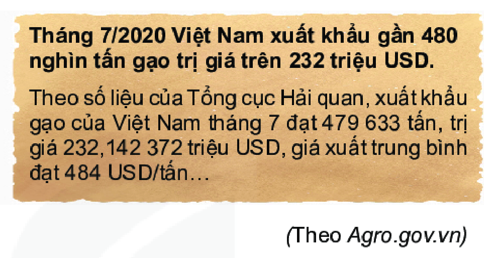
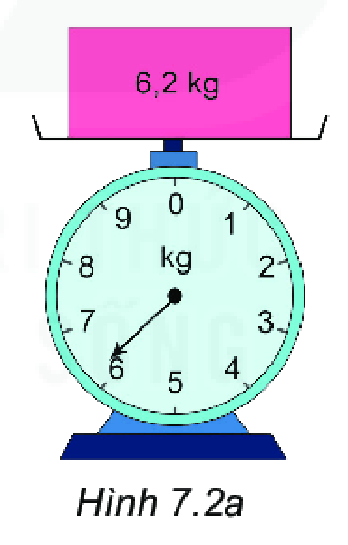
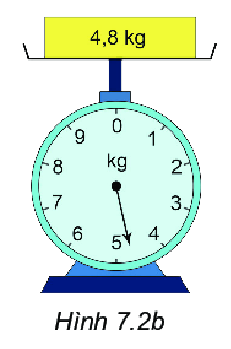
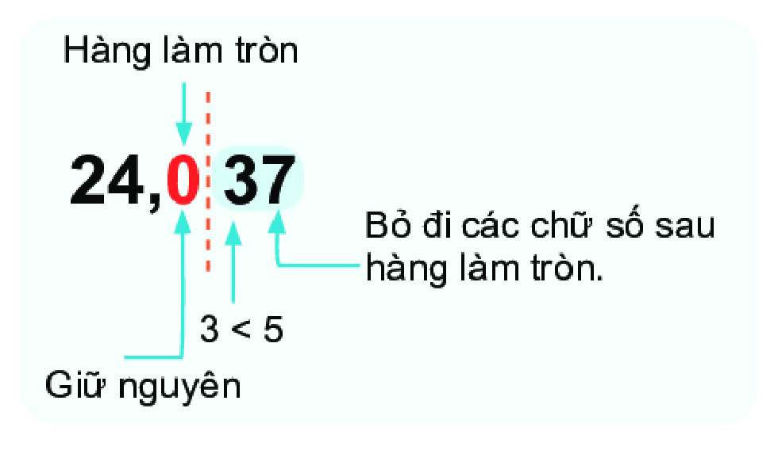
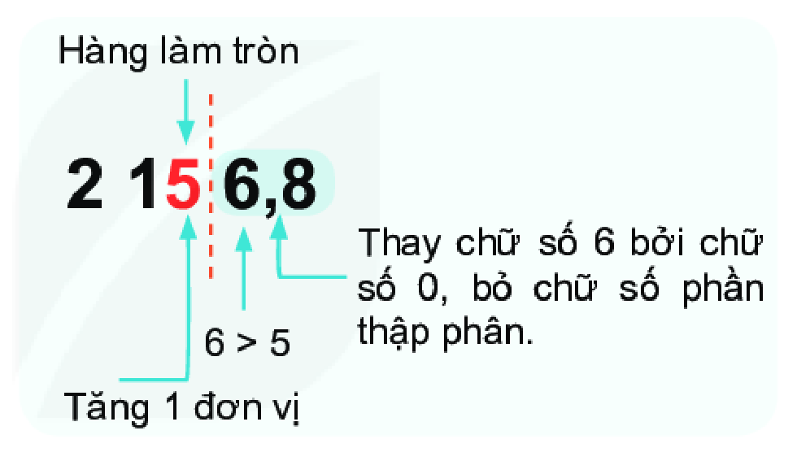

<!-- pdf:38 -->

# BÀI 30: LÀM TRÒN VÀ ƯỚC LƯỢNG

## 🔤 Khái niệm, thuật ngữ

- Làm tròn số thập phân
- Ước lượng kết quả

## 🎯 Kiến thức, kĩ năng

- Làm tròn số thập phân.
- Ước lượng kết quả phép đo, phép tính.
- Vận dụng làm tròn số thập phân trong một số tình huống thực tiễn.

## 🔴 Mở đầu

Em có biết vì sao trong phần mở đầu đoạn tin bên, người ta lại viết "trên $232$ triệu USD" thay vì viết "$232,142\,372$ triệu USD"?

Trong nhiều trường hợp, để thuận tiện, ta thường làm tròn các con số hay ước lượng kết quả của phép tính. Trong bài học này, ta sẽ tìm hiểu các cách ước lượng và làm tròn.

> **Tháng 7/2020 Việt Nam xuất khẩu gần $480$ nghìn tấn gạo trị giá trên $232$ triệu USD.**
>
> Theo số liệu của Tổng cục Hải quan, xuất khẩu gạo của Việt Nam tháng 7 đạt $479\,633$ tấn, trị giá $232,142\,372$ triệu USD, giá xuất trung bình đạt $484$ USD/tấn...
<!-- ocr-ok: đã đối chiếu ảnh trang PDF 38, OCR đọc trộn dòng với cột văn bản bên trái của khung giấy màu -->

*(Theo Agro.gov.vn)*

## 1. LÀM TRÒN SỐ

**HĐ:**

a) Theo em, khối lượng của hộp màu hồng nặng khoảng $6\text{ kg}$ hay $7\text{ kg}$?

b) Khối lượng của hộp màu vàng nặng khoảng $4\text{ kg}$ hay $5\text{ kg}$?

*Hình 7.2a*

*Hình 7.2b*

Trong hoạt động trên, ta đã làm tròn các số thập phân $6,2$ và $4,8$ đến hàng đơn vị.

<!-- term: Làm tròn số -->
> Để làm tròn một số thập phân dương tới một hàng nào đấy (gọi là **hàng làm tròn**) ta làm như sau:
> - Đối với chữ số hàng làm tròn:
>   - Giữ nguyên nếu chữ số ngay bên phải nhỏ hơn $5$;
>   - Tăng $1$ đơn vị nếu chữ số ngay bên phải lớn hơn hay bằng $5$.
> - Đối với các chữ số sau hàng làm tròn:
>   - Bỏ đi nếu ở phần thập phân;
>   - Thay bởi các chữ số $0$ nếu ở phần số nguyên.

<!-- pdf:39 -->

**Ví dụ 1:**

a) Làm tròn số $24,037$ tới hàng phần mười.

b) Làm tròn số $2\,156,8$ tới hàng chục.

**Giải:**

a) Làm tròn $24,037$ tới hàng phần mười ta được kết quả $24,0$.

b) Làm tròn số $2\,156,8$ tới hàng chục ta được kết quả là $2\,160$.

> ❓ Trong câu a, nếu viết kết quả làm tròn là $24$ thì có đúng không?

**Luyện tập:** Làm tròn số $3,141\,59$ tới hàng phần nghìn.

**Vận dụng 1:** Em hãy đọc đoạn tin ngắn ở phần mở đầu rồi làm tròn số $479\,633$ tới hàng nghìn và làm tròn số $232,142\,372$ tới hàng đơn vị. So sánh hai kết quả với các số liệu trong tiêu đề của đoạn tin đó.

<!-- term: Làm tròn số thập phân âm -->
**Chú ý:** Để làm tròn một số thập phân âm ta chỉ cần làm tròn số đối của nó rồi đặt dấu “$-$” trước kết quả.

## 2. ƯỚC LƯỢNG

<!-- term: Ước lượng -->
Trong đời sống, đôi khi ta không quá quan tâm đến tính chính xác của kết quả mà chỉ cần ước lượng kết quả, tức là tìm một số gần sát với kết quả chính xác.

<!-- pdf:40 -->

**Ví dụ 2:** Mẹ đưa cho Nam tờ tiền $200\,000$ đồng để mua táo. Giá mỗi kilôgam táo là $65\,000$ đồng. Hỏi với số tiền đó, Nam có đủ tiền để mua giỏ táo $2,8\text{ kg}$ không?

**Giải:**

Nam ước tính cân nặng giỏ táo là $3$ kg thì số tiền phải trả là:

$65\,000 \cdot 3 = 195\,000$ (đồng).

Như vậy, Nam thấy mình có đủ tiền để mua giỏ táo này.

**Vận dụng 2:** Một xe hàng có khối lượng không hàng hoá là $12$ tấn. Trên xe chở $9$ thùng hàng, mỗi thùng có khối lượng là $1,3$ tấn. Một cây cầu có biển chỉ dẫn cho phép các xe có khối lượng không quá $25$ tấn đi qua. Hỏi xe hàng trên có được phép qua cầu không?

## BÀI TẬP

**7.12.** Làm tròn số $387,0094$ tới hàng:
<!-- ocr-ok: đã đối chiếu ảnh trang PDF 40, OCR bỏ sót nhãn màu xanh 7.12 -->

a) phần mười;

b) trăm.

**7.13.** Trong bốn số sau có một số là kết quả phép tính $256,3 + 892,37 + 45$. Bằng cách ước lượng, em hãy cho biết số đó là số nào.

(A) $1\,190,65$

(B) $2\,356,67$

(C) $1\,193,67$

(D) $128,67$.

**7.14.** Chia đều một thanh gỗ dài $6,32\text{ m}$ thành bốn đoạn bằng nhau. Tính độ dài mỗi đoạn gỗ (Làm tròn kết quả tới hàng phần chục).

**7.15.** Để đo khoảng cách giữa các hành tinh trong hệ Mặt Trời, người ta sử dụng đơn vị thiên văn là AU ($1\text{ AU}$ xấp xỉ bằng khoảng cách giữa Trái Đất và Mặt Trời, được tính chính xác là $149\,597\,870\,700\text{ m}$). Để dễ viết, dễ nhớ, người ta nói $1\text{ AU}$ bằng khoảng $150$ triệu kilômét. Nói như vậy nghĩa là ta đã làm tròn số liệu trên tới hàng nào?

**7.16.** Mẹ cho An $150\,000$ đồng để mua đồ dùng học tập. An dự định mua $15$ quyển vở, $5$ chiếc bút bi và $10$ chiếc bút chì. Giá của một quyển vở, một chiếc bút bi, một chiếc bút chì lần lượt là $5\,400$ đồng, $2\,800$ đồng, $3\,000$ đồng. Em hãy ước lượng xem An có đủ tiền để mua đồ dùng học tập theo dự định không?

## 📷 Danh sách hình trong bài

| Mã hình | Trang PDF | Vị trí trong bài | Chú thích gốc |
| --- | :---: | --- | --- |
| H6-toan-b30-01 | 38 | Mở đầu | (Theo Agro.gov.vn) |
| H6-toan-b30-02 | 38 | Mục 1, HĐ | Hình 7.2a |
| H6-toan-b30-03 | 38 | Mục 1, HĐ | Hình 7.2b |
| H6-toan-b30-04 | 39 | Mục 1, Ví dụ 1a | (sách không đánh số, sơ đồ làm tròn số $24,037$ tới hàng phần mười) |
| H6-toan-b30-05 | 39 | Mục 1, Ví dụ 1b | (sách không đánh số, sơ đồ làm tròn số $2\,156,8$ tới hàng chục) |
| H6-toan-b30-06 | 40 | Mục 2, Vận dụng 2 | (sách không đánh số, minh hoạ xe hàng qua cầu giới hạn tải trọng $25$ tấn) |
