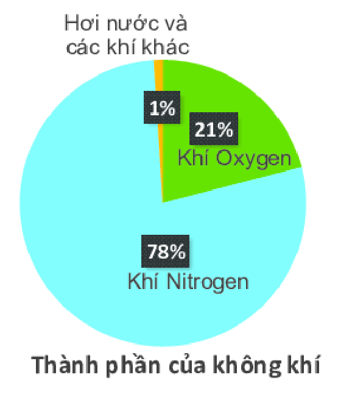

<!-- pdf:41 -->

# BÀI 31: MỘT SỐ BÀI TOÁN VỀ TỈ SỐ VÀ TỈ SỐ PHẦN TRĂM

## 🔤 Khái niệm, thuật ngữ

- Tỉ số
- Tỉ số phần trăm

## 🎯 Kiến thức, kĩ năng

- Tính tỉ số hay tỉ số phần trăm của hai số, hai đại lượng.
- Tính giá trị phần trăm của một số cho trước; Tìm một số khi biết giá trị phần trăm của số đó.
- Giải quyết được một số vấn đề thực tiễn liên quan đến tỉ số, tỉ số phần trăm.

## 🔴 Mở đầu

Ở Tiểu học chúng ta đã làm quen với tỉ số và tỉ số phần trăm. Sau đây chúng ta sẽ tìm hiểu thêm về hai khái niệm này và cách giải một số bài toán có liên quan thường gặp trong thực tế đời sống, chẳng hạn lãi suất tín dụng, thành phần các chất trong Hoá học, giảm giá, lợi nhuận – thua lỗ,...

## 1. TỈ SỐ VÀ TỈ SỐ PHẦN TRĂM

Khoai lang là thực phẩm bổ dưỡng, giàu chất xơ và rất tốt cho sức khỏe. Theo Viện Dinh dưỡng Quốc gia, trong $200$ gam khoai lang có chứa khoảng $57$ gam chất bột đường và $2,6$ gam chất xơ.

**HĐ1:** Viết tỉ số khối lượng chất bột đường và khối lượng của khoai lang.

**HĐ2:** Bằng cách tương tự, em hãy viết tỉ số khối lượng chất xơ và khối lượng của khoai lang.

> **Tỉ số** của hai số $a$ và $b$ tuỳ ý ($b \ne 0$) là thương của phép chia số $a$ cho số $b$, kí hiệu là $a : b$ hoặc $\frac{a}{b}$.

**Chú ý:**
- Ta thường dùng tỉ số dưới dạng **tỉ số phần trăm**, tức là tỉ số có dạng $\frac{a}{100}$, kí hiệu $a\%$.
- Tỉ số phần trăm của hai số $a$ và $b$ là $\frac{a}{b} \cdot 100\%$, chẳng hạn tỉ số phần trăm của $57$ và $200$ là $\frac{57}{200} \cdot 100\% = \frac{57 \cdot 100}{200}\% = 28,5\%$.

> ❓ Viết tỉ số khối lượng chất xơ và khối lượng của khoai lang dưới dạng tỉ số phần trăm.

<!-- pdf:42 -->

**Ví dụ 1:** Khi xay $3$ tấn thóc thì được $1\,995\text{ kg}$ gạo. Tính tỉ số phần trăm của số gạo thu được khi xay thóc.

**Giải:**

Đổi: $1\,995\text{ kg} = 1,995$ tấn.

Tỉ số phần trăm của số gạo thu được khi xay thóc là:

$\frac{1,995}{3} \cdot 100\% = \frac{199,5}{3}\% = 66,5\%.$

<!-- term: Tỉ số và tỉ số phần trăm của hai đại lượng -->
> **Pi:** Khi tính tỉ số hay tỉ số phần trăm của hai đại lượng, ta phải quy chúng về cùng một đơn vị đo.

**Vận dụng 1:** Trong đại hội chi đội lớp 6A, bạn Dũng được $36$ đội viên (trong tổng số $45$ đội viên chi đội) bầu làm Chi đội trưởng. Bạn Dũng đã trúng cử Chi đội trưởng với tỉ số phần trăm phiếu bầu là bao nhiêu?

## 2. HAI BÀI TOÁN VỀ TỈ SỐ PHẦN TRĂM

Tương tự hai bài toán về phân số, ta cũng có hai bài toán về tỉ số phần trăm như sau:

<!-- term: Tìm giá trị phần trăm của một số cho trước -->
> **Bài toán 1:** *Tìm giá trị phần trăm của một số cho trước.*
> *Cách giải:* Muốn tìm $m\%$ của số $a$, ta tính $a \cdot \frac{m}{100}$.

**Ví dụ 2:** *(Bài toán lãi suất)*
<!-- ocr-ok: đã đối chiếu ảnh trang PDF 42, OCR bỏ sót nhãn màu xanh lá Ví dụ 2 -->

Một người gửi $500$ triệu đồng vào ngân hàng với lãi suất $7,8\%$ một năm, nghĩa là sau một năm, người gửi nhận được số tiền lãi là $7,8\%$ của số tiền gửi. Tính số tiền lãi người đó nhận được sau một năm.

**Giải:**

Số tiền lãi người đó nhận được sau một năm là:

$500 \cdot \frac{7,8}{100} = 39$ (triệu đồng).

<!-- term: Lãi suất một năm -->
> **Pi:** Lãi suất (tiền gửi) một năm là tỉ số phần trăm của số tiền lãi trong một năm và số tiền gửi.

**Vận dụng 2:** *(Thành phần các chất trong không khí)*

Không khí xung quanh ta gồm nhiều chất khí khác nhau. Trong điều kiện thông thường, khí oxygen chiếm khoảng $21\%$ thể tích không khí. Hỏi có bao nhiêu mét khối oxygen trong một căn phòng có thể tích $70,2\text{ m}^3$?

*Thành phần của không khí*

<!-- pdf:43 -->

<!-- term: Tìm một số khi biết giá trị phần trăm của số đó -->
> **Bài toán 2:** *Tìm một số khi biết giá trị phần trăm của số đó.*
> *Cách giải:* Muốn tìm một số khi biết $m\%$ của nó là $a$, ta tính $a : \frac{m}{100}$.

**Ví dụ 3:** *(Lợi nhuận, thua lỗ)*
<!-- ocr-ok: đã đối chiếu ảnh trang PDF 43, OCR bỏ sót nhãn màu xanh lá Ví dụ 3 -->

Một chủ cửa hàng bán một chiếc tivi thu được lợi nhuận là $3$ triệu đồng. Tính giá vốn của chiếc tivi đó, biết rằng số tiền lợi nhuận bằng $25\%$ giá vốn.

**Giải:** Theo đề bài, $25\%$ giá vốn là $3$ triệu đồng.

Do đó, giá vốn của chiếc tivi đó là: $3 : \frac{25}{100} = 12\text{ (triệu đồng)}$.

**Vận dụng 3:** Trong một cuộc bình chọn cầu thủ xuất sắc nhất giải bóng đá của trường, Tân nhận được $120$ phiếu bầu, chiếm $60\%$ tổng số phiếu bình chọn. Hỏi có bao nhiêu người đã tham gia bình chọn?

## BÀI TẬP

**7.17.** Tính:

a) $25\%$ của $8$;

b) $7,5\%$ của $180$.

**7.18.** Lãi suất tiền gửi kì hạn một năm của một ngân hàng là $7,4\%$. Bác Đức gửi $150$ triệu đồng vào ngân hàng đó. Sau một năm, bác Đức rút cả vốn lẫn lãi thì nhận được bao nhiêu tiền?

**7.19.** Giá niêm yết của một chiếc điện thoại di động là $625$ nghìn đồng. Trong chương trình khuyến mại, mặt hàng này được giảm giá $10\%$. Như vậy, khi mua một chiếc điện thoại loại này người mua được giảm bao nhiêu tiền?

**7.20.** Theo Tổng cục Thống kê, năm 1989 cả nước có $914\,396$ người dân tộc Mường. Sau $10$ năm số người Mường đã tăng lên thành $1\,137\,515$ người. Em hãy cho biết trong $10$ năm đó, số người Mường ở Việt Nam đã tăng bao nhiêu phần trăm? (làm tròn kết quả tới hàng phần mười).

## 📷 Danh sách hình trong bài

| Mã hình | Trang PDF | Vị trí trong bài | Chú thích gốc |
| --- | :---: | --- | --- |
| H6-toan-b31-01 | 42 | Mục 2, Vận dụng 2 | Thành phần của không khí |
