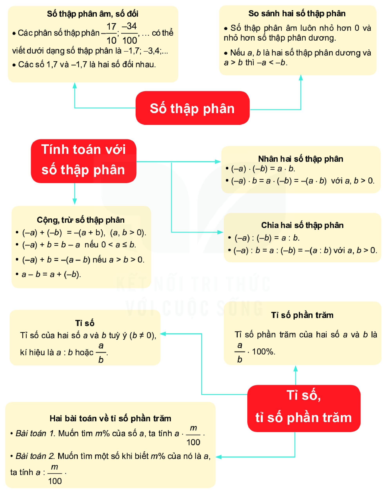
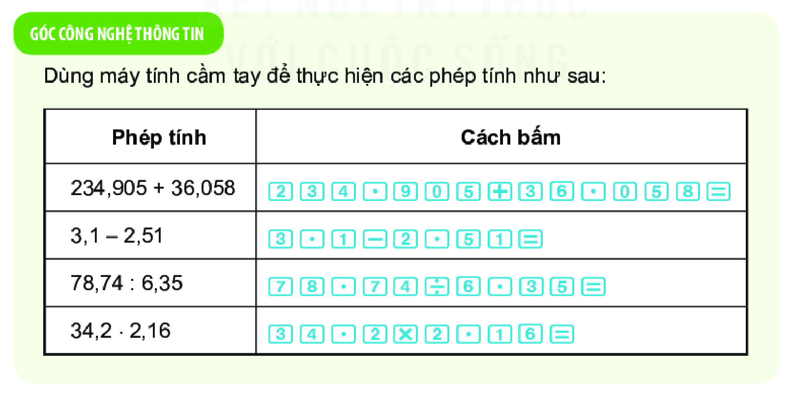

<!-- pdf:45 -->

# CHÚNG TA ĐÃ HỌC NHỮNG GÌ?

- *Số thập phân:*
  - *Số thập phân âm, số đối:*
    - Các phân số thập phân $-\frac{17}{10}; \frac{-34}{100}, \dots$ có thể viết dưới dạng số thập phân là $-1,7$; $-3,4$; $\dots$
    - Các số $1,7$ và $-1,7$ là hai số đối nhau.
  - *So sánh hai số thập phân:*
    - Số thập phân âm luôn nhỏ hơn $0$ và nhỏ hơn số thập phân dương.
    - Nếu $a, b$ là hai số thập phân dương và $a > b$ thì $-a < -b$.
- *Tính toán với số thập phân:*
  - *Cộng, trừ số thập phân:*
    - $(-a) + (-b) = -(a + b)$, $(a, b > 0)$.
    - $(-a) + b = b - a$ nếu $0 < a \le b$.
    - $(-a) + b = -(a - b)$ nếu $a > b > 0$.
    - $a - b = a + (-b)$.
  - *Nhân hai số thập phân:*
    - $(-a) \cdot (-b) = a \cdot b$.
    - $(-a) \cdot b = a \cdot (-b) = -(a \cdot b)$ với $a, b > 0$.
  - *Chia hai số thập phân:*
    - $(-a) : (-b) = a : b$.
    - $(-a) : b = a : (-b) = -(a : b)$ với $a, b > 0$.
- *Tỉ số, tỉ số phần trăm:*
  - *Tỉ số:* Tỉ số của hai số $a$ và $b$ tuỳ ý ($b \ne 0$), kí hiệu là $a : b$ hoặc $\frac{a}{b}$.
  - *Tỉ số phần trăm:* Tỉ số phần trăm của hai số $a$ và $b$ là $\frac{a}{b} \cdot 100\%$.
  - *Hai bài toán về tỉ số phần trăm:*
    - *Bài toán 1.* Muốn tìm $m\%$ của số $a$, ta tính $a \cdot \frac{m}{100}$.
    - *Bài toán 2.* Muốn tìm một số khi biết $m\%$ của nó là $a$, ta tính $a : \frac{m}{100}$.

<!-- pdf:46 -->

## BÀI TẬP CUỐI CHƯƠNG VII

**7.26.** Tính giá trị của các biểu thức sau:

a) $15,3 - 21,5 - 3 \cdot 1,5$;

b) $2(4^2 - 2 \cdot 4,1) + 1,25 : 5$.

**7.27.** Tìm $x$, biết:

a) $x - 5,01 = 7,02 - 2 \cdot 1,5$;

b) $x : 2,5 = 1,02 + 3 \cdot 1,5$.

**7.28.** Làm tròn số:
<!-- ocr-ok: đã đối chiếu ảnh trang PDF 46, OCR bỏ sót nhãn màu xanh 7.28 -->

a) $127,459$ đến hàng phần mười;

b) $152,025$ đến hàng chục;

c) $15\,025\,796$ đến hàng nghìn.

**7.29.** Năm 2002, Thumbelina được Tổ chức Kỉ lục Thế giới Guinness chính thức xác nhận là con ngựa thấp nhất thế giới với chiều cao khoảng $44,5\text{ cm}$. Còn Big Jake trở nên nổi tiếng vào năm 2010 khi được Tổ chức Kỉ lục Thế giới Guinness trao danh hiệu là con ngựa cao nhất thế giới, nó cao gấp khoảng $4,72$ lần con ngựa Thumbelina. Hỏi chiều cao của con Big Jake là bao nhiêu?

*(Theo guinessworldrecords.com)*

**7.30.** Nhân dịp Việt đạt danh hiệu học sinh giỏi, Việt được mẹ mua cho một con robot (rô-bốt). Giá niêm yết của con robot là $300\,000$ đồng nhưng hôm nay được khuyến mại giảm giá $15\%$. Vậy mẹ Việt phải trả bao nhiêu tiền để mua con robot đó?

**7.31.** Cầu Bạch Đằng nối thành phố Hải Phòng và tỉnh Quảng Ninh được khánh thành ngày 1-9-2018. Đây là một trong những cây cầu lớn nhất Việt Nam, đứng thứ ba trong số bảy cây cầu dây văng có nhiều nhịp nhất thế giới và là cây cầu dây văng thứ hai của Việt Nam được thiết kế, thi công hoàn toàn bởi kĩ sư, công nhân người Việt Nam. Cầu có tổng chiều dài khoảng $5,4\text{ km}$, vượt qua ngã ba sông Bạch Đằng, sông Cấm.

Nếu vẽ trên bản đồ tỉ lệ xích $1 : 100\,000$ thì cầu Bạch Đằng dài bao nhiêu xentimét?

**GÓC CÔNG NGHỆ THÔNG TIN**
<!-- ocr-ok: đã đối chiếu ảnh trang PDF 46, OCR bỏ sót nhãn chữ trắng trên nền xanh GÓC CÔNG NGHỆ THÔNG TIN -->

Dùng máy tính cầm tay để thực hiện các phép tính như sau:

| Phép tính | Cách bấm |
| --- | --- |
| $234,905 + 36,058$ | `2` `3` `4` `.` `9` `0` `5` `+` `3` `6` `.` `0` `5` `8` `=` |
| $3,1 - 2,51$ | `3` `.` `1` `-` `2` `.` `5` `1` `=` |
| $78,74 : 6,35$ | `7` `8` `.` `7` `4` `÷` `6` `.` `3` `5` `=` |
| $34,2 \cdot 2,16$ | `3` `4` `.` `2` `×` `2` `.` `1` `6` `=` |
<!-- ocr-ok: đã đối chiếu ảnh trang PDF 46, các phím bấm máy tính trong ảnh là icon đồ hoạ nên OCR không nhận diện được -->

## 📷 Danh sách hình trong bài

| Mã hình | Trang PDF | Vị trí trong bài | Chú thích gốc |
| --- | :---: | --- | --- |
| H6-toan-ot-c07-01 | 45 | Sơ đồ tổng kết chương | (sách không đánh số, sơ đồ tổng kết Chương VII: Số thập phân; Tính toán với số thập phân; Tỉ số, tỉ số phần trăm) |
| H6-toan-ot-c07-02 | 46 | Góc công nghệ thông tin | (sách không đánh số, bảng hướng dẫn bấm máy tính cầm tay thực hiện phép tính với số thập phân) |
