<!-- pdf:48 -->

<!-- Trang bìa Chương VIII (PDF 47): CHƯƠNG VIII. NHỮNG HÌNH HÌNH HỌC CƠ BẢN (HÌNH HỌC PHẲNG) — Làm thế nào mà Toán học có thể mô tả được những sự vật quanh ta nhỉ? Đây chính là điều mà chúng ta sẽ tìm hiểu trong chương này, khi làm quen với các hình hình học cơ bản: Điểm và đường thẳng; Điểm nằm giữa hai điểm. Tia; Đoạn thẳng. Độ dài đoạn thẳng; Trung điểm của đoạn thẳng; Góc. Điểm trong của góc; Số đo góc. Các góc đặc biệt. -->

# BÀI 32: ĐIỂM VÀ ĐƯỜNG THẲNG

## 🔤 Khái niệm, thuật ngữ

- Điểm thuộc đường thẳng
- Ba điểm thẳng hàng
- Hai đường thẳng cắt nhau
- Hai đường thẳng song song

## 🎯 Kiến thức, kĩ năng

- Nhận biết các quan hệ: điểm thuộc đường thẳng; đường thẳng đi qua hai điểm phân biệt; ba điểm thẳng hàng.
- Nhận biết hai đường thẳng cắt nhau, hai đường thẳng song song.
- Giải các bài toán thực tiễn có liên quan.

## 🔴 Mở đầu

Với bút chì và thước thẳng, em có thể vẽ được một vạch thẳng. Đó là hình ảnh của một **đường thẳng**. Mỗi dấu chấm nhỏ từ đầu bút chì là hình ảnh của một **điểm**. Ta nói đường thẳng đó được tạo nên từ các điểm như vậy.

Đối với những điểm và đường thẳng tuỳ ý, mối quan hệ giữa chúng là như thế nào?

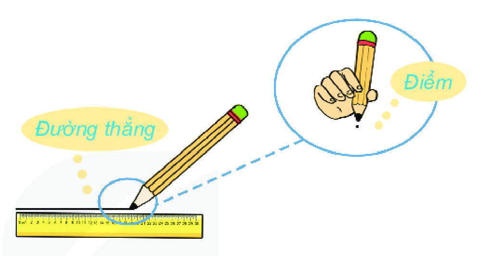

## 1. ĐIỂM THUỘC, KHÔNG THUỘC ĐƯỜNG THẲNG

Quả bóng nằm trên vạch vôi của sân bóng đá như hình bên cho ta hình ảnh một điểm nằm trên một đường thẳng.

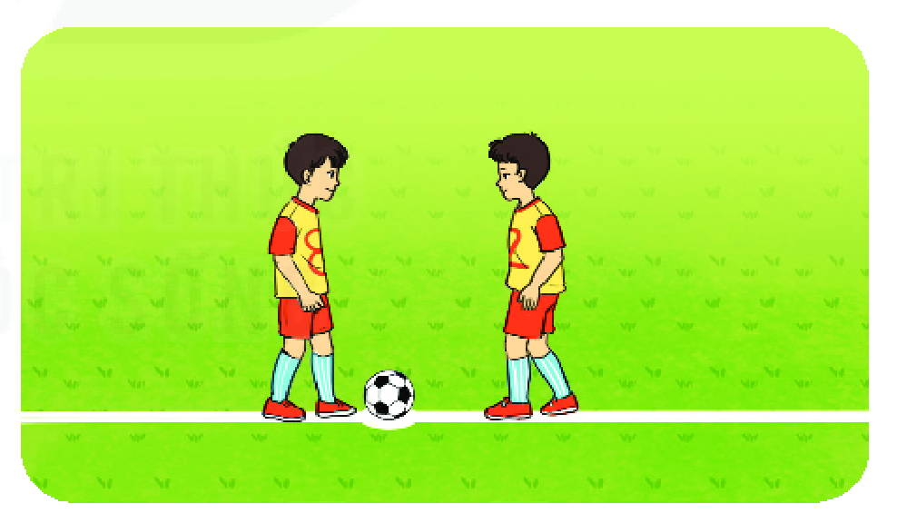

*Điểm thuộc đường thẳng*

<!-- term: Điểm thuộc đường thẳng -->
<!-- term: Điểm không thuộc đường thẳng -->
> - Ta thường dùng chữ cái in hoa để đặt tên điểm và chữ cái thường để đặt tên đường thẳng, chẳng hạn điểm $M$, đường thẳng $d$,....
> - Em hãy quan sát hình 8.1 và xem các cách diễn tả sau đây:
>   - Điểm $M$ thuộc đường thẳng $d$. Kí hiệu: $M \in d$.
>   - Điểm $N$ không thuộc đường thẳng $d$. Kí hiệu: $N \notin d$.
>
> Nếu $M \in d$, ta còn nói: Điểm $M$ *nằm trên* đường thẳng $d$, hay đường thẳng $d$ *đi qua* điểm $M$.

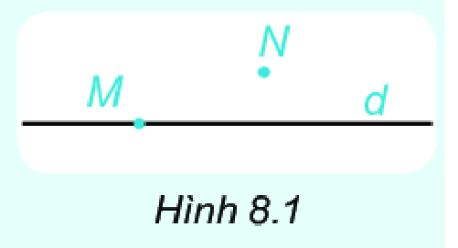
*Hình 8.1*

<!-- pdf:49 -->

> ❓ Trong hình 8.2, những điểm nào thuộc đường thẳng $d$, điểm nào không thuộc đường thẳng $d$?

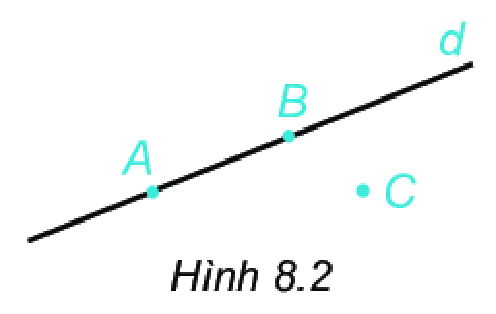
*Hình 8.2*

**HĐ1:** Đánh dấu hai điểm phân biệt $A, B$ trên một tờ giấy trắng.

- Dùng bút chì vẽ một đường thẳng đi qua hai điểm $A, B$.
- Tiếp tục dùng bút mực vẽ một đường thẳng đi qua hai điểm $A, B$.

Em có nhận xét gì về hai đường thẳng vừa vẽ?

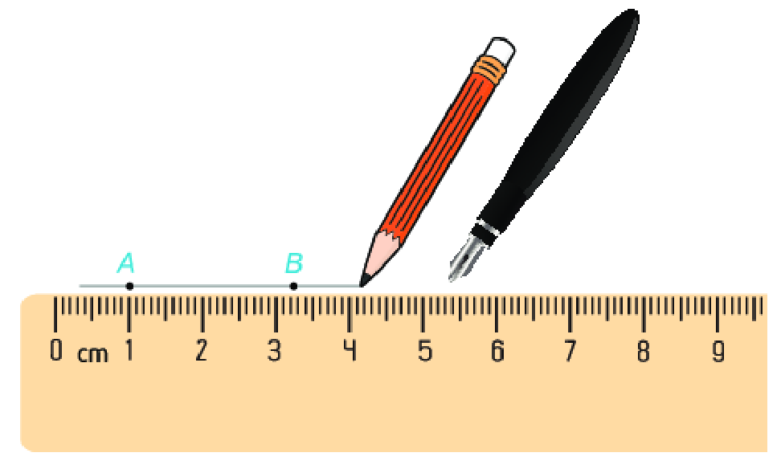

*Đường thẳng đi qua hai điểm phân biệt*

Ta thấy chỉ có thể vẽ được đúng một đường thẳng đi qua hai điểm phân biệt $A, B$. Đường thẳng đó được gọi là *đường thẳng* $AB$ hoặc *đường thẳng* $BA$.

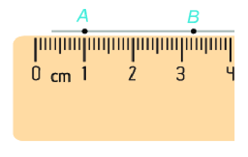

<!-- term: Đường thẳng đi qua hai điểm phân biệt -->
> Ta có nhận xét sau: *Có một đường thẳng và chỉ một đường thẳng đi qua hai điểm phân biệt.*

**Chú ý:** Để nhấn mạnh hai phía của đường thẳng, người ta còn dùng hai chữ cái thường để đặt tên, chẳng hạn đường thẳng $xy$ như hình 8.3.

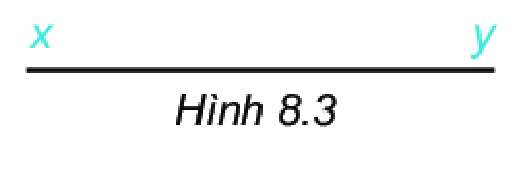
*Hình 8.3*

> ❓ Hình 8.4 có bao nhiêu đường thẳng? Hãy đọc tên các đường thẳng đó.

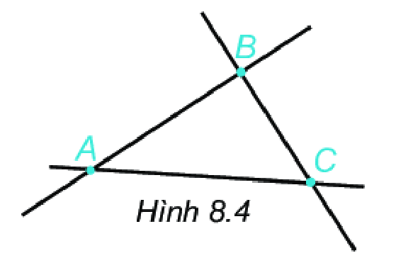
*Hình 8.4*

## 2. BA ĐIỂM THẲNG HÀNG

**HĐ2:** Một người nhìn qua các lỗ hổng được khoét trên các tấm bìa và thấy ngọn nến như hình 8.5.

Em thấy các lỗ hổng có cùng nằm trên một đường thẳng không?

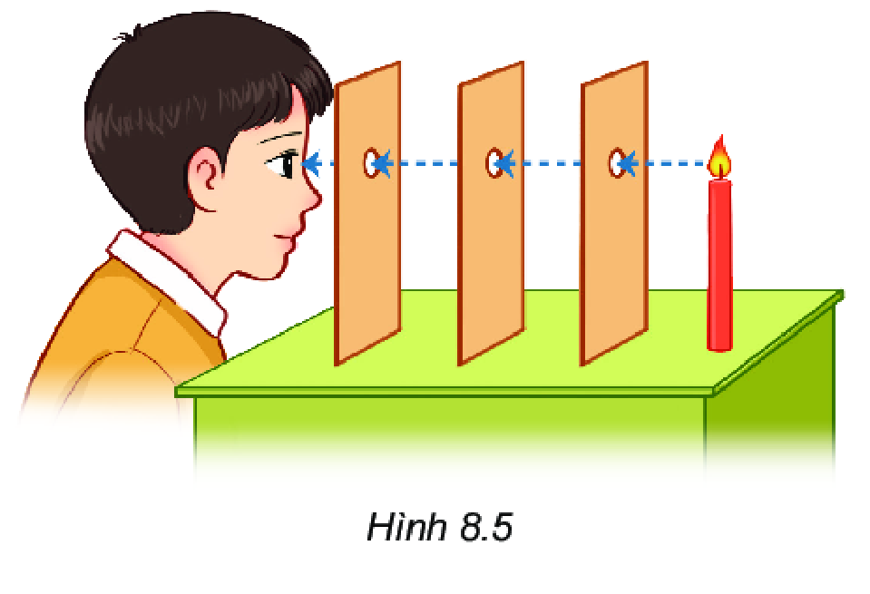
*Hình 8.5*

<!-- pdf:50 -->

*Ba điểm thẳng hàng*

<!-- term: Ba điểm không thẳng hàng -->
> Hãy quan sát hình 8.6 và xem các cách diễn đạt sau đây:
> - Ba điểm $A, B, C$ *thẳng hàng*.
> - Ba điểm $M, N, P$ *không thẳng hàng*.

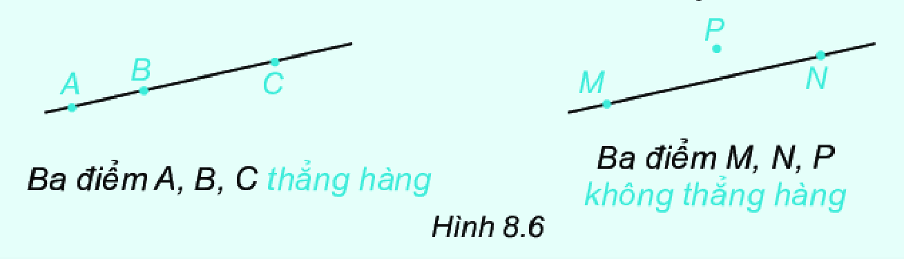
*Hình 8.6*

> **Ba điểm thẳng hàng** là ba điểm cùng thuộc một đường thẳng.

> ❓ Em hãy kể tên hai bộ ba điểm thẳng hàng trong hình 8.7.

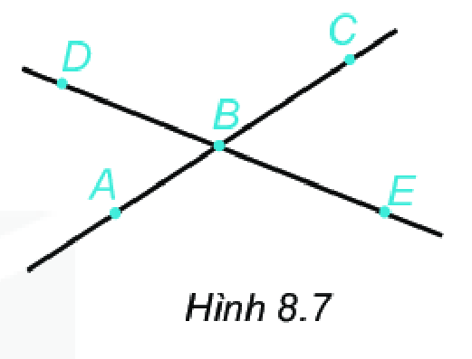
*Hình 8.7*

**Luyện tập 1:**

Em hãy dùng thước thẳng để kiểm tra trong hình 8.8:

a) Ba điểm $A, B, C$ có thẳng hàng không?

b) Ba điểm $M, N, P$ có thẳng hàng không?

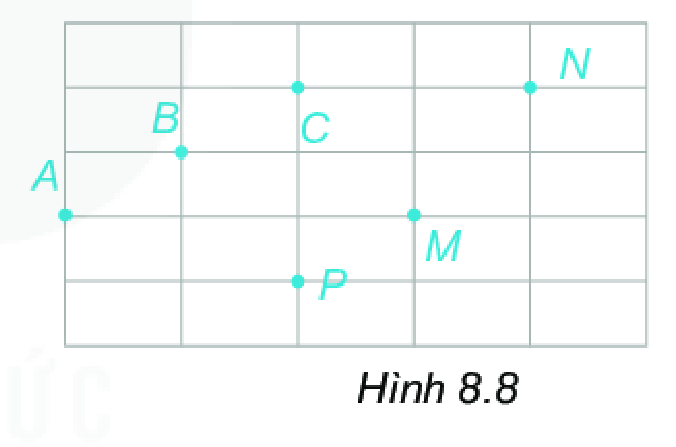
*Hình 8.8*

**Vận dụng:**

Trên sân vận động, người ta căng một sợi dây qua hai cái cọc được đóng ở hai vị trí đã chọn rồi dựa vào sợi dây đã căng để vẽ một vạch vôi. Em hãy giải thích tại sao người ta lại làm như vậy?

## 3. HAI ĐƯỜNG THẲNG SONG SONG, CẮT NHAU, TRÙNG NHAU

*Số điểm chung của hai đường thẳng phân biệt*

**HĐ3:** Em hãy quan sát các hình ảnh sau:

a) Hai thanh ray đường tàu (h.8.9a) là hình ảnh của hai đường thẳng. Chúng có điểm chung không?

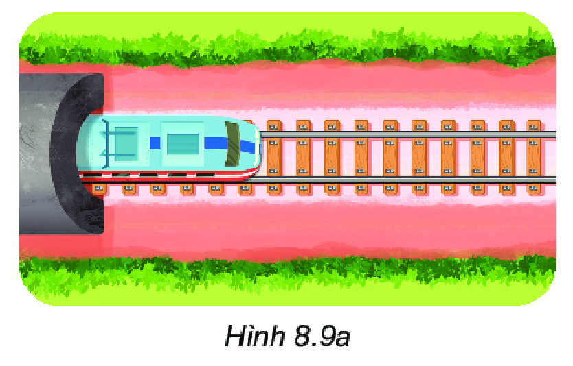
*Hình 8.9a*

<!-- pdf:51 -->

b) Hai con đường (h.8.9b) cũng là hình ảnh của hai đường thẳng. Chúng có điểm chung không?

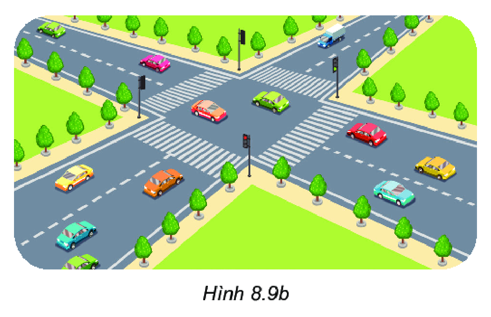
*Hình 8.9b*

**HĐ4:** Hai đường thẳng phân biệt có thể có nhiều hơn một điểm chung được không?

*Hai đường thẳng song song, cắt nhau, trùng nhau*

<!-- term: Hai đường thẳng song song -->
> ① $a$ và $b$ không có điểm chung: $a$ và $b$ *song song* với nhau. Kí hiệu: $a \parallel b$.

<!-- term: Hai đường thẳng cắt nhau -->
<!-- term: Giao điểm -->
> ② $a$ và $b$ có đúng một điểm chung $P$: $a$ và $b$ *cắt nhau* tại điểm $P$ ($P$ là *giao điểm*).
<!-- ocr-ok: đã đối chiếu ảnh trang PDF 51, bảng 3 cột Hình 8.10 khiến OCR đọc nhảy cột và kí hiệu số tròn -->

<!-- term: Hai đường thẳng trùng nhau -->
> ③ Đường thẳng $AB$ và đường thẳng $BC$ trùng nhau.
<!-- ocr-ok: đã đối chiếu ảnh trang PDF 51, cột 3 của Hình 8.10 bị OCR ghép ngang qua các cột -->

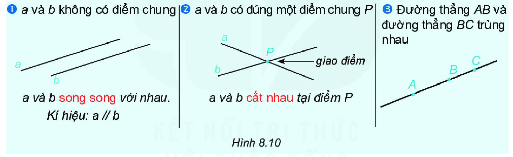
*Hình 8.10*

> ❓ Hãy tìm một số hình ảnh hai đường thẳng song song hay cắt nhau trong thực tế.

**Luyện tập 2:**

Đánh dấu ba điểm phân biệt $A, B$ và $C$ trên một tờ giấy trắng sao cho chúng không thẳng hàng.

a) Hãy vẽ các đường thẳng đi qua hai trong ba điểm ấy. Đó là những đường thẳng nào?
<!-- ocr-ok: đã đối chiếu ảnh trang PDF 51, OCR đọc trộn dòng với bóng thoại của Pi bên phải -->

b) Hãy chỉ ra hai đường thẳng cắt nhau và giao điểm của chúng.

- **Pi:** Ta nói các đường thẳng vẽ được trong câu a là các **đường thẳng đôi một cắt nhau**.

**Thử thách nhỏ:**

Cho một đường thẳng $d$ và hai điểm phân biệt $A, B$ không thuộc $d$. Tìm điểm $C$ thuộc $d$ sao cho $A, B, C$ thẳng hàng. Khi nào không thể tìm được điểm $C$ như vậy?

<!-- pdf:52 -->

## BÀI TẬP

8.1. Quan sát hình 8.11.

a) Giao điểm của hai đường thẳng $a$ và $b$ là điểm nào?

b) Điểm $A$ thuộc đường thẳng nào và không thuộc đường thẳng nào? Hãy trả lời bằng câu diễn đạt và bằng kí hiệu.

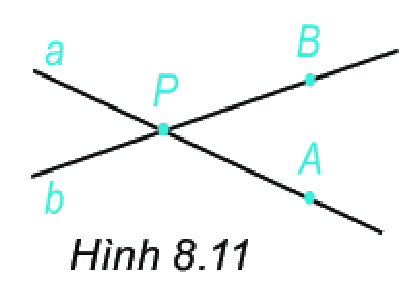
*Hình 8.11*

8.2. Xem hình 8.12 và trả lời:

a) Có bao nhiêu bộ ba điểm thẳng hàng?

b) Hãy nêu ít nhất hai bộ ba điểm không thẳng hàng.

c) Bốn điểm $A, B, C, S$ có thẳng hàng không?

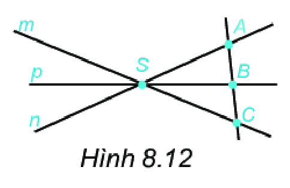
*Hình 8.12*

8.3. Cho bốn điểm $A, B, C$ và $D$ như hình vẽ dưới đây.
<!-- ocr-ok: đã đối chiếu ảnh trang PDF 52, nhãn bài 8.3 in màu xanh nhạt và kí hiệu điểm LaTeX -->

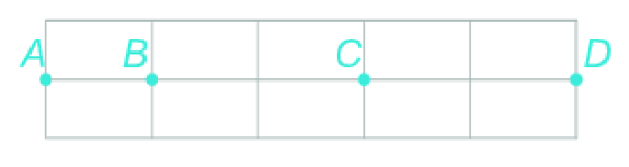

Hãy nêu tất cả các bộ ba điểm thẳng hàng.

8.4. Hình 8.13 mô tả $4$ đường thẳng và $5$ điểm có tên là $A, B, C, D$ và $E$, trong đó ta chỉ biết vị trí của điểm $A$. Hãy điền tên của các điểm còn lại, biết rằng:

① $D$ nằm trên $3$ trong $4$ đường thẳng;
<!-- ocr-ok: đã đối chiếu ảnh trang PDF 52, kí hiệu ① và các chữ/số trong công thức LaTeX -->

② Ba điểm $A, B, C$ thẳng hàng;

③ Ba điểm $B, D, E$ thẳng hàng.

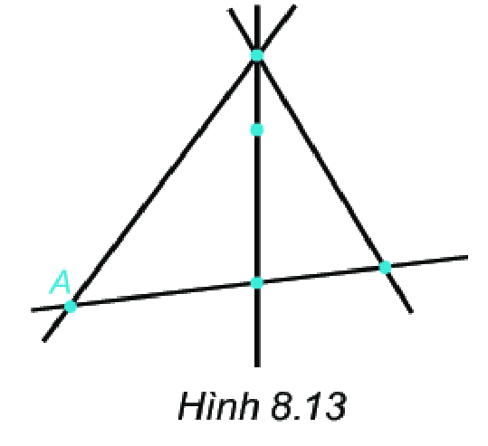
*Hình 8.13*

8.5. Hãy liệt kê các cặp đường thẳng song song trong hình sau.

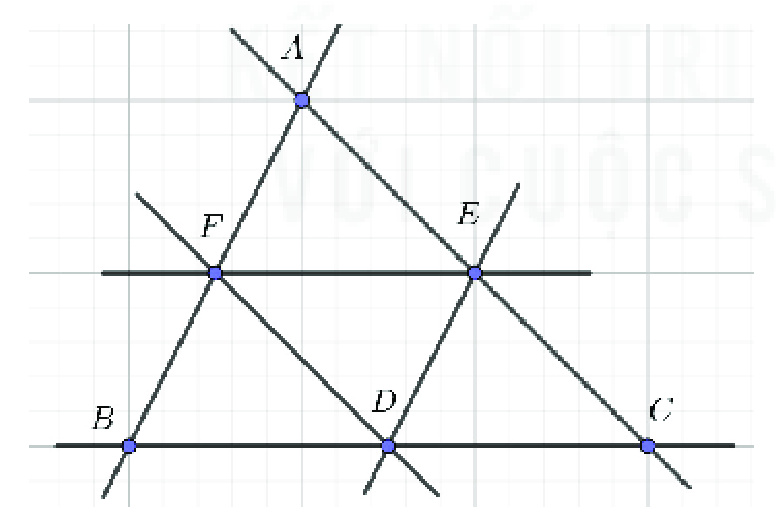

## 📷 Danh sách hình trong bài

| Mã hình | Trang PDF | Vị trí trong bài | Chú thích gốc |
| --- | :---: | --- | --- |
| H6-toan-b32-01 | 48 | Mở đầu | (sách không đánh số, minh hoạ điểm và đường thẳng bằng bút chì và thước thẳng) |
| H6-toan-b32-02 | 48 | Mục 1 | (sách không đánh số, quả bóng nằm trên vạch vôi sân bóng đá) |
| H6-toan-b32-03 | 48 | Mục 1 | Hình 8.1 |
| H6-toan-b32-04 | 49 | Mục 1, Câu hỏi | Hình 8.2 |
| H6-toan-b32-05 | 49 | Mục 1, HĐ1 | (sách không đánh số, vẽ đường thẳng đi qua hai điểm $A, B$) |
| H6-toan-b32-06 | 49 | Mục 1 | (sách không đánh số, đường thẳng đi qua hai điểm phân biệt $A, B$) |
| H6-toan-b32-07 | 49 | Mục 1, Chú ý | Hình 8.3 |
| H6-toan-b32-08 | 49 | Mục 1, Câu hỏi | Hình 8.4 |
| H6-toan-b32-09 | 49 | Mục 2, HĐ2 | Hình 8.5 |
| H6-toan-b32-10 | 50 | Mục 2 | Hình 8.6 |
| H6-toan-b32-11 | 50 | Mục 2, Câu hỏi | Hình 8.7 |
| H6-toan-b32-12 | 50 | Mục 2, Luyện tập 1 | Hình 8.8 |
| H6-toan-b32-13 | 50 | Mục 3, HĐ3a | Hình 8.9a |
| H6-toan-b32-14 | 51 | Mục 3, HĐ3b | Hình 8.9b |
| H6-toan-b32-15 | 51 | Mục 3 | Hình 8.10 |
| H6-toan-b32-16 | 52 | Bài 8.1 | Hình 8.11 |
| H6-toan-b32-17 | 52 | Bài 8.2 | Hình 8.12 |
| H6-toan-b32-18 | 52 | Bài 8.3 | (sách không đánh số, bốn điểm $A, B, C, D$ trên lưới ô vuông) |
| H6-toan-b32-19 | 52 | Bài 8.4 | Hình 8.13 |
| H6-toan-b32-20 | 52 | Bài 8.5 | (sách không đánh số, các đường thẳng cắt nhau và song song trên lưới ô vuông) |
