<!-- pdf:53 -->

# BÀI 33: ĐIỂM NẰM GIỮA HAI ĐIỂM. TIA

## 🔤 Khái niệm, thuật ngữ

- Tia, tia đối
- Điểm nằm giữa hai điểm

## 🎯 Kiến thức, kĩ năng

- Nhận biết các khái niệm tia, hai tia đối nhau.
- Nhận biết điểm nằm giữa hai điểm.
- Giải các bài toán thực tế có liên quan.

## 🔴 Mở đầu

*Nhật thực*, *nguyệt thực* là những hiện tượng thiên văn, xảy ra khi Mặt Trăng, Trái Đất và Mặt Trời cùng nằm trên một đường thẳng, nhưng theo thứ tự khác nhau.

Thứ tự của chúng trên đường thẳng khi đó như thế nào?

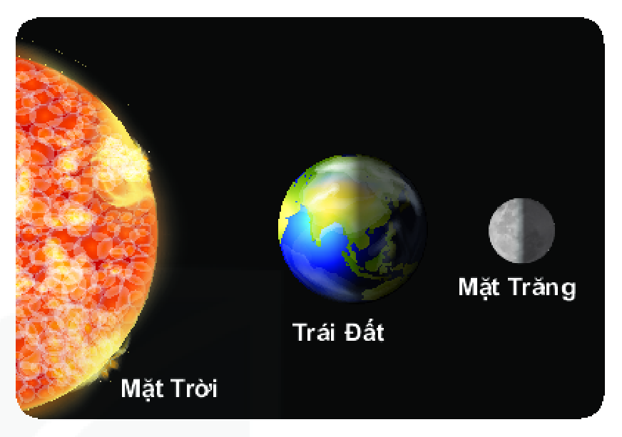

## 1. ĐIỂM NẰM GIỮA HAI ĐIỂM

**HĐ:** Em hãy quan sát hình ảnh bên.

Em có nhận xét gì về vị trí của ngọn nến, quả lắc và bóng của quả lắc ở trên tường.

*Điểm nằm giữa hai điểm*

<!-- term: Điểm nằm giữa hai điểm -->
> Hãy quan sát hình 8.14 gồm ba điểm $A, B, C$ cùng nằm trên đường thẳng $d$ và xem các cách diễn đạt sau:
> - Điểm $B$ nằm giữa hai điểm $A$ và $C$.
> - Hai điểm $A$ và $B$ nằm cùng phía đối với điểm $C$.
> - Hai điểm $A$ và $C$ nằm khác phía đối với điểm $B$.

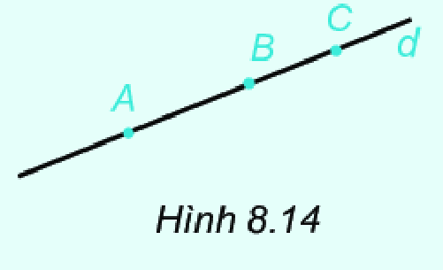
*Hình 8.14*

> ❓ Em hãy quan sát hình 8.15 và cho biết:
>
> a) Điểm $D$ nằm giữa hai điểm nào?
>
> b) Hai điểm nào nằm cùng phía đối với điểm $B$?
>
> c) Hai điểm nào nằm khác phía đối với điểm $E$?

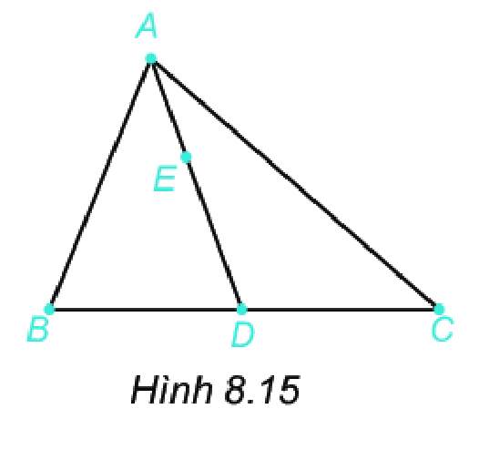
*Hình 8.15*

<!-- pdf:54 -->

**Luyện tập 1:**

Cho hai điểm phân biệt $A, B$ như hình 8.16.

Em hãy lấy hai điểm $C$ và $D$ sao cho:
<!-- ocr-ok: đã đối chiếu ảnh trang PDF 54, OCR đọc lẫn chữ cái của Hình 8.16 bên phải -->

- Điểm $C$ nằm giữa hai điểm $A$ và $B$;
- Điểm $C$ và điểm $D$ nằm khác phía đối với điểm $B$.

Khi đó điểm $A$ và điểm $B$ có nằm cùng phía với điểm $D$ không?

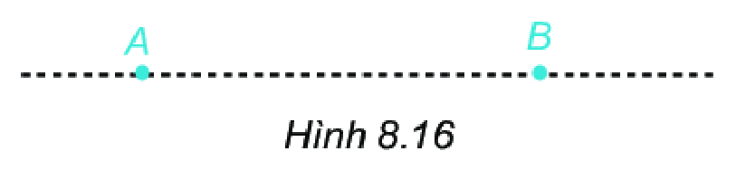
*Hình 8.16*

**Vận dụng:**

Cho hình bình hành $ABCD$ như hình 8.17. Em hãy xác định một điểm vừa nằm giữa hai điểm $A$ và $C$, vừa nằm giữa hai điểm $B$ và $D$.

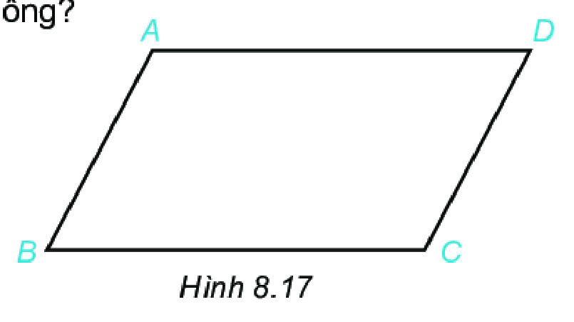
*Hình 8.17*

## 2. TIA

> - **Tia** $Am$ gồm điểm $A$, điểm $B$ và các điểm nằm cùng phía với $B$ đối với $A$. Tia $Am$ còn được kí hiệu là tia $AB$. Điểm $A$ là **gốc** của tia (h.8.18a).

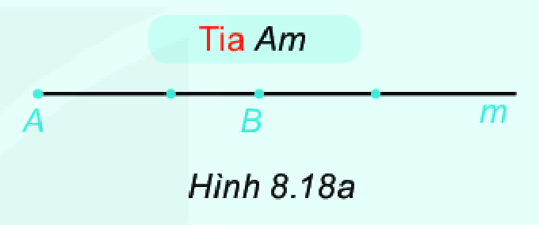
*Hình 8.18a*

> - Điểm $O$ nằm trêvn đường thẳng $xy$ chia đường thẳng thành hai phần (được tô màu đỏ và màu đen). Mỗi phần đó cùng với điểm $O$ làm thành một tia. Khi đó ta có hai tia $Ox$ và $Oy$ gọi là **hai tia đối nhau** (h.8.18b).
>
>   (Tia $Ox$ là **tia đối** của tia $Oy$ và tia $Oy$ là *tia đối* của tia $Ox$).

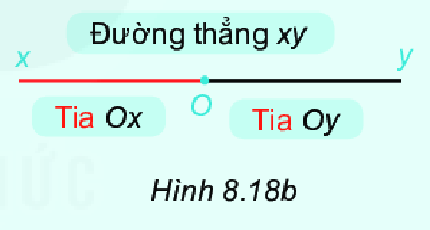
*Hình 8.18b*

> ❓ a) Quan sát hình 8.19 và đọc tên các tia trong hình vẽ.
>
> b) Với mỗi tia ở câu a, tìm tia đối của chúng.

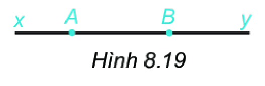
*Hình 8.19*

**Luyện tập 2:**

Quan sát hình 8.20.

a) Em hãy đọc tên các tia trong hình.

b) Nếu điểm $M$ nằm trên tia đối của tia $AB$ thì $M$ có thuộc tia $BA$ không?

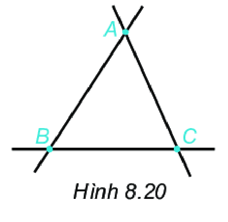
*Hình 8.20*

**Thử thách nhỏ:**

Cho hai điểm phân biệt $A$ và $B$. Hình gồm điểm $A$ và tất cả các điểm $M$ nằm khác phía với điểm $B$ đối với điểm $A$ có phải một tia không? Tia đó có phải là tia đối của tia $AB$ không?

<!-- pdf:55 -->

## BÀI TẬP

8.6. Cho bốn điểm $A, B, C, D$ cùng thuộc đường thẳng $xy$ như hình 8.21. Trong các câu sau đây, câu nào đúng?

① Điểm $B$ nằm giữa điểm $A$ và điểm $D$.
<!-- ocr-ok: đã đối chiếu ảnh trang PDF 55, phần Bài tập trình bày 2 cột và dùng số tròn màu xanh -->

② Điểm $A$ và điểm $C$ nằm cùng phía đối với điểm $D$.
<!-- ocr-ok: đã đối chiếu ảnh trang PDF 55, phần Bài tập trình bày 2 cột và dùng số tròn màu xanh -->

③ Điểm $B$ nằm khác phía điểm $A$ đối với điểm $D$.
<!-- ocr-ok: đã đối chiếu ảnh trang PDF 55, phần Bài tập trình bày 2 cột và dùng số tròn màu xanh -->

④ Điểm $B$ và điểm $C$ nằm cùng phía đối với điểm $D$.
<!-- ocr-ok: đã đối chiếu ảnh trang PDF 55, phần Bài tập trình bày 2 cột và dùng số tròn màu xanh -->

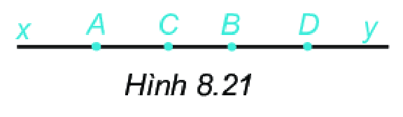
*Hình 8.21*

8.7. Quan sát hình 8.22 và cho biết:

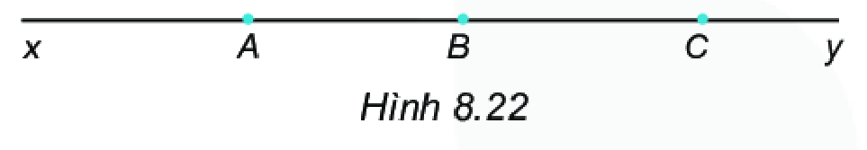
*Hình 8.22*

a) Có tất cả bao nhiêu tia? Nêu tên các tia đó.

b) Điểm $B$ nằm trên các tia nào? Tia đối của chúng là tia nào?

c) Tia $AC$ và tia $CA$ có phải là hai tia đối nhau không?

8.8. Cho điểm $C$ nằm trên tia $Ax$, điểm $B$ nằm trên tia $Cx$. Biết rằng ba điểm $A, B, C$ phân biệt. Trong các câu sau đây, câu nào đúng?

① Điểm $A$ nằm trên tia $BC$.
<!-- ocr-ok: đã đối chiếu ảnh trang PDF 55, phần Bài tập trình bày 2 cột và dùng số tròn màu xanh -->

② Điểm $C$ vừa nằm trên tia $AB$ vừa nằm trên tia $BA$.

③ Tia $CB$ và tia $BC$ là hai tia đối nhau.
<!-- ocr-ok: đã đối chiếu ảnh trang PDF 55, phần Bài tập trình bày 2 cột và dùng số tròn màu xanh -->

④ Tia $CA$ và tia $Cx$ là hai tia đối nhau.
<!-- ocr-ok: đã đối chiếu ảnh trang PDF 55, phần Bài tập trình bày 2 cột và dùng số tròn màu xanh -->

8.9. Cho ba điểm $A, B, C$ không thẳng hàng.
<!-- ocr-ok: đã đối chiếu ảnh trang PDF 55, phần Bài tập trình bày 2 cột và nhãn màu xanh nhạt -->

a) Em hãy viết tên các tia chứa hai trong ba điểm $A, B, C$.

b) Trong các tia đó, tìm hai tia khác gốc có đúng một điểm chung.

## 💡 Em có biết?

*Nguyệt thực* là hiện tượng thiên văn, xảy ra khi Mặt Trăng đi vào bóng của Trái Đất, đối diện với Mặt Trời. Điều này xảy ra khi Mặt Trời, Trái Đất và Mặt Trăng thẳng hàng (hoặc gần như thẳng hàng) và Trái Đất nằm giữa Mặt Trời và Mặt Trăng.

*Nhật thực* cũng là một hiện tượng thiên văn, xảy ra khi Mặt Trăng đi vào giữa Trái Đất và Mặt Trời làm che mất một phần ánh sáng từ Mặt Trời chiếu xuống Trái Đất.

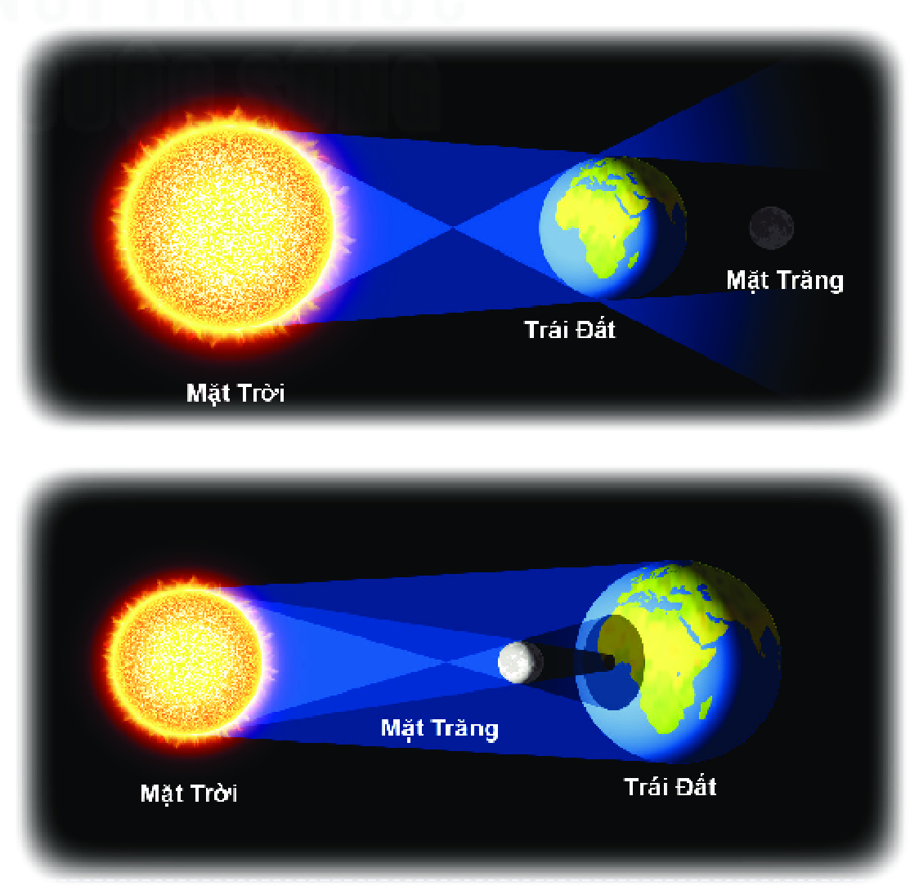

## 📷 Danh sách hình trong bài

| Mã hình | Trang PDF | Vị trí trong bài | Chú thích gốc |
| --- | :---: | --- | --- |
| H6-toan-b33-01 | 53 | Mở đầu | (sách không đánh số, minh hoạ Mặt Trời, Trái Đất, Mặt Trăng) |
| H6-toan-b33-02 | 53 | Mục 1, HĐ | (sách không đánh số, ngọn nến, quả lắc và bóng trên tường) |
| H6-toan-b33-03 | 53 | Mục 1 | Hình 8.14 |
| H6-toan-b33-04 | 53 | Mục 1, Câu hỏi | Hình 8.15 |
| H6-toan-b33-05 | 54 | Mục 1, Luyện tập 1 | Hình 8.16 |
| H6-toan-b33-06 | 54 | Mục 1, Vận dụng | Hình 8.17 |
| H6-toan-b33-07 | 54 | Mục 2 | Hình 8.18a |
| H6-toan-b33-08 | 54 | Mục 2 | Hình 8.18b |
| H6-toan-b33-09 | 54 | Mục 2, Câu hỏi | Hình 8.19 |
| H6-toan-b33-10 | 54 | Mục 2, Luyện tập 2 | Hình 8.20 |
| H6-toan-b33-11 | 55 | Bài 8.6 | Hình 8.21 |
| H6-toan-b33-12 | 55 | Bài 8.7 | Hình 8.22 |
| H6-toan-b33-13 | 55 | Em có biết? | (sách không đánh số, sơ đồ nguyệt thực và nhật thực) |
