<!-- pdf:56 -->

# BÀI 34: ĐOẠN THẲNG. ĐỘ DÀI ĐOẠN THẲNG

## 🔤 Khái niệm, thuật ngữ

- Đoạn thẳng
- Độ dài đoạn thẳng

## 🎯 Kiến thức, kĩ năng

- Nhận biết đoạn thẳng.
- Biết đo độ dài đoạn thẳng.
- Giải các bài toán thực tế có liên quan đến đoạn thẳng và độ dài của đoạn thẳng.

## 🔴 Mở đầu

Trong đời sống, ta thấy những hình ảnh của *đoạn thẳng* như cây gậy, cây bút chì, những chiếc đũa,...

Trong bài này, chúng ta cùng tìm hiểu thêm về khái niệm đó.

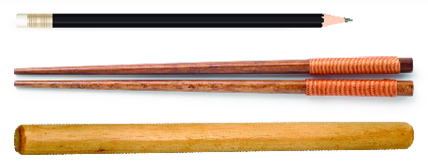

## 1. ĐOẠN THẲNG

**HĐ1:** Một người đi xe đạp trên một đoạn đường thẳng từ $A$ đến $B$ (h.8.23).

Em có nhận xét gì về những vị trí mà người đó đã đi qua so với hai điểm $A$ và $B$.

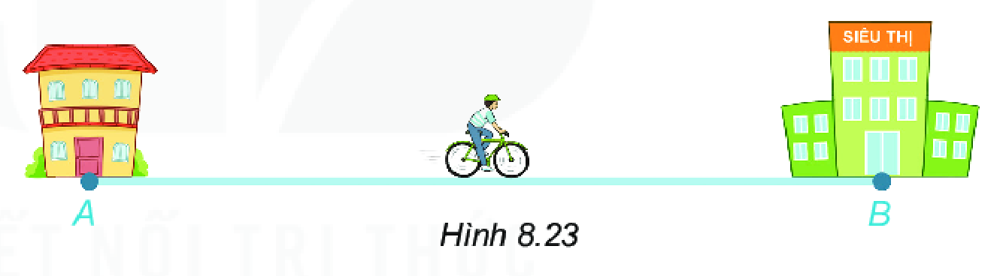
*Hình 8.23*

**HĐ2:** Cho hai điểm phân biệt $A$ và $B$.

Lấy điểm $C$ nằm ở giữa $A$ và $B$; Lấy điểm $D$ nằm khác phía với $A$ đối với $B$.

Dùng thước thẳng và bút màu đen kẻ một vạch thẳng bắt đầu từ $A$ và kết thúc ở $B$.

Em có nhận xét gì về vị trí của hai điểm $C$ và $D$ đối với phần vạch thẳng màu đen.

*Hình 8.24*

Quãng đường người đi xe đạp đi qua trong hình 8.23, vạch thẳng nối từ điểm $A$ đến điểm $B$ trong hình 8.24 mô tả các *đoạn thẳng*.

> - **Đoạn thẳng** $AB$, hay đoạn thẳng $BA$, là hình gồm hai điểm $A, B$ cùng với các điểm nằm giữa $A$ và $B$.
> - $A, B$ là hai **đầu mút** (**mút**) của đoạn thẳng $AB$.

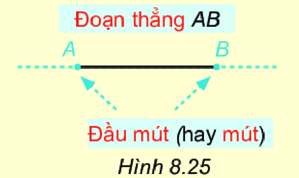
*Hình 8.25*

<!-- pdf:57 -->

> ❓ Hãy đọc tên tất cả các đoạn thẳng trong hình 8.26.

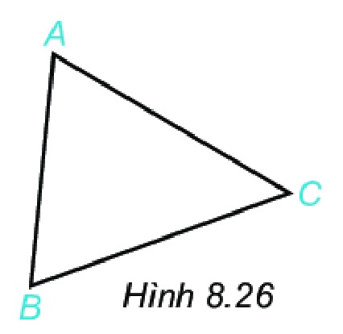
*Hình 8.26*

**Luyện tập 1:**

Với bốn điểm $A, B, C, D$ như hình 8.27, em hãy kể tên các đoạn thẳng có đầu mút là:

a) Hai trong ba điểm $A, B, C$;

a) Hai trong bốn điểm $A, B, C, D$.
<!-- ocr-ok: đã đối chiếu ảnh trang PDF 57, SGK in lặp nhãn a) ở dòng hai Luyện tập 1 -->

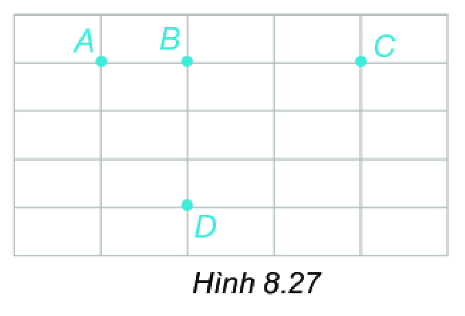
*Hình 8.27*

**Vận dụng 1:**

Có $5$ hòn đảo được vẽ như $5$ điểm phân biệt, trong đó có đúng hai hòn đảo được nối với nhau bởi một cây cầu, được vẽ như một đoạn thẳng (h.8.28).

Hỏi phải xây thêm ít nhất bao nhiêu cây cầu nối các hòn đảo để có thể đi qua lại giữa hai hòn đảo tuỳ ý thông qua các cây cầu đó?

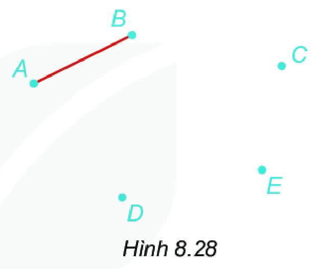
*Hình 8.28*

## 2. ĐỘ DÀI ĐOẠN THẲNG

Em đã biết cách dùng thước có vạch chia để đo độ dài của một đoạn thẳng.

Dưới đây, chúng ta sẽ cùng tìm hiểu thêm về khái niệm độ dài đoạn thẳng.

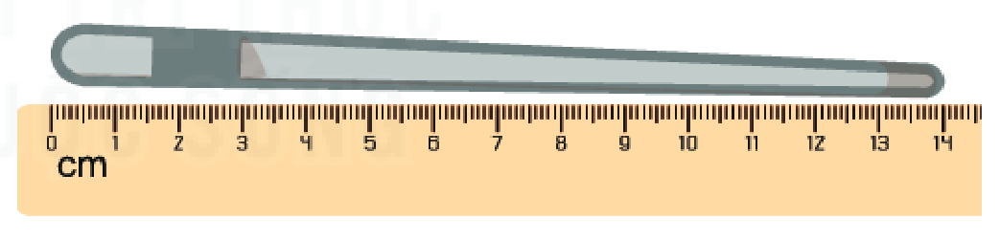

*Độ dài và đơn vị độ dài*

**HĐ3:** Mặt bàn học của em dài khoảng mấy gang tay của em?

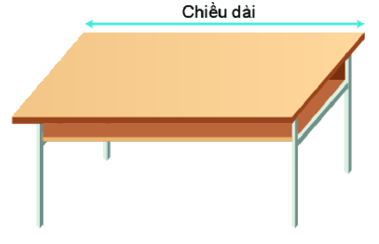

**HĐ4:** Mở trang cuối của sách giáo khoa, em sẽ thấy thông tin về khổ sách là $19 \times 26,5\text{ cm}$.

Em hiểu thông tin đó như thế nào?

**Nhận xét:** Trong HĐ3, ta đã chọn gang tay làm **đơn vị độ dài** (gọi tắt là **đơn vị**). Kết quả đo được gọi là **số đo độ dài** (gọi tắt là *độ dài*) của mặt bàn học. Trong HĐ4, người ta đã chọn đoạn $1$ xentimét làm đơn vị và chiều rộng, chiều dài của cuốn sách lần lượt là $19\text{ cm}$; $26,5\text{ cm}$.

<!-- pdf:58 -->

*Độ dài đoạn thẳng*

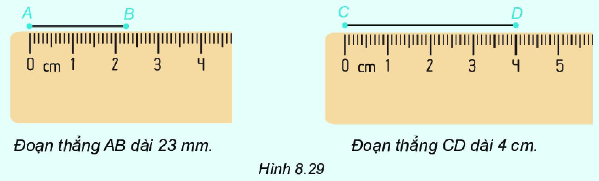
*Hình 8.29*

> Mỗi đoạn thẳng có một **độ dài**. Khi chọn một đơn vị độ dài thì độ dài mỗi đoạn thẳng được biểu diễn bởi một số dương (thường viết kèm đơn vị).

- Chẳng hạn trong hình 8.29, đoạn thẳng $AB$ dài $23\text{ mm}$, đoạn thẳng $CD$ dài $4\text{ cm}$, ta viết $AB = 23\text{ mm}$, $CD = 4\text{ cm}$.
- Độ dài đoạn thẳng $AB$ còn gọi là **khoảng cách** giữa hai điểm $A$ và $B$. Ta quy ước khoảng cách giữa hai điểm trùng nhau bằng $0$ (đơn vị).

> ❓ Em còn biết những đơn vị đo độ dài nào khác?

**Chú ý:** Với những đoạn thẳng có độ dài lớn hơn độ dài của thước thẳng, ta vẫn có thể dùng thước thẳng để đo, chẳng hạn như hình sau:

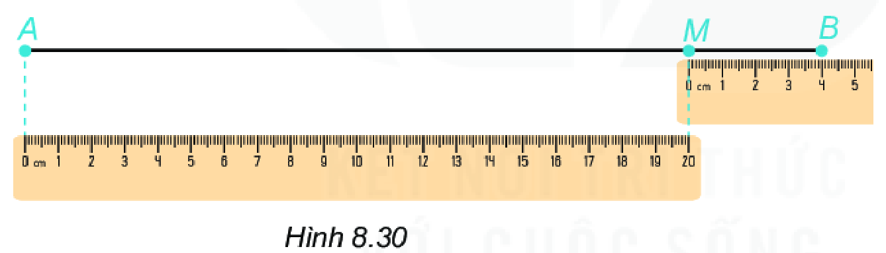
*Hình 8.30*

- **Pi:** $AB = AM + MB = 20 + 4 = 24\text{ (cm)}$.

*So sánh độ dài hai đoạn thẳng*

**HĐ5:** Dùng thước có vạch chia để đo độ dài các đoạn thẳng $AB, CD, EG$ trong hình 8.31 rồi trả lời các câu hỏi sau:

a) Đoạn thẳng $AB$ có dài bằng đoạn thẳng $EG$ không?

b) Trong các đoạn $AB$ và $CD$, đoạn thẳng nào có độ dài nhỏ hơn?

c) Trong các đoạn $CD$ và $EG$, đoạn thẳng nào có độ dài lớn hơn?

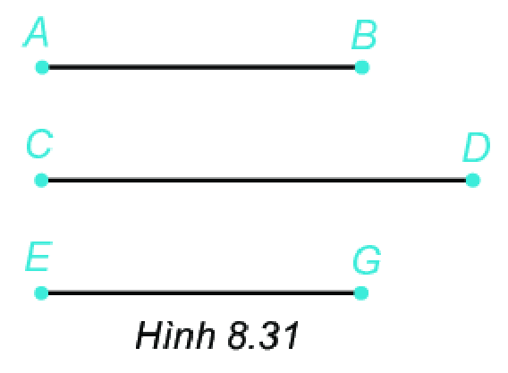
*Hình 8.31*

**Nhận xét:**

<!-- term: Hai đoạn thẳng bằng nhau -->
- Hai đoạn thẳng $AB$ và $EG$ có cùng độ dài. Ta viết $AB = EG$ và nói đoạn thẳng $AB$ bằng đoạn thẳng $EG$.
- Đoạn thẳng $AB$ có độ dài nhỏ hơn đoạn thẳng $CD$. Ta viết $AB < CD$ và nói $AB$ ngắn hơn $CD$; hoặc $CD > AB$ và nói $CD$ dài hơn $AB$.

<!-- pdf:59 -->

**Ví dụ:**

Cho ba điểm $A, B, C$ cùng nằm trên một đường thẳng như hình 8.32. Biết $AC = 6\text{ cm}$, $BC = 2\text{ cm}$.

Tính độ dài đoạn thẳng $AB$.

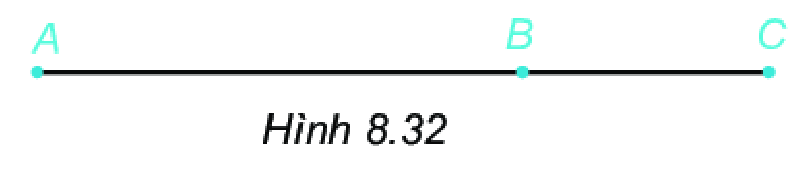
*Hình 8.32*

**Giải:**

Theo hình vẽ, ta có $AC = AB + BC$; Suy ra $AB = AC - BC = 6 - 2 = 4\text{ (cm)}$.

**Luyện tập 2:**

Em hãy đo các đoạn thẳng trong hình 8.33b rồi đánh dấu giống nhau cho các đoạn thẳng bằng nhau theo mẫu như hình 8.33a.

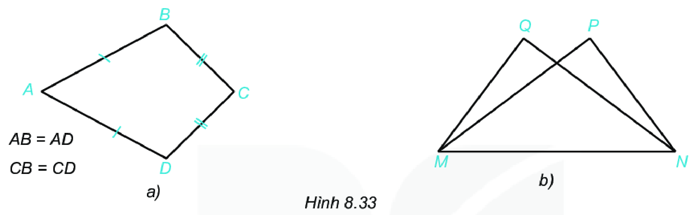
*Hình 8.33*

**Vận dụng 2:**

Dùng thước thẳng có chia vạch, em hãy đo chiều dài của cây bút em đang dùng.

So sánh chiều dài cây bút với chiều dài thước thẳng và rút ra kết luận.

## BÀI TẬP

8.10. Dùng compa vẽ đường tròn tâm $O$ có bán kính bằng $2\text{ cm}$. Gọi $M$ và $N$ là hai điểm tuỳ ý trên đường tròn đó. Hai đoạn thẳng $OM$ và $ON$ có bằng nhau không?

8.11. Việt dùng thước đo độ dài đoạn thẳng $AB$. Vì thước bị gãy mất một mẩu nên Việt chỉ có thể đặt thước để điểm $A$ trùng với vạch $3\text{ cm}$. Khi đó điểm $B$ trùng với vạch $12\text{ cm}$. Em hãy giúp Việt tính độ dài đoạn thẳng $AB$.

8.12. Bạn Nam dùng bước chân để đo chiều dài lớp học. Sau $12$ bước liên tiếp kể từ mép tường đầu lớp thì còn khoảng nửa bước chân nữa là đến mép tường cuối lớp. Nếu mỗi bước chân của Nam dài khoảng $0,6\text{ m}$ thì lớp học dài khoảng bao nhiêu?

8.13. Hãy đo độ dài (đơn vị milimét) rồi sắp xếp các đoạn thẳng trong hình 8.34 theo thứ tự tăng dần của độ dài.

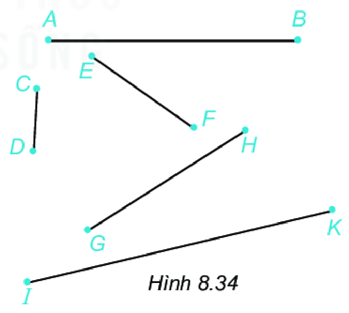
*Hình 8.34*

8.14. Một cái cây đang mọc thẳng thì bị bão làm gãy phần ngọn. Người ta đo được phần ngọn bị gãy dài $1,75\text{ m}$ và phần thân còn lại dài $3\text{ m}$. Hỏi trước khi bị gãy, cây cao bao nhiêu mét?

## 📷 Danh sách hình trong bài

| Mã hình | Trang PDF | Vị trí trong bài | Chú thích gốc |
| --- | :---: | --- | --- |
| H6-toan-b34-01 | 56 | Mở đầu | (sách không đánh số, hình ảnh cây bút chì, đôi đũa, cây gậy) |
| H6-toan-b34-02 | 56 | Mục 1, HĐ1 | Hình 8.23 |
| H6-toan-b34-03 | 56 | Mục 1, HĐ2 | Hình 8.24 |
| H6-toan-b34-04 | 56 | Mục 1 | Hình 8.25 |
| H6-toan-b34-05 | 57 | Mục 1, Câu hỏi | Hình 8.26 |
| H6-toan-b34-06 | 57 | Mục 1, Luyện tập 1 | Hình 8.27 |
| H6-toan-b34-07 | 57 | Mục 1, Vận dụng 1 | Hình 8.28 |
| H6-toan-b34-08 | 57 | Mục 2 | (sách không đánh số, cây bút và thước có vạch chia) |
| H6-toan-b34-09 | 57 | Mục 2, HĐ3 | (sách không đánh số, chiếc bàn học minh hoạ chiều dài) |
| H6-toan-b34-10 | 58 | Mục 2 | Hình 8.29 |
| H6-toan-b34-11 | 58 | Mục 2, Chú ý | Hình 8.30 |
| H6-toan-b34-12 | 58 | Mục 2, HĐ5 | Hình 8.31 |
| H6-toan-b34-13 | 59 | Mục 2, Ví dụ | Hình 8.32 |
| H6-toan-b34-14 | 59 | Mục 2, Luyện tập 2 | Hình 8.33 |
| H6-toan-b34-15 | 59 | Bài 8.13 | Hình 8.34 |
