<!-- pdf:60 -->

# BÀI 35: TRUNG ĐIỂM CỦA ĐOẠN THẲNG

## 🔤 Khái niệm, thuật ngữ

- Trung điểm của đoạn thẳng

## 🎯 Kiến thức, kĩ năng

- Nhận biết trung điểm của đoạn thẳng.
- Giải các bài toán thực tế có liên quan đến trung điểm của đoạn thẳng.

## 🔴 Mở đầu

Em đã chơi bập bênh bao giờ chưa? Trong trò chơi này, người ta dùng một thanh gỗ dài gắn cố định lên một cái trục trên giá đỡ (h.8.35). Nếu hình dung thanh gỗ là một đoạn thẳng thì điểm đặt lên trục phải ở chính giữa của đoạn thẳng đó.

Trong Hình học, điểm đó có ý nghĩa gì và làm thế nào để tìm nó?

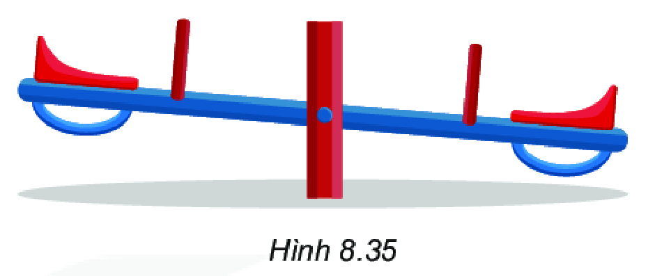
*Hình 8.35*

*Trung điểm của đoạn thẳng*

**HĐ1:** Người ta dùng một thanh gỗ dài $3\text{ m}$ để làm bập bênh. Theo em, điểm gắn trục phải cách hai đầu thanh gỗ là bao nhiêu?

**HĐ2:** Một sợi dây dài $120\text{ cm}$. Gấp đôi sợi dây lại để hai đầu sợi dây trùng nhau. Đánh dấu điểm $A$ là chỗ bị gấp (h.8.36). Khoảng cách từ điểm $A$ đến mỗi đầu sợi dây là bao nhiêu?

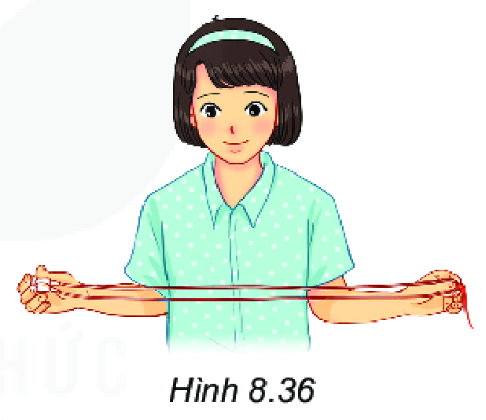
*Hình 8.36*

**HĐ3:** Một chiếc xe chạy với vận tốc không đổi trên một quãng đường thẳng dài $100\text{ km}$ từ vị trí $A$ đến vị trí $B$ hết $2$ giờ.

Hỏi sau khi chạy được $1$ giờ, xe rời xa vị trí $A$ bao nhiêu kilômét, còn cách vị trí $B$ bao nhiêu kilômét (h.8.37)?

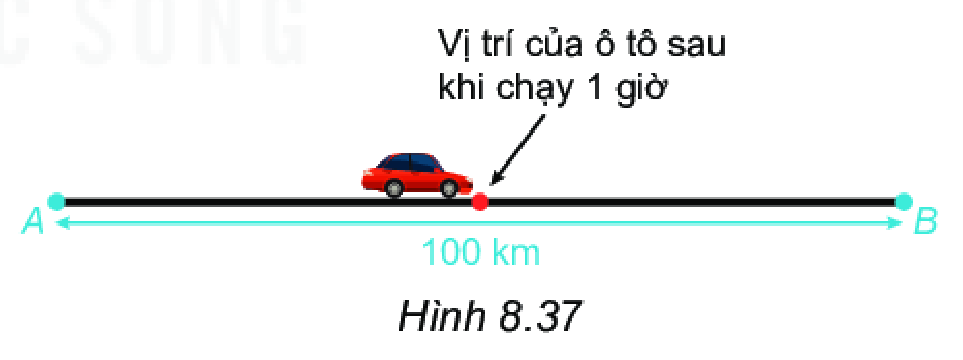
*Hình 8.37*

**Nhận xét:** Nếu xem thanh gỗ, sợi dây, quãng đường $AB$ là các đoạn thẳng thì điểm gắn trục trên thanh gỗ, điểm $A$ trên sợi dây, vị trí chiếc xe sau một giờ, là điểm cách đều hai đầu mút các đoạn thẳng và người ta gọi chúng là trung điểm của các đoạn thẳng đó.

> Nếu điểm $I$ nằm giữa hai điểm $A$ và $B$ sao cho $IA = IB$ (h.8.38) thì điểm $I$ gọi là **trung điểm** của đoạn thẳng $AB$.
>
> Khi đó ta có: $IA = IB = \frac{AB}{2}$.

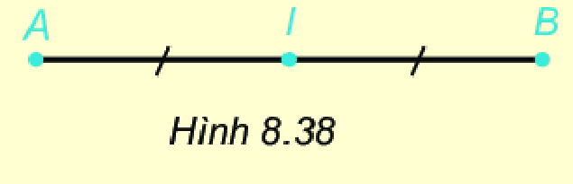
*Hình 8.38*

<!-- pdf:61 -->

> ❓ Dùng thước thẳng có vạch chia, em hãy kiểm tra xem các điểm $I, J, K$ trong hình 8.39 có lần lượt là trung điểm của các đoạn thẳng $AB, CD, EF$ hay không.

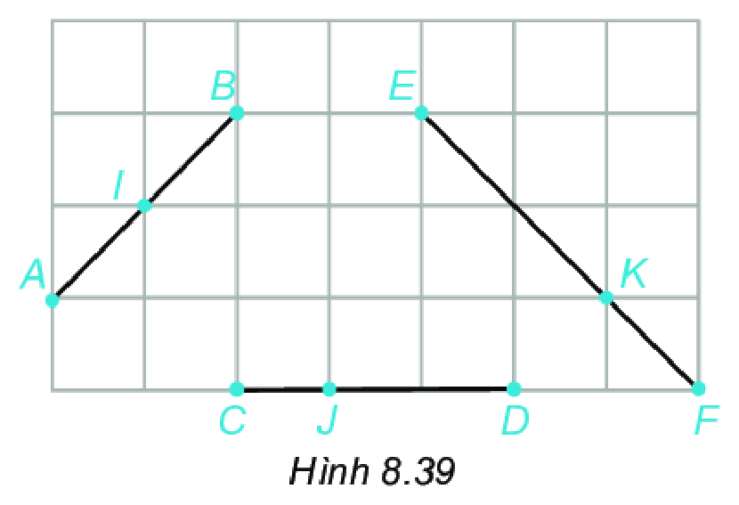
*Hình 8.39*

**Ví dụ:**

Cho đoạn thẳng $AB$ dài $4\text{ cm}$ như hình 8.40.

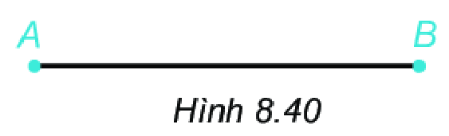
*Hình 8.40*

Gọi $M$ là trung điểm của đoạn thẳng $AB$.

Tính độ dài đoạn thẳng $AM$.

**Giải:**

$M$ là trung điểm của $AB$ nên $AM = MB = \frac{AB}{2}$.

Vậy độ dài đoạn thẳng $AM$ bằng: $\frac{4}{2} = 2\text{ (cm)}$.

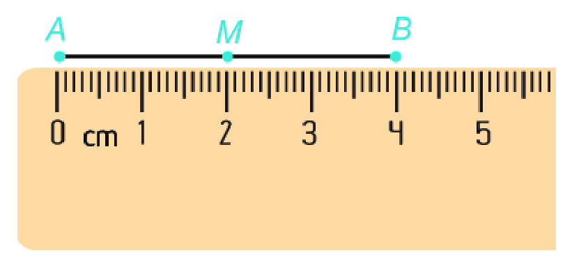

- **Pi:** Ta có thể dùng thước thẳng có vạch chia để xác định trung điểm của đoạn thẳng $AB$ như hình vẽ trên.

**Luyện tập:**

Cho đoạn thẳng $PQ$ dài $12$ đơn vị. Gọi $E$ là trung điểm của đoạn thẳng $PQ$ và $F$ là trung điểm của đoạn thẳng $PE$. Tính độ dài đoạn thẳng $EF$.

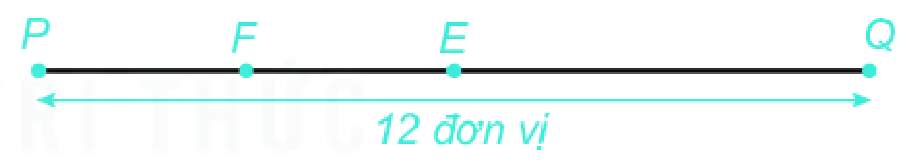

**Vận dụng:**

Vòng quay mặt trời trong khu vui chơi Đầm Sen ở thành phố Hồ Chí Minh có điểm cao nhất là $60\text{ m}$, điểm thấp nhất là $6\text{ m}$ (so với mặt đất). Hỏi trục của vòng quay nằm ở độ cao nào?

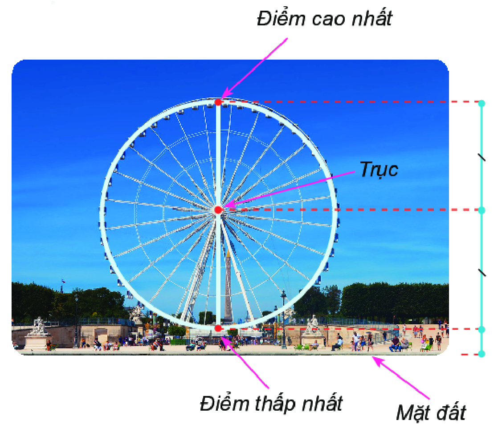

<!-- pdf:62 -->

## BÀI TẬP

8.15. Cho hình vẽ sau:
<!-- ocr-ok: đã đối chiếu ảnh trang PDF 62, nhãn bài 8.15 in màu xanh nhạt -->

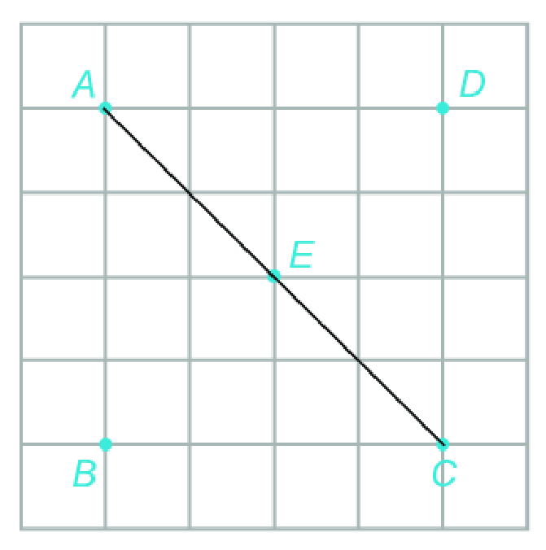

a) Em hãy dùng thước thẳng để kiểm tra xem điểm $E$ có phải là trung điểm của đoạn thẳng $AC$ không?

b) Kiểm tra xem $E$ còn là trung điểm của đoạn thẳng nào khác có các đầu mút là các điểm đã cho.

8.16. Tính độ dài của đoạn thẳng $AB$ nếu trung điểm $I$ của nó nằm cách mút $A$ một khoảng bằng $4,5\text{ cm}$.

8.17. Cho bốn điểm $A, B, C, D$ cùng nằm trên một đường thẳng sao cho $C$ là trung điểm của đoạn thẳng $AB$, $D$ là trung điểm của đoạn thẳng $AC$. Biết rằng $CD = 2\text{ cm}$, hãy tính độ dài đoạn thẳng $AB$.

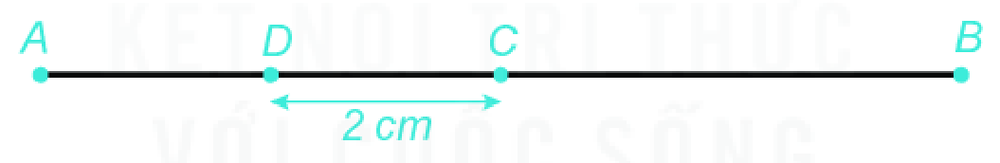

8.18. Giả sử em có một cây gậy và muốn tìm điểm chính giữa của cây gậy đó. Em sẽ làm thế nào nếu:

a) Dùng thước đo độ dài;

b) Chỉ dùng một sợi dây đủ dài.

## 📷 Danh sách hình trong bài

| Mã hình | Trang PDF | Vị trí trong bài | Chú thích gốc |
| --- | :---: | --- | --- |
| H6-toan-b35-01 | 60 | Mở đầu | Hình 8.35 |
| H6-toan-b35-02 | 60 | HĐ2 | Hình 8.36 |
| H6-toan-b35-03 | 60 | HĐ3 | Hình 8.37 |
| H6-toan-b35-04 | 60 | Khung kiến thức | Hình 8.38 |
| H6-toan-b35-05 | 61 | Câu hỏi | Hình 8.39 |
| H6-toan-b35-06 | 61 | Ví dụ | Hình 8.40 |
| H6-toan-b35-07 | 61 | Ví dụ, Giải | (sách không đánh số, dùng thước thẳng có vạch chia xác định trung điểm $M$ của $AB$) |
| H6-toan-b35-08 | 61 | Luyện tập | (sách không đánh số, đoạn thẳng $PQ$ dài $12$ đơn vị với các điểm $E, F$) |
| H6-toan-b35-09 | 61 | Vận dụng | (sách không đánh số, Vòng quay mặt trời với điểm cao nhất, trục, điểm thấp nhất và mặt đất) |
| H6-toan-b35-10 | 62 | Bài 8.15 | (sách không đánh số, đoạn thẳng $AC$ và các điểm $A, B, C, D, E$ trên lưới ô vuông) |
| H6-toan-b35-11 | 62 | Bài 8.17 | (sách không đánh số, bốn điểm $A, D, C, B$ trên đường thẳng với $CD = 2\text{ cm}$) |
