<!-- pdf:64 -->

# BÀI 36: GÓC

## 🔤 Khái niệm, thuật ngữ

- Góc
- Điểm trong của một góc

## 🎯 Kiến thức, kĩ năng

- Nhận biết góc, đỉnh và cạnh của góc.
- Nhận biết góc bẹt.
- Nhận biết điểm trong của một góc.

## 🔴 Mở đầu

Trong đời sống thực tế, chúng ta thường nghe nói đến *góc* như góc nhìn, góc sút (bóng đá), góc bắn (pháo binh),...

Vậy góc là gì và nó có quan hệ như thế nào với các khái niệm khác trong Hình học?

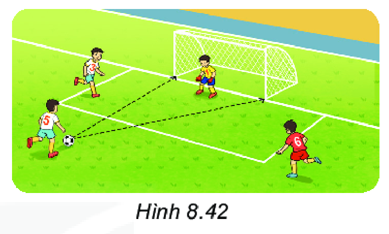
*Hình 8.42*

## 1. GÓC

> **Góc** là hình gồm hai tia chung gốc. Gốc chung của hai tia là **đỉnh** của góc. Hai tia là hai **cạnh** của góc.

- **Pi:** Người ta thường dùng các vòng cung nhỏ nối hai cạnh của góc để đánh dấu góc.
<!-- ocr-ok: đã đối chiếu ảnh trang PDF 64, bóng thoại của Pi nằm cột phải cạnh khung kiến thức -->

Quan sát hình 8.43:

- Góc $xOy$, kí hiệu là $\widehat{xOy}$ (hoặc $\angle xOy$) gồm hai tia chung gốc $Ox$ và $Oy$.
- Điểm $O$ là đỉnh của góc $xOy$; Hai tia $Ox, Oy$ là các cạnh của góc $xOy$.
- Góc $xOy$ còn có các cách gọi khác là: góc $AOB$, góc $O$, góc $yOx$.

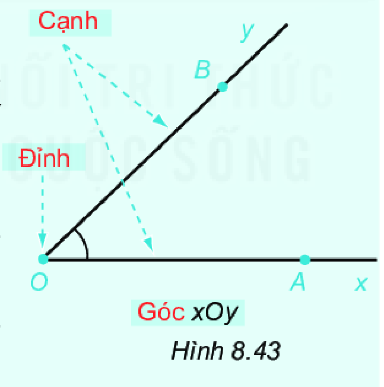
*Hình 8.43*

- Đặc biệt, khi $Ox$ và $Oy$ là hai tia đối nhau, ta có **góc bẹt** $xOy$ (h.8.44).

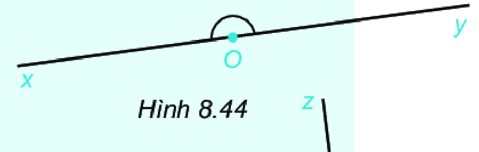
*Hình 8.44*

> ❓ Quan sát hình 8.45 và đọc tên các góc trong hình vẽ.
>
> Với mỗi góc, hãy cho biết đỉnh và các cạnh của nó.

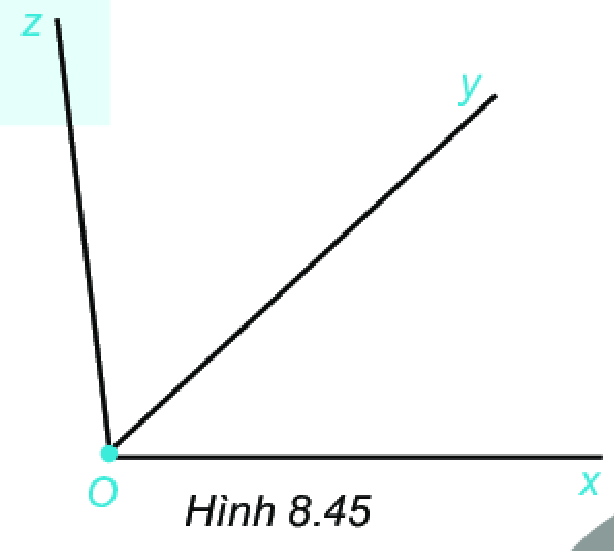
*Hình 8.45*

<!-- pdf:65 -->

**Luyện tập 1:**

① Quan sát hình 8.46 và gọi tên các góc có đỉnh là $A, B$ trong hình vẽ.

② Vẽ hình theo hướng dẫn sau:

- Vẽ đường thẳng $xy$.
- Lấy điểm $A$ thuộc đường thẳng $xy$.
- Lấy điểm $B$ không thuộc đường thẳng $xy$.
- Nối $A$ và $B$.

a) Em hãy đọc tên các góc có trong hình vừa vẽ;

b) Trong các góc đó, hãy chỉ ra góc bẹt.

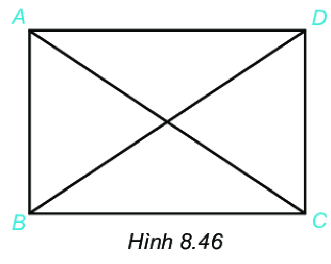
*Hình 8.46*

**Vận dụng 1:**

Compa là một dụng cụ học tập quen thuộc của các em học sinh. Mở chiếc compa ra ta thấy hình ảnh của một góc, trong đó hai cạnh của compa là hai cạnh của góc, đỉnh của compa là đỉnh của góc (h.8.47).

Em hãy tìm thêm trong thực tiễn các hình ảnh của góc và mô tả đỉnh, cạnh của các góc đó.

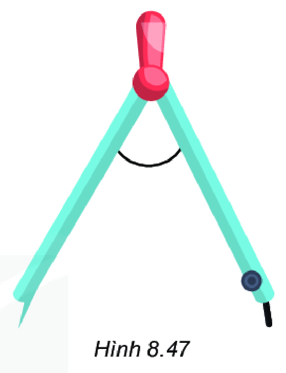
*Hình 8.47*

## 2. ĐIỂM TRONG CỦA GÓC

**HĐ1:** Quan sát hình 8.42 và cho biết cầu thủ nào nằm trong *góc sút*?

**HĐ2:** Trên tờ giấy A4 màu, em xác định hai điểm $M, N$ rồi dùng kéo cắt rời một góc từ tờ giấy như hình bên.

Em hãy cho biết trong hai điểm $M, N$:

a) Điểm nào nằm trong góc vừa cắt rời?

b) Điểm nào không nằm trong góc đó?

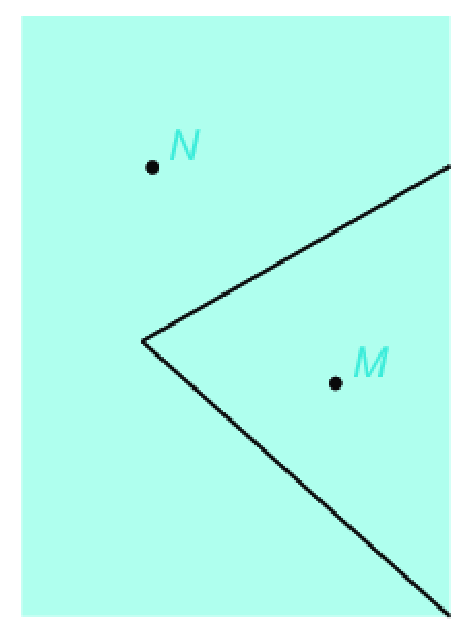

*Điểm trong của một góc không bẹt*

> Quan sát hình 8.48:
> - $M$ là một **điểm trong** của góc $xOy$ (điểm $M$ nằm bên trong góc $xOy$).
> - Các điểm nằm trên hai cạnh của góc và các điểm như điểm $N$ không phải là điểm trong của góc $xOy$.

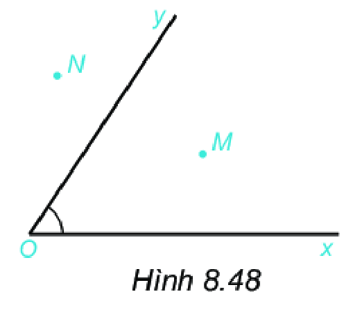
*Hình 8.48*

> ❓ Quan sát hình 8.49 và kể tên các điểm nằm trong góc $mOn$.

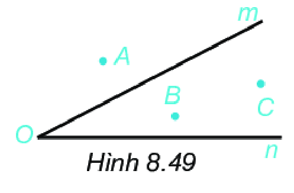
*Hình 8.49*

<!-- pdf:66 -->

**Luyện tập 2:**

Vẽ hình 8.50 vào vở.

a) Kể tên các điểm nằm trong góc $xOy$.

b) Lấy điểm $I$ thuộc đoạn thẳng $AB$, điểm $K$ nằm trên đường thẳng $AB$ nhưng không thuộc đoạn $AB$.

Hỏi điểm $I$ có nằm trong góc $xOy$ không? Điểm $K$ có nằm trong góc $xOy$ không?

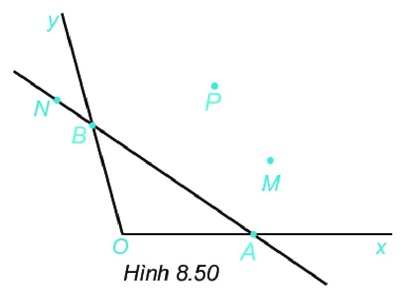
*Hình 8.50*

**Vận dụng 2:**

Quan sát mặt đồng hồ ở hình bên và cho biết trong các chấm chỉ số trên mặt đồng hồ, những chấm nào nằm trong góc tạo bởi:

a) Kim giờ và kim phút;

b) Kim giây và kim phút.

## BÀI TẬP

8.25. Viết tên (cách viết kí hiệu) của góc, chỉ ra đỉnh, cạnh của góc trong mỗi hình vẽ sau:

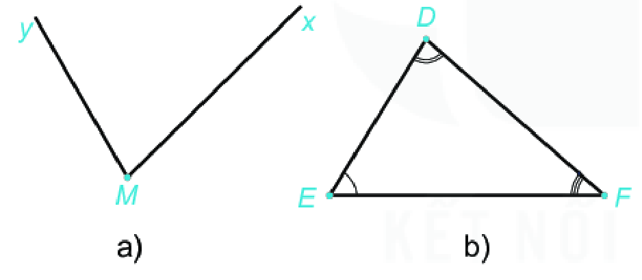

8.26. Cho đường thẳng $xy$. Vẽ hai điểm $A, B$ nằm trên $xy$. Gọi tên các góc bẹt tạo thành.

8.27. Quan sát mặt đồng hồ dưới đây.

Trong các vạch chỉ số trên mặt đồng hồ, những vạch nào nằm trong góc tạo bởi kim giờ và kim phút khi đồng hồ chỉ $8$ giờ $15$ phút?

8.28. Cho ba tia chung gốc $Oa, Ob$ và $Oc$, trong đó không có hai tia nào đối nhau. Hỏi có bao nhiêu góc có hai cạnh là hai trong ba tia đã cho?

8.29. Viết tên các góc có đỉnh $A$, đỉnh $M$ trong hình vẽ sau:

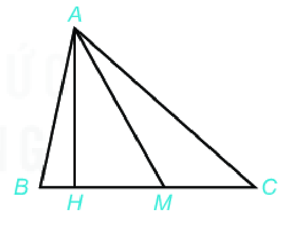

8.30. Lấy ba điểm không thẳng hàng $A, B, C$ trên tờ giấy trắng rồi vẽ các đoạn thẳng $AB, BC, CA$.

Em hãy tô màu phần hình chứa tất cả các điểm trong của cả ba góc $BAC, ACB, CBA$.

## 📷 Danh sách hình trong bài

| Mã hình | Trang PDF | Vị trí trong bài | Chú thích gốc |
| --- | :---: | --- | --- |
| H6-toan-b36-01 | 64 | Mở đầu | Hình 8.42 |
| H6-toan-b36-02 | 64 | Mục 1 | Hình 8.43 |
| H6-toan-b36-03 | 64 | Mục 1 | Hình 8.44 |
| H6-toan-b36-04 | 64 | Mục 1, Câu hỏi | Hình 8.45 |
| H6-toan-b36-05 | 65 | Mục 1, Luyện tập 1 | Hình 8.46 |
| H6-toan-b36-06 | 65 | Mục 1, Vận dụng 1 | Hình 8.47 |
| H6-toan-b36-07 | 65 | Mục 2, HĐ2 | (sách không đánh số, tờ giấy A4 màu cắt rời một góc với hai điểm $M, N$) |
| H6-toan-b36-08 | 65 | Mục 2 | Hình 8.48 |
| H6-toan-b36-09 | 65 | Mục 2, Câu hỏi | Hình 8.49 |
| H6-toan-b36-10 | 66 | Mục 2, Luyện tập 2 | Hình 8.50 |
| H6-toan-b36-11 | 66 | Mục 2, Vận dụng 2 | (sách không đánh số, mặt đồng hồ có kim giờ, kim phút, kim giây) |
| H6-toan-b36-12 | 66 | Bài 8.25 | (sách không đánh số, hai góc ở ý a và ý b) |
| H6-toan-b36-13 | 66 | Bài 8.27 | (sách không đánh số, mặt đồng hồ chỉ $8$ giờ $15$ phút) |
| H6-toan-b36-14 | 66 | Bài 8.29 | (sách không đánh số, tam giác $ABC$ với các điểm $H, M$ trên cạnh $BC$) |
