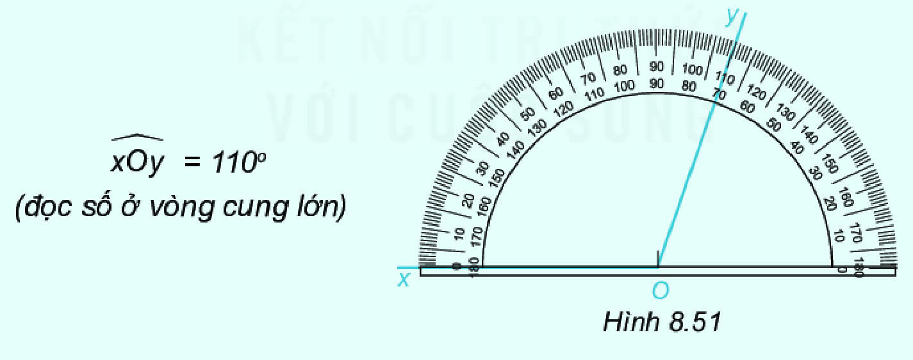
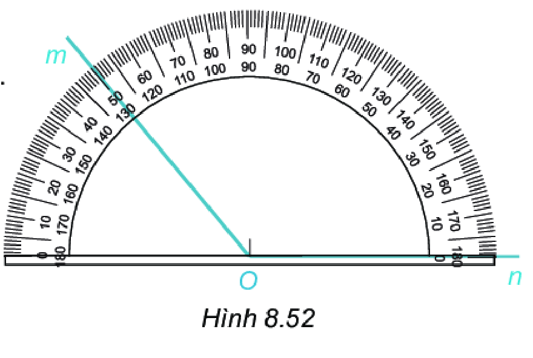
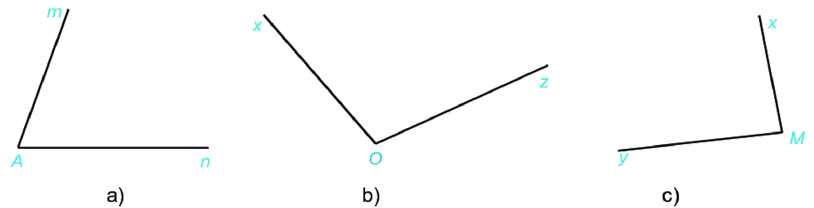
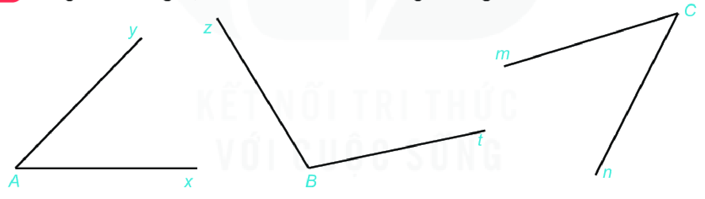
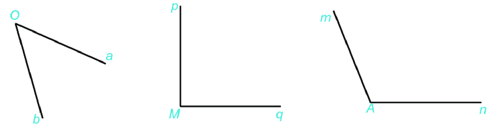
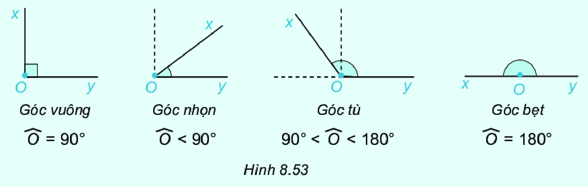
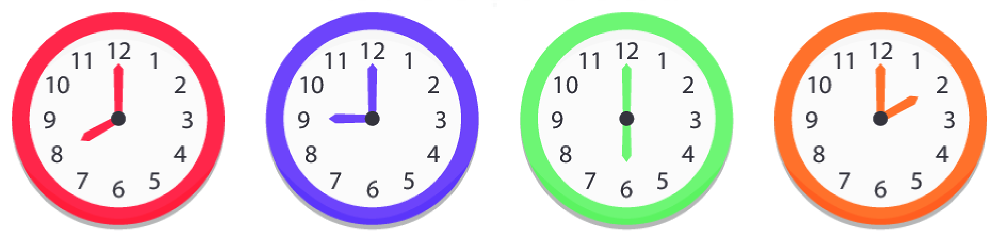
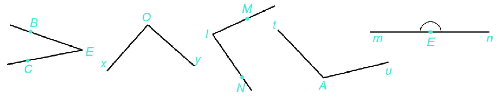
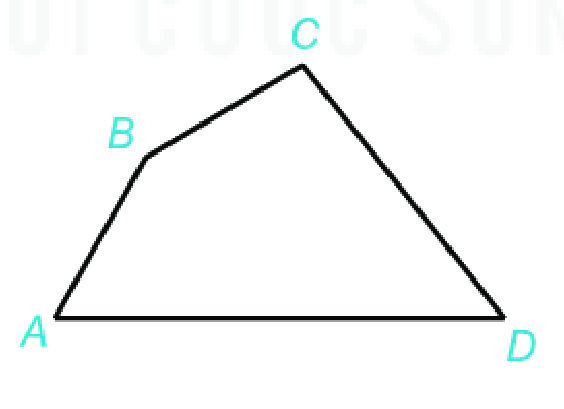

<!-- pdf:67 -->

# BÀI 37: SỐ ĐO GÓC

## 🔤 Khái niệm, thuật ngữ

- Số đo góc
- Góc vuông
- Góc nhọn
- Góc tù

## 🎯 Kiến thức, kĩ năng

- Nhận biết được khái niệm số đo góc.
- Nhận biết được các góc đặc biệt (góc vuông, góc nhọn, góc tù).

## 🔴 Mở đầu

Trong các tình huống đá phạt trực tiếp ở môn bóng đá, bình luận viên thường nói quả đá phạt có góc sút rộng nếu ở gần chính giữa khung thành, quả đá phạt có góc sút hẹp nếu lệch về hai bên. Với một góc tuỳ ý, để đo độ rộng hẹp của góc, gọi chung là độ lớn, người ta thường dùng thước đo góc.

## 1. ĐO GÓC

*Số đo góc*

> Muốn đo góc $xOy$, ta đặt thước đo góc sao cho tâm của thước trùng với $O$, tia $Ox$ đi qua vạch $0$. Khi đó tia $Oy$ đi qua vạch chỉ số đo của góc. Trên hình 8.51, ta thấy $Oy$ đi qua vạch $110$. Vậy góc $xOy$ có **số đo** là $110$ độ. Ta viết $\widehat{xOy} = 110^\circ$.

$\widehat{xOy} = 110^\circ$ *(đọc số ở vòng cung lớn)*

*Hình 8.51*

**Nhận xét:**

- Mỗi góc có một số đo. Số đo của góc bẹt là $180^\circ$.
- Số đo của một góc không vượt quá $180^\circ$.

> ❓ Đọc số đo góc $mOn$ trong hình 8.52.

*Hình 8.52*

<!-- pdf:68 -->

**Luyện tập 1:**

① Dùng thước đo góc, em hãy đo và viết số đo các góc trong mỗi hình sau.

② Em hãy đo xem góc sút trong hình 8.42, bài Góc bằng khoảng bao nhiêu độ?

**Vận dụng 1:**

Bạn Mai đặt thước đo góc đúng theo hướng dẫn để đo góc $xOy$. Tuy nhiên, khi đọc kết quả, đáng lẽ phải đọc số ở vòng cung nhỏ, Mai lại đọc số ở vòng cung lớn. Do đó, kết quả của Mai là $\widehat{xOy} = 100^\circ$. Không cần đo lại góc, em hãy cho biết góc $xOy$ có số đo là bao nhiêu độ?

## 2. CÁC GÓC ĐẶC BIỆT
<!-- ocr-ok: đã đối chiếu ảnh trang PDF 68, tiêu đề mục in chữ trắng trên băng màu xanh -->

**HĐ1:** Dùng thước đo góc, đo rồi so sánh số đo các góc trong hình sau.

<!-- term: So sánh hai góc -->
**Nhận xét:** Để so sánh hai góc, người ta có thể sử dụng số đo của chúng:

<!-- term: So sánh hai góc -->
- Hai góc $xAy$ và $mCn$ có số đo bằng nhau. Ta viết $\widehat{xAy} = \widehat{mCn}$.
- Góc $tBz$ có số đo lớn hơn góc $xAy$. Ta viết $\widehat{tBz} > \widehat{xAy}$ hoặc $\widehat{xAy} < \widehat{tBz}$.

**HĐ2:** Bằng cách đo, hãy so sánh số đo các góc trong hình sau với $90^\circ$:

<!-- pdf:69 -->

*Góc vuông, góc nhọn, góc tù*

> - Góc có số đo bằng $90^\circ$ là **góc vuông**.
> - Góc nhỏ hơn góc vuông là **góc nhọn**.
> - Góc lớn hơn góc vuông, nhỏ hơn góc bẹt là **góc tù**.

*Hình 8.53*

> ❓ Hãy chỉ ra một số hình ảnh góc nhọn, góc vuông, góc tù, góc bẹt có trong thực tế mà em biết.

**Luyện tập 2:**

Hãy sắp xếp các góc sau theo thứ tự số đo từ bé đến lớn: góc vuông, góc nhọn, góc tù và góc bẹt.

**Vận dụng 2:**

a) Dùng thước đo góc để đo các góc tạo bởi kim phút và kim giờ trong các mặt đồng hồ sau:

b) Trong các góc đó, chỉ ra góc vuông, góc nhọn, góc tù, góc bẹt.

**Chú ý:** Góc tạo bởi kim giờ và kim phút khi đồng hồ chỉ $12$ giờ cho ta hình ảnh của **góc không**.

<!-- pdf:70 -->

## BÀI TẬP

8.31. Cho các góc với số đo như dưới đây.

$\widehat{A} = 63^\circ; \quad \widehat{M} = 135^\circ; \quad \widehat{B} = 91^\circ; \quad \widehat{T} = 179^\circ.$

Trong các góc đó, kể tên các góc nhọn, góc tù.

8.32. Quan sát hình sau.
<!-- ocr-ok: đã đối chiếu ảnh trang PDF 70, nhãn bài 8.32 in màu xanh nhạt -->

a) Ước lượng bằng mắt xem góc nào là góc nhọn, góc vuông, góc tù, góc bẹt.

b) Dùng êke để kiểm tra lại kết quả của câu a.

c) Dùng thước đo góc để tìm số đo mỗi góc.

8.33. Quan sát hình ảnh mặt đồng hồ, em hãy tìm một thời điểm mà góc tạo bởi kim giờ và kim phút là:

a) Góc nhọn;

b) Góc vuông;

c) Góc tù;

d) Góc bẹt.

8.34. Đo các góc trong tứ giác $ABCD$ rồi tính tổng số đo các góc đó.

## 💡 Em có biết?

*Thước đo góc* đơn giản nhất là một nửa hình tròn được chia thành $180$ phần bằng nhau bởi các vạch, ứng với $180$ góc bằng nhau. Góc đó được chọn làm đơn vị đo góc và gọi là **độ**. Trên thước có ghi từ $0$ (độ) đến $180$ (độ). Tâm của nửa hình tròn cũng gọi là tâm của thước.

## 📷 Danh sách hình trong bài

| Mã hình | Trang PDF | Vị trí trong bài | Chú thích gốc |
| --- | :---: | --- | --- |
| H6-toan-b37-01 | 67 | Mục 1 | Hình 8.51 |
| H6-toan-b37-02 | 67 | Mục 1, Câu hỏi | Hình 8.52 |
| H6-toan-b37-03 | 68 | Mục 1, Luyện tập 1 | (sách không đánh số, ba góc $\widehat{mAn}, \widehat{xOz}, \widehat{xMy}$ ở các ý a, b, c) |
| H6-toan-b37-04 | 68 | Mục 2, HĐ1 | (sách không đánh số, ba góc $\widehat{xAy}, \widehat{zBt}, \widehat{mCn}$) |
| H6-toan-b37-05 | 68 | Mục 2, HĐ2 | (sách không đánh số, ba góc $\widehat{aOb}, \widehat{pMq}, \widehat{mAn}$) |
| H6-toan-b37-06 | 69 | Mục 2 | Hình 8.53 |
| H6-toan-b37-07 | 69 | Mục 2, Vận dụng 2 | (sách không đánh số, bốn mặt đồng hồ) |
| H6-toan-b37-08 | 70 | Bài 8.32 | (sách không đánh số, năm góc $\widehat{BEC}, \widehat{xOy}, \widehat{MIN}, \widehat{tAu}, \widehat{mEn}$) |
| H6-toan-b37-09 | 70 | Bài 8.34 | (sách không đánh số, tứ giác $ABCD$) |
