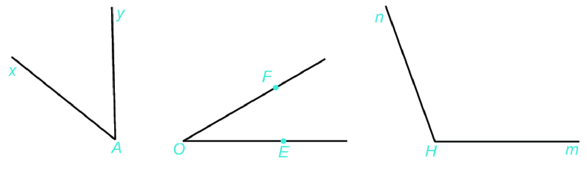
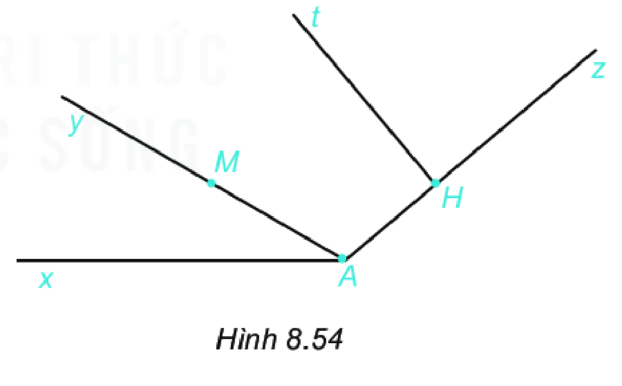
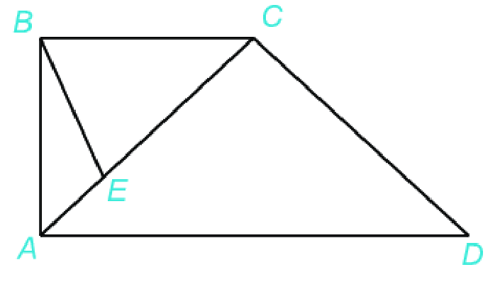
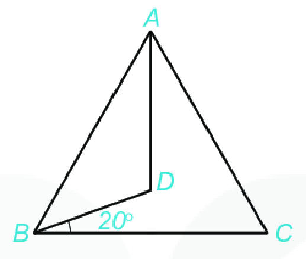
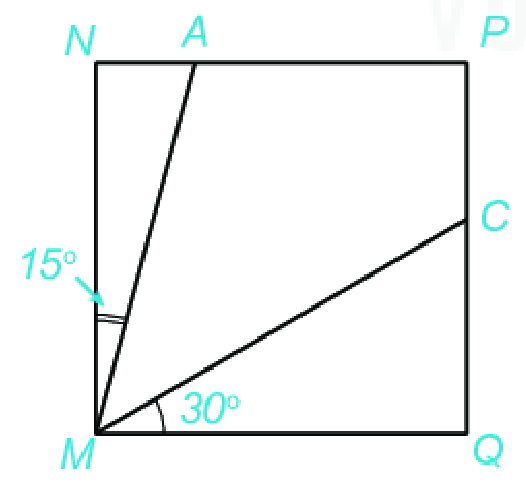
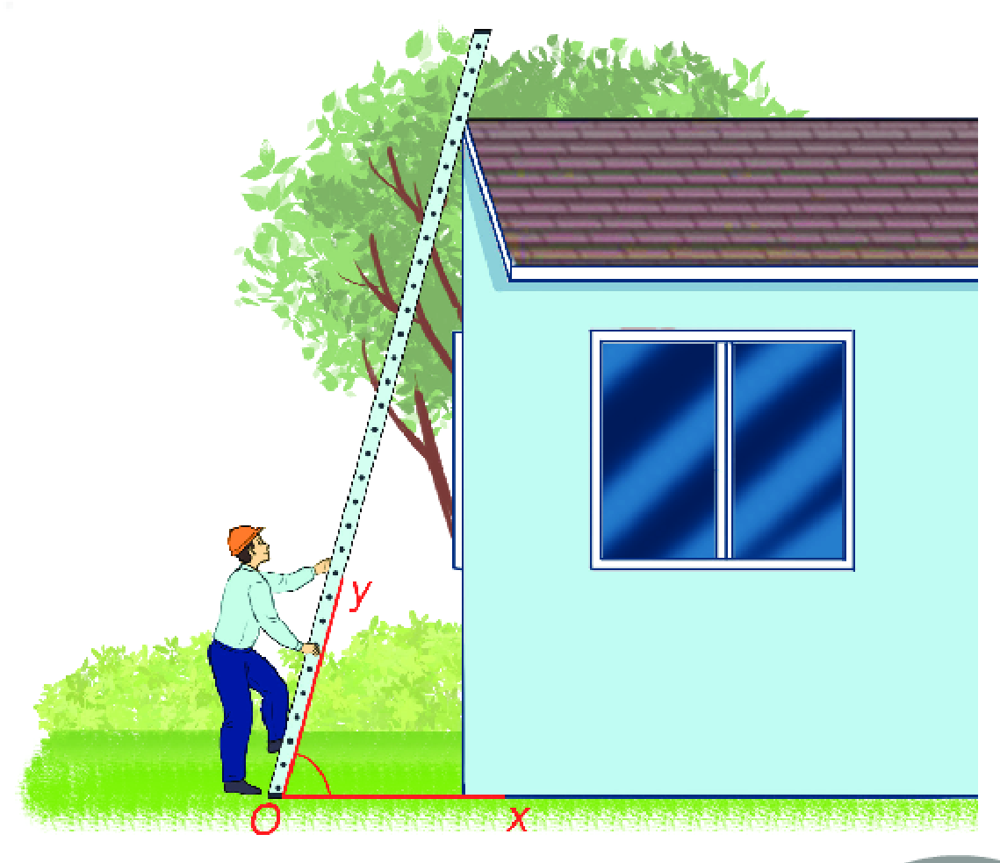

<!-- pdf:71 -->

# LUYỆN TẬP CHUNG

**Ví dụ 1:**

a) Đo rồi cho biết số đo các góc có trong hình vẽ sau.

b) Sắp xếp các góc trên theo thứ tự tăng dần của số đo góc.

**Giải:**

a) Số đo các góc có trong hình là: $\widehat{xAy} = 50^\circ$; $\widehat{EOF} = 30^\circ$; $\widehat{mHn} = 110^\circ$.

b) Sắp xếp các góc theo thứ tự tăng dần của số đo góc:

$\widehat{EOF} < \widehat{xAy} < \widehat{mHn}.$

**Ví dụ 2:**

Quan sát hình 8.54.

a) Sử dụng êke để chỉ ra các góc nhọn, góc vuông, góc tù, góc bẹt có trong hình vẽ.

b) Gọi tên các góc đỉnh $A$ có trong hình vẽ và cho biết số đo của chúng.

c) Điểm $M$ có nằm trong góc $xAz$ không? Từ đó so sánh hai góc $xAM$ và $xAz$.

*Hình 8.54*

**Giải:**

a) Góc nhọn là $\widehat{xAy}$;

Góc vuông là: $\widehat{AHt}$; $\widehat{tHz}$;

Góc tù là: $\widehat{xAz}$; $\widehat{yAz}$;

Góc bẹt là: $\widehat{AMy}$; $\widehat{AHz}$.

b) Các góc đỉnh $A$ là: $\widehat{xAy}$; $\widehat{xAz}$; $\widehat{yAz}$.

Số đo của các góc đó là: $\widehat{xAy} = 30^\circ$; $\widehat{xAz} = 140^\circ$; $\widehat{yAz} = 110^\circ$.

c) Điểm $M$ nằm trong góc $xAz$. Do đó $\widehat{xAM} < \widehat{xAz}$.

<!-- pdf:72 -->

## BÀI TẬP

8.35. Hãy dùng ê ke để kiểm tra và cho biết góc nào là góc nhọn, góc vuông, góc tù, góc bẹt có trong hình sau.

8.36. Trong hình vẽ sau, cho tam giác đều $ABC$ và góc $DBC$ bằng $20^\circ$.

a) Kể tên các góc trong hình vẽ trên. Những góc nào có số đo bằng $60^\circ$?

b) Điểm $D$ có nằm trong góc $ABC$ không? Điểm $C$ có nằm trong góc $ADB$ không?
<!-- ocr-ok: đã đối chiếu ảnh trang PDF 72, kí hiệu điểm và góc tách bằng LaTeX -->

c) Em hãy dự đoán số đo góc $ABD$ và sử dụng thước đo góc để kiểm tra lại dự đoán của mình.

8.37. Cho hình vuông $MNPQ$ và số đo các góc ghi tương ứng như trên hình sau.

a) Kể tên các điểm nằm trong góc $AMC$;

b) Cho biết số đo góc $AMC$ bằng cách đo;

c) Sắp xếp các góc $NMA$, $AMC$ và $CMQ$ theo thứ tự số đo tăng dần.

8.38. Góc nghiêng khi đặt thang là góc tạo bởi cạnh thang và mặt đất. Để đảm bảo an toàn khi sử dụng thang, người ta thấy rằng góc nghiêng an toàn khi đặt thang là $75^\circ$. Em hãy kiểm tra xem chiếc thang trong hình sau đã đảm bảo an toàn hay chưa.

## 📷 Danh sách hình trong bài

| Mã hình | Trang PDF | Vị trí trong bài | Chú thích gốc |
| --- | :---: | --- | --- |
| H6-toan-ltc-c08-02-01 | 71 | Ví dụ 1 | (sách không đánh số, ba góc $\widehat{xAy}, \widehat{EOF}, \widehat{mHn}$) |
| H6-toan-ltc-c08-02-02 | 71 | Ví dụ 2 | Hình 8.54 |
| H6-toan-ltc-c08-02-03 | 72 | Bài 8.35 | (sách không đánh số, tứ giác $ABCD$ với điểm $E$) |
| H6-toan-ltc-c08-02-04 | 72 | Bài 8.36 | (sách không đánh số, tam giác đều $ABC$ với điểm $D$ và $\widehat{DBC} = 20^\circ$) |
| H6-toan-ltc-c08-02-05 | 72 | Bài 8.37 | (sách không đánh số, hình vuông $MNPQ$ với các góc $15^\circ, 30^\circ$) |
| H6-toan-ltc-c08-02-06 | 72 | Bài 8.38 | (sách không đánh số, góc nghiêng $\widehat{xOy}$ khi đặt thang dựa vào tường) |
