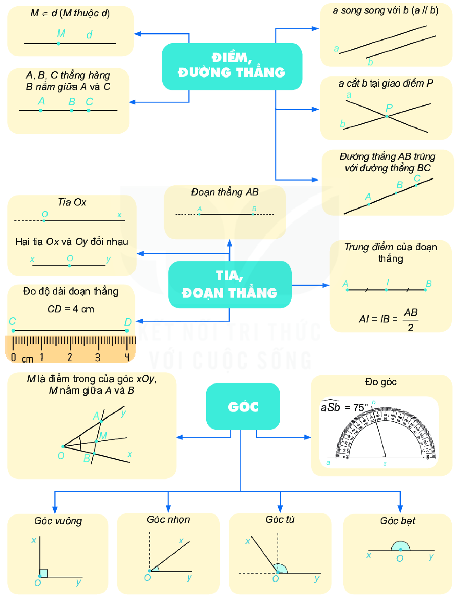
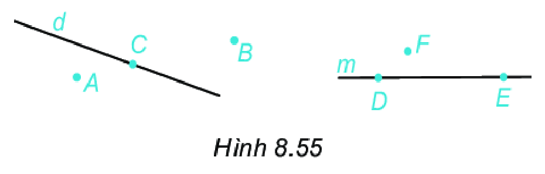
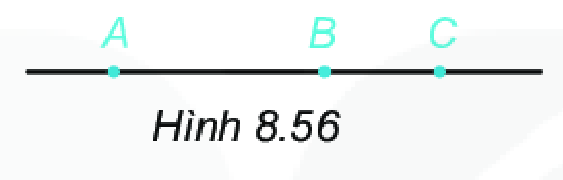
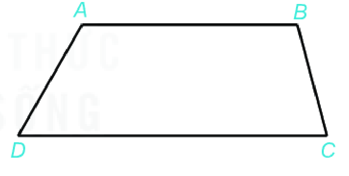
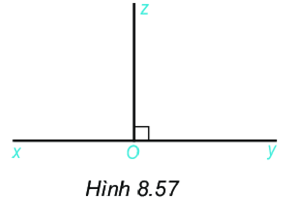

<!-- pdf:73 -->

# CHÚNG TA ĐÃ HỌC NHỮNG GÌ?

- *ĐIỂM, ĐƯỜNG THẲNG*
  - $M \in d$ ($M$ thuộc $d$)
  - $A, B, C$ thẳng hàng; $B$ nằm giữa $A$ và $C$
  - $a$ song song với $b$ ($a \parallel b$)
  - $a$ cắt $b$ tại giao điểm $P$
  - Đường thẳng $AB$ trùng với đường thẳng $BC$
- *TIA, ĐOẠN THẲNG*
  - Tia $Ox$; Hai tia $Ox$ và $Oy$ đối nhau
  - Đoạn thẳng $AB$
  - Đo độ dài đoạn thẳng: $CD = 4\text{ cm}$
  - Trung điểm của đoạn thẳng: $AI = IB = \frac{AB}{2}$
- *GÓC*
  - $M$ là điểm trong của góc $xOy$, $M$ nằm giữa $A$ và $B$
  - Đo góc: $\widehat{aSb} = 75^\circ$
  - Các góc đặc biệt: *Góc vuông*, *Góc nhọn*, *Góc tù*, *Góc bẹt*
<!-- ocr-ok: đã đối chiếu ảnh trang PDF 73, sơ đồ tổng kết chương nhiều nhánh -->

<!-- pdf:74 -->

## BÀI TẬP CUỐI CHƯƠNG VIII

8.39. Xem hình 8.55 rồi cho biết trong các khẳng định sau, khẳng định nào đúng, khẳng định nào sai?

*Hình 8.55*

a) Điểm $C$ thuộc đường thẳng $d$, hai điểm $A$ và $B$ không thuộc đường thẳng $d$.
<!-- ocr-ok: đã đối chiếu ảnh trang PDF 74, kí hiệu điểm và đường thẳng tách bằng LaTeX -->

b) Ba điểm $A, B, C$ không thẳng hàng.

c) Điểm $F$ không thuộc đường thẳng $m$.

d) Ba điểm $D, E, F$ không thẳng hàng.

8.40. Hình 8.56 thể hiện các quan hệ nào nếu nói về:

*Hình 8.56*

a) Ba điểm $A, B$ và $C$?

b) Hai tia $BA$ và $BC$?

c) Ba đoạn thẳng $AB, BC$ và $AC$?

8.41. Vẽ đoạn thẳng $MN$ dài $7\text{ cm}$ rồi tìm trung điểm của nó.
<!-- ocr-ok: đã đối chiếu ảnh trang PDF 74, nhãn bài màu xanh nhạt và kí hiệu LaTeX -->

8.42. Cho hình thang $ABCD$ như hình vẽ bên.
<!-- ocr-ok: đã đối chiếu ảnh trang PDF 74, nhãn bài màu xanh nhạt và kí hiệu LaTeX -->

Em hãy:

a) Kể tên các góc có trong hình vẽ.

b) Đo rồi chỉ ra các góc nhọn, góc tù.

8.43. Cho hình 8.57.
<!-- ocr-ok: đã đối chiếu ảnh trang PDF 74, nhãn bài 8.43 in màu xanh nhạt -->

*Hình 8.57*

a) Kể tên các tia có trong hình trên. Trong đó, hai tia nào là hai tia đối nhau?

b) Kể tên các góc vuông, góc bẹt trong hình 8.57;

c) Nếu điểm $B$ nằm trong góc $yOz$ thì góc $xOB$ là góc tù hay góc nhọn?

## 📷 Danh sách hình trong bài

| Mã hình | Trang PDF | Vị trí trong bài | Chú thích gốc |
| --- | :---: | --- | --- |
| H6-toan-ot-c08-01 | 73 | Tổng kết chương VIII | (sách không đánh số, sơ đồ tổng kết Chương VIII: Chúng ta đã học những gì?) |
| H6-toan-ot-c08-02 | 74 | Bài 8.39 | Hình 8.55 |
| H6-toan-ot-c08-03 | 74 | Bài 8.40 | Hình 8.56 |
| H6-toan-ot-c08-04 | 74 | Bài 8.42 | (sách không đánh số, hình thang $ABCD$) |
| H6-toan-ot-c08-05 | 74 | Bài 8.43 | Hình 8.57 |
