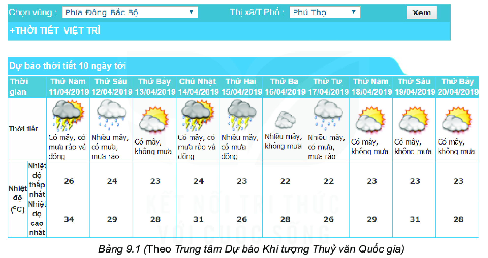
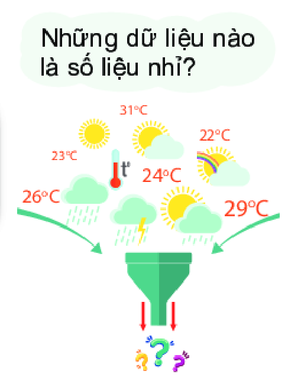
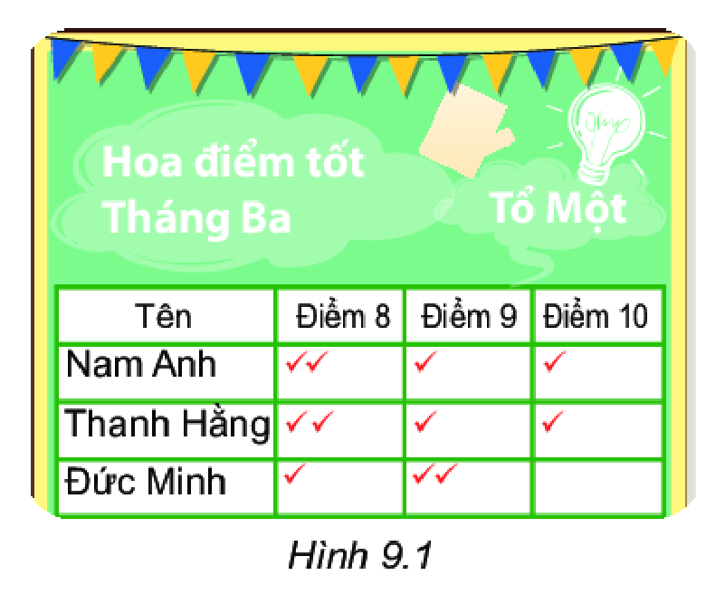
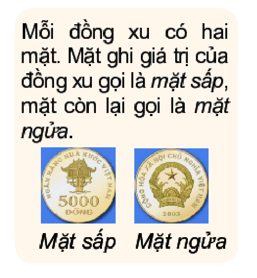
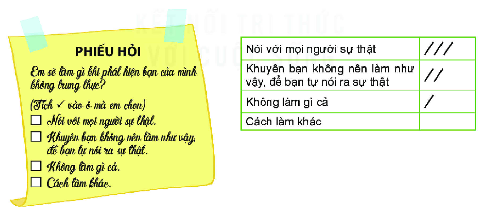

<!-- pdf:76 -->
<!-- Trang bìa Chương IX (PDF 75): CHƯƠNG IX. DỮ LIỆU VÀ XÁC SUẤT THỰC NGHIỆM — "Một ngày nào đó, tư duy thống kê sẽ trở nên cần thiết như khả năng biết đọc, biết viết vậy!" (H. G. Wells) -->

# BÀI 38: DỮ LIỆU VÀ THU THẬP DỮ LIỆU

## 🔤 Khái niệm, thuật ngữ

- Dữ liệu
- Số liệu

## 🎯 Kiến thức, kĩ năng

- Nhận biết các loại dữ liệu.
- Nhận biết tính hợp lí của dữ liệu.
- Thu thập dữ liệu.

## 🔴 Mở đầu

Trường Trung học cơ sở Nguyễn Du dự định tổ chức một số hoạt động ngoài trời tại Việt Trì, Phú Thọ. Nam được giao nhiệm vụ xem dự báo thời tiết để chuẩn bị đồ dùng cho phù hợp. Nam đã tìm thấy thông tin dự báo thời tiết $10$ ngày tới trên Internet như sau:

| Thời gian | Thứ Năm 11/04/2019 | Thứ Sáu 12/04/2019 | Thứ Bảy 13/04/2019 | Chủ Nhật 14/04/2019 | Thứ Hai 15/04/2019 | Thứ Ba 16/04/2019 | Thứ Tư 17/04/2019 | Thứ Năm 18/04/2019 | Thứ Sáu 19/04/2019 | Thứ Bảy 20/04/2019 |
| --- | :---: | :---: | :---: | :---: | :---: | :---: | :---: | :---: | :---: | :---: |
| **Thời tiết** | Có mây, có mưa rào và dông | Nhiều mây, có mưa, mưa rào | Có mây, không mưa | Có mây, có mưa rào và dông | Nhiều mây, có mưa dông | Nhiều mây, không mưa | Nhiều mây, có mưa, mưa rào | Có mây, không mưa | Có mây, không mưa | Có mây, không mưa |
| **Nhiệt độ thấp nhất ($^\circ\text{C}$)** | $26$ | $24$ | $23$ | $24$ | $23$ | $22$ | $22$ | $23$ | $23$ | $23$ |
| **Nhiệt độ cao nhất ($^\circ\text{C}$)** | $34$ | $29$ | $28$ | $31$ | $26$ | $28$ | $26$ | $29$ | $31$ | $28$ |
<!-- ocr-ok: đã đối chiếu ảnh trang PDF 76, bảng dự báo thời tiết nhiều cột có biểu tượng -->

*Bảng 9.1 (Theo Trung tâm Dự báo Khí tượng Thuỷ văn Quốc gia)*

Từ bảng dự báo thời tiết trên có thể rút ra được những thông tin gì? Chúng ta cùng tìm hiểu.

## 1. DỮ LIỆU THỐNG KÊ
<!-- ocr-ok: đã đối chiếu ảnh trang PDF 76, chữ tiêu đề in trắng trên nền băng xanh -->

Từ bảng 9.1, ta có nhiệt độ thấp nhất (đơn vị độ C) trong các ngày từ 11-4-2019 đến 20-4-2019 là

$$26, 24, 23, 24, 23, 22, 22, 23, 23, 23.$$

- **Tròn:** Em có thể truy cập trang web của *Trung tâm Dự báo Khí tượng Thuỷ văn Quốc gia* http://www.nchmf.gov.vn/ để xem dự báo thời tiết.

**HĐ1:**

a) Từ bảng 9.1, em hãy liệt kê nhiệt độ cao nhất (đơn vị độ C) trong các ngày từ 11-4-2019 đến 20-4-2019.

b) Những ngày nào trong các ngày từ 11-4-2019 đến 20-4-2019 được dự báo không mưa?

<!-- pdf:77 -->

**HĐ2:** Trong các thông tin thu được từ HĐ1, thông tin nào là số? Thông tin nào không phải là số?

> Các thông tin thu được ở trên như nhiệt độ thấp nhất, nhiệt độ cao nhất, ngày không mưa,... được gọi là **dữ liệu**. Trong các dữ liệu ấy, có dữ liệu là số (**số liệu**), có dữ liệu không phải là số.

*Những dữ liệu nào là số liệu nhỉ?*

> ❓ Cho ví dụ về dữ liệu là số, ví dụ về dữ liệu không phải là số.

<!-- term: Dữ liệu không hợp lí -->
**Ví dụ 1:** An cùng bạn liệt kê tên một số loài thực vật để làm bài tập môn Khoa học tự nhiên, được dãy dữ liệu như sau:

<!-- term: Dữ liệu không hợp lí -->
Dương xỉ, thông, dừa, rêu, đậu, bưởi, vi khuẩn.
<!-- ocr-ok: đã đối chiếu ảnh trang PDF 77, chữ màu xanh lá OCR đọc sót -->

<!-- term: Dữ liệu không hợp lí -->
a) Dữ liệu trên có phải là số liệu không?

<!-- term: Dữ liệu không hợp lí -->
b) Em hãy chỉ ra dữ liệu không hợp lí (nếu có) trong dãy dữ liệu trên.

**Giải:**

<!-- term: Dữ liệu không hợp lí -->
a) Dãy dữ liệu là tên của các loài thực vật nên không phải là dãy số liệu;

<!-- term: Dữ liệu không hợp lí -->
b) Dữ liệu không hợp lí là: vi khuẩn.

**Luyện tập 1:** Cho hai dãy dữ liệu như sau:

(1) Số học sinh các lớp 6 trong trường:

$$35 \quad 42 \quad 87 \quad 38 \quad 40 \quad 41 \quad 38.$$
<!-- ocr-ok: đã đối chiếu ảnh trang PDF 77, dãy số liệu màu xanh lá -->

(2) Tên món ăn yêu thích của các thành viên trong gia đình:

Bánh chưng, pizza, canh cua, gà rán, rau muống luộc, cá kho, rượu vang.
<!-- ocr-ok: đã đối chiếu ảnh trang PDF 77, chữ màu xanh lá OCR không nhận diện được -->

a) Trong các dãy dữ liệu trên, dãy nào là dãy số liệu?

b) Hãy tìm dữ liệu không hợp lí (nếu có) trong mỗi dãy dữ liệu trên.

**Tranh luận:** Vuông và Tròn đưa ra nhận xét về bảng *Hoa điểm tốt tháng Ba* (h.9.1).

- **Tròn:** Số điểm tốt của các bạn trong tháng là số liệu.
- **Vuông:** Tên các bạn trong tổ Một không phải là số liệu.

*Hình 9.1*

| Tên | Điểm $8$ | Điểm $9$ | Điểm $10$ |
| --- | :---: | :---: | :---: |
| Nam Anh | $\checkmark\checkmark$ | $\checkmark$ | $\checkmark$ |
| Thanh Hằng | $\checkmark\checkmark$ | $\checkmark$ | $\checkmark$ |
| Đức Minh | $\checkmark$ | $\checkmark\checkmark$ | |
<!-- ocr-ok: đã đối chiếu ảnh trang PDF 77, bảng trong Hình 9.1 có nền màu xanh -->

Em có đồng ý với Vuông và Tròn không?

<!-- pdf:78 -->

## 2. THU THẬP DỮ LIỆU THỐNG KÊ

Ở HĐ1 em đã thu thập được dữ liệu về nhiệt độ thấp nhất, cao nhất, những ngày không mưa từ Internet. Trong mục này, chúng ta sẽ tiếp tục làm quen với việc thu thập dữ liệu thống kê.

**HĐ3:** Quân muốn thu thập số liệu về số lượng học sinh đeo kính trong một số lớp học để làm một dự án học tập.

Em hãy giúp Quân bằng cách quan sát và đếm xem lớp em có bao nhiêu bạn đeo kính?

Mỗi đồng xu có hai mặt. Mặt ghi giá trị của đồng xu gọi là *mặt sấp*, mặt còn lại gọi là *mặt ngửa*.

**HĐ4:** Vuông gieo một đồng xu $5$ lần và ghi lại kết quả như bảng bên (mỗi gạch ứng với một lần xuất hiện).

| Mặt đồng xu | Kết quả kiểm đếm |
| --- | :---: |
| Mặt sấp | `///` |
| Mặt ngửa | `//` |
<!-- ocr-ok: đã đối chiếu ảnh trang PDF 78, bảng kiểm đếm thêm tiêu đề cột mô tả -->

Em hãy gieo một đồng xu $10$ lần và ghi lại kết quả theo cách tương tự.

**HĐ5:** Trong môn Giáo dục công dân, cô giáo muốn khảo sát phản ứng của các bạn trong lớp khi phát hiện bạn của mình không trung thực. Em hãy giúp cô giáo làm khảo sát trong lớp em theo các gợi ý sau:

1. Lập phiếu hỏi theo mẫu dưới đây và phát cho các bạn trong lớp.

2. Thu phiếu và tổng hợp xem mỗi phản ứng có bao nhiêu bạn lựa chọn (bảng sau, mỗi gạch tương ứng với một bạn chọn). Phản ứng nào được nhiều bạn chọn nhất?

**PHIẾU HỎI**

*Em sẽ làm gì khi phát hiện bạn của mình không trung thực?*
*(Tích $\checkmark$ vào ô mà em chọn)*
- $\square$ *Nói với mọi người sự thật.*
- $\square$ *Khuyên bạn không nên làm như vậy, để bạn tự nói ra sự thật.*
- $\square$ *Không làm gì cả.*
- $\square$ *Cách làm khác.*

| Phản ứng | Kết quả kiểm đếm |
| --- | :---: |
| Nói với mọi người sự thật | `///` |
| Khuyên bạn không nên làm như vậy, để bạn tự nói ra sự thật | `//` |
| Không làm gì cả | `/` |
| Cách làm khác | |

> Có nhiều cách để **thu thập dữ liệu** như *quan sát, làm thí nghiệm, lập phiếu hỏi*,... hay *thu thập từ những nguồn có sẵn* như sách báo, trang web,...

<!-- pdf:79 -->

**Ví dụ 2:** Đoạn thơ sau được trích trong bài thơ *Cửu Long Giang ta ơi* của tác giả Nguyên Hồng:

...“Mê Kông quặn đẻ
Chín nhánh sông vàng
Nông dân Nam Bộ gối đất nằm sương
Mồ hôi và bãi lầy thành đồng lúa
Thành những tên đọc lên nước mắt đều muốn ứa
Những Hà Tiên, Gia Định, Long Châu
Những Gò Công, Gò Vấp, Đồng Tháp, Cà Mau.”...
<!-- ocr-ok: đã đối chiếu ảnh trang PDF 79, đoạn thơ in màu xanh lá OCR đọc sót -->

(Nguyên Hồng, *Trời xanh*, NXB Văn học, Hà Nội, 1960, tr.5 – 9)

Em hãy liệt kê tên các địa danh xuất hiện trong đoạn thơ trên.

**Giải:**

Tên các địa danh xuất hiện trong đoạn thơ trên là: Mê Kông, Nam Bộ, Hà Tiên, Gia Định, Long Châu, Gò Công, Gò Vấp, Đồng Tháp, Cà Mau.

**Luyện tập 2:** Dựa vào bảng *Hoa điểm tốt tháng Ba* (h.9.1), hãy lập bảng số điểm $8$ của các bạn trong tổ Một theo mẫu như hình bên.

Ngoài thông tin này, em còn thu được những thông tin nào khác từ bảng đó?

| Tên | Số điểm $8$ |
| --- | :---: |
| Nam Anh | |
| Thanh Hằng | |
| Đức Minh | |
<!-- ocr-ok: đã đối chiếu ảnh trang PDF 79, bảng mẫu đặt ngang hàng văn bản -->

**Tranh luận:** Người ta muốn thống kê số người tham gia giao thông vượt đèn đỏ trong một ngày tại một ngã tư. Vuông và Tròn đề xuất cách thu thập dữ liệu như sau:

- **Vuông:** Nên thu thập dữ liệu bằng cách hỏi những người tham gia giao thông xem họ có vượt đèn đỏ không.
- **Tròn:** Nên đặt máy quay ở ngã tư để thu thập dữ liệu.

Theo em, cách nào tốt hơn? Vì sao?

<!-- pdf:80 -->

## BÀI TẬP

9.1. Trong các dữ liệu sau, dữ liệu nào là số liệu, dữ liệu nào không phải là số liệu?

1) Cân nặng của trẻ sơ sinh (đơn vị tính là gam);

2) Quốc tịch của các học sinh trong một trường quốc tế;

3) Chiều cao trung bình của một số loại cây thân gỗ (đơn vị tính là mét).

9.2. Bản tin sau được trích từ báo điện tử Vietnamnet ngày 18-3-2020:

“Như vậy, chỉ trong $12$ ngày, Việt Nam đã ghi nhận thêm $60$ ca mắc mới Covid-19, trong đó có $24$ người nước ngoài. Hiện Hà Nội là địa phương có nhiều ca mắc mới nhất, với $20$ trường hợp, kế đó là Bình Thuận $9$ ca, Thành phố Hồ Chí Minh $9$ ca.”
<!-- ocr-ok: đã đối chiếu ảnh trang PDF 80, đoạn trích in chữ màu xanh nhạt -->

Thay dấu "?" trong bảng sau bằng số liệu thống kê số ca mắc mới Covid-19 tại các địa phương tính đến ngày 18-3-2020.

| Địa phương | Số ca mắc mới Covid-19 |
| --- | :---: |
| Hà Nội | $?$ |
| Bình Thuận | $?$ |
| Thành phố Hồ Chí Minh | $?$ |

9.3. Bảng sau cho biết số anh chị em ruột trong gia đình của $35$ học sinh lớp 6A.

| Số anh chị em ruột | $0$ | $1$ | $2$ | $3$ |
| --- | :---: | :---: | :---: | :---: |
| Số học sinh | $18$ | $12$ | $5$ | $1$ |

Hãy tìm điểm không hợp lí trong bảng thống kê trên.

9.4. Hãy tìm dữ liệu không hợp lí (nếu có) trong các dãy dữ liệu sau.

Thủ đô của một số quốc gia châu Á:

Hà Nội $\quad$ Bắc Kinh $\quad$ Paris $\quad$ Tokyo $\quad$ Đà Nẵng
<!-- ocr-ok: đã đối chiếu ảnh trang PDF 80, dãy dữ liệu in chữ màu xanh nhạt -->

9.5. Để hoàn thiện bảng sau, em sẽ sử dụng phương pháp thu thập dữ liệu nào?

| Cây | Môi trường sống | Dạng thân | Kiểu lá |
| --- | :---: | :---: | :---: |
| Đậu | | | |
| Bèo tây | | | |
<!-- ocr-ok: đã đối chiếu ảnh trang PDF 80, bảng nhiều cột -->

9.6. Hãy lập phiếu hỏi để thu thập dữ liệu về phương tiện đến trường của các thầy, cô giáo trong trường em.

## 📷 Danh sách hình trong bài

| Mã hình | Trang PDF | Vị trí trong bài | Chú thích gốc |
| --- | :---: | --- | --- |
| H6-toan-b38-01 | 76 | Mở đầu | Bảng 9.1 (Theo Trung tâm Dự báo Khí tượng Thuỷ văn Quốc gia) |
| H6-toan-b38-02 | 77 | Mục 1, sau HĐ2 | (sách không đánh số, hình minh hoạ câu hỏi Những dữ liệu nào là số liệu nhỉ?) |
| H6-toan-b38-03 | 77 | Mục 1, Tranh luận | Hình 9.1 |
| H6-toan-b38-04 | 78 | Mục 2, cạnh HĐ3–HĐ4 | (sách không đánh số, hình minh hoạ mặt sấp và mặt ngửa của đồng xu) |
| H6-toan-b38-05 | 78 | Mục 2, HĐ5 | (sách không đánh số, mẫu Phiếu hỏi và bảng kiểm đếm phản ứng) |
