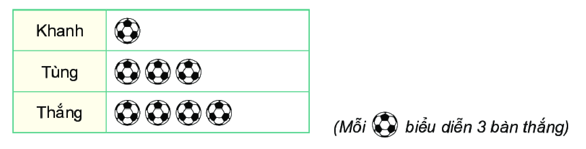
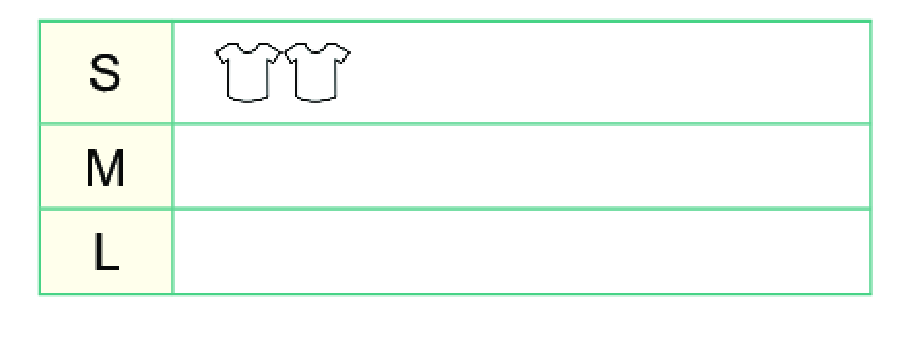
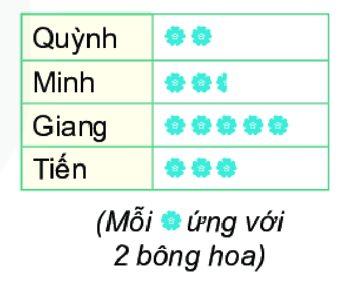
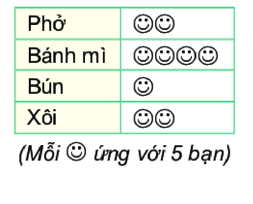
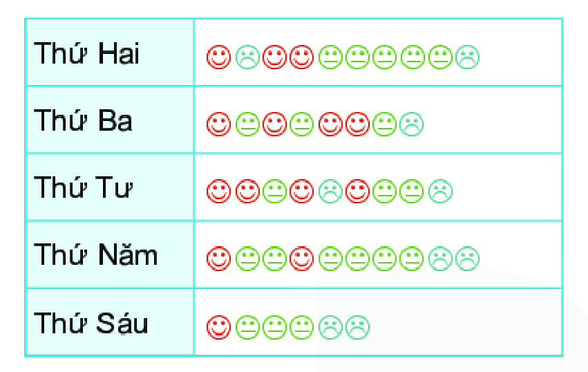
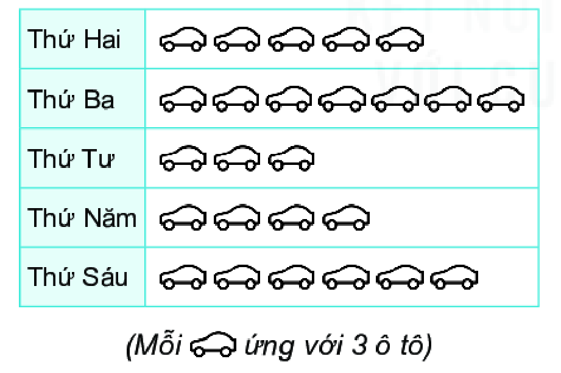

<!-- pdf:81 -->

# BÀI 39: BẢNG THỐNG KÊ VÀ BIỂU ĐỒ TRANH

## 🔤 Khái niệm, thuật ngữ

- Bảng thống kê
- Biểu đồ tranh

## 🎯 Kiến thức, kĩ năng

- Đọc và phân tích dữ liệu từ bảng thống kê, biểu đồ tranh.
- Biểu diễn dữ liệu vào bảng thống kê, biểu đồ tranh.

## 🔴 Mở đầu

Một cửa hàng bán quần áo muốn biết cỡ áo nào bán được nhiều nhất trong các cỡ S (Small - Nhỏ), M (Medium - Vừa), L (Large - Lớn) nên yêu cầu nhân viên bán hàng ghi lại cỡ của một mẫu áo bán ra trong một tuần, kết quả thu được dãy dữ liệu như sau:

M, M, S, M, S, M, M, L, M, M, M, M, S, M, L, L, L, M, S, S, M,
M, L, M, M, M, S, M, M, S, S, L, M, S, M, M, M, S, L, L, M, L,
L, M, M, L, L, M, M, L, M, M, L, L, M.
<!-- ocr-ok: đã đối chiếu ảnh trang PDF 81, dãy chữ cái in màu xanh nhạt -->

- **Tròn:** Cỡ áo nào bán được nhiều nhất nhỉ???

Nhìn vào dãy dữ liệu này, nhân viên cửa hàng có thể biết ngay cỡ áo nào được bán nhiều nhất không?

## 1. BẢNG THỐNG KÊ

**HĐ1:**

a) Hãy đếm xem cửa hàng đó đã bán được bao nhiêu chiếc áo mỗi cỡ rồi thay các dấu "?" bằng số thích hợp trong bảng sau:
<!-- ocr-ok: đã đối chiếu ảnh trang PDF 81, chữ trong khung thoại bên phải chèn ngang dòng HĐ1 -->

| Cỡ áo | S | M | L |
| --- | :---: | :---: | :---: |
| Số lượng bán được | $10$ | $?$ | $?$ |

b) Dựa vào bảng trên, hãy cho biết cỡ áo nào bán được nhiều nhất, cỡ áo nào bán được ít nhất.

- **Tròn:** Giờ thì mình đã hiểu vì sao nên thống kê dữ liệu vào bảng rồi!

**HĐ2:** Cho dãy số liệu về cân nặng (theo đơn vị kilôgam) của $15$ học sinh lớp 6 như sau:

$$40, 39, 41, 45, 41, 42, 40, 42, 40, 41, 43, 40, 42, 45, 42.$$
<!-- ocr-ok: đã đối chiếu ảnh trang PDF 81, dãy số liệu in màu xanh lá -->

a) Hãy lập bảng thống kê theo mẫu sau:

| Cân nặng ($\text{kg}$) | $39$ | $40$ | $41$ | $42$ | $43$ | $45$ |
| --- | :---: | :---: | :---: | :---: | :---: | :---: |
| Số học sinh | $?$ | $?$ | $?$ | $?$ | $?$ | $?$ |

b) Dựa vào bảng hãy cho biết có bao nhiêu bạn nặng $45$ kilôgam?

**Ví dụ 1:** Cho bảng thống kê như sau:

| | Hà Nội | Vĩnh Phúc | Bắc Ninh | Quảng Ninh |
| --- | :---: | :---: | :---: | :---: |
| Diện tích ($\text{km}^2$) | $3\,358,6$ | $1\,235,2$ | $822,7$ | $6\,178,2$ |
| Dân số (nghìn người) | $7\,520,7$ | $1\,092,4$ | $1\,247,5$ | $1\,266,5$ |

*(Theo Tổng cục Thống kê, năm 2018)*

Bảng trên cho biết những thông tin gì?

<!-- pdf:82 -->

**Giải:**

- Bảng trên cho biết thông tin về diện tích, dân số của $4$ tỉnh/thành phố là Hà Nội, Vĩnh Phúc, Bắc Ninh, Quảng Ninh.
- Đơn vị đo diện tích là kilômét vuông ($\text{km}^2$) và dân số tính theo đơn vị là nghìn người.

> Các bảng thu được trong HĐ1, HĐ2 và bảng cho trong ví dụ trên được gọi là **bảng thống kê**.

**Luyện tập 1:**

1) Cho các loại cây: bưởi, lúa, hồng xiêm, tỏi, hoa huệ, mít, ổi. Hãy xác định loại rễ (rễ cọc, rễ chùm) của mỗi cây rồi lập bảng thống kê về số lượng cây theo loại rễ.

2) Trong một kì thi quốc tế, các thành viên đội tuyển Việt Nam đạt được số điểm lần lượt là:

$$26 \quad 18 \quad 36 \quad 28 \quad 21 \quad 32$$
<!-- ocr-ok: đã đối chiếu ảnh trang PDF 82, dãy số liệu in màu xanh lá -->

Biết rằng người ta phân loại huy chương theo điểm số như sau:

Từ $15$ đến dưới $24$ điểm: Huy chương đồng;

Từ $24$ đến dưới $31$ điểm: Huy chương bạc;

Từ $31$ điểm trở lên: Huy chương vàng.

Em hãy lập bảng thống kê số lượng huy chương của đội tuyển Việt Nam trong kì thi này theo mẫu sau:

| Huy chương | Vàng | Bạc | Đồng |
| --- | :---: | :---: | :---: |
| Số học sinh | | | |

## 2. BIỂU ĐỒ TRANH

<!-- term: Biểu đồ tranh -->
**Ví dụ 2:** Trong giải bóng đá của trường, bạn Khanh ghi được $3$ bàn thắng, bạn Tùng ghi được $9$ bàn, còn bạn Thắng ghi được $12$ bàn. Vẽ biểu đồ tranh biểu diễn số lượng bàn thắng mỗi bạn ghi được.

**Giải:**

<!-- term: Biểu đồ tranh -->
Vì $\text{ƯCLN}(3, 9, 12) = 3$ nên ta sẽ dùng mỗi biểu tượng quả bóng biểu diễn cho $3$ bàn thắng.
<!-- ocr-ok: đã đối chiếu ảnh trang PDF 82, câu có hình biểu tượng quả bóng xen giữa chữ -->

Số bàn thắng của Khanh ứng với: $3 : 3 = 1$ (biểu tượng);

Số bàn thắng của Tùng ứng với: $9 : 3 = 3$ (biểu tượng);

Số bàn thắng của Thắng ứng với: $12 : 3 = 4$ (biểu tượng).

Ta có biểu đồ tranh sau đây:

*(Mỗi biểu tượng quả bóng biểu diễn $3$ bàn thắng)*
<!-- ocr-ok: đã đối chiếu ảnh trang PDF 82, chú thích có biểu tượng quả bóng -->

<!-- pdf:83 -->

**HĐ3:** Hãy vẽ lại hình sau vào vở rồi hoàn thiện biểu đồ tranh để biểu diễn bảng thống kê trong HĐ1. Cho mỗi hình chiếc áo ứng với $5$ chiếc áo bán ra.

- **Vuông:** Số lượng áo cỡ S bán ra là $10$, ứng với $2$ hình chiếc áo.
<!-- ocr-ok: đã đối chiếu ảnh trang PDF 83, bóng thoại có biểu tượng chiếc áo -->

**HĐ4:** Thống kê số bạn mang bút chì và tẩy ở tổ em.

Lập bảng thống kê rồi vẽ biểu đồ tranh cho bảng thống kê đó.

**Ví dụ 3:** Biểu đồ tranh sau đây cho biết số bông hoa các bạn Quỳnh, Minh, Giang và Tiến làm được trong buổi đi dã ngoại ở làng nghề. Từ biểu đồ tranh, em hãy lập bảng thống kê biểu diễn số bông hoa mỗi bạn đã làm được.

*(Mỗi biểu tượng bông hoa ứng với $2$ bông hoa)*
<!-- ocr-ok: đã đối chiếu ảnh trang PDF 83, chú thích có biểu tượng bông hoa -->

**Giải:**

- Số bông hoa mỗi bạn đã làm là:

Quỳnh: $2 \cdot 2 = 4$ (bông) $\qquad$ Minh: $2,5 \cdot 2 = 5$ (bông)

Giang: $5 \cdot 2 = 10$ (bông) $\qquad$ Tiến: $3 \cdot 2 = 6$ (bông)

- Bảng thống kê:

| Tên học sinh | Quỳnh | Minh | Giang | Tiến |
| --- | :---: | :---: | :---: | :---: |
| Số bông hoa | $4$ | $5$ | $10$ | $6$ |

**Luyện tập 2:** Biểu đồ tranh ở bên cho biết món ăn sáng yêu thích của các bạn trong lớp.

Lập bảng thống kê biểu diễn số lượng học sinh trong lớp ưa thích mỗi món ăn.

*(Mỗi biểu tượng mặt cười ứng với $5$ bạn)*
<!-- ocr-ok: đã đối chiếu ảnh trang PDF 83, chú thích có biểu tượng mặt cười -->

**Vận dụng:** Một cuộc điều tra về vệ sinh trường học cho thấy có $50$ học sinh có sử dụng xà phòng rửa tay, $30$ học sinh chỉ rửa tay bằng nước sạch, $10$ học sinh không rửa tay trước khi ăn.

a) Lập bảng thống kê biểu diễn dữ liệu đã thu thập.

b) Cho mỗi biểu tượng mặt cười ứng với $10$ học sinh. Vẽ biểu đồ tranh cho bảng thống kê thu được từ câu a.

<!-- pdf:84 -->

## BÀI TẬP

9.7. Một phường lắp đặt hệ thống lấy ý kiến đánh giá của nhân dân về thái độ phục vụ của cán bộ phường. Biểu đồ tranh dưới đây là kết quả đánh giá của người dân về một cán bộ trong một tuần làm việc (Mỗi biểu tượng thể hiện kết quả một lần đánh giá, hài lòng: mặt cười, bình thường: mặt bình thường, không hài lòng: mặt buồn).

Cả tuần có bao nhiêu lượt người cho ý kiến đánh giá về cán bộ này? Có bao nhiêu lượt đánh giá hài lòng, bình thường, không hài lòng?

9.8. Biểu đồ tranh sau đây cho biết số lượt ô tô vào gửi tại một bãi đỗ xe vào các ngày trong tuần.

*(Mỗi biểu tượng ô tô ứng với $3$ ô tô)*
<!-- ocr-ok: đã đối chiếu ảnh trang PDF 84, chú thích có biểu tượng ô tô -->

Hãy lập bảng thống kê biểu diễn số ô tô vào gửi tại bãi đỗ xe ở các ngày trong tuần.

9.9. Lớp 6A lấy ý kiến của các bạn trong lớp về việc tham gia các câu lạc bộ ngoại ngữ với $3$ lựa chọn:

A. Tiếng Anh

B. Tiếng Pháp

C. Tiếng Nga

Mỗi học sinh chỉ được chọn tham gia một trong ba câu lạc bộ. Kết quả khảo sát như sau:

A B B C C B A C A A A A B A B A A A B B A
B B B A C A A B A B A A A C C
<!-- ocr-ok: đã đối chiếu ảnh trang PDF 84, dãy chữ cái in màu xanh nhạt -->

a) Lập bảng thống kê biểu diễn số lượng học sinh đăng kí tham gia mỗi câu lạc bộ;

b) Vẽ biểu đồ tranh cho bảng thống kê ở câu a.

9.10. Bảng thống kê sau cho biết số lượng tin nhắn một người nhận được vào các ngày làm việc trong tuần.

| Ngày | Số tin nhắn |
| --- | :---: |
| Thứ Hai | $6$ |
| Thứ Ba | $4$ |
| Thứ Tư | $4$ |
| Thứ Năm | $2$ |
| Thứ Sáu | $8$ |

Dùng mỗi biểu tượng $\boxtimes$ cho $2$ tin nhắn, hãy vẽ biểu đồ tranh biểu diễn bảng thống kê trên.

## 📷 Danh sách hình trong bài

| Mã hình | Trang PDF | Vị trí trong bài | Chú thích gốc |
| --- | :---: | --- | --- |
| H6-toan-b39-01 | 82 | Mục 2, Ví dụ 2 | (Mỗi biểu tượng quả bóng biểu diễn 3 bàn thắng) |
| H6-toan-b39-02 | 83 | Mục 2, HĐ3 | (sách không đánh số, mẫu biểu đồ tranh cỡ áo S, M, L) |
| H6-toan-b39-03 | 83 | Mục 2, Ví dụ 3 | (Mỗi biểu tượng bông hoa ứng với 2 bông hoa) |
| H6-toan-b39-04 | 83 | Mục 2, Luyện tập 2 | (Mỗi biểu tượng mặt cười ứng với 5 bạn) |
| H6-toan-b39-05 | 84 | Bài tập 9.7 | (sách không đánh số, biểu đồ tranh kết quả đánh giá cán bộ phường) |
| H6-toan-b39-06 | 84 | Bài tập 9.8 | (Mỗi biểu tượng ô tô ứng với 3 ô tô) |
