<!-- pdf:85 -->

# BÀI 40: BIỂU ĐỒ CỘT

## 🔤 Khái niệm, thuật ngữ

- Biểu đồ cột

## 🎯 Kiến thức, kĩ năng
<!-- Sách in lỗi tiêu đề hộp đầu bài trang in 84 (PDF 85) là "KIẾN THỨC, KĨ NĂNGP" -->

- Vẽ biểu đồ cột từ bảng thống kê cho trước.
- Đọc và mô tả dữ liệu từ biểu đồ cột.
- Nhận ra vấn đề hoặc quy luật đơn giản từ việc phân tích biểu đồ cột.

## 🔴 Mở đầu

Tết Nguyên đán năm nay, các bạn học sinh khối lớp 6 của một trường trung học đã nghĩ ra ý tưởng tự thiết kế phong bao lì xì để gây quỹ từ thiện cho các bạn học sinh miền núi và hải đảo. Bảng 9.2 cho biết số lượng phong bao lì xì các lớp đã bán được trong ngày đầu tiên.

| Lớp | 6A | 6B | 6C | 6D |
| --- | :---: | :---: | :---: | :---: |
| Số phong bao lì xì | $32$ | $27$ | $35$ | $30$ |

*Bảng 9.2*

Nếu dùng biểu đồ tranh để thể hiện bảng thống kê này, em có thể gặp những khó khăn gì?

Để biểu diễn bảng thống kê trên, người ta thường dùng **biểu đồ cột** (h.9.2). Việc vẽ biểu đồ cột và phân tích dữ liệu dựa vào biểu đồ cột như thế nào, chúng ta cùng tìm hiểu.

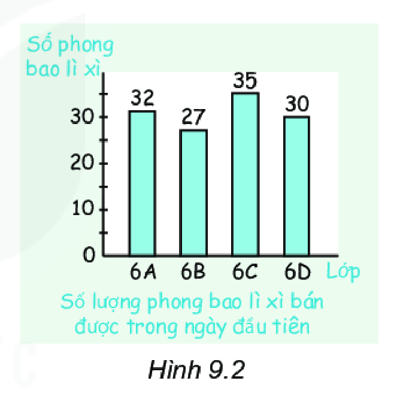
*Hình 9.2*

## 1. VẼ BIỂU ĐỒ CỘT

**Thực hành:** *Vẽ biểu đồ cột*

<!-- term: Các bước vẽ biểu đồ cột -->
Để vẽ biểu đồ cột biểu diễn số liệu trong bảng 9.2, ta thực hiện theo các bước sau:

<!-- term: Các bước vẽ biểu đồ cột -->
*Bước 1.* Vẽ trục ngang biểu diễn các lớp của khối 6. Vẽ trục đứng biểu diễn số phong bao lì xì bán được (h.9.3).

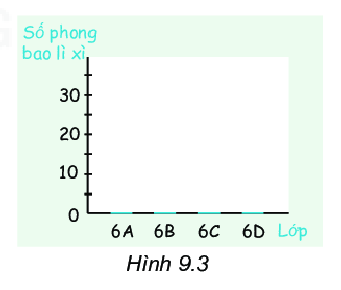
*Hình 9.3*

<!-- term: Các bước vẽ biểu đồ cột -->
*Bước 2.* Với mỗi lớp trên trục ngang, ta vẽ một hình chữ nhật có chiều cao bằng số phong bao lì xì mà lớp đó bán được trong ngày đầu tiên (chiều rộng của các hình chữ nhật bằng nhau) (h.9.4).

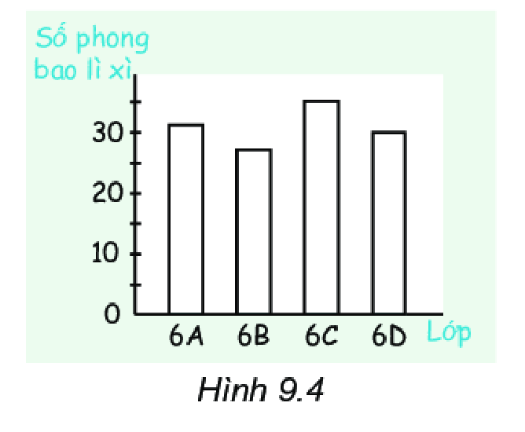
*Hình 9.4*

<!-- term: Các bước vẽ biểu đồ cột -->
*Bước 3.* Đặt tên cho biểu đồ, ghi chú thích và tô màu cho các cột (nếu cần) để hoàn thiện biểu đồ (h.9.2).

<!-- pdf:86 -->

**Chú ý:** Trên biểu đồ hình 9.5, ta thấy khoảng cách từ gốc $0$ đến vạch $20$ không phải $20$ đơn vị độ dài. Trong một số biểu đồ, ta cũng vẽ theo cách tương tự.

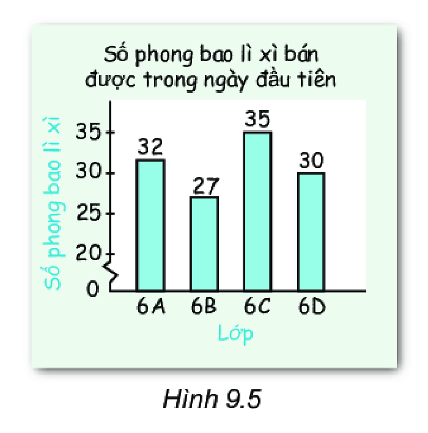
*Hình 9.5*

- Ta có thể sử dụng công cụ Excel để vẽ biểu đồ cột. Xem thêm trong Hoạt động thực hành trải nghiệm.
- Người ta cũng dùng **biểu đồ thanh ngang** để biểu diễn số liệu bảng 9.2 như sau:

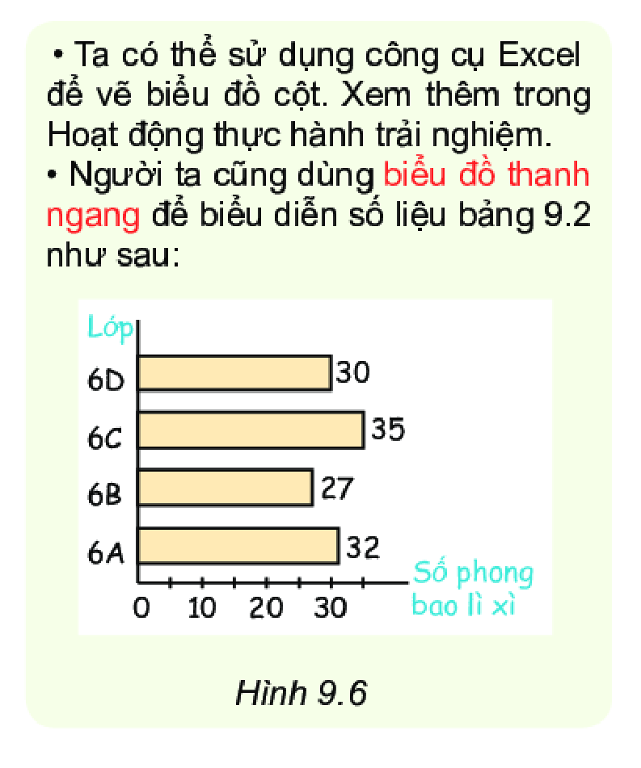
*Hình 9.6*

**Luyện tập 1:**

1) Để chuẩn bị cho việc xây dựng tủ sách lớp học, lớp trưởng làm một bảng hỏi về thể loại văn học dân gian yêu thích của các bạn trong lớp và thu được kết quả như bảng 9.3 (*mỗi gạch ứng với một bạn*).

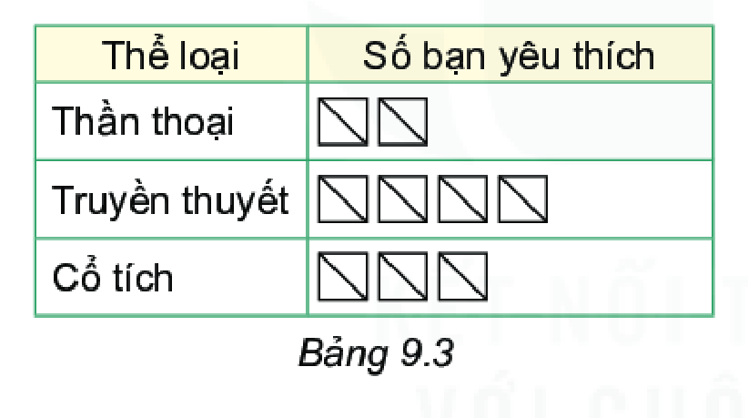
*Bảng 9.3*

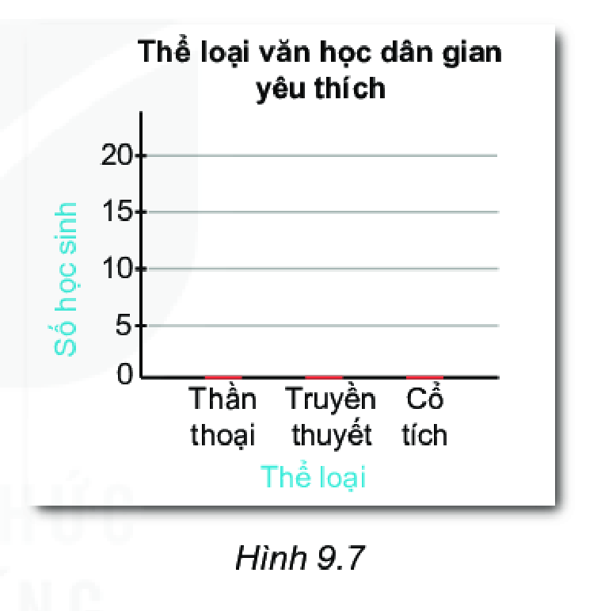
*Hình 9.7*

a) Lập bảng thống kê số học sinh yêu thích các thể loại văn học dân gian từ bảng 9.3;

b) Vẽ biểu đồ hình 9.7 vào vở rồi hoàn thiện biểu đồ cột biểu diễn bảng thống kê ở câu a.

2) Mai đếm số cánh hoa của một số loài hoa và thống kê theo bảng 9.4. Em hãy vẽ biểu đồ cột cho bảng thống kê này.

| Tên loài hoa | Sen | Tulip | Mai | Dã quỳ |
| --- | :---: | :---: | :---: | :---: |
| Số cánh hoa | $8$ | $6$ | $5$ | $13$ |
<!-- ocr-ok: đã đối chiếu ảnh trang PDF 86, bảng nhiều cột -->

*Bảng 9.4*

<!-- pdf:87 -->

## 2. PHÂN TÍCH SỐ LIỆU VỚI BIỂU ĐỒ CỘT
<!-- ocr-ok: đã đối chiếu ảnh trang PDF 87, tiêu đề in trắng trên băng nền xanh -->

**Ví dụ:** Nam quan sát để thu thập dữ liệu về hoạt động của các bạn lớp mình trong một giờ ra chơi và biểu diễn dưới dạng biểu đồ cột như hình 9.8.

a) Cho biết hoạt động nào thu hút nhiều bạn tham gia nhất?

b) Hãy lập bảng thống kê số lượng các bạn lớp Nam tham gia các hoạt động trong giờ ra chơi từ biểu đồ bên.

c) So sánh số học sinh tham gia hoạt động tại chỗ và hoạt động vận động trong giờ ra chơi.

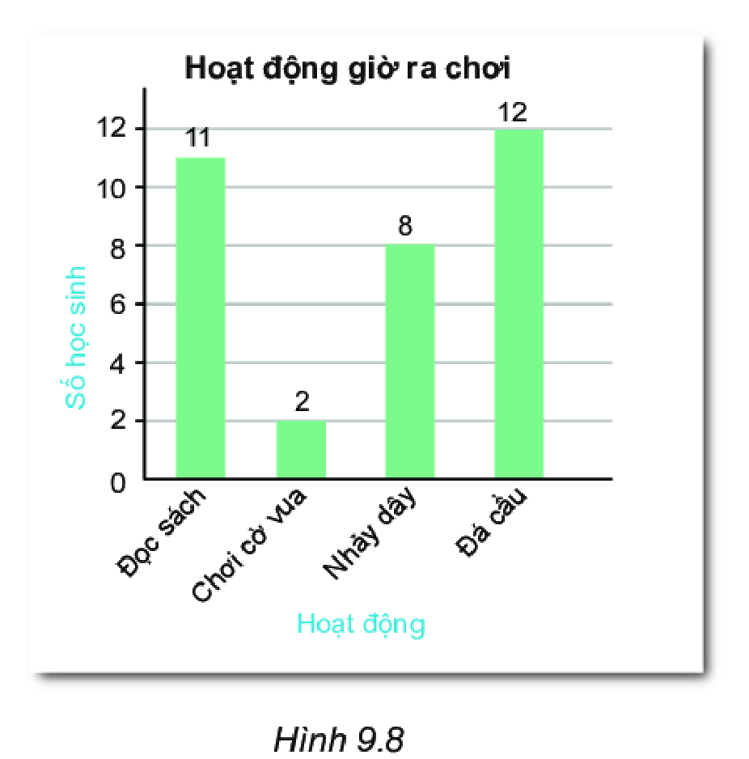
*Hình 9.8*

**Giải:**

a) Hoạt động đá cầu thu hút nhiều bạn tham gia nhất.

b) Ta có bảng thống kê như sau:

| Hoạt động | Đọc sách | Chơi cờ vua | Nhảy dây | Đá cầu |
| --- | :---: | :---: | :---: | :---: |
| Số bạn tham gia | $11$ | $2$ | $8$ | $12$ |

c) Đọc sách, chơi cờ vua là các hoạt động tại chỗ; Nhảy dây, đá cầu là các hoạt động vận động.

Số học sinh tham gia hoạt động tại chỗ là:

$$11 + 2 = 13 \text{ (học sinh)}$$
<!-- ocr-ok: đã đối chiếu ảnh trang PDF 87, công thức toán hiển thị -->

Số học sinh tham gia hoạt động vận động là:

$$8 + 12 = 20 \text{ (học sinh)}$$
<!-- ocr-ok: đã đối chiếu ảnh trang PDF 87, công thức toán hiển thị -->

Số học sinh tham gia hoạt động vận động nhiều hơn.

**Luyện tập 2:**

1) Biểu đồ cột ở hình 9.9 cho biết tốc độ tối đa của một số loài động vật (đơn vị là dặm/giờ; dặm (mile) là một đơn vị đo độ dài; $1\text{ dặm} = 1,609\text{ km}$).

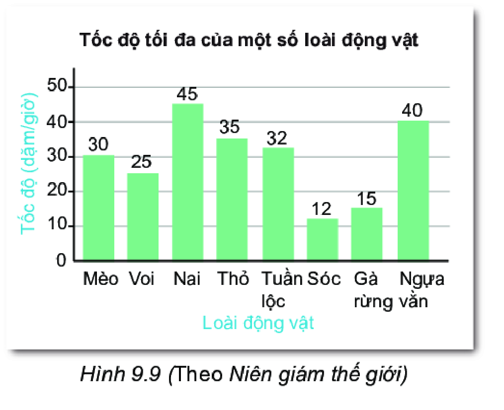
*Hình 9.9 (Theo Niên giám thế giới)*

<!-- pdf:88 -->

a) Trong các nhận xét dưới đây, nhận xét nào phù hợp với thông tin từ biểu đồ? Vì sao?

- **Vuông:** Nai chạy nhanh nhất.
- **Pi:** Nhanh như sóc. Sóc chạy nhanh nhất chứ!!!
- **Tròn:** Tốc độ tối đa của thỏ gấp khoảng hai lần tốc độ tối đa của sóc!
<!-- ocr-ok: đã đối chiếu ảnh trang PDF 88, lời thoại ba nhân vật đặt ngang nhau -->

b) Trong biểu đồ trên, em thấy những loài nào có tốc độ tối đa từ $10$ đến $19$, $40$ đến $49$ (dặm/giờ)?

2) Cho biểu đồ cột hình 9.10.

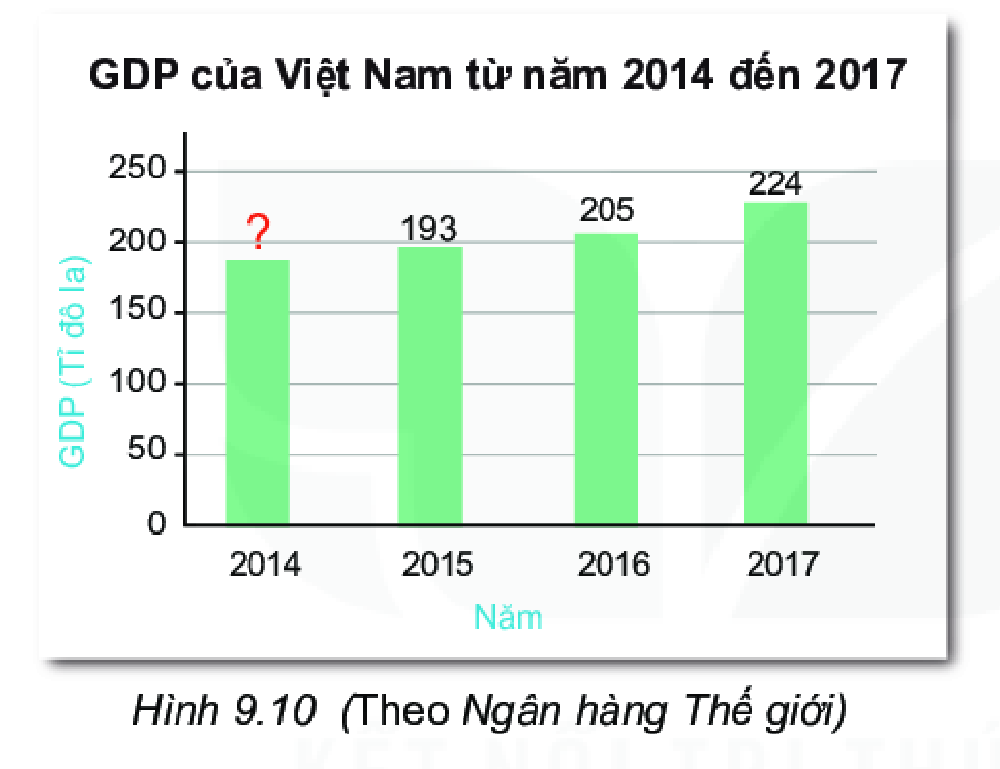
*Hình 9.10 (Theo Ngân hàng Thế giới)*

- **Pi:** GDP (Gross Domestic Product) là tổng sản phẩm quốc nội.

a) Thay dấu "?" trong biểu đồ trên bằng số liệu thích hợp nếu biết GDP của Việt Nam năm 2014 là $186$ tỉ đô la.

b) Từ năm 2014 đến năm 2017, GDP của Việt Nam có xu hướng tăng hay giảm?

**Thử thách nhỏ:** Bảng 9.5 cho biết lợi nhuận của một cửa hàng trong quý I năm 2020.

| Tháng | $1$ | $2$ | $3$ |
| --- | :---: | :---: | :---: |
| Lợi nhuận (triệu đồng) | $-10$ | $-8$ | $5$ |
<!-- ocr-ok: đã đối chiếu ảnh trang PDF 88, bảng nhiều cột -->

*Bảng 9.5*

Minh vẽ biểu đồ cột để biểu diễn bảng thống kê này như hình 9.11. Theo em, biểu đồ Minh vẽ có hợp lí không? Các cột nằm dưới trục ngang thể hiện điều gì?

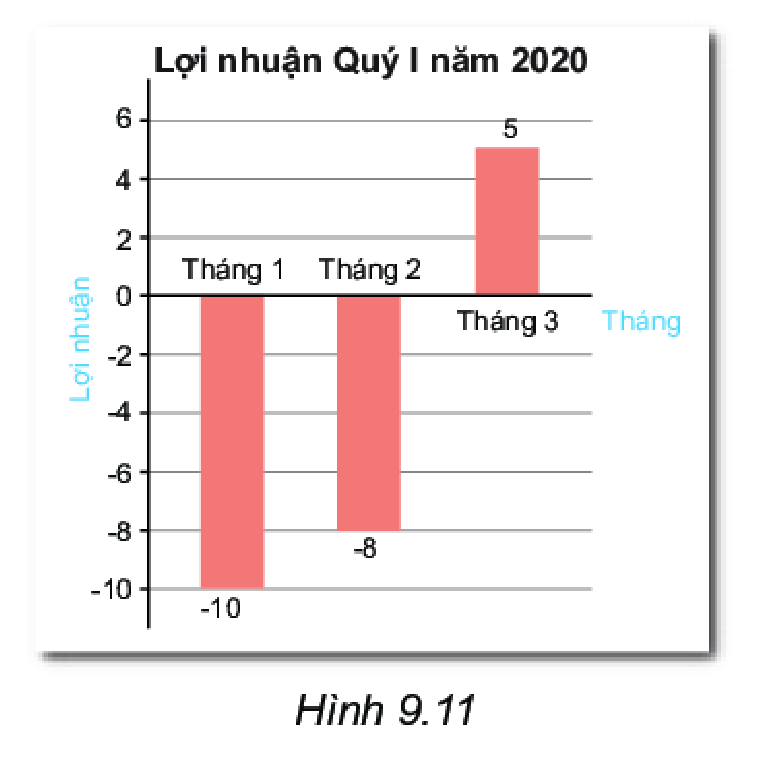
*Hình 9.11*

<!-- pdf:89 -->

## BÀI TẬP

Sử dụng biểu đồ hình 9.12 để trả lời các bài từ 9.11 đến 9.15.
<!-- ocr-ok: đã đối chiếu ảnh trang PDF 89, dòng dẫn in chữ màu xanh nhạt -->

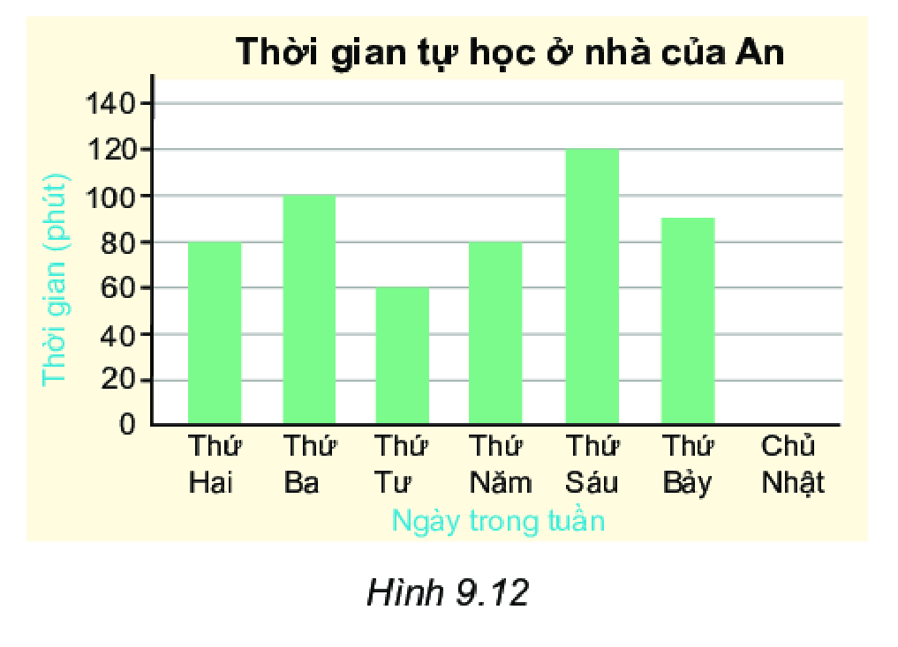
*Hình 9.12*

9.11. Ngày nào trong tuần An dành thời gian tự học ở nhà nhiều nhất?

9.12. Ngày nào trong tuần An không tự học ở nhà?

9.13. Tổng thời gian trong tuần An tự học ở nhà là bao nhiêu phút?

9.14. Hoàn thiện biểu đồ nếu ngày Chủ Nhật An dành $50$ phút tự học ở nhà.

9.15. Lập bảng thống kê thể hiện thời gian tự học ở nhà của An vào các ngày trong tuần.

9.16. Bảng sau cho biết số lượng các bạn lớp Khoa hâm mộ ba câu lạc bộ bóng đá ở giải Ngoại hạng Anh (*mỗi gạch ứng với một bạn*).

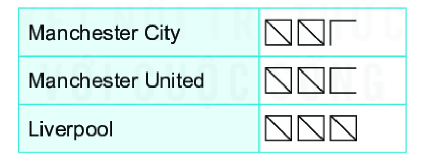

Lập bảng thống kê và vẽ biểu đồ cột biểu diễn bảng thống kê đó.

9.17. Cho bảng thống kê sau:

| Thể loại phim | Hành động | Khoa học viễn tưởng | Hoạt hình | Hài |
| --- | :---: | :---: | :---: | :---: |
| Số lượng bạn yêu thích | $6$ | $5$ | $12$ | $8$ |
<!-- ocr-ok: đã đối chiếu ảnh trang PDF 89, bảng nhiều cột -->

Hãy vẽ biểu đồ cột biểu diễn bảng thống kê trên.

## 📷 Danh sách hình trong bài

| Mã hình | Trang PDF | Vị trí trong bài | Chú thích gốc |
| --- | :---: | --- | --- |
| H6-toan-b40-01 | 85 | Mở đầu | Hình 9.2 |
| H6-toan-b40-02 | 85 | Mục 1, Thực hành | Hình 9.3 |
| H6-toan-b40-03 | 85 | Mục 1, Thực hành | Hình 9.4 |
| H6-toan-b40-04 | 86 | Mục 1, Chú ý | Hình 9.5 |
| H6-toan-b40-05 | 86 | Mục 1, hộp mở rộng cạnh Chú ý | Hình 9.6 |
| H6-toan-b40-06 | 86 | Mục 1, Luyện tập 1.1 | Bảng 9.3 |
| H6-toan-b40-07 | 86 | Mục 1, Luyện tập 1.1 | Hình 9.7 |
| H6-toan-b40-08 | 87 | Mục 2, Ví dụ | Hình 9.8 |
| H6-toan-b40-09 | 87 | Mục 2, Luyện tập 2.1 | Hình 9.9 (Theo Niên giám thế giới) |
| H6-toan-b40-10 | 88 | Mục 2, Luyện tập 2.2 | Hình 9.10 (Theo Ngân hàng Thế giới) |
| H6-toan-b40-11 | 88 | Mục 2, Thử thách nhỏ | Hình 9.11 |
| H6-toan-b40-12 | 89 | Bài tập 9.11–9.15 | Hình 9.12 |
| H6-toan-b40-13 | 89 | Bài tập 9.16 | (sách không đánh số, bảng kiểm đếm câu lạc bộ bóng đá yêu thích) |
