<!-- pdf:90 -->

# BÀI 41: BIỂU ĐỒ CỘT KÉP

## 🔤 Khái niệm, thuật ngữ

- Biểu đồ cột kép

## 🎯 Kiến thức, kĩ năng

- Vẽ biểu đồ cột kép; Đọc dữ liệu từ biểu đồ cột kép.
- Nhận ra quy luật đơn giản từ biểu đồ cột kép.

## 🔴 Mở đầu

Hai biểu đồ cột dưới đây biểu diễn dữ liệu trong bảng 9.6, cho biết học lực của các bạn lớp 6A và lớp 6B.

| Lớp \ Học lực | Giỏi | Khá | Trung bình | Yếu |
| --- | :---: | :---: | :---: | :---: |
| 6A | $13$ | $16$ | $9$ | $2$ |
| 6B | $9$ | $18$ | $10$ | $5$ |
<!-- ocr-ok: đã đối chiếu ảnh trang PDF 90, bảng có ô chéo nhiều cột -->

*Bảng 9.6*

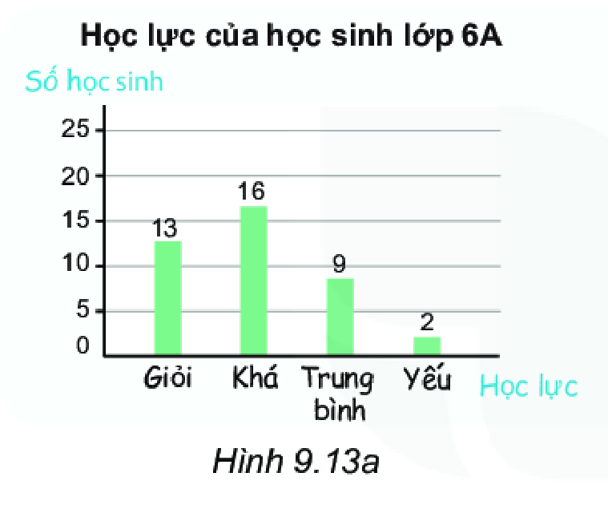
*Hình 9.13a*

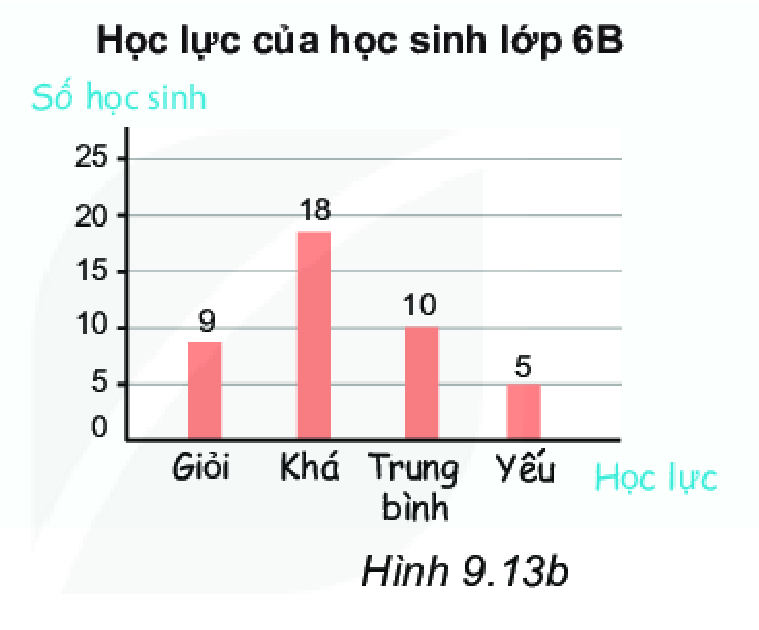
*Hình 9.13b*

Để dễ dàng so sánh học lực của học sinh hai lớp này người ta thường ghép hai biểu đồ cột này lại vào một biểu đồ mới như hình 9.14, được gọi là **biểu đồ cột kép**.

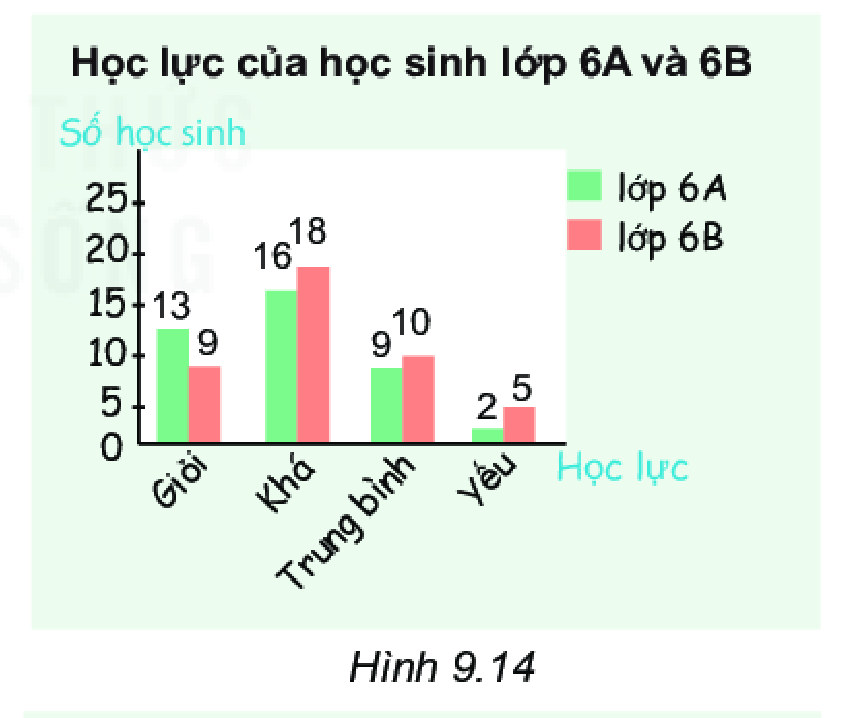
*Hình 9.14*

## 1. VẼ BIỂU ĐỒ CỘT KÉP

**Thực hành:** *Vẽ biểu đồ cột kép*

<!-- term: Các bước vẽ biểu đồ cột kép -->
Để vẽ biểu đồ cột kép biểu diễn bảng thống kê ở trên, em thực hiện theo các bước sau:

<!-- term: Các bước vẽ biểu đồ cột kép -->
*Bước 1.* Vẽ các trục biểu diễn số lượng học sinh và các loại học lực (h.9.15).

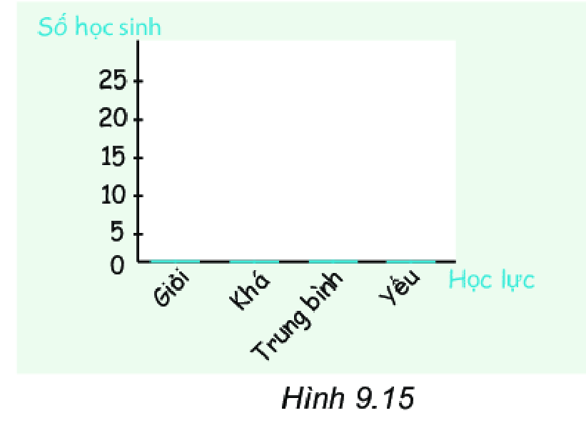
*Hình 9.15*

<!-- pdf:91 -->

<!-- term: Các bước vẽ biểu đồ cột kép -->
*Bước 2.* Với mỗi loại học lực, vẽ hai hình chữ nhật cạnh nhau với chiều rộng bằng nhau và chiều cao bằng số lượng học sinh mỗi lớp có học lực đó (h.9.16).

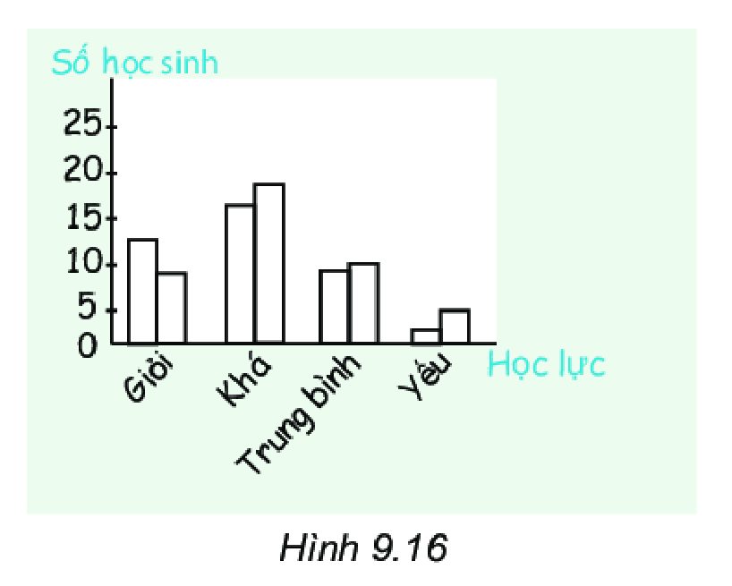
*Hình 9.16*

<!-- term: Các bước vẽ biểu đồ cột kép -->
*Bước 3.* Tô màu hoặc gạch chéo để phân biệt hai lớp và ghi chú thích (h.9.17). Đặt tên cho biểu đồ và điền số liệu trên các cột (nếu cần) để hoàn thiện biểu đồ (h.9.14).

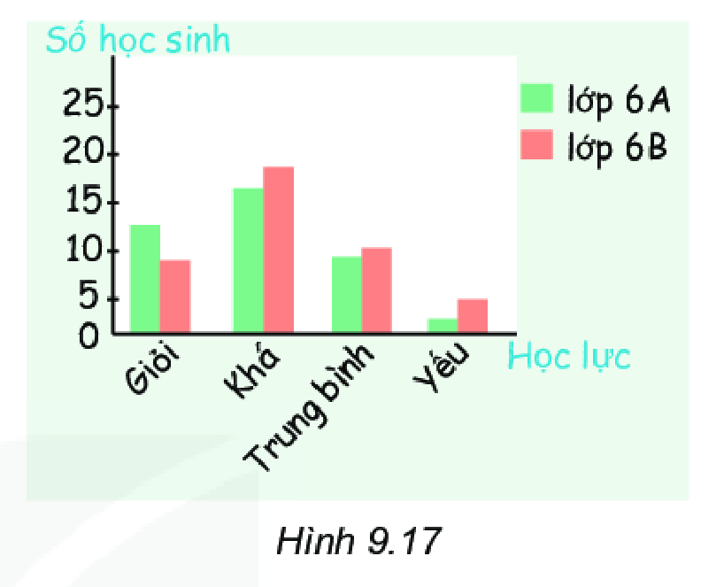
*Hình 9.17*

**Nhận xét:** Với cách vẽ biểu đồ cột kép như hình 9.14, ta có thể nhìn thấy ngay tương quan về số lượng học sinh đạt các loại học lực giữa hai lớp. Chẳng hạn lớp 6A có số học sinh giỏi nhiều hơn và số học sinh yếu ít hơn so với lớp 6B.

<!-- term: Biểu đồ thanh ngang kép -->
Người ta cũng có thể vẽ biểu đồ thanh ngang kép cho dữ liệu về học lực của học sinh hai lớp 6A, 6B như sau:

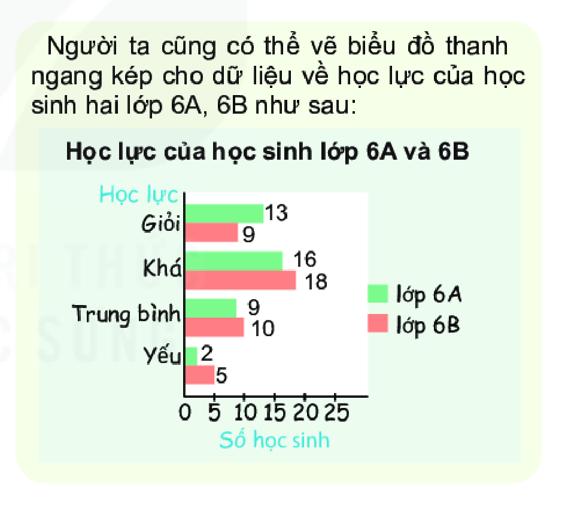

**Luyện tập 1:** Bảng thống kê 9.7 cho biết số bé trai và bé gái được sinh ra trong ba ngày đầu năm 2020 tại một bệnh viện địa phương.

| | Ngày $1$ | Ngày $2$ | Ngày $3$ |
| --- | :---: | :---: | :---: |
| Bé trai | $9$ | $6$ | $7$ |
| Bé gái | $5$ | $6$ | $4$ |
<!-- ocr-ok: đã đối chiếu ảnh trang PDF 91, bảng nhiều cột đặt cạnh biểu đồ -->

*Bảng 9.7*

Từ bảng 9.7, em hãy thay các dấu "?" trong hình 9.18 bằng số liệu phù hợp.

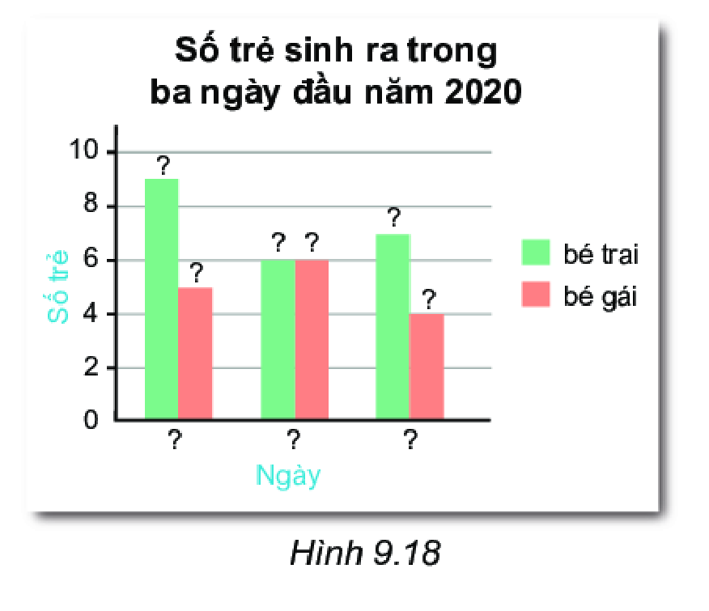
*Hình 9.18*

<!-- pdf:92 -->

## 2. PHÂN TÍCH SỐ LIỆU VỚI BIỂU ĐỒ CỘT KÉP
<!-- ocr-ok: đã đối chiếu ảnh trang PDF 92, tiêu đề in trắng trên băng nền xanh -->

**Ví dụ:** Biểu đồ hình 9.19 cho biết số bàn thắng của L.Messi và C.Ronaldo ghi được trong các năm từ 2016 đến 2018.

a) So sánh số bàn thắng trong mỗi năm từ 2016 đến 2018 của L.Messi và C.Ronaldo.

b) Có phải từ năm 2016 đến năm 2018, số bàn thắng ghi được của cả hai cầu thủ đều có xu hướng giảm dần không?

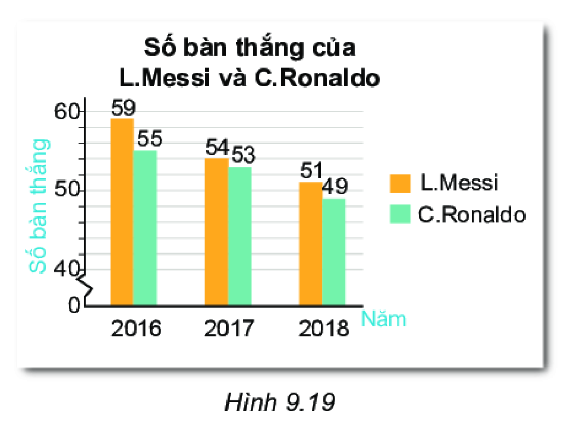
*Hình 9.19*

**Giải:**

a) Quan sát biểu đồ ta thấy ở cả ba năm, cột màu vàng đều cao hơn cột màu xanh. Do đó số bàn thắng mà L.Messi ghi được trong mỗi năm luôn nhiều hơn C.Ronaldo.

b) Cột màu vàng và xanh đều có xu hướng thấp dần từ trái sang phải nên số bàn thắng ghi được của L.Messi và C.Ronaldo đều có xu hướng giảm dần từ năm 2016 đến năm 2018.

Cristiano Ronaldo và Lionel Messi là hai cầu thủ bóng đá nổi tiếng thế giới.

**Luyện tập 2:**

1) Biểu đồ hình 9.20 cho biết lượng mưa trung bình các tháng trong năm 2018 tại hai trạm Tuyên Quang và Nha Trang.

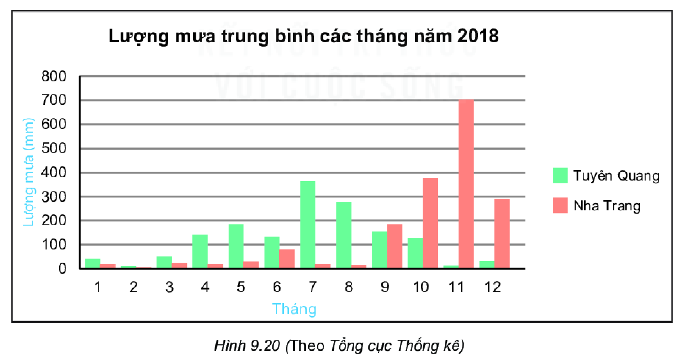
*Hình 9.20 (Theo Tổng cục Thống kê)*

a) Quan sát biểu đồ và cho biết cột màu nào biểu diễn lượng mưa trung bình các tháng năm 2018 ở Tuyên Quang và Nha Trang;

b) Kể tên ba tháng có lượng mưa lớn nhất ở mỗi trạm. Từ đó dự đoán thời gian mùa mưa ở các địa phương này.

<!-- pdf:93 -->

2) Quan sát biểu đồ hình 9.21 và trả lời câu hỏi:

a) Nước nào có chiều cao trung bình của nam cao nhất, thấp nhất?

b) Nước nào có chiều cao trung bình của nữ cao nhất, thấp nhất?

c) Sự chênh lệch chiều cao giữa nam và nữ ở nước nào lớn nhất?

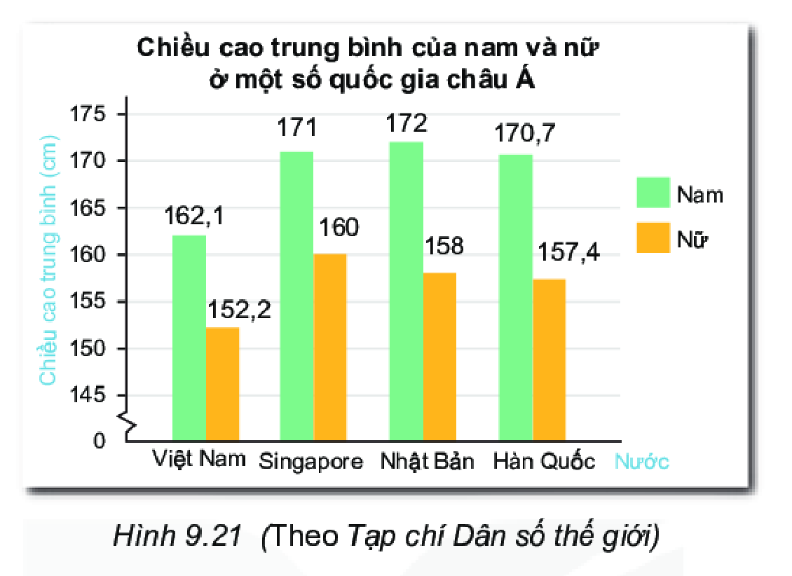
*Hình 9.21 (Theo Tạp chí Dân số thế giới)*

**Tranh luận:** Bảng 9.8 cho biết độ mặn (đơn vị gam/lít) tại một số trạm quan trắc trên sông Vàm Cỏ vào tháng 3 trong hai năm 2015 và 2016.

Để việc so sánh số liệu trong hai năm 2015 và 2016 trực quan hơn, Vuông đã vẽ biểu đồ cột kép như hình 9.22a, Tròn lại vẽ biểu đồ như hình 9.22b.

| | Trạm Cầu Nổi | Trạm Bến Lức |
| --- | :---: | :---: |
| Năm 2015 | $15,6$ | $3,1$ |
| Năm 2016 | $20,3$ | $9,7$ |
<!-- ocr-ok: đã đối chiếu ảnh trang PDF 93, bảng nhiều cột đặt cạnh đoạn văn -->

*Bảng 9.8 (Theo Cục thông tin Khoa học và Công nghệ Quốc gia)*

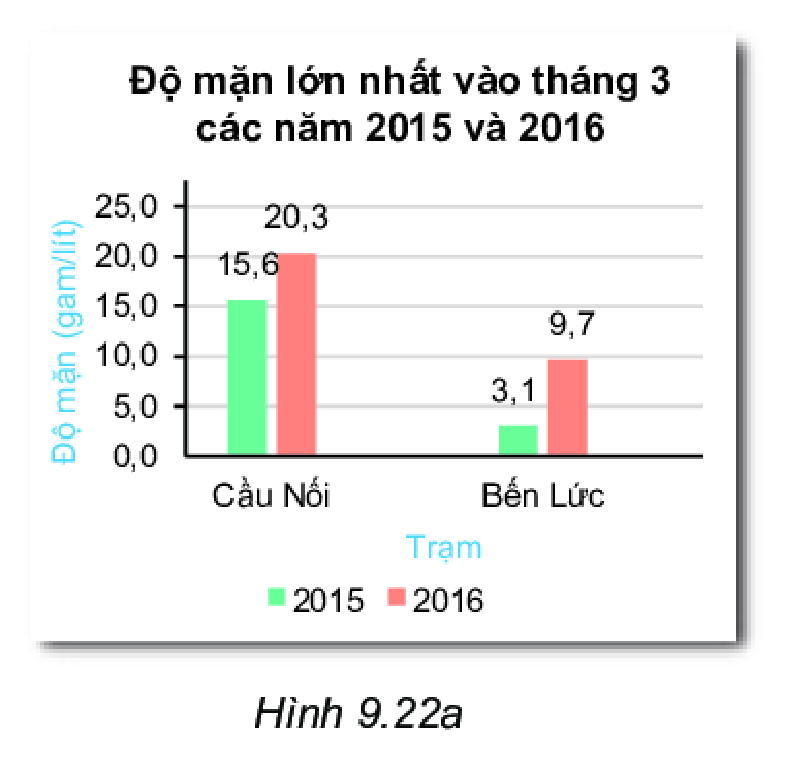
*Hình 9.22a*

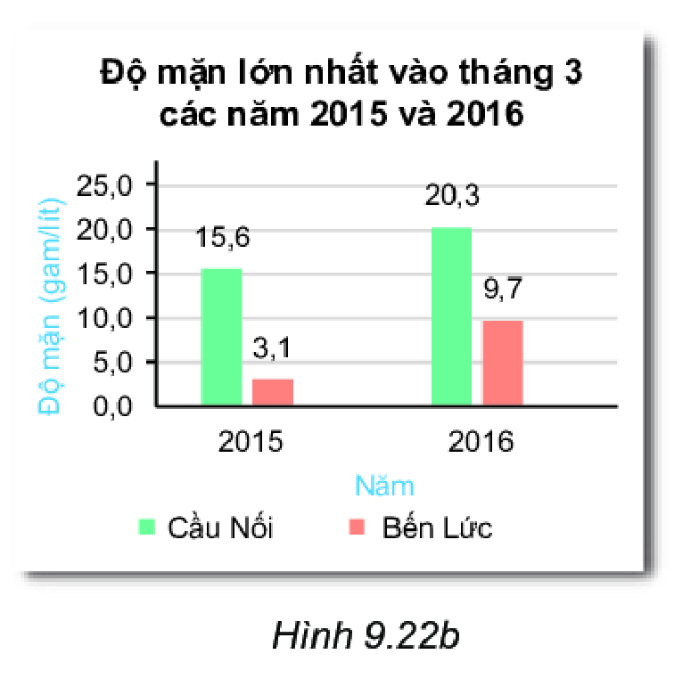
*Hình 9.22b*

Theo em, cách vẽ nào giúp việc so sánh số liệu trong hai năm tại mỗi trạm thuận lợi, dễ dàng hơn?

<!-- pdf:94 -->

## BÀI TẬP

Biểu đồ hình 9.23 cho biết số lượng quạt trần và quạt cây bán được tại một cửa hàng điện máy trong năm 2018.

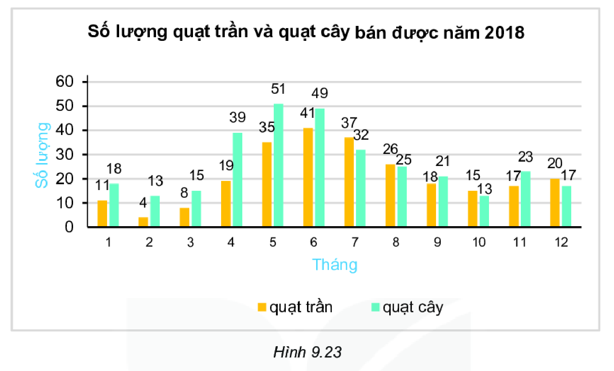
*Hình 9.23*

**Quan sát biểu đồ hình 9.23 và trả lời các bài từ 9.18 đến 9.22.**

9.18. Liệt kê ba tháng cửa hàng bán được nhiều quạt trần nhất?

9.19. Liệt kê ba tháng cửa hàng bán được nhiều quạt cây nhất?

9.20. Tính tổng số lượng quạt cả hai loại bán được trong ba tháng $5, 6, 7$ và ba tháng $10, 11, 12$ rồi so sánh.

9.21. Các loại quạt có xu hướng bán chạy hơn vào mùa nào trong năm?

9.22. Từ biểu đồ, không thực hiện tính toán, hãy cho biết loại quạt nào bán được với số lượng nhiều hơn tại cửa hàng điện máy.

9.23. Vẽ biểu đồ cột kép biểu diễn bảng thống kê số lượng học sinh đạt điểm giỏi môn Văn và Toán của các lớp khối 6.

| | 6A | 6B | 6C | 6D |
| --- | :---: | :---: | :---: | :---: |
| Văn | $9$ | $11$ | $16$ | $12$ |
| Toán | $8$ | $7$ | $12$ | $15$ |

9.24. Bảng thống kê sau đây cho biết số lượng các bạn nam, nữ trong lớp yêu thích một số môn thể thao.

| | Bóng đá | Cầu lông | Cờ vua | Bóng bàn |
| --- | :---: | :---: | :---: | :---: |
| Nam | $20$ | $15$ | $10$ | $17$ |
| Nữ | $5$ | $6$ | $12$ | $9$ |
<!-- ocr-ok: đã đối chiếu ảnh trang PDF 94, bảng nhiều cột trong bố cục hai cột -->

Từ bảng trên, em hãy thay dấu "?" bằng dữ liệu thích hợp để hoàn thiện biểu đồ ở hình 9.24.

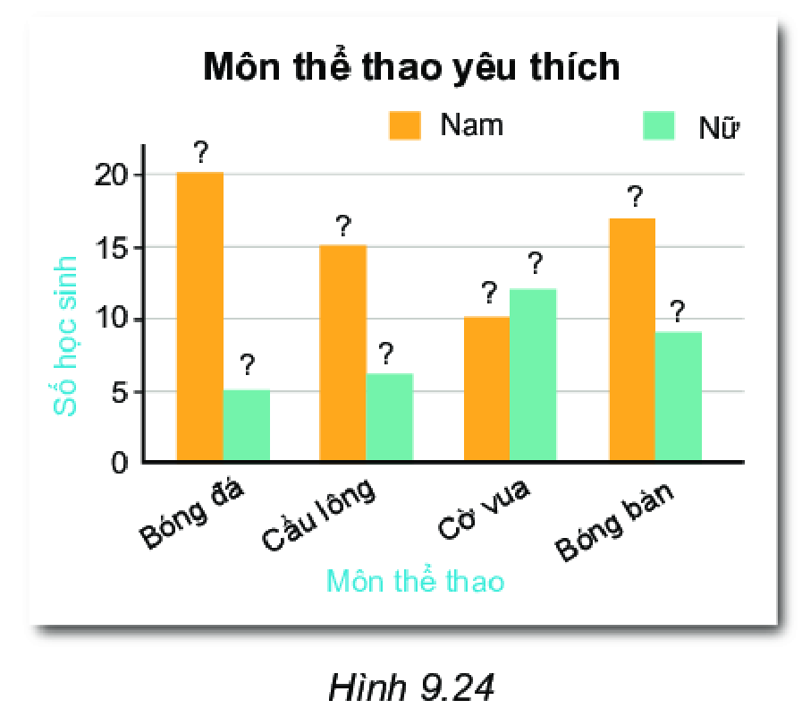
*Hình 9.24*

## 📷 Danh sách hình trong bài

| Mã hình | Trang PDF | Vị trí trong bài | Chú thích gốc |
| --- | :---: | --- | --- |
| H6-toan-b41-01 | 90 | Mở đầu | Hình 9.13a |
| H6-toan-b41-02 | 90 | Mở đầu | Hình 9.13b |
| H6-toan-b41-03 | 90 | Mở đầu | Hình 9.14 |
| H6-toan-b41-04 | 90 | Mục 1, Thực hành | Hình 9.15 |
| H6-toan-b41-05 | 91 | Mục 1, Thực hành | Hình 9.16 |
| H6-toan-b41-06 | 91 | Mục 1, Thực hành | Hình 9.17 |
| H6-toan-b41-07 | 91 | Mục 1, hộp mở rộng cạnh Nhận xét | (sách không đánh số, biểu đồ thanh ngang kép học lực của học sinh lớp 6A và 6B) |
| H6-toan-b41-08 | 91 | Mục 1, Luyện tập 1 | Hình 9.18 |
| H6-toan-b41-09 | 92 | Mục 2, Ví dụ | Hình 9.19 |
| H6-toan-b41-10 | 92 | Mục 2, Luyện tập 2.1 | Hình 9.20 (Theo Tổng cục Thống kê) |
| H6-toan-b41-11 | 93 | Mục 2, Luyện tập 2.2 | Hình 9.21 (Theo Tạp chí Dân số thế giới) |
| H6-toan-b41-12 | 93 | Mục 2, Tranh luận | Hình 9.22a |
| H6-toan-b41-13 | 93 | Mục 2, Tranh luận | Hình 9.22b |
| H6-toan-b41-14 | 94 | Bài tập 9.18–9.22 | Hình 9.23 |
| H6-toan-b41-15 | 94 | Bài tập 9.24 | Hình 9.24 |
