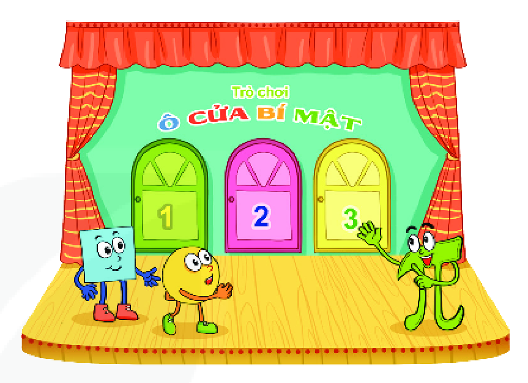
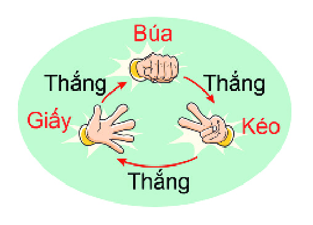
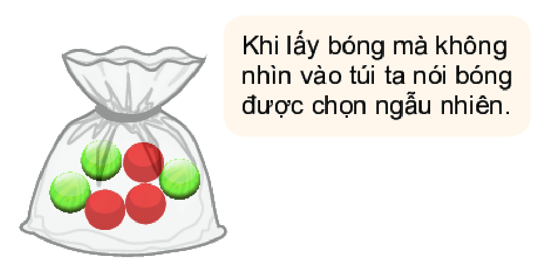
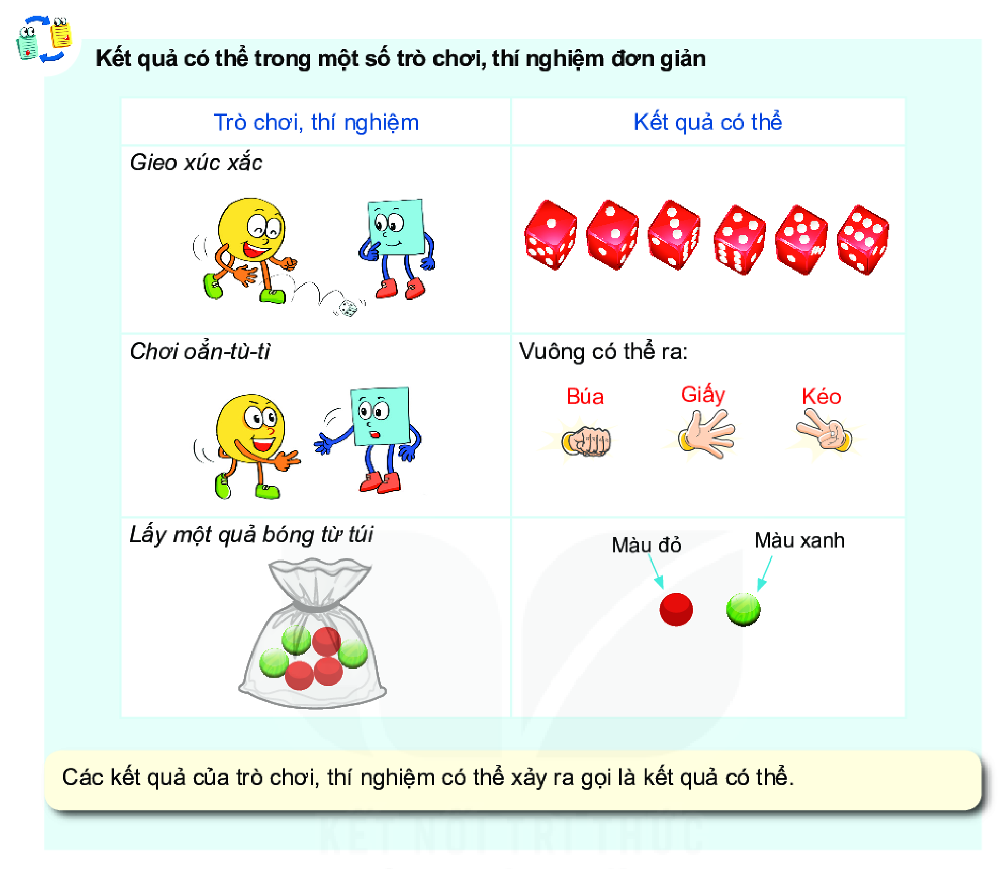
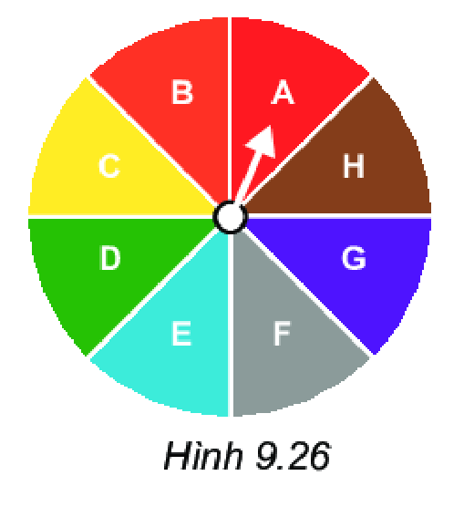
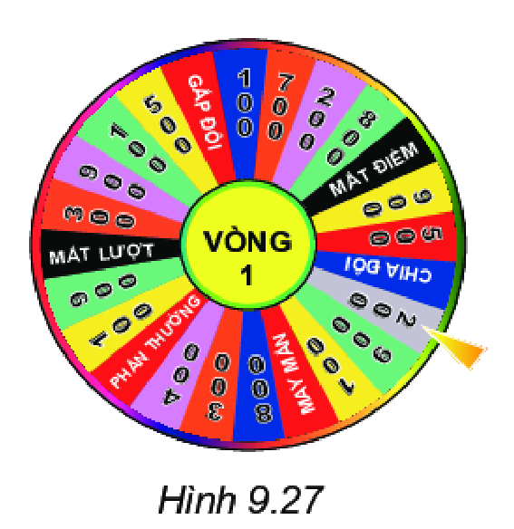
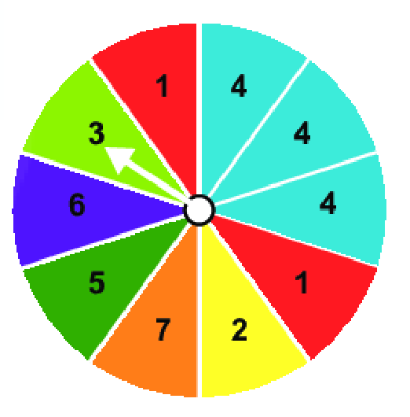
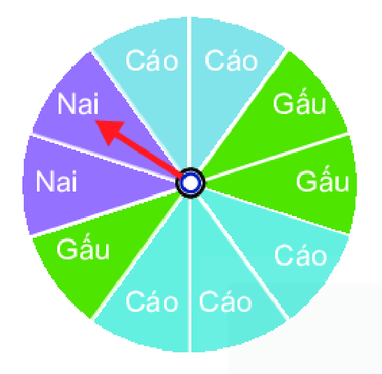
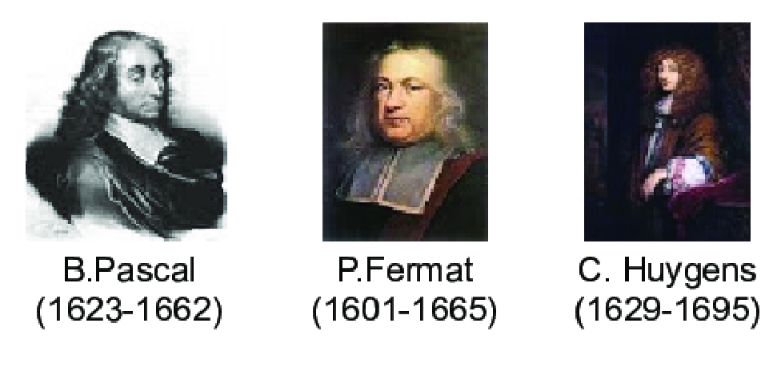

<!-- pdf:97 -->

# BÀI 42: KẾT QUẢ CÓ THỂ VÀ SỰ KIỆN TRONG TRÒ CHƠI, THÍ NGHIỆM

## 🔤 Khái niệm, thuật ngữ

- Kết quả có thể
- Sự kiện

## 🎯 Kiến thức, kĩ năng

- Nhận biết tính không đoán trước về kết quả của một số trò chơi, thí nghiệm.
- Liệt kê các kết quả có thể xảy ra trong các trò chơi, thí nghiệm đơn giản.
- Nhận biết một sự kiện trong trò chơi, thí nghiệm có xảy ra hay không.

## 🔴 Mở đầu

Trong trò chơi *Ô cửa bí mật*, người ta đặt ba phần thưởng gồm một chiếc ô tô và hai con dê sau ba ô cửa. Người chơi sẽ chọn ngẫu nhiên một ô cửa và nhận được phần thưởng sau ô cửa đó.

Liệu người chơi có may mắn nhận được phần thưởng là chiếc ô tô không?

## 1. KẾT QUẢ CÓ THỂ

**HĐ1:** Vuông và Tròn gieo một con xúc xắc và quan sát mặt xuất hiện của nó. Có thể xảy ra những kết quả nào?

**HĐ2:** Vuông và Tròn đang chơi trò oẳn-tù-tì. Em hãy liệt kê các kết quả Vuông có thể ra trong mỗi lần oẳn-tù-tì.

- **Tròn:** Oẳn tù tì ra cái gì, ra cái... này!!!

**HĐ3:** Một túi có $3$ quả bóng màu đỏ và $3$ quả bóng màu xanh. Không nhìn vào túi, lấy ra một quả bóng, ghi lại màu của quả bóng được lấy ra. Liệt kê các kết quả có thể xảy ra trong thí nghiệm này.

<!-- term: Chọn ngẫu nhiên -->
Khi lấy bóng mà không nhìn vào túi ta nói bóng được chọn ngẫu nhiên.

<!-- pdf:98 -->

*Kết quả có thể trong một số trò chơi, thí nghiệm đơn giản:*

| Trò chơi, thí nghiệm | Kết quả có thể |
| --- | --- |
| *Gieo xúc xắc* | Xuất hiện mặt $1, 2, 3, 4, 5$ hoặc $6$ chấm |
| *Chơi oẳn-tù-tì* | Vuông có thể ra: Búa, Giấy, Kéo |
| *Lấy một quả bóng từ túi* | Màu đỏ, Màu xanh |
<!-- ocr-ok: đã đối chiếu ảnh trang PDF 98, bảng tổng hợp mô tả lại các kết quả bằng hình vẽ -->

> Các kết quả của trò chơi, thí nghiệm có thể xảy ra gọi là **kết quả có thể**.

> ❓ a) Liệt kê các kết quả có thể về phần thưởng trong trò chơi *Ô cửa bí mật*;
>
> b) Tìm một trò chơi, thí nghiệm khác và liệt kê các kết quả có thể của trò chơi, thí nghiệm đó.

**Ví dụ 1:** Quay tấm bìa như hình 9.26 và ghi lại chữ cái trong ô mà mũi tên chỉ vào sau khi tấm bìa dừng lại.

a) Em có biết chắc chắn mũi tên sẽ chỉ vào ô nào sau mỗi lần quay không?

b) Liệt kê tất cả các kết quả có thể của thí nghiệm này. Có bao nhiêu kết quả có thể?

*Hình 9.26*

**Giải:**

a) Không thể chắc chắn mũi tên sẽ chỉ vào ô nào sau mỗi lần quay;

b) Các kết quả có thể của thí nghiệm này gồm A, B, C, D, E, F, G, H. Có $8$ kết quả có thể.

<!-- pdf:99 -->

**Luyện tập 1:** *Chiếc nón kì diệu* từng là một trò chơi truyền hình nổi tiếng ở Việt Nam. Quan sát hình 9.27 và liệt kê tất cả các kết quả có thể khi quay chiếc nón kì diệu.

*Hình 9.27*

Trò chơi *Chiếc nón kì diệu* đã thu hút lượng người xem kỉ lục những năm 2000. Chiếc nón (h.9.27) chính là yếu tố hấp dẫn người xem nhất, bởi không ai đoán trước được người chơi sẽ quay trúng ô nào trong mỗi lượt chơi.

**Tranh luận:**

- **Tròn:** Tớ đã gieo xúc xắc $7$ lần. Số chấm xuất hiện trên mặt con xúc xắc là: $1, 4, 5, 1, 1, 3, 5$.
- **Vuông:** Thế nghĩa là tập tất cả các kết quả có thể của thí nghiệm gieo xúc xắc là: $S = \{1, 3, 4, 5\}$.

Em có đồng ý với Vuông không?

## 2. SỰ KIỆN

<!-- term: Sự kiện -->
**HĐ4:** Gieo đồng thời $2$ con xúc xắc. Quan sát số chấm xuất hiện và cho biết sự kiện nào sau đây xảy ra?

<!-- term: Sự kiện -->
a) Tổng số chấm xuất hiện trên hai con xúc xắc là số chẵn;

<!-- term: Sự kiện -->
b) Tổng số chấm xuất hiện trên hai con xúc xắc lớn hơn $7$.

<!-- term: Sự kiện -->
**HĐ5:** Trong hộp có $10$ tấm thẻ ghi các số $2, 2, 3, 3, 3, 5, 5, 5, 5, 5$. Yêu cầu $5$ bạn lần lượt rút ngẫu nhiên $1$ thẻ, quan sát số ghi trên thẻ rồi trả lại thẻ vào hộp. Sau mỗi lần một bạn rút, hãy cho biết các sự kiện sau có xảy ra hay không?

a) Rút được thẻ ghi số $5$;

b) Không rút được thẻ ghi số $2$.

> Khi thực hiện trò chơi hoặc thí nghiệm, một sự kiện **có thể xảy ra** hoặc **không xảy ra** tuỳ thuộc vào kết quả của trò chơi, thí nghiệm đó.

<!-- pdf:100 -->

**Ví dụ 2:** *Trò chơi tung đồng xu* (dành cho hai người chơi)

*Luật chơi:* Mỗi lượt chơi, từng người chơi lần lượt tung đồng thời hai đồng xu. Nếu cả hai đồng xu ra mặt ngửa thì người đó được $1$ điểm, nếu ra kết quả khác thì không được điểm.

Sau $10$ lượt chơi, ai được nhiều điểm hơn là người thắng cuộc.

Tú và Quân chơi trò chơi và ghi lại số điểm của từng lượt chơi như sau:

| | Lượt 1 | Lượt 2 | Lượt 3 | Lượt 4 | Lượt 5 | Lượt 6 | Lượt 7 | Lượt 8 | Lượt 9 | Lượt 10 |
| --- | :---: | :---: | :---: | :---: | :---: | :---: | :---: | :---: | :---: | :---: |
| Tú | $1$ | $1$ | $0$ | $0$ | $0$ | $1$ | $1$ | $0$ | $1$ | $1$ |
| Quân | $1$ | $0$ | $0$ | $1$ | $0$ | $1$ | $1$ | $1$ | $0$ | $0$ |
<!-- ocr-ok: đã đối chiếu ảnh trang PDF 100, bảng điểm 10 lượt chơi thêm tiêu đề cột Lượt 1..10 -->

Em hãy cho biết trong hai sự kiện: *Tú thắng* và *Quân thắng*, sự kiện nào xảy ra? Sự kiện nào không xảy ra?

**Giải:**

Từ bảng số điểm từng lượt chơi, ta thấy Tú được $6$ điểm, Quân được $5$ điểm.

Vậy sự kiện: *Tú thắng* xảy ra; sự kiện *Quân thắng* không xảy ra.

**Luyện tập 2:** Minh quay tấm bìa và thấy mũi tên chỉ vào ô số $3$ như hình bên. Hãy cho biết sự kiện nào sau đây xảy ra:

(1) *Mũi tên chỉ vào ô ghi số $3$ hoặc $5$;*

(2) *Mũi tên chỉ vào ô ghi số $4$;*

(3) *Mũi tên chỉ vào ô ghi số lớn hơn $5$.*

**Thử thách nhỏ:** Một hộp kín đựng $5$ viên bi xanh, $3$ viên bi đỏ và $2$ viên bi vàng. Mỗi lượt chơi, Minh và Khoa lần lượt lấy ra một viên bi từ hộp. Quan sát và ghi lại màu của viên bi rồi trả lại viên bi vào hộp.

Màu của các viên bi trong mỗi lượt lấy được Minh và Khoa ghi lại như hình bên (*X: xanh, Đ: đỏ, V: vàng*)

- Minh: X X V V Đ X V Đ Đ X
- Khoa: Đ V X Đ X X V Đ Đ X
<!-- ocr-ok: đã đối chiếu ảnh trang PDF 100, dãy kí hiệu màu bi trong hộp vàng -->

Người thắng là người lấy được nhiều viên bi đỏ hơn sau $10$ lượt chơi. Sự kiện *Minh thắng* có xảy ra không?

<!-- pdf:101 -->

## BÀI TẬP

9.25. Gieo một con xúc xắc.

a) Liệt kê các kết quả có thể để sự kiện *Số chấm xuất hiện là số nguyên tố* xảy ra;

b) Nếu số chấm xuất hiện là $5$ thì sự kiện *Số chấm xuất hiện không phải là $6$* có xảy ra hay không?

9.26. Quay tấm bìa như hình sau và xem mũi tên chỉ vào ô nào khi tấm bìa dừng lại.

a) Liệt kê các kết quả có thể của thí nghiệm này;

b) Liệt kê các kết quả có thể để sự kiện *Mũi tên không chỉ vào ô Nai* xảy ra;

c) Nếu mũi tên chỉ vào ô Nai như hình vẽ thì sự kiện *Mũi tên chỉ vào ô Gấu hoặc Nai* có xảy ra không?

9.27. Trò chơi dành cho hai người chơi. Mỗi người chơi chọn một trong sáu số $1, 2, 3, 4, 5, 6$ rồi gieo con xúc xắc năm lần liên tiếp. Mỗi lần gieo, nếu xuất hiện mặt có số chấm bằng số đã chọn thì được $10$ điểm, ngược lại bị trừ $5$ điểm. Ai được nhiều điểm hơn sẽ thắng.

An và Bình cùng chơi, An chọn số $3$ và Bình chọn số $4$. Kết quả gieo của An và Bình lần lượt là $2, 3, 6, 4, 3$ và $4, 3, 4, 5, 4$. Hỏi An hay Bình là người thắng?

9.28. Mai và Linh cùng chơi, mỗi người gieo một đồng xu liên tiếp $30$ lần được kết quả như sau (*S: sấp, N: ngửa*):

Mai: S N N S S N S N S N S N N S S N N S S N N N S S S N N N S S
<!-- ocr-ok: đã đối chiếu ảnh trang PDF 101, dãy chữ cái in màu xanh nhạt -->

Linh: N S S N N S N S N S S S S N S N N S S S N N N S S S N N S S
<!-- ocr-ok: đã đối chiếu ảnh trang PDF 101, dãy chữ cái in màu xanh nhạt -->

Người chơi được một điểm khi có đúng ba lần liên tiếp đồng xu ra mặt ngửa. Người nào được nhiều điểm hơn là người thắng.

Sự kiện *Mai thắng* có xảy ra hay không?

## 💡 Em có biết?

Vào năm 1651, nhà toán học vĩ đại người Pháp B.Pascal (1623-1662) nhận được một bức thư của nhà quý tộc Pháp nhờ ông giải quyết một vấn đề rắc rối khi chia tiền thu được trong một trò chơi. Pascal trao đổi với nhà toán học Pháp là P.Fermat (1601-1665). Hai ông đã “toán học hoá” vấn đề này và nâng lên thành một bài toán tổng quát. Dựa trên các trao đổi đó, năm 1657 nhà toán học và vật lí người Hà Lan C. Huygens (1629-1695) đã viết một cuốn sách về chủ đề này. Cuốn sách này được xem là cuốn sách đã khai sinh ra Lí thuyết xác suất.

*B.Pascal (1623-1662) — P.Fermat (1601-1665) — C. Huygens (1629-1695)*

## 📷 Danh sách hình trong bài

| Mã hình | Trang PDF | Vị trí trong bài | Chú thích gốc |
| --- | :---: | --- | --- |
| H6-toan-b42-01 | 97 | Mở đầu | (sách không đánh số, minh hoạ trò chơi Ô cửa bí mật) |
| H6-toan-b42-02 | 97 | Mục 1, HĐ2 | (sách không đánh số, sơ đồ Búa – Giấy – Kéo trong trò chơi oẳn-tù-tì) |
| H6-toan-b42-03 | 97 | Mục 1, HĐ3 | (sách không đánh số, túi đựng 3 quả bóng màu đỏ và 3 quả bóng màu xanh) |
| H6-toan-b42-04 | 98 | Mục 1, bảng tổng hợp | Kết quả có thể trong một số trò chơi, thí nghiệm đơn giản |
| H6-toan-b42-05 | 98 | Mục 1, Ví dụ 1 | Hình 9.26 |
| H6-toan-b42-06 | 99 | Mục 1, Luyện tập 1 | Hình 9.27 |
| H6-toan-b42-07 | 100 | Mục 2, Luyện tập 2 | (sách không đánh số, tấm bìa quay chia ô số 1, 2, 3, 4, 5, 6, 7) |
| H6-toan-b42-08 | 101 | Bài tập 9.26 | (sách không đánh số, tấm bìa quay chia các ô Cáo, Gấu, Nai) |
| H6-toan-b42-09 | 101 | Em có biết? | B.Pascal (1623-1662) — P.Fermat (1601-1665) — C. Huygens (1629-1695) |
