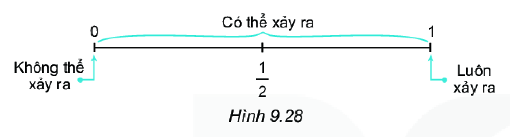
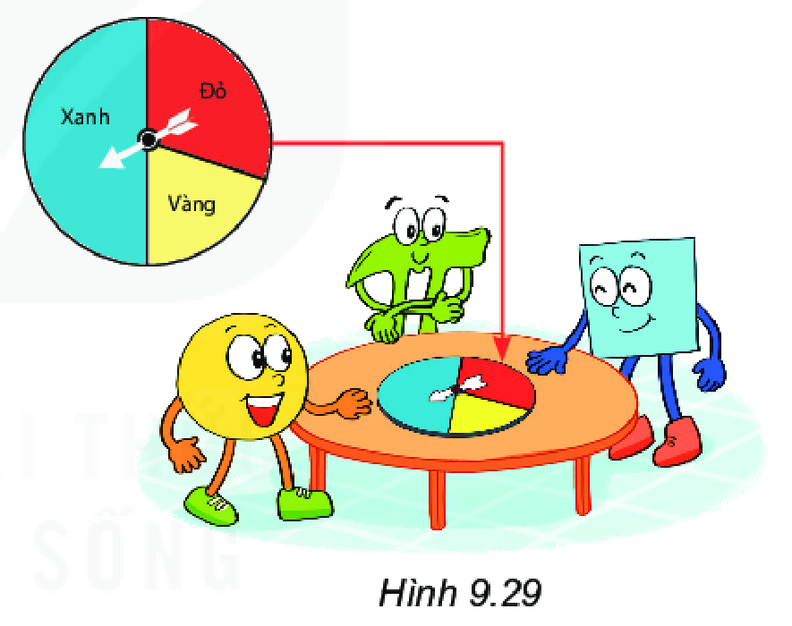
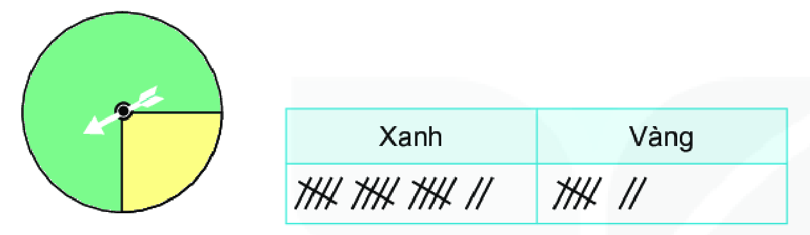

<!-- pdf:102 -->

# BÀI 43: XÁC SUẤT THỰC NGHIỆM

## 🔤 Khái niệm, thuật ngữ

- Xác suất thực nghiệm

## 🎯 Kiến thức, kĩ năng

- Biểu diễn khả năng xảy ra một sự kiện theo xác suất thực nghiệm.

## 🔴 Mở đầu

<!-- term: Không thể xảy ra -->
<!-- term: Chắc chắn xảy ra -->
Khi thực hiện thí nghiệm hoặc trò chơi, một sự kiện có thể xảy ra hoặc không xảy ra. Khả năng xảy ra một sự kiện được thể hiện bằng một con số từ $0$ đến $1$.

<!-- term: Không thể xảy ra -->
<!-- term: Chắc chắn xảy ra -->
- **Tròn:** Khả năng bằng $0$ (hay $0\%$) có nghĩa sự kiện đó không bao giờ xảy ra. Khả năng bằng $1$ (hay $100\%$) có nghĩa sự kiện đó chắc chắn xảy ra.

*Hình 9.28*

*Vòng quay may mắn*

*Chuẩn bị:* Một miếng bìa cứng hình tròn được chia thành ba phần và tô màu xanh, đỏ, vàng như hình 9.29 được gắn vào trục quay có mũi tên ở tâm.

*Thực hiện:* Quay miếng bìa và quan sát xem mũi tên chỉ vào ô màu nào khi miếng bìa dừng lại.

*Hình 9.29*

**HĐ1:** Em hãy đoán xem mũi tên sẽ chỉ vào ô màu nào khi quay miếng bìa?

**HĐ2:** Quay miếng bìa $20$ lần và thống kê kết quả theo mẫu bên.

| | Đỏ | Xanh | Vàng |
| --- | :---: | :---: | :---: |
| Số lần ($k$) | | | |
| Tỉ số $\left(\dfrac{k}{20}\right)$ | | | |

> Tỉ số $\dfrac{\text{Số lần mũi tên chỉ vào ô màu vàng}}{\text{Số lần quay}}$ được gọi là **xác suất thực nghiệm** của sự kiện *Mũi tên chỉ vào ô màu vàng*.

**Nhận xét:** Xác suất thực nghiệm phụ thuộc vào người thực hiện thí nghiệm, trò chơi và số lần người đó thực hiện thí nghiệm, trò chơi.

<!-- pdf:103 -->

> ❓ Cho biết xác suất thực nghiệm của sự kiện *Mũi tên chỉ vào ô màu xanh* và sự kiện *Mũi tên chỉ vào ô màu đỏ* trong HĐ2.

**Ví dụ:** Trong buổi thực hành môn Khoa học tự nhiên đo thể tích của vật thể không xác định được hình dạng, lớp 6A có $40$ học sinh thực hiện phép đo thì có $35$ học sinh thực hiện thành công. Em hãy tính xác suất thực nghiệm của sự kiện *Phép đo được thực hiện thành công*.

**Giải:**

Số lần thực hiện phép đo là $n = 40$.

Số lần đo thành công là $k = 35$.

Xác suất thực nghiệm của sự kiện *Phép đo được thực hiện thành công* là:

$$\frac{k}{n} = \frac{35}{40} = 87,5\%.$$
<!-- ocr-ok: đã đối chiếu ảnh trang PDF 103, công thức toán hiển thị -->

**Luyện tập:** An gieo hai con xúc xắc cùng lúc $80$ lần. Ở mỗi lần gieo, An cộng số chấm xuất hiện ở hai xúc xắc và ghi lại kết quả như bảng sau:

| Tổng số chấm | $2$ | $3$ | $4$ | $5$ | $6$ | $7$ | $8$ | $9$ | $10$ | $11$ | $12$ |
| --- | :---: | :---: | :---: | :---: | :---: | :---: | :---: | :---: | :---: | :---: | :---: |
| Số lần | $2$ | $5$ | $6$ | $8$ | $11$ | $14$ | $12$ | $9$ | $6$ | $4$ | $3$ |

Nếu tổng số chấm xuất hiện ở hai con xúc xắc lớn hơn $6$ thì An thắng. Tính xác suất thực nghiệm của sự kiện *An thắng*.

**Tranh luận:** Vuông gieo một đồng xu $50$ lần và thấy có $30$ lần xuất hiện mặt sấp. Tròn lấy đồng xu đó gieo $100$ lần và thấy có $55$ lần xuất hiện mặt sấp.

- **Vuông:** Xác suất thực nghiệm của sự kiện *Đồng xu xuất hiện mặt sấp* là $\dfrac{30}{50}$.
- **Tròn:** Xác suất thực nghiệm của sự kiện *Đồng xu xuất hiện mặt sấp* là $\dfrac{55}{100}$.

Bạn nào nói đúng nhỉ?

<!-- pdf:104 -->

## BÀI TẬP

9.29. Minh gieo một con xúc xắc $100$ lần và ghi lại số chấm xuất hiện ở mỗi lần gieo được kết quả như sau:

| Số chấm xuất hiện | $1$ | $2$ | $3$ | $4$ | $5$ | $6$ |
| --- | :---: | :---: | :---: | :---: | :---: | :---: |
| Số lần | $15$ | $20$ | $18$ | $22$ | $10$ | $15$ |

Tính xác suất thực nghiệm của các sự kiện sau:

a) *Số chấm xuất hiện là số chẵn;*

b) *Số chấm xuất hiện lớn hơn $2$.*

9.30. An quay tấm bìa như hình bên một số lần và ghi kết quả dưới dạng bảng như sau (*Mỗi gạch tương ứng $1$ lần*):

a) An đã quay tấm bìa bao nhiêu lần?

b) Có bao nhiêu lần mũi tên chỉ vào ô màu xanh, bao nhiêu lần mũi tên chỉ vào ô màu vàng?

c) Tính xác suất thực nghiệm của sự kiện *Mũi tên chỉ vào ô màu xanh*.

9.31. Trong túi có một số viên bi màu đen và một số viên bi màu đỏ. Thực hiện lấy ngẫu nhiên một viên bi từ túi, xem viên bi màu gì rồi trả lại viên bi vào túi. Khoa thực hiện thí nghiệm $30$ lần. Số lần lấy được viên bi màu đỏ là $13$. Hãy tính xác suất thực nghiệm của sự kiện *Khoa lấy được viên bi màu đỏ*.

9.32. Một chiếc thùng kín có một số quả bóng màu xanh, đỏ, tím, vàng. Trong một trò chơi, người chơi lấy ngẫu nhiên một quả bóng, ghi lại màu rồi trả lại bóng vào thùng. Bình thực hiện trò chơi $100$ lần và được kết quả như bảng sau:

| Màu | Số lần |
| :---: | :---: |
| Xanh | $43$ |
| Đỏ | $22$ |
| Tím | $18$ |
| Vàng | $17$ |

Tính xác suất thực nghiệm của các sự kiện sau:

a) *Bình lấy được quả bóng màu xanh;*

b) *Quả bóng được lấy ra không là màu đỏ.*

## 📷 Danh sách hình trong bài

| Mã hình | Trang PDF | Vị trí trong bài | Chú thích gốc |
| --- | :---: | --- | --- |
| H6-toan-b43-01 | 102 | Mở đầu | Hình 9.28 |
| H6-toan-b43-02 | 102 | Mở đầu, Vòng quay may mắn | Hình 9.29 |
| H6-toan-b43-03 | 104 | Bài tập 9.30 | (sách không đánh số, tấm bìa quay hai màu xanh, vàng và bảng kiểm đếm) |
