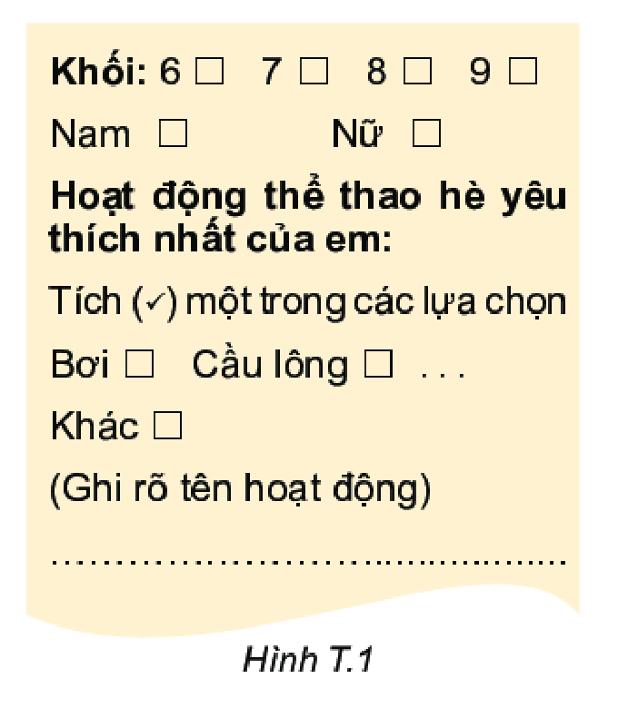
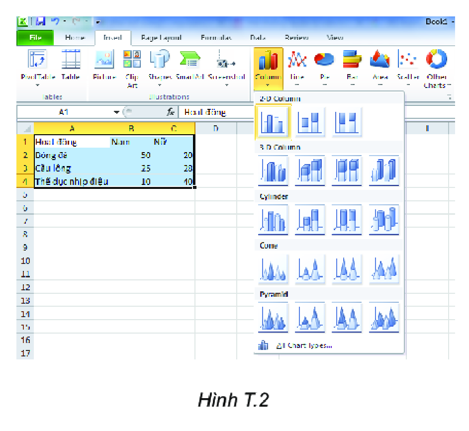
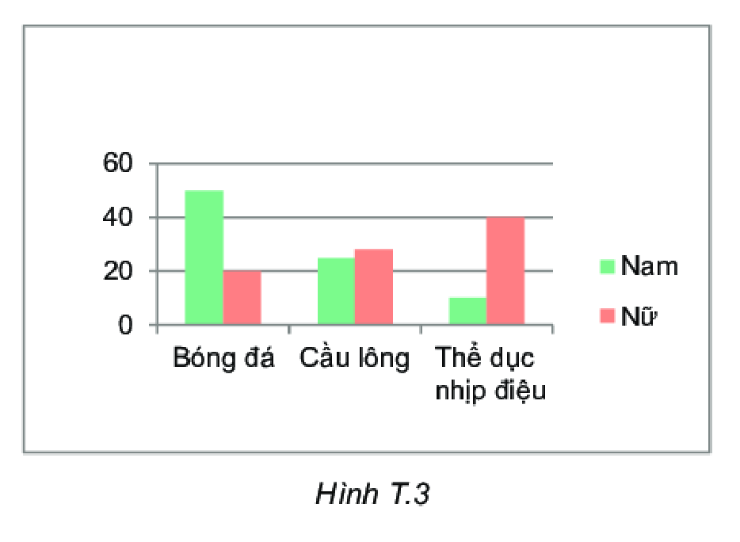
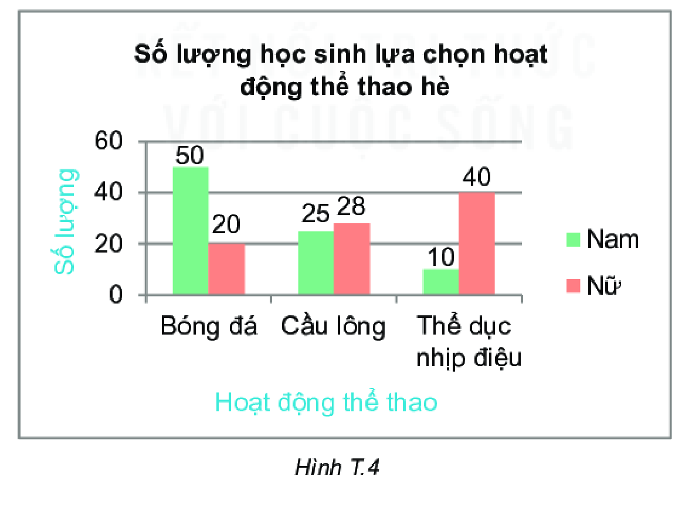

<!-- pdf:111 -->

# HOẠT ĐỘNG THỂ THAO NÀO ĐƯỢC YÊU THÍCH NHẤT TRONG HÈ?

## 🎯 Mục tiêu

- Điều tra và phân tích về lựa chọn hoạt động thể thao hè mà học sinh lựa chọn để tư vấn cho Ban giám hiệu trong việc tổ chức các hoạt động thể thao hè trong kì nghỉ hè tới. Thông qua dự án, học sinh luyện tập cách thu thập dữ liệu, tổ chức dữ liệu, xử lí dữ liệu và phân tích dữ liệu.

## 🔴 Mở đầu

Ve ve ve hè về
<!-- ocr-ok: đã đối chiếu ảnh trang PDF 111, chữ màu xanh nhạt -->

Vui vui vui hè hè ...
<!-- ocr-ok: đã đối chiếu ảnh trang PDF 111, chữ màu xanh nhạt -->

Mùa hè sắp đến rồi, em có mong chờ mùa hè đến không?
<!-- ocr-ok: đã đối chiếu ảnh trang PDF 111, chữ màu xanh nhạt -->

Hẳn là có rồi, vì đó là khoảng thời gian các em được tự do học tập, vận động và trải nghiệm ngoài nhà trường mà. Em mong chờ điều gì nhất khi mùa hè đến? Một kì nghỉ cùng gia đình, đắm mình với những cuốn truyện ở thư viện, những buổi chiều được đi đá bóng, thả diều, chơi các môn thể thao yêu thích cùng chúng bạn, hay những buổi sinh hoạt ở nhà văn hoá, những hoạt động thi đấu thể thao được tổ chức ở trường...?
<!-- ocr-ok: đã đối chiếu ảnh trang PDF 111, đoạn văn in chữ màu xanh nhạt -->

*Yeah!!! Mùa hè đến rồi!!!!*
<!-- ocr-ok: đã đối chiếu ảnh trang PDF 111, chữ trang trí màu xanh nhạt -->

Bài thực hành trải nghiệm này sẽ giúp các em có cơ hội được chia sẻ cùng các bạn trong lớp những hoạt động thể thao được yêu thích và mong chờ nhất của em trong mùa hè này! Hãy cùng tìm hiểu nào!

*CÁC CÂU HỎI CẦN TRẢ LỜI*
<!-- ocr-ok: đã đối chiếu ảnh trang PDF 111, tiêu đề màu xanh nhạt -->

- Hoạt động thể thao hè nào mà học sinh muốn lựa chọn nhiều nhất?
- Những hoạt động thể thao ưa thích của các bạn học sinh nam, học sinh nữ?
- Sự lựa chọn hoạt động thể thao hè của học sinh đầu cấp (khối lớp $6, 7$) có khác với lựa chọn của học sinh cuối cấp (lớp $8, 9$) không?

*CHUẨN BỊ*

- Giấy, bút, thước kẻ
- Danh sách học sinh các khối trong trường;
- Máy tính, máy in, mạng Internet (nếu có điều kiện).

<!-- pdf:112 -->

*CÁC BƯỚC THỰC HIỆN*

*Bước 1. THU THẬP DỮ LIỆU*
<!-- ocr-ok: đã đối chiếu ảnh trang PDF 112, chữ trắng trên nền băng xanh nhạt -->

Em có thể lựa chọn một trong ba phương án:

*Phương án 1.* Sử dụng phiếu hỏi.

*Điều kiện thực hiện:* Có máy tính, máy in.

Thiết kế bảng hỏi trên máy tính như gợi ý hình T.1 (dùng phần mềm Microsoft Word) và in đủ số lượng cần điều tra, phát phiếu hỏi cho những học sinh cần lấy ý kiến và thu lại để tổng hợp.

*Hình T.1*

*Phương án 2.* Khảo sát qua mạng Internet

*Điều kiện thực hiện:* Có máy tính kết nối Internet

Các bước hướng dẫn cụ thể xem phần chú giải.

*Phương án 3.* Phỏng vấn trực tiếp
<!-- ocr-ok: đã đối chiếu ảnh trang PDF 112, nhãn in màu xanh nhạt ngang bảng T.3 -->

Em thực hiện phỏng vấn trực tiếp và liệt kê kết quả theo mẫu như bảng T.3.

| Lớp | Giới tính | Hoạt động yêu thích |
| :---: | :---: | :---: |
| $9$ | Nam | Bơi |
| $7$ | Nữ | Cầu lông |
| $\dots$ | $\dots$ | $\dots$ |
<!-- ocr-ok: đã đối chiếu ảnh trang PDF 112, bảng T.3 đặt bên phải -->

*Bảng T.3 (Hoạt động thể thao hè được yêu thích nhất)*

*Bước 2. LẬP BẢNG THỐNG KÊ*
<!-- ocr-ok: đã đối chiếu ảnh trang PDF 112, chữ trắng trên nền băng xanh nhạt -->

Tổng kết số liệu theo mẫu sau:

| Hoạt động | Nam — Khối $6, 7$ | Nam — Khối $8, 9$ | Nữ — Khối $6, 7$ | Nữ — Khối $8, 9$ |
| --- | :---: | :---: | :---: | :---: |
| Bóng đá | `///` | `//` | | |
| $\dots$ | $\dots$ | $\dots$ | $\dots$ | $\dots$ |
<!-- ocr-ok: đã đối chiếu ảnh trang PDF 112, bảng T.4 tiêu đề gộp cột -->

*Bảng T.4*

Trong bảng T.4, mỗi gạch tương ứng với một bạn. Lập các bảng thống kê sau:

1. Bảng thống kê về số lượng học sinh lựa chọn các hoạt động thể thao hè (bảng T.5).

| Hoạt động | Số lượng |
| --- | :---: |
| Bóng đá | |
| $\dots$ | $\dots$ |
<!-- ocr-ok: đã đối chiếu ảnh trang PDF 112, bảng T.5 đặt bên phải -->

*Bảng T.5*

2. Bảng thống kê số lượng học sinh nam và nữ lựa chọn các hoạt động thể thao hè (bảng T.6).

3. Bảng thống kê số lượng học sinh đầu cấp (khối $6, 7$) và cuối cấp (khối $8, 9$) lựa chọn các hoạt động thể thao hè (bảng T.7).

| Hoạt động | Nam | Nữ |
| --- | :---: | :---: |
| Bóng đá | | |
| $\dots$ | | $\dots$ |
| Aerobic | | |

*Bảng T.6*

| Hoạt động | Học sinh khối $6, 7$ | Học sinh khối $8, 9$ |
| --- | :---: | :---: |
| Bóng đá | | |
| $\dots$ | | $\dots$ |

*Bảng T.7*

<!-- pdf:113 -->

*Bước 3. VẼ BIỂU ĐỒ CỘT, CỘT KÉP*

Vẽ các biểu đồ cột, cột kép biểu diễn các bảng thống kê. Có hai phương án:

*Phương án 1.* Vẽ mỗi biểu đồ trên giấy.

*Phương án 2.* Vẽ bằng phần mềm Microsoft Excel.

*Điều kiện thực hiện:* Có máy tính được cài đặt Microsoft Excel. Xem hướng dẫn cụ thể trong phần chú giải.

*Bước 4. PHÂN TÍCH DỮ LIỆU*
<!-- ocr-ok: đã đối chiếu ảnh trang PDF 113, chữ trắng trên nền băng xanh nhạt -->

1) Dựa vào các biểu đồ thu được hãy trả lời các câu hỏi đã được đặt ra từ đầu.

2) Em hãy đưa ra những khuyến nghị cho Ban giám hiệu trong việc tổ chức các hoạt động hè cho học sinh trong trường vào kì nghỉ hè tới.

*CHÚ GIẢI - HƯỚNG DẪN THỰC HÀNH VỚI MÁY TÍNH*
<!-- ocr-ok: đã đối chiếu ảnh trang PDF 113, tiêu đề màu xanh nhạt -->

## 1. Hướng dẫn điều tra trên Internet

Các công cụ điều tra trên Internet có thể kể đến như: Google Forms, Office365, Facebook, Zalo, ....

Ở đây các em được hướng dẫn sử dụng Google Forms. Để thực hiện điều tra sử dụng Google Forms em thực hiện theo các bước sau:

(1) Nếu em chưa có tài khoản thì đầu tiên em cần lập một tài khoản Google.

(2) Vào trang forms.google.com.
<!-- ocr-ok: đã đối chiếu ảnh trang PDF 113, địa chỉ web in chữ màu xanh nhạt -->

(3) Nhập tên tài khoản và mật khẩu.

(4) Trong Main menu chọn Forms. Chọn biểu tượng Blank/Trống để tạo một form mới.

(5) Hoàn thành form theo các gợi ý của Google Forms.

(6) Bấm vào biểu tượng Preview (biểu tượng con mắt) để xem trước và điều chỉnh form nếu cần thiết.

(7) Chọn Send/Gửi (nút Gửi) hoặc sao chép đường dẫn để gửi khảo sát qua thư điện tử. Em cũng có thể chia sẻ form qua Facebook, Zalo, ...

(8) Xem kết quả trong phần Responses.

## 2. Vẽ biểu đồ cột, cột kép bằng Excel 2010

Để vẽ biểu đồ cột/cột kép trong Excel 2010, em thực hiện theo các bước chính sau:

(1) Mở công cụ Microsoft Excel và nhập dữ liệu, chẳng hạn dữ liệu như bảng T.8.

| Hoạt động | Nam | Nữ |
| --- | :---: | :---: |
| Bóng đá | $50$ | $20$ |
| Cầu lông | $25$ | $28$ |
| Thể dục nhịp điệu | $10$ | $40$ |

*Bảng T.8*

(2) Chọn vùng dữ liệu cần vẽ biểu đồ.

Trên thanh menu chọn Insert $\rightarrow$ Column $\rightarrow$ 2-D Column, sau đó chọn biểu tượng của biểu đồ cột kép ta được biểu đồ, chọn loại biểu đồ cần vẽ (h.T.2) để được biểu đồ giống hình T.3.

<!-- pdf:114 -->

*Hình T.2*

*Hình T.3*

(3) Hoàn thiện tiêu đề, các chú giải khác bằng cách chọn Layout, cụ thể:

- Chọn Chart Title $\rightarrow$ Above Chart rồi điền tiêu đề: *Biểu đồ biểu diễn số lượng học sinh nam và nữ lựa chọn các hoạt động thể thao hè*.
- Chọn Data Label $\rightarrow$ Outside End để hiện số liệu.
- Chọn Axis Title $\rightarrow$ Primary Horizontal Axis Title $\rightarrow$ Title Below Axis sau đó điền: *Hoạt động thể thao*.
- Chọn Axis Title $\rightarrow$ Primary Vertical Axis Title $\rightarrow$ Rotated Title sau đó điền *Số lượng*.
<!-- ocr-ok: đã đối chiếu ảnh trang PDF 114, tên lệnh tiếng Anh in chữ màu xanh nhạt -->

(4) Kết quả ta có biểu đồ như hình T.4.

*Hình T.4*

## 📷 Danh sách hình trong bài

| Mã hình | Trang PDF | Vị trí trong bài | Chú thích gốc |
| --- | :---: | --- | --- |
| H6-toan-hd-thtn-05-01 | 111 | Mở đầu | Yeah!!! Mùa hè đến rồi!!!! |
| H6-toan-hd-thtn-05-02 | 112 | Bước 1, Phương án 1 | Hình T.1 |
| H6-toan-hd-thtn-05-03 | 114 | Mục 2, bước (2) | Hình T.2 |
| H6-toan-hd-thtn-05-04 | 114 | Mục 2, bước (2) | Hình T.3 |
| H6-toan-hd-thtn-05-05 | 114 | Mục 2, bước (4) | Hình T.4 |
