<!-- pdf:115 -->

# VẼ HÌNH ĐƠN GIẢN VỚI PHẦN MỀM GEOGEBRA

## 🎯 Mục tiêu

- Vẽ những hình có trục đối xứng, hình có tâm đối xứng bằng phần mềm GeoGebra.

## 🔴 Mở đầu

Các em đã được học về những hình có trục đối xứng, hình có tâm đối xứng. Liệu vẽ những hình đó bằng phần mềm GeoGebra như thế nào? Chúng ta cùng thực hành nhé!

Khởi động phần mềm GeoGebra và trên giao diện của phần mềm GeoGebra với các bảng chọn, công cụ Tiếng Việt như sau:

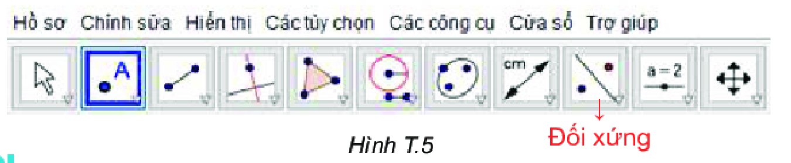
*Hình T.5*

*VẼ HÌNH THOI*

Em đã biết vẽ được hình thoi bằng cách vẽ đường tròn và đường thẳng song song nhưng nếu sử dụng tính đối xứng thì có nhanh hơn không nhỉ?

*Bước 1.* Vẽ tam giác đều $ABB'$.
<!-- ocr-ok: đã đối chiếu ảnh trang PDF 115, nhãn Bước 1 in màu xanh nhạt -->

*Bước 2.* Vẽ điểm $A'$ đối xứng với $A$ qua $BB'$ như sau:
<!-- ocr-ok: đã đối chiếu ảnh trang PDF 115, nhãn Bước 2 in màu xanh nhạt kèm kí hiệu toán -->

Chọn nhóm công cụ Đối xứng $\rightarrow$ Chọn Đối xứng qua đường thẳng $\rightarrow$ Chọn điểm $A$ $\rightarrow$ Chọn đoạn thẳng $BB'$.

*Bước 3.* Vẽ các đoạn thẳng $A'B$ và $A'B'$.
<!-- ocr-ok: đã đối chiếu ảnh trang PDF 115, nhãn Bước 3 in màu xanh nhạt kèm kí hiệu toán -->

*Kết quả:* Ta được hình thoi $ABA'B'$ có trục đối xứng là $BB'$ (h.T.6).
<!-- ocr-ok: đã đối chiếu ảnh trang PDF 115, nhãn Kết quả in màu xanh nhạt -->

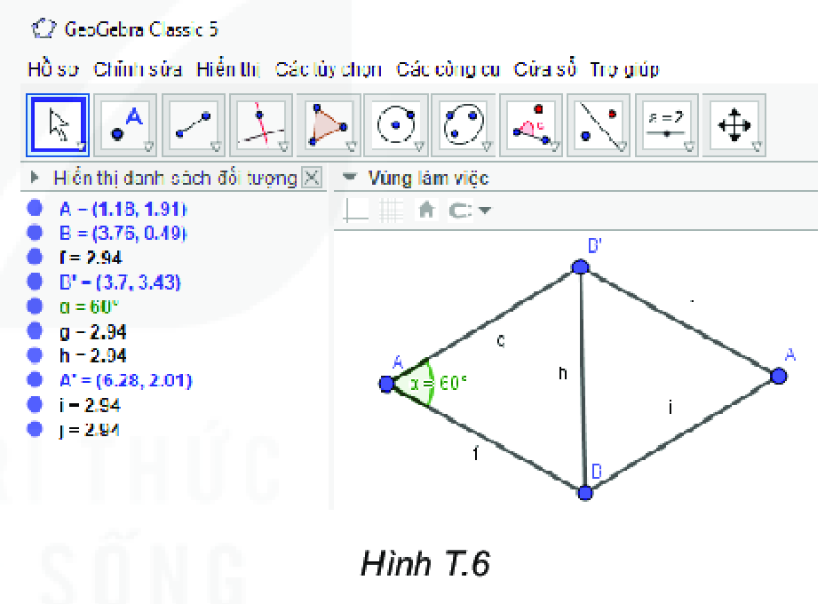
*Hình T.6*

*VẼ HÌNH LỤC GIÁC ĐỀU*

*Bước 1.* Vẽ tam giác đều $ABB'$.
<!-- ocr-ok: đã đối chiếu ảnh trang PDF 115, nhãn Bước 1 in màu xanh nhạt -->

*Bước 2.* Vẽ điểm đối xứng $A'$ của $A$ qua $B'$ như sau:
<!-- ocr-ok: đã đối chiếu ảnh trang PDF 115, nhãn Bước 2 in màu xanh nhạt -->

Chọn nhóm công cụ Đối xứng $\rightarrow$ Chọn Đối xứng qua điểm $\rightarrow$ Chọn điểm cần lấy đối xứng (điểm $A$) $\rightarrow$ Chọn tâm đối xứng (điểm $B'$).

*Bước 3.* Vẽ điểm $B'_1$ đối xứng của $B$ qua $B'$.
<!-- ocr-ok: đã đối chiếu ảnh trang PDF 115, nhãn Bước 3 in màu xanh nhạt -->

*Bước 4.* Vẽ điểm $B'_2$ đối xứng của $B$ qua đường thẳng $AB'$.
<!-- ocr-ok: đã đối chiếu ảnh trang PDF 115, nhãn Bước 4 in màu xanh nhạt -->

*Bước 5.* Vẽ điểm $A'_1$ đối xứng của $A$ qua đường thẳng $BB'$.
<!-- ocr-ok: đã đối chiếu ảnh trang PDF 115, nhãn Bước 5 in màu xanh nhạt -->

*Bước 6.* Vẽ các đoạn thẳng $BA'_1$, $A'_1A'$, $A'B'_1$, $B'_1B'_2$, $B'_2A$.
<!-- ocr-ok: đã đối chiếu ảnh trang PDF 115, nhãn Bước 6 in màu xanh nhạt -->

*Kết quả:* Ta được hình lục giác đều (h.T.7).

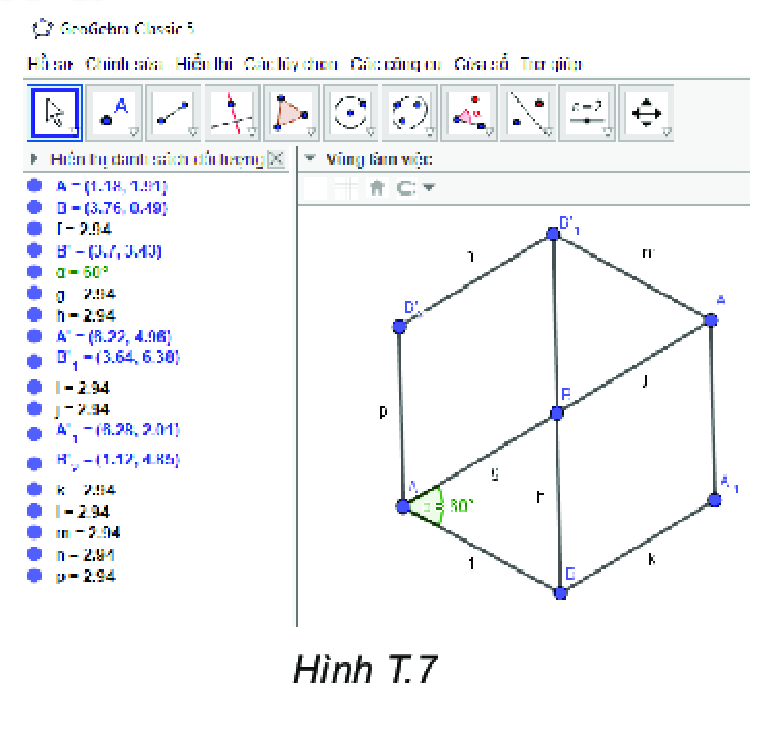
*Hình T.7*

**Chú ý:** Có thể vẽ tam giác đều và lục giác đều rất nhanh như sau: Chọn nhóm công cụ Đa giác $\rightarrow$ Chọn Đa giác đều $\rightarrow$ Chọn hai điểm $\rightarrow$ Nhập số đỉnh.

<!-- pdf:116 -->

*Cùng suy luận*

- Hình lục giác đều trên có tâm đối xứng không?
- Hình lục giác đều trên có mấy trục đối xứng? Em hãy vẽ tất cả các trục đối xứng đó nhé!

*VẼ HÌNH TỰ DO*

Em hãy vẽ một hình có trục đối xứng theo mẫu sau hoặc một mẫu tuỳ ý.

*Bước 1.* Em hãy vẽ hình T.8a vào Vùng làm việc của GeoGebra.

*Bước 2.* Em hãy dùng công cụ biến hình để bức vẽ là hình có trục đối xứng nhé.

**Chú ý:** Ẩn các đối tượng không cần thiết của hình vẽ.

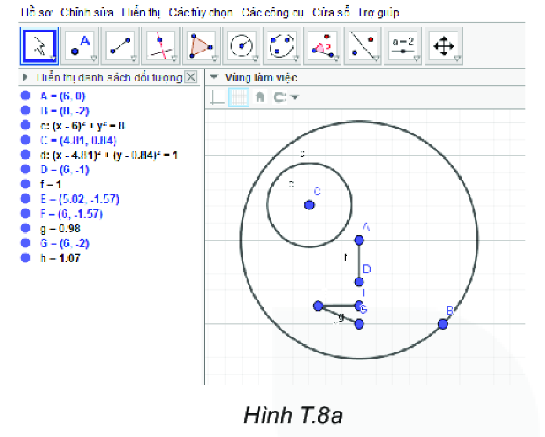
*Hình T.8a*

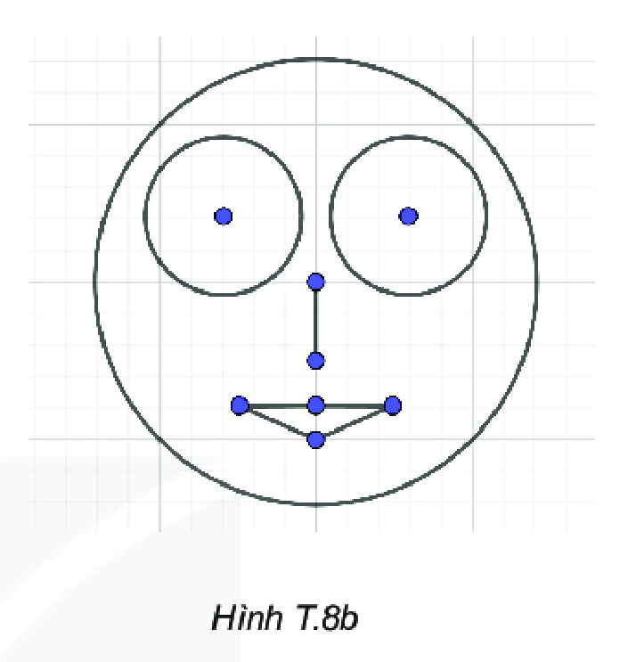
*Hình T.8b*

*MỘT SỐ TÍNH NĂNG HỖ TRỢ*
<!-- ocr-ok: đã đối chiếu ảnh trang PDF 116, tiêu đề màu xanh nhạt -->

## 1. Hiển thị giao diện tiếng Việt

Mở bảng chọn Các tuỳ chọn $\rightarrow$ Ngôn Ngữ rồi chọn Tiếng Việt (h.T.9).
<!-- ocr-ok: đã đối chiếu ảnh trang PDF 116, tên bảng chọn in chữ màu xanh nhạt -->

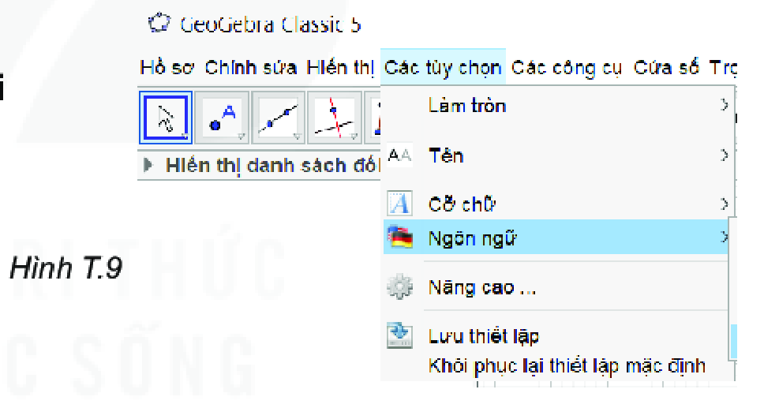
*Hình T.9*

## 2. Ẩn/hiện đối tượng
<!-- ocr-ok: đã đối chiếu ảnh trang PDF 116, OCR tách dấu gạch chéo Ẩn/hiện -->

Nháy nút phải chuột lên đối tượng $\rightarrow$ Chọn Hiển thị đối tượng

*Kết quả:* Đối tượng đó được ẩn (không còn hiển thị ở Vùng làm việc nữa).

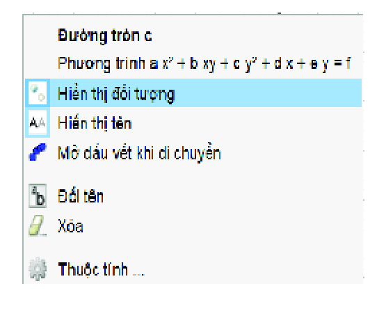

- **Tròn:** Em có thể nhấn giữ phím Ctrl rồi nháy chuột chọn nhiều đối tượng để thực hiện thao tác ẩn các đối tượng đó cùng lúc.

## 3. Xoá đối tượng

*Cách 1.* Nháy chọn đối tượng rồi nhấn phím Delete.

*Cách 2.* Nháy nút phải chuột lên đối tượng đó rồi chọn Xóa.

## 4. Đổi tên đối tượng
<!-- ocr-ok: đã đối chiếu ảnh trang PDF 116, dòng nằm cạnh khung thoại hình bên phải -->

Nháy chọn đối tượng rồi nháy nút phải chuột và chọn Đổi tên.

## 5. Ẩn/hiện hệ trục tọa độ và lưới ô vuông ở vùng làm việc

Chọn Vùng làm việc rồi nháy chuột vào các biểu tượng tương ứng để ẩn/hiện lưới hoặc hệ trục toạ độ.

<!-- pdf:117 -->

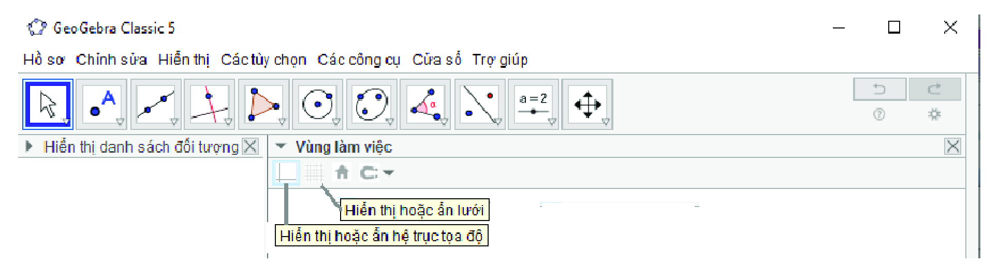

## 6. Lưu lại kết quả

- Để lưu lại hình đã vẽ thành tệp ta chọn Hồ sơ $\rightarrow$ Lưu lại $\rightarrow$ Chọn vị trí lưu tệp và đặt tên tệp. Tệp được tạo có phần mở rộng là ggb.

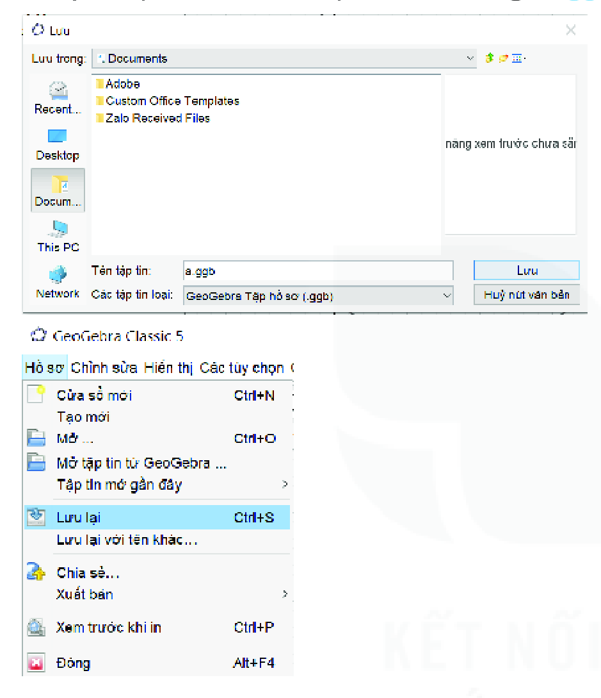

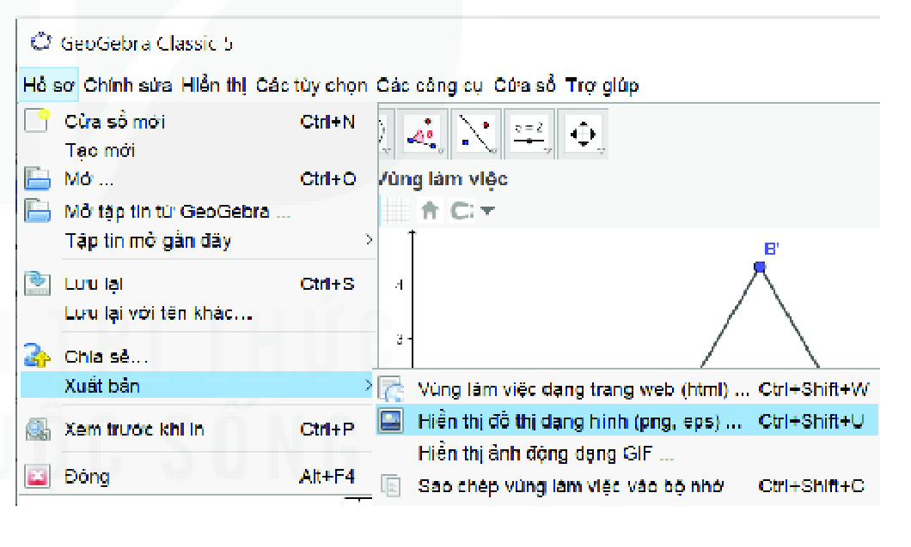

- Chúng ta cũng có thể xuất hình đã vẽ thành một tệp ảnh như sau:
<!-- ocr-ok: đã đối chiếu ảnh trang PDF 117, dòng nằm ngang ảnh chụp màn hình bên phải -->

Chọn Hồ sơ $\rightarrow$ Xuất bản $\rightarrow$ Hiển thị đồ thị dạng hình (png,eps)...
<!-- ocr-ok: đã đối chiếu ảnh trang PDF 117, tên lệnh in chữ màu xanh nhạt -->

Tệp được tạo ngầm định có phần mở rộng là png.

## BÀI TẬP

Em hãy vẽ những hình sau bằng phần mềm GeoGebra, sau đó dùng công cụ Đối xứng để có hình có trục đối xứng nhé!

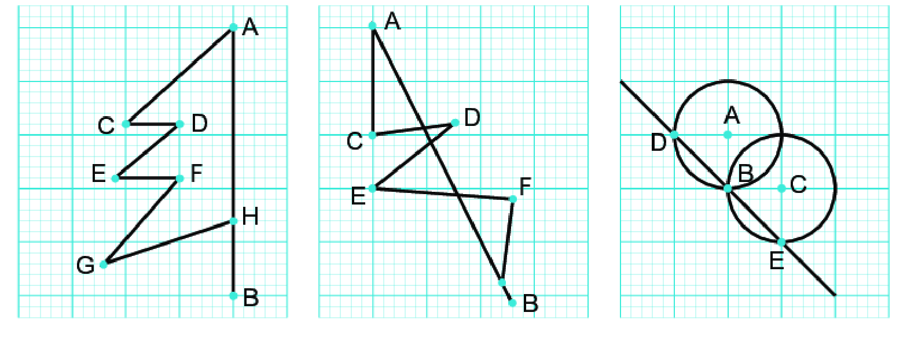

## 📷 Danh sách hình trong bài

| Mã hình | Trang PDF | Vị trí trong bài | Chú thích gốc |
| --- | :---: | --- | --- |
| H6-toan-hd-thtn-06-01 | 115 | Mở đầu | Hình T.5 |
| H6-toan-hd-thtn-06-02 | 115 | Vẽ hình thoi | Hình T.6 |
| H6-toan-hd-thtn-06-03 | 115 | Vẽ hình lục giác đều | Hình T.7 |
| H6-toan-hd-thtn-06-04 | 116 | Vẽ hình tự do | Hình T.8a |
| H6-toan-hd-thtn-06-05 | 116 | Vẽ hình tự do | Hình T.8b |
| H6-toan-hd-thtn-06-06 | 116 | Mục 1 | Hình T.9 |
| H6-toan-hd-thtn-06-07 | 116 | Mục 2 | (sách không đánh số, bảng chọn tắt Hiển thị đối tượng) |
| H6-toan-hd-thtn-06-08 | 117 | Mục 5 | (sách không đánh số, biểu tượng Hiển thị hoặc ẩn lưới và Hiển thị hoặc ẩn hệ trục tọa độ) |
| H6-toan-hd-thtn-06-09 | 117 | Mục 6 | (sách không đánh số, hộp thoại Lưu tệp .ggb và bảng chọn Hồ sơ — Lưu lại) |
| H6-toan-hd-thtn-06-10 | 117 | Mục 6 | (sách không đánh số, bảng chọn Hồ sơ — Xuất bản — Hiển thị đồ thị dạng hình) |
| H6-toan-hd-thtn-06-11 | 117 | Bài tập | (sách không đánh số, ba hình mẫu trên lưới ô vuông để vẽ đối xứng) |
