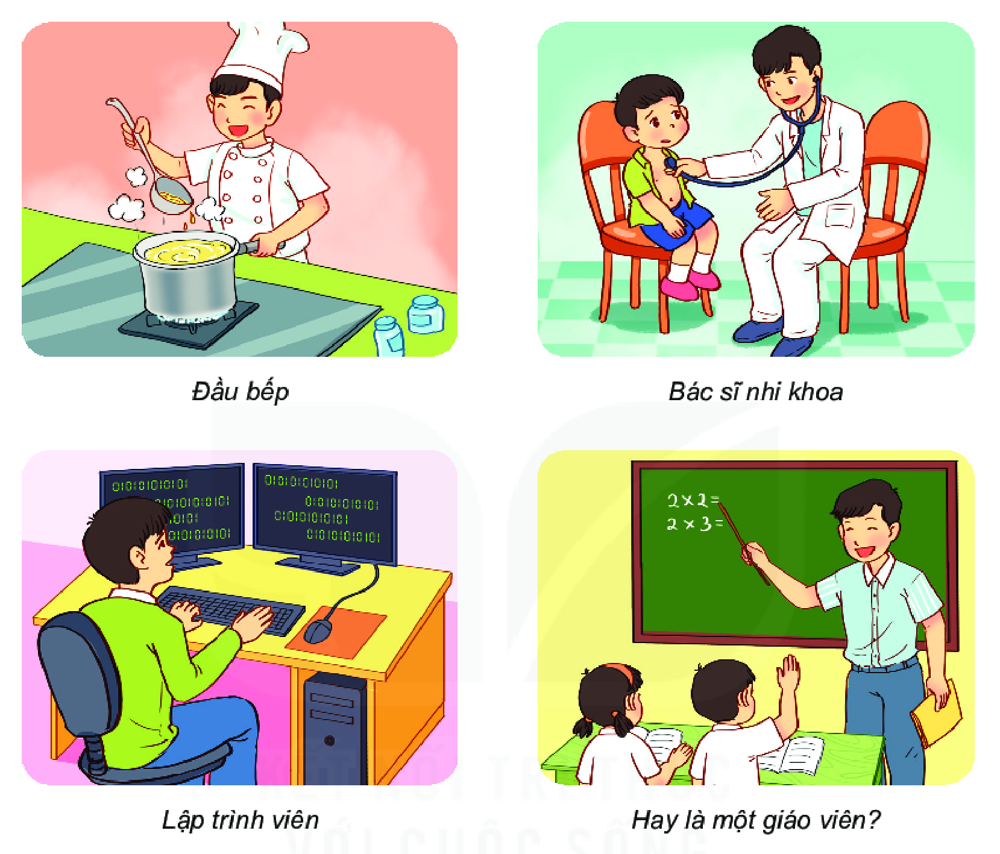
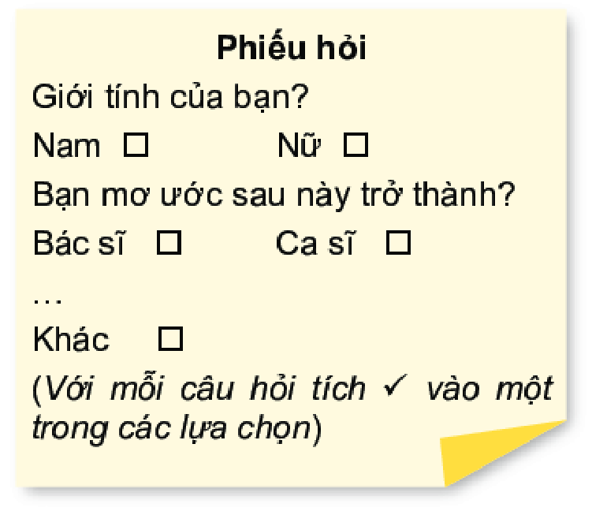
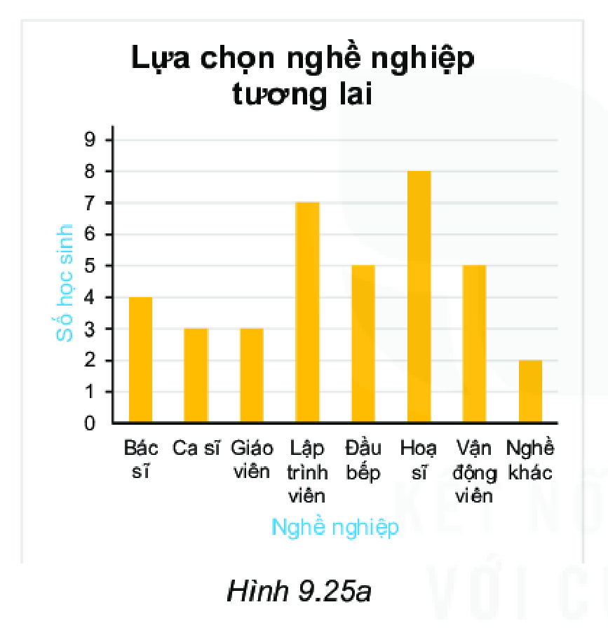
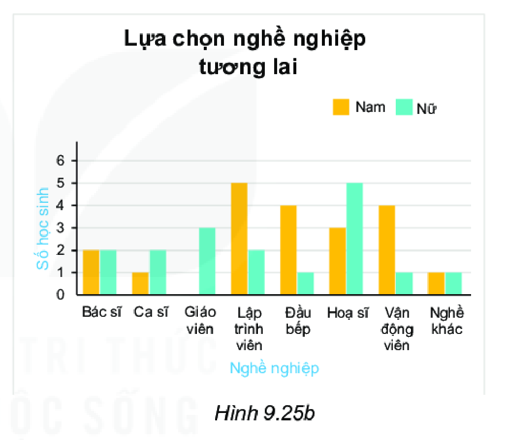

<!-- pdf:95 -->

# LUYỆN TẬP CHUNG

**Em sẽ làm gì trong tương lai?**

Em đã tưởng tượng gì về công việc của mình trong tương lai?

*Đầu bếp — Bác sĩ nhi khoa — Lập trình viên — Hay là một giáo viên?*
<!-- ocr-ok: đã đối chiếu ảnh trang PDF 95, chú thích gộp 4 hình minh hoạ -->

Em có muốn biết ước mơ về công việc trong tương lai của các bạn trong lớp không?

Hãy cùng các bạn chia sẻ những ước mơ đó nhé!

Đầu tiên, hãy chia lớp thành các nhóm. Mỗi nhóm sẽ thực hiện điều tra độc lập và chia sẻ lại dữ liệu của nhóm mình với các nhóm khác sau khi hoàn thành.

**Bước 1. THU THẬP DỮ LIỆU**

1) Mỗi nhóm lập phiếu hỏi (theo mẫu phiếu như hình bên).
<!-- ocr-ok: đã đối chiếu ảnh trang PDF 95, dòng văn bản nằm ngang hộp Phiếu hỏi -->

Em có thể lựa chọn một danh sách công việc khác để phù hợp với các bạn trong lớp mình.

2) Phát phiếu hỏi cho các bạn trong nhóm để thu thập dữ liệu.

*Phiếu hỏi:*
- Giới tính của bạn? Nam $\square$ $\quad$ Nữ $\square$
- Bạn mơ ước sau này trở thành? Bác sĩ $\square$ $\quad$ Ca sĩ $\square$ $\quad$ ... $\quad$ Khác $\square$
- *(Với mỗi câu hỏi tích $\checkmark$ vào một trong các lựa chọn)*
<!-- ocr-ok: đã đối chiếu ảnh trang PDF 95, nội dung hộp Phiếu hỏi -->

<!-- pdf:96 -->

**Bước 2. LẬP BẢNG THỐNG KÊ**

Thu phiếu hỏi trong nhóm và tổng hợp dữ liệu theo mẫu như bảng bên (*mỗi gạch ứng với một bạn*).

| Nghề nghiệp | Nam | Nữ |
| --- | :---: | :---: |
| Bác sĩ | `//` | `/` |
| Ca sĩ | | |
| ... | | |
| Khác | | |

Tổng hợp dữ liệu của các nhóm thành dữ liệu chung của cả lớp.

Lập bảng thống kê biểu diễn số lượng nam, nữ yêu thích các nghề nghiệp.

**Bước 3. VẼ BIỂU ĐỒ**

- Vẽ biểu đồ cột theo mẫu như hình 9.25a biểu diễn số học sinh theo lựa chọn nghề nghiệp.
- Vẽ biểu đồ cột kép theo mẫu hình 9.25b biểu diễn số học sinh nam, nữ theo lựa chọn nghề nghiệp.

*Hình 9.25a*

*Hình 9.25b*

**Bước 4. PHÂN TÍCH DỮ LIỆU**

Trả lời các câu hỏi sau dựa trên dữ liệu và các biểu đồ thu được.

1. Công việc nào được nhiều bạn lựa chọn nhất? Nhiều bạn nam lựa chọn nhất? Nhiều bạn nữ lựa chọn nhất?

2. Các bạn nam có xu hướng chọn những công việc nào?

3. Các bạn nữ có xu hướng chọn những công việc nào?

## 📷 Danh sách hình trong bài

| Mã hình | Trang PDF | Vị trí trong bài | Chú thích gốc |
| --- | :---: | --- | --- |
| H6-toan-ltc-c09-01-01 | 95 | Mở đầu | Đầu bếp — Bác sĩ nhi khoa — Lập trình viên — Hay là một giáo viên? |
| H6-toan-ltc-c09-01-02 | 95 | Bước 1 | (sách không đánh số, mẫu Phiếu hỏi khảo sát nghề nghiệp mơ ước) |
| H6-toan-ltc-c09-01-03 | 96 | Bước 3 | Hình 9.25a |
| H6-toan-ltc-c09-01-04 | 96 | Bước 3 | Hình 9.25b |
