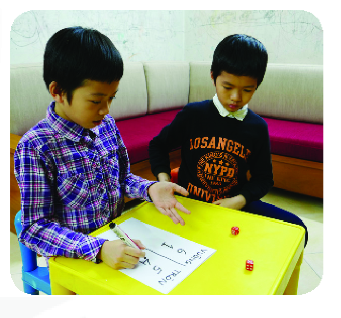

<!-- pdf:105 -->

# LUYỆN TẬP CHUNG

**Trò chơi xúc xắc**

1. Em đọc luật chơi sau và dự đoán xem trong hai người chơi, ai là người có khả năng thắng cuộc cao hơn?

*Chuẩn bị:* Hai con xúc xắc xanh và đỏ.

*Cách chơi:*
- Hai người chơi bốc thăm hoặc oẳn tù tì để chọn người chơi trước và mang tên E (Even number), người chơi sau mang tên O (Odd number).
- Hai người chơi lần lượt gieo đồng thời hai con xúc xắc. Ở mỗi lần gieo, nếu tích số chấm xuất hiện trên hai con xúc xắc là số lẻ thì O được $1$ điểm, là số chẵn thì E được $1$ điểm.
- Ai được $20$ điểm trước là người thắng.

2. Chia lớp thành từng cặp hai người chơi. Mỗi cặp chơi một ván (tức là chơi đến lúc có người thắng) và ghi lại kết quả theo mẫu bảng 9.9.

| Lần tung | Số chấm xuất hiện | Số điểm E | Số điểm O |
| :---: | :---: | :---: | :---: |
| $1$ | $1, 4$ | $1$ | $0$ |
| $2$ | $5, 3$ | $1$ | $1$ |
| $\dots$ | $\dots$ | $\dots$ | $\dots$ |
| $25$ | $2, 1$ | $20$ | $5$ |
| **Kết quả:** | $\boxtimes$ E thắng | $\square$ O thắng | |
<!-- ocr-ok: đã đối chiếu ảnh trang PDF 105, bảng 9.9 nhiều cột -->

*Bảng 9.9*

3. Tổng hợp lại kết quả chơi của cả lớp theo mẫu bảng 9.10.

| Cặp chơi số | E thắng | O thắng |
| :---: | :---: | :---: |
| $1$ | x | |
| $2$ | | x |
| $\dots$ | | |
<!-- ocr-ok: đã đối chiếu ảnh trang PDF 105, bảng 9.10 nhiều cột -->

*Bảng 9.10*

4. Từ dữ liệu bảng 9.10, hãy tính xác suất thực nghiệm của các sự kiện *E thắng*, *O thắng*. Dựa vào kết quả tính được, khả năng E hay O thắng là cao hơn? Dự đoán ban đầu của em có chính xác không?

## 📷 Danh sách hình trong bài

| Mã hình | Trang PDF | Vị trí trong bài | Chú thích gốc |
| --- | :---: | --- | --- |
| H6-toan-ltc-c09-02-01 | 105 | Mục 1 | (sách không đánh số, ảnh hai học sinh chơi trò chơi xúc xắc) |
