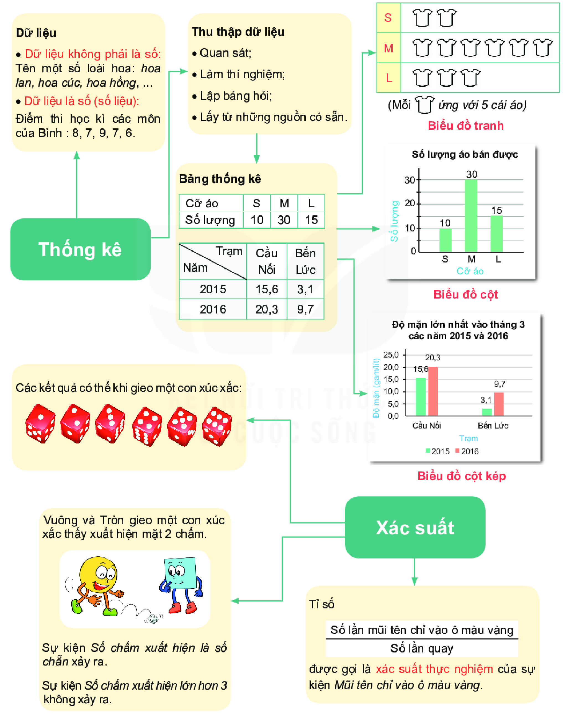

<!-- pdf:106 -->

# CHÚNG TA ĐÃ HỌC NHỮNG GÌ?

- *Thống kê:*
  - *Dữ liệu:*
    - *Dữ liệu không phải là số:* Tên một số loài hoa: *hoa lan, hoa cúc, hoa hồng, ...*
    - *Dữ liệu là số (số liệu):* Điểm thi học kì các môn của Bình : $8, 7, 9, 7, 6$.
  - *Thu thập dữ liệu:*
    - Quan sát;
    - Làm thí nghiệm;
    - Lập bảng hỏi;
    - Lấy từ những nguồn có sẵn.
  - *Bảng thống kê:*
    - Ví dụ 1: Cỡ áo S ($10$), M ($30$), L ($15$).
    - Ví dụ 2: Độ mặn tại trạm Cầu Nổi và Bến Lức năm 2015 ($15,6$; $3,1$) và năm 2016 ($20,3$; $9,7$).
  - *Biểu diễn dữ liệu bằng biểu đồ:*
    - *Biểu đồ tranh:* Cỡ áo S ($2$ hình áo), M ($6$ hình áo), L ($3$ hình áo) — *(Mỗi hình áo ứng với $5$ cái áo)*.
    - *Biểu đồ cột:* Số lượng áo bán được theo cỡ áo S ($10$), M ($30$), L ($15$).
    - *Biểu đồ cột kép:* Độ mặn lớn nhất vào tháng 3 các năm 2015 và 2016 tại Cầu Nổi và Bến Lức.
- *Xác suất:*
  - *Kết quả có thể:* Các kết quả có thể khi gieo một con xúc xắc: mặt $1, 2, 3, 4, 5, 6$ chấm.
  - *Sự kiện:* Vuông và Tròn gieo một con xúc xắc thấy xuất hiện mặt $2$ chấm.
    - Sự kiện *Số chấm xuất hiện là số chẵn* xảy ra.
    - Sự kiện *Số chấm xuất hiện lớn hơn $3$* không xảy ra.
  - *Xác suất thực nghiệm:* Tỉ số $\dfrac{\text{Số lần mũi tên chỉ vào ô màu vàng}}{\text{Số lần quay}}$ được gọi là *xác suất thực nghiệm* của sự kiện *Mũi tên chỉ vào ô màu vàng*.
<!-- ocr-ok: đã đối chiếu ảnh trang PDF 106, sơ đồ tổng kết chương nhiều nhánh -->

<!-- pdf:107 -->

## BÀI TẬP CUỐI CHƯƠNG IX

9.33. Nam muốn tìm kiếm thông tin để trả lời các câu hỏi dưới đây.

Em hãy gợi ý giúp Nam cách thu thập dữ liệu phù hợp cho mỗi câu hỏi.

a) Năm quốc gia nào có diện tích lớn nhất?

b) Có bao nhiêu bạn trong lớp có đồng hồ đeo tay?

c) Trong tuần trước, tổ nào trong lớp có nhiều lượt đi học muộn nhất?

9.34. Việt muốn tìm hiểu về đội bóng yêu thích của một số bạn nam. Em hãy giúp Việt:

a) Lập phiếu hỏi để thu thập dữ liệu;

b) Thu thập trong phạm vi lớp em và ghi lại kết quả dưới dạng bảng.

Từ kết quả thu được em có kết luận gì?

9.35. Một túi đựng $2$ quả bóng màu xanh, $4$ quả bóng màu vàng và $1$ quả bóng màu đỏ. Nam lấy một quả bóng mà không nhìn vào túi.

a) Quả bóng Nam lấy ra có thể có màu gì?

b) Em hãy lấy một quả bóng từ túi đó $20$ lần, sau mỗi lần ghi lại xem quả bóng lấy được có màu gì rồi trả bóng lại túi trước khi lấy lần sau. Hoàn thiện bảng thống kê sau:

| Màu bóng | Xanh | Vàng | Đỏ |
| --- | :---: | :---: | :---: |
| Số lần | $?$ | $?$ | $?$ |

c) Vẽ biểu đồ cột biểu diễn bảng thống kê trên;

d) Tính xác suất thực nghiệm của các sự kiện *Quả bóng lấy ra có màu* (1) *xanh;* (2) *vàng;* (3) *đỏ.*

9.36. Bình khảo sát môn thể thao yêu thích của các bạn trong lớp thu được kết quả như trong bảng thống kê 9.11.

a) Vẽ biểu đồ cột kép biểu diễn bảng thống kê này;

b) Môn thể thao nào được các bạn nam yêu thích nhất? Môn thể thao nào được các bạn nữ yêu thích nhất?

| | Nữ | Nam |
| --- | :---: | :---: |
| Bóng đá | $3$ | $6$ |
| Cầu lông | $5$ | $5$ |
| Bơi lội | $7$ | $2$ |
| Bóng rổ | $1$ | $3$ |
| Khác | $0$ | $2$ |
<!-- ocr-ok: đã đối chiếu ảnh trang PDF 107, bảng 9.11 trong bố cục hai cột -->

*Bảng 9.11*

9.37. Minh bỏ $7$ viên bi đen và $3$ viên bi trắng vào một cái túi. Mỗi lần Minh lấy ra ngẫu nhiên một viên bi từ túi, xem viên bi đó có màu gì rồi lại bỏ viên bi đó vào túi. Minh đã thực hiện $100$ lần và thấy có $58$ lần lấy được bi đen.

Tính xác suất thực nghiệm của sự kiện *Minh lấy được viên bi màu đen*.

9.38. Trong hộp có $5$ phần thưởng gồm $2$ chiếc bút chì và $3$ chiếc bút bi. Quỳnh chọn ngẫu nhiên hai phần thưởng trong hộp. Em hãy liệt kê các kết quả có thể.

## 📷 Danh sách hình trong bài

| Mã hình | Trang PDF | Vị trí trong bài | Chú thích gốc |
| --- | :---: | --- | --- |
| H6-toan-ot-c09-01 | 106 | Tổng kết chương | (sách không đánh số, sơ đồ tổng kết Chương IX — Chúng ta đã học những gì?) |
| H6-toan-ot-c09-02 | 107 | Bài tập 9.35 | (sách không đánh số, túi đựng 2 quả bóng xanh, 4 quả bóng vàng và 1 quả bóng đỏ) |
