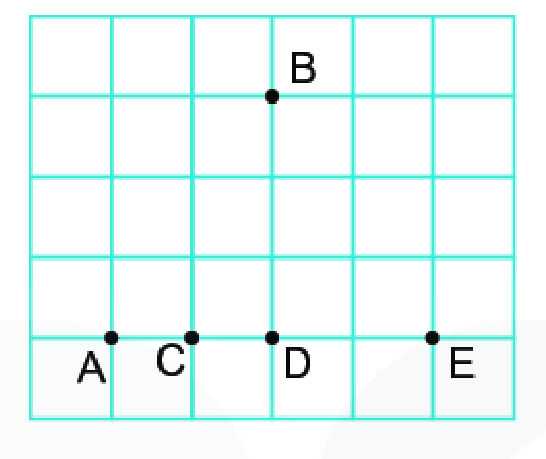
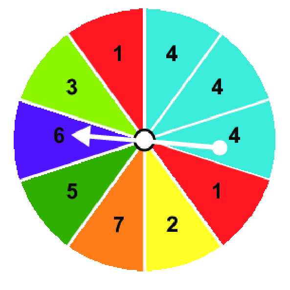

<!-- pdf:118 -->

# BÀI TẬP ÔN TẬP CUỐI NĂM

## SỐ VÀ ĐẠI SỐ

1. Số tự nhiên $n$ có sáu chữ số phân biệt, hai chữ số cạnh nhau luôn là hai số tự nhiên liên tiếp. Hãy tìm số $n$, biết rằng trong sáu chữ số của nó, chữ số $4$ có giá trị bằng $4\,000$. Em tìm được mấy số như vậy?

2. Hai bạn An và Bình mua một số sách. Khi trả tiền, Bình nhận thấy An đưa cho người bán hàng $2$ tờ $100$ nghìn đồng, $4$ tờ $10$ nghìn đồng và $6$ tờ $1$ nghìn đồng. Hãy biểu diễn số tiền sách (đơn vị nghìn đồng) mà An đã trả dưới dạng tổng giá trị các chữ số của nó rồi so sánh với số tờ các loại tiền mà An dùng để trả và nêu nhận xét.

3. Tính giá trị của các biểu thức sau rồi phân tích kết quả ra thừa số nguyên tố:

a) $160 - (2^3 \cdot 5^2 - 6 \cdot 25)$;

b) $37 \cdot 3 + 225 : 15^2$;

c) $5\,871 : 103 - 64 : 2^5$;

d) $(1 + 2 + 3 + 4 + 5 + 6 + 7 + 8) \cdot 5^2 - 850 : 2$.

4. Một phân xưởng có $30$ công nhân. Dự kiến mỗi giờ mỗi công nhân làm được $100$ sản phẩm. Khi đó phân xưởng sẽ hoàn thành một đơn hàng trong $24$ giờ. Hãy viết biểu thức số biểu thị (không cần tính giá trị của biểu thức):

a) Tổng số sản phẩm mà phân xưởng phải hoàn thành theo đơn hàng.

b) Số sản phẩm mà mỗi công nhân phải làm để hoàn thành đơn hàng.

5. Khoảng $3\,000$ người tham gia một lễ kỉ niệm. Nếu họ xếp hàng $7$, hàng $8$, hàng $9$ hay hàng $10$ thì đều còn dư ra $6$ người. Hỏi chính xác có bao nhiêu người tham gia?

6. Tính giá trị của các biểu thức sau (tính hợp lí, nếu có thể):

a) $\dfrac{-3}{7} \cdot \dfrac{2}{5} + \dfrac{2}{5} \cdot \left(-\dfrac{5}{14}\right) - \dfrac{18}{35}$;

b) $\left(\dfrac{2}{3} - \dfrac{5}{11} + \dfrac{1}{4}\right) : \left(1 + \dfrac{5}{12} - \dfrac{7}{11}\right)$;

c) $(13,6 - 37,8) \cdot (-3,2)$;

d) $(-25,4) \cdot (18,5 + 43,6 - 16,8) : 12,7$.

7. Tính giá trị của các biểu thức sau (tính hợp lí, nếu có thể):

a) $\left(\dfrac{7}{3} + 3,5\right) : \left(-\dfrac{25}{6} + \dfrac{22}{7}\right) + 0,5$;

b) $\dfrac{38}{7} + (-3,25) - \dfrac{17}{7} + 4,55$.

8. Tìm $x$, biết:

a) $x : 1\dfrac{2}{7} = -3,5$;

b) $0,4 \cdot x - \dfrac{1}{5} \cdot x = \dfrac{3}{4}$.

<!-- pdf:119 -->

9. Bốn thửa ruộng thu hoạch được tất cả $10,5$ tấn thóc. Số thóc thu hoạch ở ba thửa ruộng đầu lần lượt bằng $0,2$; $15\%$ và $\dfrac{2}{7}$ tổng số thóc thu hoạch được ở cả năm thửa ruộng. Tính số thóc thu hoạch được ở thửa ruộng thứ tư.
<!-- Lưu ý nguyên văn SGK trang in 118 (PDF 119) in là "cả năm thửa ruộng" -->

10. Một người bán một tấm vải. Ngày thứ nhất, người đó bán được $25\%$ tấm vải và $15\text{ m}$; ngày thứ hai bán được $\dfrac{1}{3}$ số vải còn lại sau ngày thứ nhất và còn lại $28\text{ m}$. Hỏi tấm vải đó dài bao nhiêu mét?

## HÌNH HỌC VÀ ĐO LƯỜNG
<!-- ocr-ok: đã đối chiếu ảnh trang PDF 119, tiêu đề in hoa màu xanh nhạt -->

11. Có tất cả bao nhiêu đường thẳng đi qua ít nhất $2$ trong $5$ điểm dưới đây? Em hãy kể tên các đường thẳng đó

12. Một mảnh đất hình chữ nhật có kích thước $50\text{ m} \times 30\text{ m}$. Trên mảnh đất đó, người ta làm một lối đi xung quanh rộng $2\text{ m}$, diện tích còn lại dùng để trồng rau. Hỏi diện tích trồng rau là bao nhiêu mét vuông?

13.

a) Em hãy vẽ một tam giác tuỳ ý rồi dùng thước đo góc để đo các góc của tam giác đó.

b) Tính tổng các số đo của ba góc và so sánh với kết quả của các bạn khác.

**Chú ý:** Nếu vẽ tam giác quá nhỏ thì sẽ khó đo góc.

## MỘT SỐ YẾU TỐ THỐNG KÊ VÀ XÁC SUẤT
<!-- ocr-ok: đã đối chiếu ảnh trang PDF 119, tiêu đề in hoa màu xanh nhạt -->

14. Hai người cùng chơi một trò chơi như sau: Mỗi người chơi lần lượt quay một tấm bìa có gắn một mũi tên ở tâm (như hình vẽ bên).

Nếu mũi tên chỉ vào số chẵn thì người chơi đầu thắng, nếu mũi tên chỉ vào số lẻ thì người chơi sau thắng.

a) Em và bạn quay miếng bìa $20$ lần. Ghi lại xem trong $20$ lần chơi có bao nhiêu lần em thắng, bao nhiêu lần bạn em thắng;

b) Tính xác suất thực nghiệm của các sự kiện *Em thắng*, *Bạn em thắng*;

c) Vẽ biểu đồ cột biểu diễn số lần thắng của mỗi người.

## 📷 Danh sách hình trong bài

| Mã hình | Trang PDF | Vị trí trong bài | Chú thích gốc |
| --- | :---: | --- | --- |
| H6-toan-on-tap-cuoi-nam-01 | 119 | Hình học và đo lường, Bài 11 | (sách không đánh số, năm điểm A, B, C, D, E trên lưới ô vuông) |
| H6-toan-on-tap-cuoi-nam-02 | 119 | Một số yếu tố thống kê và xác suất, Bài 14 | (sách không đánh số, tấm bìa quay chia 10 hình quạt ghi số) |
