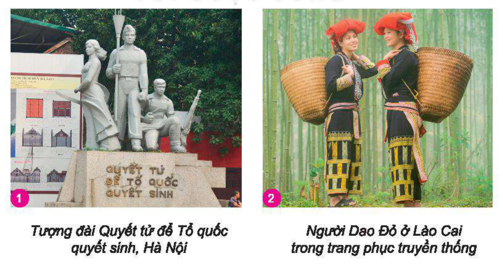
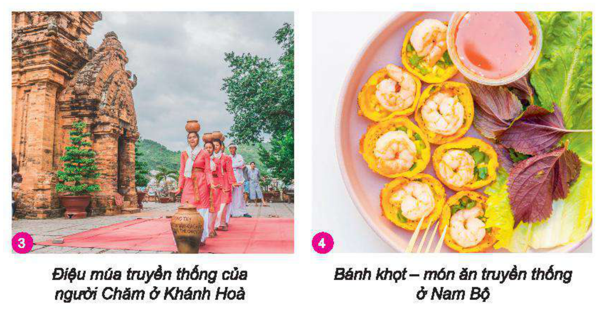

<!-- pdf:6 -->

# BÀI 1: TỰ HÀO VỀ TRUYỀN THỐNG QUÊ HƯƠNG

## 🎯 Mục tiêu:

- Nêu được một số truyền thống văn hoá, truyền thống yêu nước, chống giặc ngoại xâm của quê hương.
- Thực hiện được những việc làm phù hợp để giữ gìn, phát huy truyền thống của quê hương.
- Phê phán được những việc làm trái ngược với truyền thống tốt đẹp của quê hương.

## 🔴 Mở đầu

**Truyền thống quê hương** là những giá trị văn hoá tốt đẹp của quê hương được truyền từ đời này qua đời khác. Tự hào về truyền thống quê hương chính là tự hào về nguồn gốc của mình, là nền tảng để xây dựng giá trị cốt lõi và hình thành sự tự tin cho mỗi người. Bài học này giúp em tìm hiểu về truyền thống văn hoá, truyền thống yêu nước, chống giặc ngoại xâm của quê hương; biết giữ gìn và phát huy những nét đẹp của truyền thống và tự hào về quê hương, nguồn cội của mình.

Em hãy quan sát các hình ảnh dưới đây và trả lời câu hỏi:

- **Hình 1:** Tượng đài Quyết tử để Tổ quốc quyết sinh, Hà Nội
- **Hình 2:** Người Dao Đỏ ở Lào Cai trong trang phục truyền thống
<!-- ocr-ok: đã đối chiếu ảnh trang gốc 6, chú thích dưới Hình 1 và Hình 2 -->

<!-- pdf:7 -->

- **Hình 3:** Điệu múa truyền thống của người Chăm ở Khánh Hoà
- **Hình 4:** Bánh khọt – món ăn truyền thống ở Nam Bộ

> ❓ a) Theo em, các hình ảnh trên nói về những truyền thống nào của quê hương?
>
> b) Hãy chia sẻ hiểu biết của em về các truyền thống quê hương qua những bức ảnh trên.

## KHÁM PHÁ

## 1. Một số truyền thống của quê hương

Em hãy đọc các thông tin dưới đây và trả lời câu hỏi:

> **Thông tin 1:** Hằng năm, trong không khí tưng bừng của những ngày đầu xuân, các liền anh, liền chị quan họ vùng Kinh Bắc lại cùng nhau về thị trấn Lim, huyện Tiên Du, tỉnh Bắc Ninh để trẩy hội. Đông đảo người dân và du khách thập phương cũng tham gia. Các liền chị mặc những chiếc áo tứ thân mớ ba mớ bảy sặc sỡ duyên dáng, thiết tha câu hát quan họ trên thuyền rồng cùng các liền anh. Ngoài hát quan họ, hội Lim còn có thi đấu vật cổ truyền, chơi cờ tướng, têm trầu cánh phượng, hát giao duyên,...
>
> *(Theo Đến hội Lim nghe quan họ, báo Nhân Dân, số ra ngày 28 – 2 – 2018)*

<!-- pdf:8 -->

> **Thông tin 2:** Nhân kỉ niệm 60 năm ngày Bến Tre Đồng khởi và 100 năm ngày sinh Anh hùng – nữ tướng Nguyễn Thị Định, Hội Liên hiệp Phụ nữ Việt Nam cùng Uỷ ban nhân dân tỉnh Bến Tre tổ chức họp mặt “Đội quân tóc dài”. Buổi họp mặt là dịp để các mẹ, các dì giao lưu và ôn lại truyền thống đấu tranh bất khuất của lực lượng nữ trong kháng chiến chống Mỹ cứu nước. “Đội quân tóc dài”, Bộ đội Thu Hà, thanh niên xung phong và đông đảo phụ nữ Nam Bộ đã đóng góp không nhỏ cho sự nghiệp giành độc lập và thống nhất đất nước. Đây là buổi sinh hoạt mang ý nghĩa giáo dục cho các thế hệ sau phát huy mạnh mẽ truyền thống yêu nước, cần cù, sáng tạo, tự lực, tự cường của cha ông.
>
> *(Theo Thu Huyền, Lễ kỉ niệm 60 năm ngày Bến Tre Đồng khởi, báo Đồng Khởi, số ra ngày 16 – 1 – 2020)*

> ❓ a) Những thông tin trên giới thiệu truyền thống nào của tỉnh Bắc Ninh và Bến Tre? Em có suy nghĩ gì về những truyền thống đó?
>
> b) Hãy kể tên những truyền thống ở quê hương em và chia sẻ cảm nhận của em về những truyền thống đó.
>
> c) Truyền thống của quê hương có ý nghĩa như thế nào đối với mỗi người?

## 2. Giữ gìn và phát huy truyền thống của quê hương

Em hãy đọc các trường hợp dưới đây và trả lời câu hỏi:

> **Trường hợp 1:** Sinh ra và lớn lên ở Hà Nội, Thanh thường được nghe ông kể về thời kháng chiến chống thực dân, đế quốc của người dân Thủ đô. Thanh thấy rất tự hào và rủ bạn bè cùng lập nhóm tìm hiểu lịch sử chống giặc ngoại xâm của các thế hệ trước. Nhóm bạn đã sưu tầm các hình ảnh về trận Điện Biên Phủ trên không, tượng đài Quyết tử để Tổ quốc quyết sinh,... Các bạn còn phỏng vấn những nhân chứng lịch sử, ghi lại những câu chuyện cảm động và chia sẻ lên cổng thông tin điện tử của trường cho bạn bè cùng biết.

> **Trường hợp 2:** Hoà là người dân tộc Dao. Từ nhỏ, Hoà đã yêu thích những bộ trang phục truyền thống nhiều màu sắc, được thêu cầu kì của dân tộc mình và luôn ao ước có thể tự mình làm ra những bộ trang phục đẹp như vậy. Từ khi biết thông tin về câu lạc bộ may, thêu trang phục truyền thống của hội phụ nữ xã, Hoà rủ các bạn trong lớp cùng tham gia. Cuối tuần, bạn thường đến câu lạc bộ để học hỏi kinh nghiệm và tập thêu cùng các cô, các chị. Hoà dự định sẽ tự may thêu cho mình bộ trang phục truyền thống của người Dao và mặc trong lễ tốt nghiệp Trung học cơ sở.

<!-- pdf:9 -->

> **Trường hợp 3:** Hằng năm, lễ hội chùa Hương ở huyện Mỹ Đức (Hà Nội) đón rất nhiều du khách đến tham quan, dâng hương. Nơi đây còn tồn tại một số hành vi làm mất đi vẻ đẹp truyền thống của lễ hội như: vứt rác bừa bãi, đốt vàng mã gây mất vệ sinh môi trường,... Bình không đồng tình với những hành động trên và muốn góp phần giữ gìn nét đẹp văn hoá của lễ hội truyền thống quê hương mình. Bạn cùng các anh chị thanh niên tình nguyện đã nhắc nhở du khách không vứt rác bừa bãi ở khu di tích, mỗi người chỉ thắp một nén hương và báo với công an khi thấy hiện tượng tiêu cực.

> ❓ a) Trong những trường hợp trên, các bạn đã có những hành động gì để giữ gìn và phát huy truyền thống của quê hương?
>
> b) Theo em, học sinh cần làm gì để giữ gìn và phát huy truyền thống tốt đẹp của quê hương?

> 1. Mỗi vùng miền, địa phương trên đất nước Việt Nam đều có những truyền thống tốt đẹp về ẩm thực, lễ hội, nghệ thuật, trang phục, tinh thần yêu nước, chống giặc ngoại xâm,... **Tự hào về truyền thống của quê hương** là sự tự tin, hãnh diện về những giá trị mà người dân ở quê hương đã sáng tạo ra và được lưu truyền từ thế hệ này sang thế hệ khác.
>
> 2. Chúng ta cần tìm hiểu và tự hào về truyền thống tốt đẹp của quê hương, từ đó có những việc làm phù hợp để giữ gìn và phát huy truyền thống đó như: tôn trọng sự đa dạng văn hoá vùng miền; kính trọng và biết ơn những người có công với quê hương, đất nước; tham gia các hoạt động đền ơn đáp nghĩa; tham gia các hoạt động sinh hoạt văn hoá của quê hương;... <!-- term: Giữ gìn và phát huy truyền thống của quê hương -->
>
> 3. Cần phê phán, ngăn chặn những việc làm gây tổn hại đến những truyền thống tốt đẹp của quê hương.

## ✏️ Luyện tập

1. Em tán thành hay không tán thành với những quan điểm dưới đây? Vì sao?

a) Tự hào về truyền thống quê hương cũng chính là tự hào về nguồn gốc, dòng họ, tổ tiên của mình.

b) Nghề thủ công truyền thống không còn là niềm tự hào của quê hương vì không phù hợp với cuộc sống hiện đại.

c) Truyện dân gian và những làn điệu dân ca địa phương là một phần của truyền thống văn hoá quê hương.

<!-- pdf:10 -->

2. Em hãy liệt kê những việc nên làm, những việc không nên làm để giữ gìn và phát huy truyền thống tốt đẹp của quê hương theo gợi ý dưới đây:

| Truyền thống | Việc nên làm | Việc không nên làm |
|---|---|---|
| ? | ? | ? |

3. Em đồng tình hay không đồng tình với những hành vi của các bạn dưới đây? Vì sao?

a) K cùng các bạn trong lớp lập nhóm tìm hiểu về truyền thống yêu nước, chống giặc ngoại xâm của thành phố nơi mình sinh sống.

b) Trong lễ hội đầu xuân, M theo một số anh chị đi chèo kéo khách mua đồ lưu niệm.

c) A vận động các bạn trong lớp tham gia hội thi “Tự hào truyền thống quê hương” do trường tổ chức.

4. Xử lí tình huống:

a) Phát huy truyền thống “Uống nước nhớ nguồn”, trường của H tổ chức lễ dâng hương tại khu tưởng niệm các anh hùng liệt sĩ. Sau lễ dâng hương, các bạn tập trung nghe kể về những tấm gương hi sinh anh dũng chống giặc ngoại xâm, bảo vệ Tổ quốc. Trong khi các bạn trật tự ngồi nghe thì H lại đùa nghịch, trêu chọc khiến các bạn xung quanh mất tập trung.

*Em có đồng tình với hành động của H không? Nếu là bạn cùng lớp với H, em sẽ khuyên H điều gì?*

b) Chào mừng ngày Quốc tế Phụ nữ 8 – 3, trường của T tổ chức cuộc thi nấu ăn giữa các chi đội. Khi cả lớp thảo luận sẽ chọn nấu món gì, T đề xuất chọn các món ăn truyền thống của quê hương xứ Huế như bún bò, bánh bèo, nem lụi,... nhưng một số bạn lại cho rằng những món ăn bình dân như vậy không phù hợp để dự thi mà nên chọn những món ăn nước ngoài sẽ mới mẻ và hợp thời hơn.

*Nếu là T, em sẽ thuyết phục các bạn trong lớp như thế nào?*

## 🚀 Vận dụng

1. Em hãy tìm hiểu về một truyền thống của quê hương và viết bài giới thiệu truyền thống đó cho mọi người.
2. Em hãy cùng các bạn trong nhóm tập một làn điệu dân ca, điệu múa truyền thống hoặc một bài hát ca ngợi truyền thống quê hương để biểu diễn trước lớp.

## 📷 Danh sách hình trong bài

| Mã hình | Trang PDF | Trang sách | Chú thích |
|---|---|---|---|
| H7-giao_duc_cong_dan-b01-01 | 6 | 5 | Hình 1–2 Mở đầu: Tượng đài Quyết tử để Tổ quốc quyết sinh, Hà Nội; Người Dao Đỏ ở Lào Cai trong trang phục truyền thống |
| H7-giao_duc_cong_dan-b01-02 | 7 | 6 | Hình 3–4 Mở đầu: Điệu múa truyền thống của người Chăm ở Khánh Hoà; Bánh khọt – món ăn truyền thống ở Nam Bộ |
