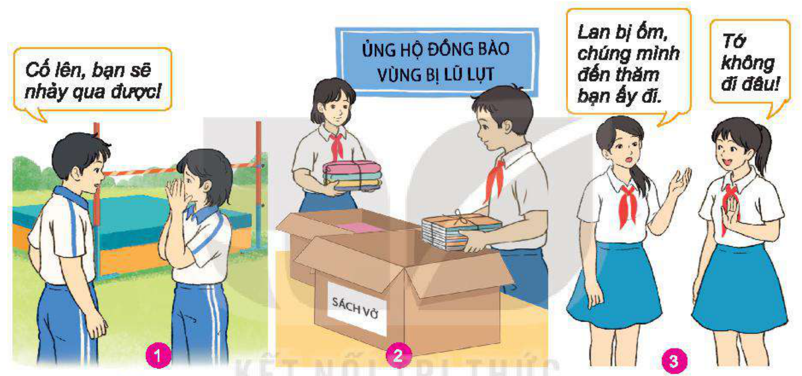

<!-- pdf:11 -->

# BÀI 2: QUAN TÂM, CẢM THÔNG VÀ CHIA SẺ

## 🎯 Mục tiêu:

- Nêu được những biểu hiện của sự quan tâm, cảm thông và chia sẻ với người khác.
- Giải thích được vì sao mọi người phải quan tâm, cảm thông và chia sẻ với nhau.
- Thường xuyên có những lời nói, việc làm thể hiện sự quan tâm, cảm thông và chia sẻ với mọi người.
- Khích lệ, động viên bạn bè quan tâm, cảm thông và chia sẻ với người khác; phê phán thói ích kỉ, thờ ơ trước khó khăn, mất mát của người khác.

## 🔴 Mở đầu

Trong cuộc sống, mỗi người đều cần sự quan tâm, cảm thông và chia sẻ. Những lời nói động viên, cử chỉ ân cần, sự giúp đỡ chân thành, tấm lòng bao dung,... sẽ làm cho cuộc sống tốt đẹp, ấm áp hơn. Bài học này sẽ giúp em thấu hiểu hơn ý nghĩa của sự quan tâm, cảm thông và chia sẻ, từ đó góp phần lan toả những giá trị tốt đẹp của lòng nhân ái tới cộng đồng.

Em cùng các bạn tham gia trò chơi “Tiếp sức”: Các thành viên của mỗi đội lần lượt nêu một câu thành ngữ, tục ngữ về quan tâm, cảm thông và chia sẻ. Đội nào nêu được nhiều câu đúng hơn sẽ thắng.

## KHÁM PHÁ

## 1. Biểu hiện của quan tâm, cảm thông và chia sẻ

Em hãy đọc câu chuyện, quan sát các bức tranh dưới đây và trả lời câu hỏi:

> CHIẾC BĂNG GẠC CHO TRÁI TIM TAN VỠ
>
> – Mẹ, mẹ đang làm gì thế ạ? – Cô bé Su-ri chỉ mới 6 tuổi hỏi mẹ.
>
> – Mẹ đang nấu món thịt hầm cho cô Xmit hàng xóm.
>
> – Vì sao ạ? – Su-ri thắc mắc.
>
> – Vì cô Xmit đang rất buồn, con ạ! Con gái cô ấy vừa qua đời và trái tim cô ấy đang tan nát. Chúng ta sẽ chăm sóc cô ấy một thời gian – bà mẹ dịu dàng trả lời... Cô Xmit sẽ không bao giờ còn có thể nói chuyện, ôm hôn con gái cô ấy hoặc làm bất cứ điều gì thú vị như mẹ và con có thể làm cùng nhau. Con là một cô bé thông minh, Su-ri. Có thể con sẽ nghĩ ra cách nào đó để giúp đỡ cô ấy.
>
> ... Vài phút sau, Su-ri đã ở trước cửa nhà cô Xmit, rụt rè bấm chuông. Mất một lúc lâu cô Xmit mới ra mở cửa:

<!-- pdf:12 -->

> – Chào Su-ri, cháu cần gì?...
>
> – Mẹ cháu nói con gái của cô vừa qua đời và cô đang rất buồn vì trái tim cô bị thương – Su-ri e dè xoè tay ra. Trong lòng bàn tay của cô bé là một chiếc băng gạc cá nhân.
>
> – Cái này để băng cho trái tim của cô ạ! – Như để chắc chắn, Su-ri nói thêm – Cháu đã dùng vài lần và nó rất tốt.
>
> Cô Xmit kinh ngạc, cố gắng không bật khóc. Cô xúc động quỳ xuống ôm chặt Su-ri, nghẹn ngào qua làn nước mắt: “Cảm ơn, cháu yêu quý, nó sẽ giúp cô rất nhiều!”.
>
> *(Theo Hạt giống tâm hồn, Tuyển chọn những câu chuyện hay nhất, NXB Tổng hợp Thành phố Hồ Chí Minh, 2006)*

> - **Tranh 1:** “Cố lên, bạn sẽ nhảy qua được!”
> - **Tranh 2:** “ỦNG HỘ ĐỒNG BÀO VÙNG BỊ LŨ LỤT”, “SÁCH VỞ”
> - **Tranh 3:** “Lan bị ốm, chúng mình đến thăm bạn ấy đi.” – “Tớ không đi đâu!”
<!-- ocr-ok: đã đối chiếu ảnh trang gốc 12, lời thoại và chữ trong Tranh 1–3 -->

> ❓ a) Nêu các biểu hiện của sự quan tâm, cảm thông và chia sẻ trong câu chuyện “Chiếc băng gạc cho trái tim tan vỡ” và những bức tranh trên.
>
> b) Trong các bức tranh trên, hành vi nào chưa thể hiện sự quan tâm, cảm thông và chia sẻ? Em có suy nghĩ gì về hành vi đó?
>
> c) Em hãy kể thêm một số biểu hiện khác của sự quan tâm, cảm thông và chia sẻ.

## 2. Ý nghĩa của quan tâm, cảm thông và chia sẻ

Em hãy đọc các trường hợp dưới đây và trả lời câu hỏi:
<!-- ocr-ok: đã đối chiếu ảnh trang gốc 12, dòng dẫn mục 2 bị chữ chìm nền làm nhiễu OCR -->

> **Trường hợp 1:** Những ngày nghỉ cuối tuần, mọi người trong gia đình Mai thường cùng nhau dọn vệ sinh nhà cửa, nấu ăn, đi thăm ông bà và dạo chơi cùng nhau. Chị em Mai kể cho bố mẹ nghe chuyện ở trường, ở lớp. Mai cảm thấy thật vui, hạnh phúc và ấm áp trong tình yêu thương, sự quan tâm, chia sẻ của gia đình.

<!-- pdf:13 -->

> **Trường hợp 2:** Chuyển về trường học mới, An cảm thấy rất hồi hộp, lo lắng. Nhưng cảm giác đó qua đi rất nhanh khi cô giáo ân cần nắm tay, giới thiệu An với cả lớp. Các bạn hát vang bài “Chào người bạn mới đến”. Bạn cùng bàn cười thân thiện, cho An mượn bút và nói sẽ về cùng đường với An.

> **Trường hợp 3:** Nhờ phong trào “Áo ấm tặng bạn”, Thanh nhận được một chiếc áo khoác cũ nhưng dày dặn. Trong túi áo có mẩu giấy nhỏ với lời đề tặng dễ thương bằng nét bút mềm mại: “Chúc bạn có một mùa đông ấm áp!”. Dù ngoài trời lạnh giá, chưa mặc chiếc áo khoác ấy nhưng Thanh thấy lòng mình thật ấm.

> ❓ a) Trong các trường hợp trên, sự quan tâm, cảm thông và chia sẻ đã mang lại điều gì?
>
> b) Theo em, vì sao phải quan tâm, cảm thông và chia sẻ?

> 1. **Sự quan tâm, cảm thông và chia sẻ** là sự chăm sóc bằng tình cảm chân thành; đặt mình vào vị trí của người khác, nhận biết và thấu hiểu cảm xúc của họ; san sẻ, giúp đỡ, trao gửi những điều tốt đẹp cho nhau.
>
> 2. Chúng ta cần có những lời nói, việc làm thể hiện sự quan tâm, cảm thông và chia sẻ với người khác như:
> - Lắng nghe, động viên, an ủi, nhắn tin, gọi điện hỏi thăm;
> - Chia sẻ về vật chất và tinh thần với những người gặp khó khăn;
> - Khích lệ, động viên bạn bè quan tâm, cảm thông và chia sẻ với người khác; phê phán thói ích kỉ, thờ ơ trước khó khăn, mất mát của người khác. <!-- term: Biểu hiện của sự quan tâm, cảm thông và chia sẻ -->
>
> 3. Nhận được sự quan tâm, cảm thông và chia sẻ, mỗi người sẽ có động lực vượt qua khó khăn, thử thách. Người biết quan tâm, cảm thông và chia sẻ sẽ nhận được sự yêu quý, tôn trọng của mọi người. Nhờ đó, cuộc sống sẽ tràn ngập tình yêu thương, niềm vui và hạnh phúc; các mối quan hệ sẽ trở nên tốt đẹp và bền vững hơn. <!-- term: Ý nghĩa của sự quan tâm, cảm thông và chia sẻ -->

## ✏️ Luyện tập

1. Em tán thành hay không tán thành với ý kiến nào dưới đây? Vì sao?

a) Chỉ người nào gặp khó khăn mới cần tới sự quan tâm, cảm thông và chia sẻ.

b) Khi ai đó có lời đề nghị thì mình mới cần quan tâm, cảm thông và chia sẻ.

c) Để thể hiện sự quan tâm, cảm thông và chia sẻ thì chỉ cần tặng quà là đủ.

d) Sự quan tâm, cảm thông và chia sẻ giúp mọi người cảm thấy vui vẻ, hạnh phúc và yêu thương nhau hơn.

<!-- pdf:14 -->

2. Em hãy nhận xét hành vi của các bạn dưới đây:

a) Mặc dù rất yêu quý ông bà nhưng H ít khi gọi điện hỏi thăm vì cho rằng như thế là không cần thiết.

b) Thấy hoàn cảnh bác hàng xóm khó khăn, M xin mẹ rau và gạo mang sang biếu bác.

c) Thỉnh thoảng, K lại mượn V mấy thứ lặt vặt như: cục tẩy, bút chì,... Thấy vậy, C ngạc nhiên hỏi: “Cậu cũng có những thứ đó, sao phải mượn của V làm gì?”. K đáp: “Nhà V ở cạnh nhà mình. V rất mặc cảm về hoàn cảnh khó khăn của bản thân, nên tớ làm như vậy để bạn ấy có nhờ gì tớ thì cũng sẽ thấy thoải mái hơn”.

d) Trên đường đi học về, thấy một bạn bị bắt nạt, T định dừng lại can ngăn nhưng A kéo tay bảo: “Thôi...”.

3. Em sẽ làm gì nếu ở trong các tình huống dưới đây?

a) Khi đi học cùng bạn, em thấy một em bé đang khóc vì bị lạc. Bạn em nói: “Sẽ có người khác giúp em ấy, còn mình phải đến trường cho kịp giờ học”.

b) Hoàn cảnh gia đình của H rất khó khăn do bố mẹ kinh doanh thua lỗ. H tâm sự với em và muốn em không nói với ai.

c) Mặc dù rất muốn giúp đỡ các bạn có hoàn cảnh khó khăn nhưng em không có điều kiện vật chất.

4. Trong cuộc sống, em đã thể hiện sự quan tâm, cảm thông và chia sẻ như thế nào? Hãy chia sẻ theo gợi ý dưới đây:

| Đối tượng / Biểu hiện | Lời nói | Việc làm |
|---|---|---|
| Người trong gia đình | ? | ? |
| Bạn bè | ? | ? |
| Thầy, cô giáo | ? | ? |
| Người khác | ? | ? |
<!-- ocr-ok: đã đối chiếu ảnh trang gốc 14, bảng gợi ý có ô kẻ chéo -->

## 🚀 Vận dụng

1. Sưu tầm và kể về một tấm gương biết quan tâm, cảm thông và chia sẻ với người khác mà em biết. Em học tập được điều gì từ tấm gương đó?
2. Em hãy tìm hiểu về một bạn có hoàn cảnh khó khăn và lập kế hoạch giúp đỡ bạn đó.

## 📷 Danh sách hình trong bài

| Mã hình | Trang PDF | Trang sách | Chú thích |
|---|---|---|---|
| H7-giao_duc_cong_dan-b02-01 | 12 | 11 | Tranh 1–3 mục 1: Biểu hiện của quan tâm, cảm thông và chia sẻ |
