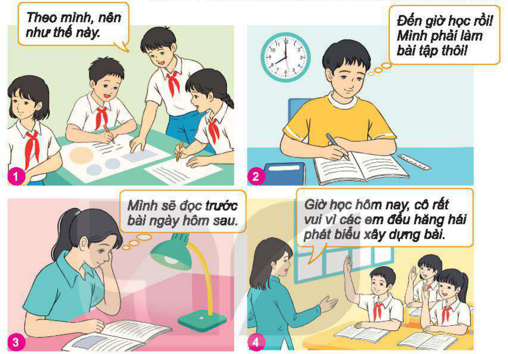

<!-- pdf:15 -->

# BÀI 3: HỌC TẬP TỰ GIÁC, TÍCH CỰC

## 🎯 Mục tiêu:

- Nêu được các biểu hiện của học tập tự giác, tích cực.
- Giải thích được vì sao phải học tập tự giác, tích cực.
- Thực hiện được việc học tập tự giác, tích cực.
- Biết góp ý, nhắc nhở những bạn chưa tự giác, tích cực học tập để khắc phục hạn chế này.

## 🔴 Mở đầu

Học tập là nhiệm vụ rất quan trọng trong cuộc sống của mỗi người. Học tập tự giác, tích cực chính là chìa khoá giúp mỗi chúng ta thành công trong cuộc sống.

Em hãy cùng các bạn nghe/hát bài *“Hổng dám đâu”* và cho biết bạn nhỏ trong bài hát đã tự giác học tập như thế nào?

> *“Trên cành cao chim hót mời em chơi giữa vườn xuân*
> *Bao bạn thân lấp ló gọi em tung tăng sân nhà*
> *Đá bóng với đá cầu, nhảy dây, bắn bi, trốn tìm*
> *Ôi hấp dẫn tuyệt vời nhưng mà em hổng dám đâu.*
> *Hổng dám đâu, em còn phải học bài [...]*
> *Hổng dám đâu.”*
>
> *(Sáng tác: Nguyễn Văn Hiên)*

## KHÁM PHÁ

## 1. Biểu hiện của học tập tự giác, tích cực

Em hãy đọc câu chuyện, quan sát các bức tranh dưới đây và trả lời câu hỏi:

> BÁC HỒ TỰ HỌC NGOẠI NGỮ
>
> Bác Hồ là tấm gương sáng về tinh thần tự học, đặc biệt là học ngoại ngữ trong suốt hành trình tìm đường cứu nước. Nhờ tích cực, tự giác học, Bác có thể nói được một số tiếng nước ngoài như tiếng Pháp, tiếng Anh, tiếng Nga, tiếng Trung Quốc,... Kết quả đó chính là nhờ vào sự rèn luyện không ngừng bằng việc tự học với một tinh thần cầu tiến, lòng quyết tâm cao và phương pháp đúng.
>
> Hồi làm phụ bếp trên tàu Đô đốc La-tút-sơ Tê-rê-vin chạy tuyến đường từ Sài Gòn sang Pháp, mỗi ngày Bác phải làm việc từ 4 giờ sáng đến 9 giờ tối mới xong. Dù mệt, Bác vẫn cố tự học thêm hai giờ nữa, trong khi những người bạn khác thì đi ngủ hoặc đánh bài. Khi học, những từ nào không hiểu, Bác nhờ những thuỷ thủ người Pháp giảng lại cho. Bác còn nghĩ ra cách học độc đáo là mỗi một ngày viết mười từ tiếng Pháp vào cánh tay để vừa làm việc, vừa nhẩm học. Khi làm việc ở Luân Đôn, Người thường mang sách, bút ra vườn hoa học vào buổi sáng sớm và buổi chiều mỗi ngày. Ngày cuối tuần được nghỉ, Bác đến học tiếng Anh với một giáo sư người Ý. Và tới bất kì nước nào, Bác đều tự học tiếng nước ấy.

<!-- pdf:16 -->

> Sau này, mặc dù tuổi đã cao, khi đọc sách, báo tiếng nước ngoài, gặp từ nào không hiểu hay một danh từ khoa học, Bác đều tra từ điển hoặc nhờ người thạo tiếng nước đó giải thích, rồi ghi lại vào sổ để nhớ.
>
> Bác Hồ của chúng ta đã tự học ngoại ngữ như thế đấy!
>
> *(Theo Vũ Kỳ, Kể chuyện đạo đức Bác Hồ, NXB Giáo dục, 1998)*

> - **Tranh 1:** “Theo mình, nên như thế này.”
> - **Tranh 2:** “Đến giờ học rồi! Mình phải làm bài tập thôi!”
> - **Tranh 3:** “Mình sẽ đọc trước bài ngày hôm sau.”
> - **Tranh 4:** “Giờ học hôm nay, cô rất vui vì các em đều hăng hái phát biểu xây dựng bài.”
<!-- ocr-ok: đã đối chiếu ảnh trang gốc 16, lời thoại và suy nghĩ trong Tranh 1–4 -->

> ❓ a) Bác Hồ đã tự học ngoại ngữ như thế nào?
>
> b) Em hãy nêu những biểu hiện của việc học tập tự giác, tích cực và chưa tự giác, tích cực qua các bức tranh trên.
>
> c) Em hãy kể thêm những biểu hiện khác của học tập tự giác, tích cực và chưa tự giác, tích cực mà em biết.

## 2. Ý nghĩa của học tập tự giác, tích cực

Em hãy đọc các trường hợp dưới đây và trả lời câu hỏi:

> **Trường hợp 1:** Bố mẹ có ý định cho Tuấn theo học ở trung tâm luyện thi với mong muốn bạn đỗ vào trường chuyên của thành phố nhưng Tuấn cho rằng không cần thiết vì bạn muốn tự rèn luyện tính tích cực, tự giác học tập. Không chỉ hoàn thành tất cả các bài tập thầy cô giao, Tuấn còn tìm cách để giải được những bài toán khó, say mê với bài tập thực hành ở các môn học. Mới đây, bạn đã giành giải Nhất ở cuộc thi Khoa học kĩ thuật cấp Quốc gia dành cho học sinh trung học.

<!-- pdf:17 -->

> **Trường hợp 2:** Yến là một học sinh không chỉ có ý thức học tập tốt mà còn tích cực tham gia các hoạt động tập thể để khám phá bản thân, rèn luyện kĩ năng giao tiếp, ứng xử,... Yến đã xây dựng được hình ảnh một học sinh năng động, tự tin, gần gũi, thân thiện được thầy cô và bạn bè yêu mến.

> ❓ a) Việc tự giác, tích cực học tập đã đem lại điều gì cho Tuấn và Yến?
>
> b) Em hãy cho biết ý nghĩa của học tập tự giác, tích cực.

> 1. **Học tập tự giác, tích cực** là chủ động, cố gắng tự mình thực hiện tốt nhiệm vụ học tập mà không cần ai nhắc nhở, khuyên bảo.
>
> 2. Học tập tự giác, tích cực biểu hiện ở:
> - Có mục đích và động cơ học tập đúng đắn;
> - Chủ động, tích cực trong thực hiện nhiệm vụ học tập (học và làm bài đầy đủ, hăng hái phát biểu xây dựng bài, tích cực hợp tác khi học nhóm,...);
> - Luôn cố gắng, vượt khó, kiên trì trong học tập;
> - Xây dựng và thực hiện kế hoạch học tập cụ thể, phù hợp với năng lực của bản thân. <!-- term: Biểu hiện của học tập tự giác, tích cực -->
>
> 3. Học tập tự giác, tích cực giúp chúng ta:
> - Không ngừng tiến bộ, đạt kết quả cao trong học tập;
> - Rèn luyện được tính tự lập, tự chủ, ý chí kiên cường, bền bỉ;
> - Thành công trong cuộc sống và được mọi người tin yêu, quý mến. <!-- term: Ý nghĩa của học tập tự giác, tích cực -->
>
> 4. Cần góp ý, nhắc nhở những bạn chưa tự giác, tích cực trong học tập để các bạn đạt kết quả tốt hơn.

## ✏️ Luyện tập

1. Em đồng tình hay không đồng tình với ý kiến nào dưới đây? Vì sao?

a) Luôn chủ động thực hiện nhiệm vụ học tập mà không cần ai nhắc nhở là biểu hiện của học tập tự giác, tích cực.

b) Chỉ cần tự giác, tích cực học tập khi tới các kì kiểm tra.

c) Chỉ cần xây dựng kế hoạch học tập còn việc thực hiện thì tuỳ thuộc vào hoàn cảnh.

d) Tự giác, tích cực học tập giúp em rèn luyện tính tự lập, tự chủ và tích luỹ kiến thức cho bản thân.

<!-- pdf:18 -->

2. Bạn nào dưới đây đã học tập tự giác, tích cực? Vì sao?

a) Q thường nhờ các bạn học giỏi trong lớp làm giúp bài tập rồi chép lại.

b) A luôn thích đọc tác phẩm văn học, sưu tầm những câu chuyện, câu nói hay để vận dụng vào việc viết văn. Nhờ vậy, kĩ năng viết văn của bạn ngày càng được nâng cao.

c) B thích môn Tiếng Anh nên thường xuyên mang sách Tiếng Anh ra làm bài tập trong các giờ học khác, B cho rằng: “Môn học này rất quan trọng trong thời kì hội nhập. Các môn học còn lại là môn phụ nên chỉ cần biết là đủ”.

d) Buổi tối, N thường xuyên ngồi vào bàn học đúng giờ nhưng tay vẫn cầm điện thoại để nhắn tin và chỉ tập trung học bài khi bố mẹ thúc giục, kiểm tra.

e) Thấy T ngủ gật trong giờ học, P nhắc bạn cần tập trung nghe cô giảng bài.

3. Xử lí tình huống:

a) Tuy có rất nhiều bài tập cần hoàn thành nhưng M vẫn muốn đi dự sinh nhật của bạn thân vì đã hứa với bạn.

*Nếu là M, em sẽ làm gì?*

b) K học giỏi và luôn hoà đồng, chia sẻ suy nghĩ, kinh nghiệm học tập của mình với các bạn trong lớp. Thấy vậy, một số bạn nói rằng K hay khoe khoang.

*Nếu là K, em sẽ nói thế nào để các bạn hiểu mình?*

c) Trong giờ học Ngữ văn, mặc dù hiểu bài và biết câu trả lời nhưng C không giơ tay phát biểu.

*Nếu là bạn cùng lớp với C, em sẽ khuyên bạn điều gì?*

d) Đầu năm học, S chuyển đến lớp học mới nên nhút nhát, rụt rè, ít phát biểu ý kiến xây dựng bài.

*Nếu là bạn học cùng lớp với S, em sẽ làm gì để giúp bạn thay đổi, tích cực trong học tập?*

## 🚀 Vận dụng

1. Em hãy viết về một tấm gương học tập tự giác, tích cực mà em biết. Em học tập được điều gì từ tấm gương đó?
2. Em hãy xác định một biểu hiện chưa tự giác, tích cực học tập của bản thân. Lập kế hoạch khắc phục điểm chưa tự giác, tích cực đó theo gợi ý dưới đây:

| Biểu hiện chưa tự giác | Biện pháp rèn luyện | Thời gian thực hiện | Kết quả |
|---|---|---|---|
| ? | ? | ? | ? |
<!-- ocr-ok: đã đối chiếu ảnh trang gốc 18, bảng gợi ý có ô kẻ chéo -->

## 📷 Danh sách hình trong bài

| Mã hình | Trang PDF | Trang sách | Chú thích |
|---|---|---|---|
| H7-giao_duc_cong_dan-b03-01 | 16 | 15 | Tranh 1–4 mục 1: Biểu hiện của học tập tự giác, tích cực |
